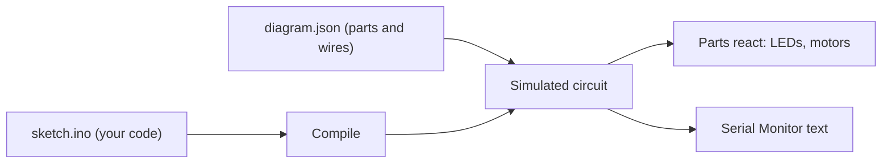

:::objectives
- Open a new Arduino Uno project in Wokwi, with or without an account.
- Find the code editor, the parts menu, the play button, and the Serial Monitor.
- Name the Uno's digital, PWM, analog, and power pins.
- Know which optional parts are worth buying, and which you can skip.
:::

Every circuit in this course runs on a board that costs nothing: a simulated Arduino Uno inside your browser. You can wire an LED backwards, forget a resistor, or connect the wrong pin, and nothing gets hot or breaks. When you are ready for real parts, the same code runs unchanged on a real Uno.

The simulator is **Wokwi** (wokwi.com). It needs no install and no payment, and you can run circuits without signing in. A free account only matters when you want Wokwi to save projects for you.

## What you need, and what is optional

You need a computer with a recent web browser (Chrome, Edge, Firefox, or Safari) and an internet connection. Windows, macOS, ChromeOS, and Linux all work, because everything happens in the browser. A tablet can open Wokwi too, but drawing wires with a finger is slow, so use a mouse or trackpad if you can.

Hardware is optional for every lesson. If you want to build for real later, these are the parts that match the course:

| Optional part | What it is for | When it helps |
| --- | --- | --- |
| Arduino Uno starter kit | A Uno (or compatible board), USB cable, breadboard, LEDs, resistors, buttons, a potentiometer | Modules 2 to 4 |
| Extra sensors | Light, temperature, distance, and soil moisture sensors | Module 4 onward |
| 2WD robot chassis kit | A small chassis with two DC motors and wheels; most kits also need a motor driver board and a AA battery pack | The robot modules and the capstone |

:::tip
Don't buy anything yet. Finish Module 4 in the simulator first. By then you will know exactly which parts you want, and you will be able to read the parts list in a kit description.
:::

## Open your first Wokwi project

1.  Go to **wokwi.com**.
2.  Under **Simulate with Wokwi Online**, click the **Arduino (Uno, Mega, Nano)** tile.
3.  Scroll to **Start from Scratch** and click **Arduino Uno**.

A new project opens with a code editor on one side and a drawing of an Arduino Uno on the other. You can also bookmark the direct link, `wokwi.com/projects/new/arduino-uno`, which skips straight to that page.

The code editor already contains two empty functions:

```arduino
void setup() {
  // put your setup code here, to run once:

}

void loop() {
  // put your main code here, to run repeatedly:

}
```

That is the skeleton of every Arduino program, which Arduino calls a **sketch**. You will fill it in during the next lesson.

## A tour of the editor

The left side holds your files as tabs:

-   **sketch.ino** is your program, written in Arduino's version of C++.
-   **diagram.json** is a text description of every part and every wire in the circuit. When you drag parts around, Wokwi rewrites this file for you. You can also paste a whole circuit into it, which this course does often.
-   **Library Manager** adds code libraries for fancier parts such as displays. You won't need it for a while.

The right side is the simulation:

-   The blue **+** button opens the parts list (or press **A** while the diagram is selected). Pick a part and it appears on the canvas, ready to drag into place.
-   To draw a wire, click one pin, then click another.
-   The green **play** button compiles your sketch and starts the simulated board. While it runs, the same spot shows a stop button.
-   The **Serial Monitor**, a text panel for messages from your program, appears under the diagram as soon as your sketch prints something.

Across the top are **Save** and **Share**. Saving needs a free account, which lesson 3 of this module covers.



## A tour of the Arduino Uno

The Uno is a small board built around one chip, the ATmega328P microcontroller. Your sketch runs on that chip, and the chip talks to the outside world through the metal pins along the board's edges. Zoom in on the Wokwi drawing (press **+** or scroll) and find each group:

| Pins | Label on the board | What they do |
| --- | --- | --- |
| Digital pins | 0 to 13 | Read or write on/off signals. Pins 0 and 1 also carry the USB serial link, so leave them free. |
| PWM pins | 3, 5, 6, 9, 10, 11 (marked with **~**) | Can fake an "in-between" output by switching very fast, for dimming LEDs and setting motor speed |
| Analog inputs | A0 to A5 | Measure a voltage between 0 and 5 volts and turn it into a number |
| Power | 5V, 3.3V, GND | Supply power to your circuit. GND (ground) is the 0-volt reference, and there are three GND pins. |
| Built-in LED | the tiny LED marked **L** | Wired inside the board to pin 13, so you can blink it with no extra parts |

:::note
In Wokwi, the Uno's 3.3V, IOREF, AREF, and RESET pins are not simulated. Everything in this course uses 5V and GND instead.
:::

## Prove it works with the official Blink example

Wokwi's documentation links to a ready-made Blink project. Open `wokwi.com/projects/344891652101374548`, then click the green play button.

```text
After a second or two the simulation starts.
The small "L" LED on the board turns on and off about once a second.
A timer near the board counts up the simulated time.
```

If the L LED blinks, your browser can run every lesson in this course. Close that tab without saving; you will write your own version next.

## Set up for your computer

Wokwi behaves the same everywhere, so the differences are keyboard shortcuts and, if you have a real board, how you load code onto it.

:::tabs
@tab Windows
-   Use Chrome, Edge, or Firefox. Undo in the diagram is **Ctrl+Z**, copy is **Ctrl+C**, paste is **Ctrl+V**.
-   **Real board (optional):** download **Arduino IDE 2** from `arduino.cc/en/software` and run the installer. Plug the Uno in with a USB cable, then pick the board and its COM port from the board menu at the top of the IDE.
@tab macOS
-   Use Safari, Chrome, or Firefox. The shortcuts use **⌘** instead of Ctrl: **⌘Z** undoes, **⌘C** copies, **⌘V** pastes.
-   **Real board (optional):** download **Arduino IDE 2** from `arduino.cc/en/software`, open the downloaded file, and drag the app into **Applications**. The Uno's port name starts with `/dev/cu.usbmodem` or `/dev/cu.usbserial`.
@tab Chromebook
-   Use Chrome. Wokwi needs no Linux setup or app.
-   **Real board (optional):** ChromeOS can't run the desktop Arduino IDE. Use the free **Arduino Cloud Editor** at `app.arduino.cc` instead (it needs a free Arduino account), which uploads to an Uno through Chrome.
:::

## Tinkercad Circuits, the backup simulator

If Wokwi is blocked on your network, **Tinkercad Circuits** (tinkercad.com/circuits) from Autodesk also simulates an Arduino Uno with breadboards, LEDs, and sensors. It needs a free account; students usually join through a teacher's class link, or set one up with a parent. The lessons in this course are written for Wokwi, but the code is the same Arduino code, so it runs in Tinkercad's text code mode too.

## Fixes for the problems beginners actually hit

-   **The Wokwi page is blank or never loads.** School and library networks sometimes block simulator sites. Try a different network, or use Tinkercad Circuits. Also try another browser, and close extra tabs on an older laptop.
-   **I pressed play and it spins for a while.** The first run compiles your sketch, which takes a few seconds and needs the internet. If it never starts, reload the page; your code stays in the editor until you close the tab.
-   **Keyboard shortcuts like A or R do nothing.** Click an empty spot on the diagram first, so it has focus. In Firefox, the setting **Search for text when you start typing** steals those keys; turn it off in Firefox's settings.
-   **I closed the tab and my work is gone.** Without an account, Wokwi doesn't keep your project. Lesson 3 of this module shows two ways to save, one of which needs no account.
-   **(Real board) The IDE shows no port.** Some USB cables only carry power, with no data wires. Try a different cable. Many low-cost compatible boards use a CH340 USB chip, and on older systems that chip needs a driver from the board seller's instructions.

:::video JyMMrtaJWOg
A beginner's walkthrough of the Wokwi Arduino simulator. Watch for where the parts menu and play button sit, and how wires are drawn by clicking one pin and then another.
:::

:::quiz
Q: You want to dim an LED smoothly. Which pin should it connect to?
- [ ] Pin 7
  Pin 7 is a plain digital pin: it can only be fully on or fully off.
- [x] Pin 9
  Pin 9 has the **~** mark, so it supports PWM, which switches fast enough to look dimmed.
- [ ] Pin A0
  A0 is an analog **input**. It measures voltages; it doesn't output in-between levels.

Q: Your friend's project lives only in a Wokwi tab, and they never signed in. What happens if they close the tab?
- [ ] Wokwi saves it to their browser automatically
  Without an account, Wokwi doesn't keep the project for you.
- [x] The project is lost unless they copied the files out first
  Saving to Wokwi needs an account. Without one, copying `sketch.ino` and `diagram.json` into files is the backup.
- [ ] It is saved on the simulated Arduino
  The simulated board's memory disappears when the simulation stops.

Q: Which file would you edit to change the color of an LED part without touching the code?
- [ ] sketch.ino
  The sketch controls behavior, such as when the LED turns on, not what the part looks like.
- [x] diagram.json
  It lists each part with its attributes, such as an LED's color, and every wire.
- [ ] Library Manager
  That tab adds code libraries; it doesn't describe the circuit.
:::

:::takeaways
- Wokwi runs an Arduino Uno in your browser for free; an account is only needed to save projects online.
- `sketch.ino` holds your code, `diagram.json` holds your circuit, and the green play button runs both.
- PWM pins are marked with **~**, analog inputs are A0 to A5, and the L LED is wired to pin 13.
- Real hardware is optional. If you add it later, Arduino IDE 2 (Windows, macOS) or the Arduino Cloud Editor (Chromebook) loads the same code onto a real Uno.
:::

## Further reading

-   [Wokwi diagram editor guide](https://docs.wokwi.com/guides/diagram-editor): every mouse action and keyboard shortcut for placing parts and wires.
-   [Wokwi's Arduino Uno reference](https://docs.wokwi.com/parts/wokwi-arduino-uno): which pins and features the simulated Uno supports.
-   [Arduino UNO R3 documentation](https://docs.arduino.cc/hardware/uno-rev3/): the official specs and pinout for the real board.
