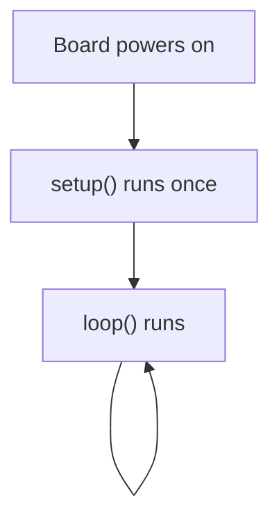

:::objectives
- Explain what `setup()` and `loop()` do and when each one runs.
- Blink the built-in LED with `pinMode`, `digitalWrite`, and `delay`.
- Send text from the board with `Serial.begin`, `Serial.print`, and `Serial.println`.
- Read and fix the most common compile errors.
:::

Making one tiny LED blink sounds like a boring first program. It is actually a full system test. When the LED blinks, you know your code compiled, the chip is running it, a pin is switching between 0 and 5 volts on schedule, and the timing is right. Every project in this course, robot included, sits on top of those four facts.

Open a fresh project at `wokwi.com/projects/new/arduino-uno` and keep it open for this whole lesson.

## The two functions every sketch has

An Arduino program has no `main()` that you write yourself. Instead, the board calls two functions for you:

-   `setup()` runs **once**, right after the board powers on or resets. Put one-time preparation here, such as telling a pin to act as an output.
-   `loop()` runs **again and again, forever**. When it reaches its closing brace, it starts over at the top.

If you have written a `while True:` loop in Python, `loop()` is the body of that loop, and `setup()` is the code just above it.



## Step 1: Blink the built-in LED

Replace everything in `sketch.ino` with this:

```arduino title="sketch.ino"
void setup() {
  pinMode(LED_BUILTIN, OUTPUT);   // pin 13 will drive the L LED
}

void loop() {
  digitalWrite(LED_BUILTIN, HIGH); // 5 volts on the pin: LED on
  delay(500);                      // wait 500 milliseconds
  digitalWrite(LED_BUILTIN, LOW);  // 0 volts: LED off
  delay(500);
}
```

Press the green play button.

```text
The L LED on the board lights for half a second, goes dark for half a second, and repeats.
```

Line by line:

-   `LED_BUILTIN` is a name Arduino defines for the pin wired to the L LED. On the Uno it is pin 13.
-   `pinMode(LED_BUILTIN, OUTPUT)` configures that pin to drive a voltage instead of measuring one. Pins start as inputs, so this line is required.
-   `digitalWrite(pin, HIGH)` puts 5 volts on the pin; `LOW` puts 0 volts.
-   `delay(500)` pauses the whole program for 500 milliseconds (half a second). During a delay, the board does nothing else.

One trip through `loop()` takes 500 + 500 = 1000 ms, so the LED blinks once per second.

:::try
Change both delays to `100`. Then try `50` for the on-time and `950` for the off-time. The second version gives a short "heartbeat" flash, still once per second, because the two delays still add up to 1000.
:::

## Step 2: Make the board talk to you

An LED can only say "on" or "off". To see numbers and messages, use the **serial port**: a text link from the board back to your computer. In Wokwi the Serial Monitor panel appears as soon as your sketch prints.

```arduino title="sketch.ino"
int blinks = 0;   // a global variable keeps its value between loops

void setup() {
  pinMode(LED_BUILTIN, OUTPUT);
  Serial.begin(9600);                 // start the serial link at 9600 baud
  Serial.println("Blink counter starting");
}

void loop() {
  digitalWrite(LED_BUILTIN, HIGH);
  delay(500);
  digitalWrite(LED_BUILTIN, LOW);
  delay(500);

  blinks = blinks + 1;
  Serial.print("Blinks so far: ");
  Serial.println(blinks);
}
```

Run it and watch the Serial Monitor:

```text
Blink counter starting
Blinks so far: 1
Blinks so far: 2
Blinks so far: 3
Blinks so far: 4
```

A new line arrives every second, in step with the LED. Three details matter here:

-   `Serial.begin(9600)` must run before any printing. The number is the **baud rate**, the speed of the link in bits per second. Wokwi detects it automatically on the Uno, but the real Arduino IDE needs you to choose the same 9600 in its Serial Monitor.
-   `Serial.print` writes text and stays on the same line; `Serial.println` writes text and then ends the line. That's why `"Blinks so far: "` and the number share a line.
-   `int blinks = 0;` sits **outside** both functions. If you declared it inside `loop()`, it would be re-created as 0 on every pass, and the counter would print 1 forever.

## Step 3: Check the timing with millis()

`millis()` returns how many milliseconds have passed since the board started. It keeps counting during delays, which makes it a good stopwatch. Add one line at the end of `loop()`:

```arduino
  Serial.print("  time in ms: ");
  Serial.println(millis());
```

```text
Blink counter starting
Blinks so far: 1
  time in ms: 1000
Blinks so far: 2
  time in ms: 2001
Blinks so far: 3
  time in ms: 3002
```

The times climb by about 1000 each pass. Your exact numbers may differ by a few milliseconds, because the code between the delays (printing, adding) takes a little time too, and that time adds up. Module 4 uses `millis()` to replace `delay()` entirely, so a sketch can blink an LED and watch a sensor at the same time.

## Proof that your setup works

Check all three before moving on:

1.  The L LED blinks once per second.
2.  The Serial Monitor shows the counter going up by one each second.
3.  Changing a delay and pressing play again changes the blink speed.

If all three happen, your lab works. If not, the next section covers the usual reasons.

## When it doesn't compile

Arduino code is C++, which is stricter than Python. When the compiler refuses your sketch, the simulation doesn't start and the compiler's messages appear instead. Read the **first** error; the later ones are often side effects of it.

**A missing semicolon.** Every statement ends with `;`. Leave one off after `digitalWrite(LED_BUILTIN, HIGH)` and the compiler reports:

```text
error: expected ';' before 'delay'
```

The message names the line *after* the mistake, because that's where the compiler noticed. Look at the end of the line above.

**Wrong capitalization.** Arduino names are case-sensitive. Typing `pinmode` instead of `pinMode` gives:

```text
error: 'pinmode' was not declared in this scope
```

"Not declared in this scope" means "I have never heard of this name". Check the spelling and capital letters, or check that you declared the variable.

**A missing closing brace.** Delete the final `}` of `loop()` and you get:

```text
error: expected '}' at end of input
```

Click just after each `{` and match it with its `}`. Indenting the code inside each pair makes a missing brace easy to spot.

:::warning
**Nothing appears in the Serial Monitor, and there is no error.** You probably forgot `Serial.begin(9600);` in `setup()`, so the serial port never started. On a real board, a second cause is a baud-rate mismatch: if the Serial Monitor is set to 115200 while the sketch says 9600, you see scrambled characters instead of text.
:::

## Running it on a real Uno (optional)

If you have a board and installed Arduino IDE 2 in the last lesson:

1.  Plug the Uno into your computer with a USB data cable.
2.  Paste the sketch into a new IDE window.
3.  In the board menu at the top, choose **Arduino Uno** and its port.
4.  Click **Upload** (the right-arrow button). The output panel reports when uploading is done, and the L LED starts blinking.
5.  Open **Tools > Serial Monitor**, and set the baud rate menu to **9600**.

The code is identical to the Wokwi version. That is the point of simulating first.

:::video FKekzzj5844
Science Buddies blinks an LED on a real Arduino. Watch for the upload step and for how the same `pinMode`/`digitalWrite`/`delay` pattern drives a physical LED on a breadboard.
:::

:::quiz
Q: A sketch has `delay(200)` after the HIGH and `delay(800)` after the LOW. What does the LED do?
- [ ] Blinks five times per second
  That would need a 200 ms cycle. Here one cycle is 200 + 800 = 1000 ms.
- [x] Flashes briefly once per second
  It is on for 200 ms and off for 800 ms, so you see a short flash every second.
- [ ] Stays on, because the delays don't match
  The delays don't need to match; each one just sets how long its state lasts.

Q: You move `int blinks = 0;` from the top of the file to the first line inside `loop()`. What does the Serial Monitor show?
- [ ] 1, 2, 3, 4, … as before
  The variable is now created fresh at the start of each pass, so the count can't build up.
- [x] `Blinks so far: 1` over and over
  Each pass sets `blinks` to 0, adds 1, and prints 1.
- [ ] A compile error
  Declaring a variable inside a function is legal; it just changes how long it lives.

Q: The compiler says `error: expected ';' before 'Serial'`. Where is the mistake most likely to be?
- [ ] On the line that starts with `Serial`
  That line is where the compiler noticed the problem, not usually where it is.
- [x] At the end of the line just above it
  The compiler only realizes a `;` is missing when it reaches the next statement.
- [ ] In `setup()`, because Serial needs to be started
  A missing `Serial.begin` doesn't cause a compile error; it just means nothing prints.
:::

:::takeaways
- `setup()` runs once at power-on, and `loop()` repeats forever.
- `pinMode(pin, OUTPUT)` comes before `digitalWrite(pin, HIGH/LOW)`.
- `delay(ms)` freezes the program; `millis()` tells you how long the board has been running.
- `Serial.begin(9600)` in `setup()`, then `Serial.print`/`Serial.println`, is how the board tells you what it's doing.
- Read the first compile error, and check the line above the one it names.
:::

## Further reading

-   [Arduino's Blink example](https://docs.arduino.cc/built-in-examples/basics/Blink/): the official version of this sketch, with a wiring diagram for an external LED.
-   [Serial reference](https://docs.arduino.cc/language-reference/en/functions/communication/serial/): every Serial function, including `print` options for decimals and number bases.
-   [Wokwi Serial Monitor guide](https://docs.wokwi.com/guides/serial-monitor): how Wokwi's monitor opens, and how to type input back to your sketch.
