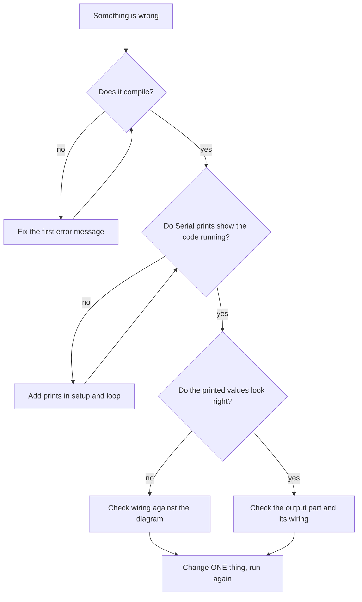

:::objectives
- Follow the course safety rules, including the one with no exceptions.
- Save a Wokwi project with an account, or back it up without one.
- Keep personal information out of public projects.
- Debug a broken circuit with a fixed routine instead of random changes.
:::

Most electronics accidents in school labs don't involve anything dramatic. They involve a 9-volt battery rolling around in a bag with some coins, an LED connected with no resistor, or someone rewiring a board while it's still plugged in. The rules below prevent all of those, and they apply from the first real part you touch.

## The safety rules for this course

**Rule 1, the one with no exceptions: never work with mains power.** Mains is the electricity from wall outlets (120 or 230 volts, depending on your country). It can kill. Nothing in this course plugs into an outlet except a USB charger or your computer. Don't open chargers or power bricks, don't wire anything to an outlet or extension cord, and don't follow online projects that do.

The power sources this course uses are low voltage:

| Source | Voltage | Used for |
| --- | --- | --- |
| USB from your computer | 5 V | The Uno and small circuits |
| AA battery pack (4 × AA) | about 6 V | Motors and robots, later |
| 9 V battery | 9 V | Optional board power |

**Rule 2: unplug before you rewire.** Moving a wire on a powered board is the easiest way to touch 5V to GND by accident. Pull the USB cable, change the circuit, check it, then plug back in.

**Rule 3: every LED gets a resistor, and nothing connects 5V straight to GND.** A direct wire from 5V to GND is a **short circuit**. Module 2 shows the math behind why that's dangerous for the board and the USB port.

**Rule 4: feel, smell, look.** If a part is hot to touch, if you smell hot plastic, or if the board's power light goes out, unplug immediately and find out why before powering it again.

**Rule 5: treat batteries with respect.** Never connect a battery's two terminals together with a wire. Store 9 V batteries with their terminals covered (their terminals sit side by side, so a coin or key can short them). Lithium packs (LiPo, Li-ion) are only charged with their proper charger, and a swollen, dented, or punctured one goes to a battery recycling point, not back into a project.

**Rule 6: motors get their own power.** An Arduino pin can't drive a motor. The motor modules show how to use a motor driver and a separate battery pack.

:::warning
The simulator can't warn you about most of these mistakes. Wokwi's own documentation says its analog simulation is very basic, so a circuit that would overheat on a real desk may look perfectly happy on screen. Use the rules on real parts even when the simulated version worked.
:::

## Saving your work in Wokwi

You have two options.

**With a free account.** Click **Save**. Wokwi asks you to sign in or create an account the first time. After that, your project gets its own web address (it looks like `wokwi.com/projects/` followed by a long number), and **Save** updates it. Ask a parent or guardian before you create any online account.

**Without an account.** Back up the two files that make up a project:

1.  Click the **sketch.ino** tab, select all the text (**Ctrl+A**, or **⌘A** on a Mac), copy it, and paste it into a plain text file named, for example, `m2-led-resistor.ino.txt`.
2.  Do the same for the **diagram.json** tab, into `m2-led-resistor.diagram.json.txt`.
3.  To restore, open a new Uno project and paste each file back into its tab.

Because `diagram.json` describes every part and wire, those two files rebuild the whole circuit.

### Name projects so you can find them

Use the module number and what the project does, like `m3-button-led` or `m4-greenhouse-monitor`. When you change a working project into something new, save a copy first instead of editing over the version that worked. Then you always have something to go back to.

## Privacy: free projects are public

On Wokwi's free plan, saved projects are **public**: the pricing page says free projects are "visible to everyone". So keep personal details out of them:

-   No real full names, school names, addresses, or photos in project titles, code comments, or Serial messages.
-   Pick an account username that doesn't identify you.
-   Only share a project link with people you'd show the code to anyway, such as a teacher or a help forum.

## Working comfortably: keyboard and accessibility

The Wokwi diagram editor can be driven mostly from the keyboard once a part is selected:

| Key | What it does |
| --- | --- |
| **A** | Add a part |
| **R** | Rotate the selected part 90° |
| **D** | Duplicate the selected part |
| **Delete** | Remove the selected part or wire |
| **+** / **-** | Zoom in and out |
| **F** | Fit the whole diagram in the window |
| **?** | Open the documentation for the selected part |

Your browser's zoom (**Ctrl** and **+**, or **⌘** and **+**) enlarges the code text. If you use a screen reader, the code editor and the Serial Monitor are text, while the circuit drawing is visual. The `diagram.json` tab describes the same circuit in words, so you can read or build circuits by editing that file directly.

If colors are hard for you to tell apart, you are not stuck with resistor color bands or wire colors. In Wokwi a resistor's value is written in `diagram.json`, and you can change a selected wire's color with a number key (for example **0** for black, **2** for red), which helps if you choose colors you can tell apart.

## A routine for getting unstuck

When something doesn't work, changing random things wastes time and can hide the real fault. Use the same order every time:



The most useful tool on that chart is a **breadcrumb print**: a `Serial.println` that tells you where the program is and what it sees.

```arduino
void loop() {
  Serial.println("top of loop");       // proves loop() is running
  int reading = analogRead(A0);
  Serial.print("reading = ");
  Serial.println(reading);             // proves what the sensor gave
  if (reading > 500) {
    Serial.println("bright branch");   // proves the if was taken
    digitalWrite(9, HIGH);
  }
  delay(250);
}
```

If "bright branch" prints but the LED stays dark, the code is fine and the problem is the LED circuit. If "bright branch" never prints, look at the numbers being compared. Each print cuts the search area in half.

### When you ask for help

Give the helper what they need to answer in one reply:

1.  **What you expected** ("the LED should light when I press the button").
2.  **What happened instead** ("it stays on all the time").
3.  **The project link**, or the two files.
4.  **What you already tried** ("swapped the LED, checked it's on pin 9").

Writing those four lines often solves the problem on its own, because you have to look at the circuit carefully to write them.

:::video 9GLaU-BCEQM
Science Buddies debugs a real circuit. Watch for how they check one connection at a time instead of rebuilding everything, the same routine as the chart above.
:::

:::quiz
Q: Your circuit worked in Wokwi with an LED and no resistor. What should you do when you build it for real?
- [ ] Build it the same way, since the simulation proved it's fine
  Wokwi doesn't model heat or current limits well, so "worked in the simulator" doesn't mean safe.
- [x] Add a resistor in series with the LED
  The real LED and pin need a resistor to limit current, whatever the simulation showed.
- [ ] Power it from a 9 V battery instead of USB
  More voltage makes the missing-resistor problem worse, not better.

Q: Your LED never lights. Serial shows `reading = 812` and then `bright branch`. Where should you look next?
- [ ] The `if` condition in the code
  The print proves the `if` was taken, so the condition worked.
- [x] The LED, its resistor, and the wires to pin 9 and GND
  The code reached `digitalWrite(9, HIGH)`, so the fault is between the pin and ground.
- [ ] The sensor on A0
  The sensor gave a sensible number and the branch ran; the input side is fine.
:::

:::takeaways
- Never work with mains power. Use USB and small battery packs only.
- Unplug before rewiring, put a resistor on every LED, and never wire 5V straight to GND.
- Save with a Wokwi account, or copy `sketch.ino` and `diagram.json` into files; free projects are public.
- Debug in order: compile, prove the code runs with prints, check the values, then check the wiring, changing one thing at a time.
:::

## Further reading

-   [Arduino: digital pins](https://docs.arduino.cc/learn/microcontrollers/digital-pins/): the official explanation of how much current a pin can handle and what a short does to it.
-   [All About Batteries (Adafruit)](https://learn.adafruit.com/all-about-batteries): battery types, capacity, and safe handling, written for makers.
-   [Wokwi diagram editor guide](https://docs.wokwi.com/guides/diagram-editor): the full list of editor shortcuts, including wire color keys.
