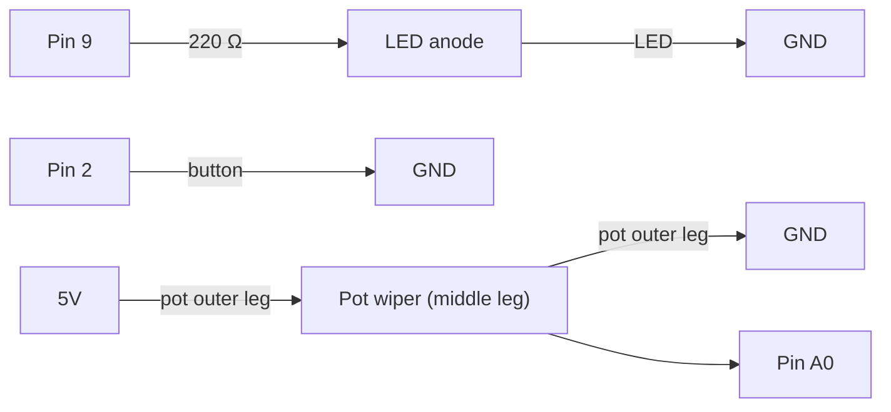

:::objectives
- Plan a breadboard layout from a schematic, one node per row.
- Read a pushbutton with `INPUT_PULLUP` and handle its inverted logic.
- Read a potentiometer with `analogRead` and scale it with `map`.
- Print status on a timer with `millis()` so the inputs stay responsive.
:::

Here's the finished behavior. While you hold the button, the LED glows; the knob sets how brightly. Let go, and it goes dark. Four times a second, the board reports what it sees:

```text
Hold the button; turn the knob to set brightness
pressed=0  knob=0  brightness=0
pressed=1  knob=0  brightness=0
pressed=1  knob=512  brightness=127
pressed=1  knob=1023  brightness=255
pressed=0  knob=1023  brightness=255
```

It's a small project, but it has the shape of nearly every robot program you'll write later: read a digital input, read an analog input, decide, then drive an output.

## The schematic, as nodes

There are three separate circuits sharing the Uno's 5V and GND:



## Step 1: Lay out the parts

**In Wokwi**, paste this into the **diagram.json** tab of a new Uno project. Wokwi lets you wire parts straight to each other, so this version skips the breadboard; electrically it's identical.

```json title="diagram.json"
{
  "version": 1,
  "author": "C4T Hardware Lab",
  "editor": "wokwi",
  "parts": [
    { "type": "wokwi-arduino-uno", "id": "uno", "top": 0, "left": 0, "attrs": {} },
    { "type": "wokwi-resistor", "id": "r1", "top": -90, "left": 110, "attrs": { "value": "220" } },
    { "type": "wokwi-led", "id": "led1", "top": -150, "left": 230, "attrs": { "color": "red" } },
    { "type": "wokwi-pushbutton", "id": "btn1", "top": -110, "left": 330, "attrs": { "color": "green" } },
    { "type": "wokwi-potentiometer", "id": "pot1", "top": 250, "left": 120, "attrs": {} }
  ],
  "connections": [
    [ "uno:9", "r1:1", "orange", [] ],
    [ "r1:2", "led1:A", "orange", [] ],
    [ "led1:C", "uno:GND.1", "black", [] ],
    [ "btn1:1.l", "uno:2", "blue", [] ],
    [ "btn1:2.l", "uno:GND.2", "black", [] ],
    [ "pot1:VCC", "uno:5V", "red", [] ],
    [ "pot1:GND", "uno:GND.3", "black", [] ],
    [ "pot1:SIG", "uno:A0", "green", [] ]
  ],
  "dependencies": {}
}
```

Notice the button uses `1.l` and `2.l`, one leg from **each** contact. Using `1.l` and `1.r` would connect two legs that are always joined, and the button would read as pressed forever.

**On a real half-size breadboard**, give each node its own row:

| Part or wire | Where its ends go | Node it creates |
| --- | --- | --- |
| Jumper | Uno 5V to the **+** rail; Uno GND to the **−** rail | Power and ground rails |
| Jumper | Uno pin 9 to hole 5a | Row 5 is "pin 9" |
| 220 Ω resistor | 5c to 9c | Bridges row 5 to row 9 |
| LED | Long leg in 9e, short leg in 10e | Bridges row 9 to row 10 |
| Jumper | 10a to the **−** rail | LED cathode to ground |
| Pushbutton | Straddles the center gap, legs in rows 16 and 18 | Pressing joins row 16 to row 18 |
| Jumpers | 16a to Uno pin 2; 18a to the **−** rail | Button between pin 2 and ground |
| Potentiometer | Legs in rows 24, 25, 26 | One row per leg |
| Jumpers | Row 24 to **+** rail, row 26 to **−** rail, row 25 to Uno A0 | Wiper to A0 |

## Step 2: Prove the LED works first

Build in small steps and test each one, so when something fails you know which step broke it.

```arduino title="sketch.ino"
const int LED = 9;

void setup() {
  pinMode(LED, OUTPUT);
}

void loop() {
  digitalWrite(LED, HIGH);
  delay(300);
  digitalWrite(LED, LOW);
  delay(300);
}
```

```text
The LED blinks a little faster than once a second.
```

If it doesn't, check the LED circuit now, before the button and pot make things harder to untangle.

## Step 3: Read the button

```arduino title="sketch.ino"
const int BUTTON = 2;

void setup() {
  pinMode(BUTTON, INPUT_PULLUP);   // built-in pull-up: released = HIGH
  Serial.begin(9600);
}

void loop() {
  Serial.println(digitalRead(BUTTON));
  delay(200);
}
```

Run it, then click and hold the green button.

```text
1
1
1
0
0
0
1
```

`digitalRead` returns 1 (HIGH) while the button is up and 0 (LOW) while it's held. That's the pull-up at work: the pin rests at 5 V, and pressing connects it to GND. Get used to writing `== LOW` for "pressed".

## Step 4: Light the LED only while the button is held

```arduino title="sketch.ino"
const int LED = 9;
const int BUTTON = 2;

void setup() {
  pinMode(LED, OUTPUT);
  pinMode(BUTTON, INPUT_PULLUP);
}

void loop() {
  if (digitalRead(BUTTON) == LOW) {   // LOW means pressed
    digitalWrite(LED, HIGH);
  } else {
    digitalWrite(LED, LOW);
  }
}
```

```text
The LED is on exactly while the button is held down.
```

There is no `delay` in this loop, so `loop()` runs many thousands of times a second and the LED responds instantly.

## Step 5: Read the knob

```arduino title="sketch.ino"
const int KNOB = A0;

void setup() {
  Serial.begin(9600);
}

void loop() {
  Serial.println(analogRead(KNOB));
  delay(200);
}
```

While the simulation runs, click the potentiometer, then use the **Left** and **Right** arrow keys to turn it. **Page Up** and **Page Down** make bigger steps, and **Home** and **End** jump to the two ends.

```text
0
0
212
487
760
1023
```

The reading goes from 0 at one end to 1023 at the other. `analogRead` measures the wiper's voltage: 0 V gives 0, 5 V gives 1023. Module 4 explains exactly how.

:::note
Wokwi's potentiometer documentation says it gives the same readings even if VCC and GND aren't connected, because the simulator doesn't fully model analog circuits. Connect them anyway. On a real board, a pot without both outer legs connected gives a floating, meaningless reading.
:::

## Step 6: Turn the knob reading into a brightness

`analogRead` gives 0 to 1023, but `analogWrite` wants 0 to 255. Arduino's `map(value, fromLow, fromHigh, toLow, toHigh)` rescales one range to another. It uses whole-number math and throws away remainders, so let's check what it gives compared with simply dividing by 4:

```python run title="map_check.py"
def arduino_map(x, in_min, in_max, out_min, out_max):
    # Same formula as Arduino's map(), with whole-number division
    return (x - in_min) * (out_max - out_min) // (in_max - in_min) + out_min

print(f"{'knob':>5} {'map()':>6} {'knob/4':>7}")
for knob in [0, 3, 4, 300, 512, 1000, 1023]:
    print(f"{knob:>5} {arduino_map(knob, 0, 1023, 0, 255):>6} {knob // 4:>7}")
```

They never differ by more than 1, and both reach exactly 255 at the top. Use `map` anyway: it says what you mean, and it still works when the ranges aren't a neat factor of 4 apart.

## Step 7: Combine everything and report on a timer

If the reporting used `delay(250)`, the button would only be checked four times a second and would feel sluggish. Instead, the loop checks the clock each pass with `millis()` and prints only when 250 ms have passed since the last print. Everything else runs at full speed.

```arduino title="sketch.ino"
const int LED = 9;        // PWM pin, through a 220 ohm resistor
const int BUTTON = 2;     // to GND, uses the built-in pull-up
const int KNOB = A0;      // potentiometer wiper

unsigned long lastPrint = 0;   // millis() returns an unsigned long

void setup() {
  pinMode(LED, OUTPUT);
  pinMode(BUTTON, INPUT_PULLUP);
  Serial.begin(9600);
  Serial.println("Hold the button; turn the knob to set brightness");
}

void loop() {
  bool pressed = (digitalRead(BUTTON) == LOW);
  int knob = analogRead(KNOB);
  int brightness = map(knob, 0, 1023, 0, 255);

  if (pressed) {
    analogWrite(LED, brightness);
  } else {
    analogWrite(LED, 0);
  }

  if (millis() - lastPrint >= 250) {   // has a quarter second passed?
    lastPrint = millis();
    Serial.print("pressed=");
    Serial.print(pressed);
    Serial.print("  knob=");
    Serial.print(knob);
    Serial.print("  brightness=");
    Serial.println(brightness);
  }
}
```

Run it, hold the button, and turn the knob. The output matches the preview at the top of this lesson.

The timer pattern is worth memorizing: **subtract the last time from now, and compare with an interval**. Writing it as `millis() - lastPrint >= 250` (rather than storing a future deadline) keeps working even when `millis()` wraps back to zero after about 50 days.

:::video yBgMJssXqHY
Science Buddies wires a pushbutton to a real Arduino and explains pull-up and pull-down resistors. Watch for the floating-input demonstration, where the reading changes when nobody is touching the button.
:::

:::quiz
Q: Why does the code check `digitalRead(BUTTON) == LOW` to mean "pressed"?
- [ ] Because `LOW` is the Arduino word for "on"
  `LOW` means 0 volts; whether that's "on" depends on the circuit.
- [x] The internal pull-up holds the pin HIGH, and pressing connects it to GND
  With `INPUT_PULLUP` the button pulls the pin down to ground, so pressed reads LOW.
- [ ] Buttons always read LOW when pressed
  With a pull-down resistor wired to GND and the button to 5V, pressed would read HIGH.

Q: What would change if Step 7 printed with `delay(250)` at the end of `loop()` instead of the `millis()` check?
- [ ] Nothing; both print four times a second
  The prints would look the same, but the inputs would only be checked once per delay.
- [x] The LED would react to the button and knob up to a quarter second late
  `delay` freezes the whole loop, so the button and knob are only read four times a second.
- [ ] The Serial Monitor would print faster
  It would print at the same rate. The difference is in how quickly everything else responds.

Q: You move the LED to pin 8 without changing anything else (except `const int LED = 8;`). What happens when you hold the button and turn the knob?
- [ ] It fades smoothly as before
  Pin 8 has no **~** mark, so it can't produce PWM.
- [x] It's off for the lower half of the knob and fully on for the upper half
  On a non-PWM pin, `analogWrite` treats values below 128 as LOW and 128 or above as HIGH.
- [ ] It doesn't compile
  `analogWrite` compiles for any pin; it just can't dim a pin without PWM.
:::

:::takeaways
- Build and test one sub-circuit at a time: LED, then button, then knob.
- `INPUT_PULLUP` needs no extra resistor; the button goes between the pin and GND, and pressed reads LOW.
- `analogRead` gives 0 to 1023; `map(value, 0, 1023, 0, 255)` turns that into an `analogWrite` brightness.
- Use `if (millis() - last >= interval)` for repeated tasks, so `loop()` never stalls.
:::

## Ideas to extend it

-   Make each press **toggle** the LED on and off instead of needing to hold it. You'll need to detect the moment the button changes, and deal with bounce; the practice lesson walks through both.
-   Add a passive buzzer on pin 8 and play `tone(8, frequency)` while the button is held, with the knob mapped to a frequency from 200 to 2000 Hz.
-   Add a second button that remembers the current brightness, so letting go of the knob doesn't matter.

## Further reading

-   [Arduino's Input Pullup Serial example](https://docs.arduino.cc/built-in-examples/digital/InputPullupSerial/): the official version of Step 3, with a schematic.
-   [map() reference](https://docs.arduino.cc/language-reference/en/functions/math/map/): why it uses whole-number math, and how to pair it with `constrain()`.
-   [Wokwi pushbutton reference](https://docs.wokwi.com/parts/wokwi-pushbutton): the button's pins, its keyboard shortcut attribute, and how its bounce simulation works.
