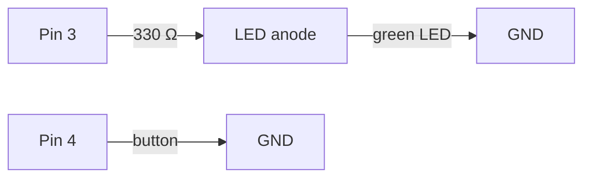

:::objectives
- Trace a breadboard layout node by node and find a bypassed part.
- Convert between resistor values and color bands in both directions.
- Diagnose buttons that read "always pressed" or flicker randomly.
- Count button presses reliably by detecting changes and debouncing them.
:::

The first three exercises are about layout and need no simulator. The last three run in Wokwi; start from the button-and-knob circuit from the build-along, since it already has a button on pin 2 and an LED on pin 9.

**Warm-up.** On a half-size breadboard, which of these pairs of holes are connected? (a) 7a and 7d, (b) 7e and 7f, (c) 7a and 8a, (d) two holes in the same + rail, one at each end of the board. *(Answers: (a) yes, same five-hole group. (b) no, the center gap. (c) no, different rows. (d) yes on a half-size board; on a full-size board, only if the rail isn't split in the middle.)*

### Exercise 1: Find the bypassed part

This layout should light an LED from pin 6, but the LED stays dark. Trace it node by node and find the fault.

| Part | Placement |
| --- | --- |
| Jumper | Uno pin 6 to hole 3a |
| 330 Ω resistor | 3c to 7c |
| LED | Long leg in 7d, short leg in 7e |
| Jumper | 8a to the **−** rail |
| Jumper | **−** rail to Uno GND |

:::hint
Write down which node each leg of each part is in: "row 3 (a–e)", "row 7 (a–e)", and so on. Does every part connect two *different* nodes? Does the loop make it all the way from pin 6 to GND?
:::

:::solution
Both LED legs are in row 7 (7d and 7e are in the same five-hole group), so the LED is bypassed. There's a second problem hiding behind it: nothing connects row 7 to row 8, so the loop is also open.

Moving the LED's short leg from 7e to **8e** fixes both at once. The loop becomes: pin 6 → row 3 → resistor → row 7 → LED → row 8 → jumper → − rail → GND.
:::

### Exercise 2: Color bands in both directions

Write `encode(ohms)` that returns the first three bands for a value (assume two significant digits and gold tolerance), and use the decoder from the notes to check it round-trips. Test with 220, 330, 4700, and 10000.

```text
220 ohms -> red-red-brown-gold -> 220 ohms
330 ohms -> orange-orange-brown-gold -> 330 ohms
4700 ohms -> yellow-violet-red-gold -> 4700 ohms
10000 ohms -> brown-black-orange-gold -> 10000 ohms
```

:::hint
Keep dividing by 10 until the value is a two-digit number (10 to 99), and count how many times you divided. That count is the multiplier band's digit.
:::

:::solution
```python run
DIGITS = ["black", "brown", "red", "orange", "yellow",
          "green", "blue", "violet", "grey", "white"]

def encode(ohms):
    zeros = 0
    while ohms >= 100:
        ohms //= 10
        zeros += 1
    return [DIGITS[ohms // 10], DIGITS[ohms % 10], DIGITS[zeros], "gold"]

def decode(bands):
    first, second, multiplier, _ = bands
    return (DIGITS.index(first) * 10 + DIGITS.index(second)) * 10 ** DIGITS.index(multiplier)

for value in [220, 330, 4700, 10000]:
    bands = encode(value)
    print(f"{value} ohms -> {'-'.join(bands)} -> {decode(bands)} ohms")
```

The multiplier band is just "how many zeros", which is why 10 kΩ ends in orange (3 zeros) and 220 Ω ends in brown (1 zero).
:::

### Exercise 3: From schematic to breadboard

Write a row-by-row breadboard plan for this circuit: a green LED on pin 3 with a 330 Ω resistor, and a pushbutton between pin 4 and GND (to be read with `INPUT_PULLUP`).



:::hint
Count the nodes first. The LED circuit has three (pin 3's wire, the resistor-to-LED junction, the LED-to-ground junction) and the button circuit has two. Ground can share the **−** rail. Remember the button straddles the center gap.
:::

:::solution
One plan that works (yours can use different row numbers, as long as each node has its own row):

| Part or wire | Placement |
| --- | --- |
| Jumper | Uno GND to the **−** rail |
| Jumper | Uno pin 3 to 2a |
| 330 Ω resistor | 2c to 6c |
| Green LED | Long leg 6e, short leg 7e |
| Jumper | 7a to the **−** rail |
| Pushbutton | Straddles the gap, legs in rows 12 and 14 |
| Jumpers | 12a to Uno pin 4; 14a to the **−** rail |

Check it the way you checked Exercise 1: every part bridges two different rows, and both loops end at the **−** rail.
:::

### Exercise 4: Two broken buttons

Two students run Step 3 of the build-along (print `digitalRead(2)` every 200 ms).

-   **Student A** sees `0` every time, pressed or not. Their `diagram.json` has `["btn1:1.l", "uno:2", ...]` and `["btn1:1.r", "uno:GND.2", ...]`.
-   **Student B** wired the button correctly but wrote `pinMode(2, INPUT);`. On their real breadboard, when the button is released the output jumps between `0` and `1` at random, and changes when they wave a hand near the wires.

Explain each fault and fix it.

:::hint
For A: which button pins are always joined, pressed or not? For B: what is pin 2 connected to while the button is open?
:::

:::solution
**Student A** connected pin 2 and GND through `1.l` and `1.r`, two legs of the **same** contact, which are always joined. The pin is permanently grounded, so it always reads 0. Fix: use one leg from each contact.

```json
[ "btn1:1.l", "uno:2", "blue", [] ],
[ "btn1:2.l", "uno:GND.2", "black", [] ]
```

**Student B's** pin is **floating** when the button is open: connected to nothing, so it drifts with electrical noise, including the noise from a nearby hand. Fix: turn on the internal pull-up.

```arduino
pinMode(2, INPUT_PULLUP);   // released = HIGH, pressed = LOW
```
:::

### Exercise 5: Count presses, not loops

Print `Presses: 1`, `Presses: 2`, … exactly once each time the button goes down. A loop that does `if (digitalRead(2) == LOW) presses++;` doesn't work: it adds thousands per press, because `loop()` runs thousands of times while your finger is down.

```text
Presses: 1
Presses: 2
Presses: 3
```

:::hint
Count **changes**, not states. Remember the reading from the previous pass in a variable. A press is the moment the reading was HIGH last time and is LOW now.
:::

:::solution
```arduino
const int BUTTON = 2;

int lastReading = HIGH;   // released, thanks to the pull-up
int presses = 0;

void setup() {
  pinMode(BUTTON, INPUT_PULLUP);
  Serial.begin(9600);
}

void loop() {
  int reading = digitalRead(BUTTON);
  if (lastReading == HIGH && reading == LOW) {   // the falling edge
    presses++;
    Serial.print("Presses: ");
    Serial.println(presses);
  }
  lastReading = reading;
}
```

Click the button a few times in Wokwi. Sometimes one click prints two or three numbers. That isn't a bug in the edge detection. It's **bounce**: the simulated contacts open and close several times before settling, and each closing is a real falling edge. To prove it, add `"bounce": "0"` to the button's `attrs` in `diagram.json`; the extra counts disappear. Real buttons can't switch off their bounce, so Exercise 6 fixes it in code.
:::

### Exercise 6: Debounce with a timer

The fix for bounce: only accept a new button state after the reading has stayed the same for a short time, such as 20 ms. Bounces are shorter than that; human presses are much longer.

First, model it in Python. The list below is a button sampled once per millisecond (1 = released, 0 = pressed), with bounces at each press and release. Count the falling edges in the raw signal, then write a debouncer and count again. Then write the Arduino version.

:::hint
Track three things: the last raw reading, the time it last changed, and the accepted ("stable") state. On each sample, if the raw reading differs from the last raw reading, record the time. If 20 or more samples have passed since that change and the raw reading differs from the stable state, accept it, and count a press if the new stable state is 0.
:::

:::solution
```python run alt="Two stacked step plots over about 290 milliseconds. The raw signal flickers rapidly between 0 and 1 at the start and end of each of two presses. The debounced signal shows exactly two clean low pulses, each starting about 20 milliseconds after the bouncing stops." caption="Raw readings bounce at every press and release; the debounced state changes once, 20 ms after the bouncing settles."
import matplotlib.pyplot as plt

def press(bounce_in, held_ms, bounce_out):
    return bounce_in + [0] * held_ms + bounce_out

samples = ([1] * 30 + press([0, 1, 0, 0, 1, 0, 1, 1, 0], 70, [1, 0, 1, 1, 0, 1])
           + [1] * 60 + press([0, 1, 1, 0, 1, 0], 60, [1, 0, 0, 1, 0, 1, 1]) + [1] * 40)

raw_presses = sum(1 for a, b in zip(samples, samples[1:]) if a == 1 and b == 0)

DEBOUNCE_MS = 20
stable, last_raw, last_change, presses = 1, 1, 0, 0
debounced = []
for t, raw in enumerate(samples):
    if raw != last_raw:
        last_change, last_raw = t, raw
    if t - last_change >= DEBOUNCE_MS and raw != stable:
        stable = raw
        if stable == 0:
            presses += 1
    debounced.append(stable)

print("Falling edges in the raw signal:", raw_presses)
print("Presses after debouncing:       ", presses)

fig, (top, bottom) = plt.subplots(2, 1, figsize=(8, 3.6), sharex=True)
top.step(range(len(samples)), samples, where="post", color="#eb6834", linewidth=1.5)
top.set_title("Raw digitalRead", fontsize=10)
top.set_yticks([0, 1])
bottom.step(range(len(debounced)), debounced, where="post", color="#2a78d6", linewidth=2)
bottom.set_title("Debounced state", fontsize=10)
bottom.set_yticks([0, 1])
bottom.set_xlabel("Time (ms)")
fig.tight_layout()
```

The same logic in Arduino code, using `millis()` as the clock:

```arduino
const int BUTTON = 2;
const unsigned long DEBOUNCE_MS = 20;

int lastReading = HIGH;
int stableState = HIGH;
unsigned long lastChange = 0;
int presses = 0;

void setup() {
  pinMode(BUTTON, INPUT_PULLUP);
  Serial.begin(9600);
}

void loop() {
  int reading = digitalRead(BUTTON);
  if (reading != lastReading) {          // the raw signal moved: restart the timer
    lastChange = millis();
    lastReading = reading;
  }
  if (millis() - lastChange >= DEBOUNCE_MS && reading != stableState) {
    stableState = reading;               // steady for 20 ms: accept it
    if (stableState == LOW) {
      presses++;
      Serial.print("Presses: ");
      Serial.println(presses);
    }
  }
}
```

With bounce switched back on in Wokwi, each click now prints exactly one number. The cost is a 20 ms delay before a press counts, far too short for a person to notice.
:::

### Challenge: A knob bar graph with a freeze button

Wire four LEDs, each with its own 220 Ω resistor, to pins 3, 5, 6, and 9. Light 0 to 4 of them like a bar graph as the knob on A0 turns. Each (debounced) press of the button on pin 2 toggles **freeze** mode, where the display holds still even if the knob moves. Print `frozen` or `live` when the mode changes.

:::hint
`knob * 5 / 1024` turns 0–1023 into 0–4 with five equal bands. Light LED number `i` (0 to 3) when `i < lit`. For the toggle, reuse Exercise 6's debouncer, and flip a `bool frozen` where it used to count a press. Only recompute `lit` when not frozen.
:::

:::solution
```arduino
const int LEDS[] = {3, 5, 6, 9};
const int BUTTON = 2;
const int KNOB = A0;
const unsigned long DEBOUNCE_MS = 20;

int lastReading = HIGH;
int stableState = HIGH;
unsigned long lastChange = 0;
bool frozen = false;
int lit = 0;

void setup() {
  for (int i = 0; i < 4; i++) {
    pinMode(LEDS[i], OUTPUT);
  }
  pinMode(BUTTON, INPUT_PULLUP);
  Serial.begin(9600);
  Serial.println("live");
}

void loop() {
  int reading = digitalRead(BUTTON);
  if (reading != lastReading) {
    lastChange = millis();
    lastReading = reading;
  }
  if (millis() - lastChange >= DEBOUNCE_MS && reading != stableState) {
    stableState = reading;
    if (stableState == LOW) {
      frozen = !frozen;
      Serial.println(frozen ? "frozen" : "live");
    }
  }

  if (!frozen) {
    lit = analogRead(KNOB) * 5 / 1024;   // 0 to 4
  }
  for (int i = 0; i < 4; i++) {
    digitalWrite(LEDS[i], i < lit ? HIGH : LOW);
  }
}
```

Each LED draws about 14 mA through its own resistor, so all four together stay well within what the Uno can supply. `analogRead(KNOB) * 5` peaks at 5115, which fits in an `int` (the Uno's `int` holds up to 32,767).
:::

:::video DfKAwrBievM
Robotics Back-End shows button bounce on a real Arduino and debounces it in code. Watch for the explanation of why the timer restarts on every raw change; that line is what makes Exercise 6 work.
:::

:::video 9cps7Q_IrX0
Collin's Lab walks through schematic symbols and how to follow a circuit from one end to the other. It's a good companion to Exercise 3.
:::
