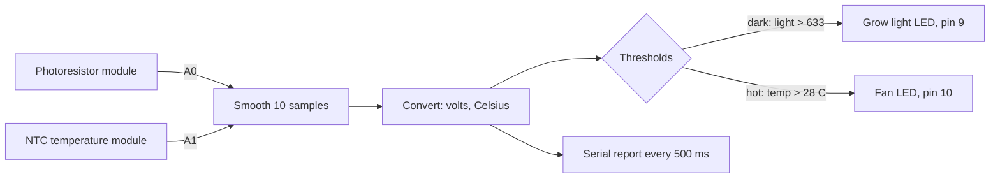

:::objectives
- Read two analog sensors and convert their values to volts and degrees Celsius.
- Check a conversion formula in Python before trusting it on the board.
- Smooth readings with a moving average stored in an array.
- Sample, decide, and report on separate `millis()` timers.
:::

A small greenhouse needs two decisions made all day: switch on a grow light when it gets too dark, and switch on a fan when it gets too warm. This build makes a monitor that does both, with LEDs standing in for the light and the fan. (Real motors need a driver circuit, which comes later in the course.) When it's finished, it prints a status line twice a second:

```text
Greenhouse monitor starting
light=250 (1.22 V)  temp=24.0 C  grow light OFF  fan OFF
light=251 (1.23 V)  temp=24.0 C  grow light OFF  fan OFF
light=771 (3.77 V)  temp=24.0 C  grow light ON  fan OFF
light=771 (3.77 V)  temp=29.0 C  grow light ON  fan ON
```



## Step 1: Wire the sensors and indicators

Start a new Uno project and paste this into **diagram.json**:

```json title="diagram.json"
{
  "version": 1,
  "author": "C4T Hardware Lab",
  "editor": "wokwi",
  "parts": [
    { "type": "wokwi-arduino-uno", "id": "uno", "top": 0, "left": 0, "attrs": {} },
    { "type": "wokwi-photoresistor-sensor", "id": "ldr1", "top": -130, "left": 20, "attrs": {} },
    { "type": "wokwi-ntc-temperature-sensor", "id": "ntc1", "top": 260, "left": 40, "attrs": {} },
    { "type": "wokwi-resistor", "id": "r1", "top": -60, "left": 250, "attrs": { "value": "220" } },
    { "type": "wokwi-led", "id": "led1", "top": -150, "left": 360, "attrs": { "color": "yellow", "label": "grow" } },
    { "type": "wokwi-resistor", "id": "r2", "top": -20, "left": 250, "attrs": { "value": "220" } },
    { "type": "wokwi-led", "id": "led2", "top": -150, "left": 420, "attrs": { "color": "blue", "label": "fan" } }
  ],
  "connections": [
    [ "ldr1:VCC", "uno:5V", "red", [] ],
    [ "ldr1:GND", "uno:GND.1", "black", [] ],
    [ "ldr1:AO", "uno:A0", "green", [] ],
    [ "ntc1:VCC", "uno:5V", "red", [] ],
    [ "ntc1:GND", "uno:GND.2", "black", [] ],
    [ "ntc1:OUT", "uno:A1", "green", [] ],
    [ "uno:9", "r1:1", "orange", [] ],
    [ "r1:2", "led1:A", "orange", [] ],
    [ "led1:C", "uno:GND.3", "black", [] ],
    [ "uno:10", "r2:1", "blue", [] ],
    [ "r2:2", "led2:A", "blue", [] ],
    [ "led2:C", "uno:GND.3", "black", [] ]
  ],
  "dependencies": {}
}
```

Both sensor modules take power from 5V and GND and send their analog output to their own pin: light to **A0**, temperature to **A1**. Each module already contains its voltage divider. With a real kit, you'd build the light divider yourself from a photoresistor and a 10 kΩ resistor, as in the notes, or use a TMP36 for temperature.

## Step 2: Print the raw readings

Never write conversions before you've seen the raw numbers.

```arduino title="sketch.ino"
void setup() {
  Serial.begin(9600);
}

void loop() {
  Serial.print("light=");
  Serial.print(analogRead(A0));
  Serial.print("  temp_raw=");
  Serial.println(analogRead(A1));
  delay(500);
}
```

```text
light=250  temp_raw=523
light=250  temp_raw=523
```

Now, while the simulation runs, click the photoresistor and drag its light slider down toward darkness. Then click the temperature sensor and raise its temperature.

```text
light=772  temp_raw=523
light=911  temp_raw=523
light=911  temp_raw=467
light=911  temp_raw=403
```

Both numbers move in the "wrong" direction: darker means a *higher* light reading, and hotter means a *lower* temperature reading. That's how their dividers are built (the notes showed why for light). This is exactly why you print raw values first. A threshold written with the wrong `>` or `<` would switch the grow light on in sunshine.

## Step 3: Convert to volts and degrees, and test the formula first

Volts is the formula from the notes. For temperature, the NTC module's documentation gives a Beta-equation conversion. Before trusting that formula in C++, check it in Python: generate the reading the sensor *should* give at known temperatures, convert it back, and compare.

```python run alt="Line chart of NTC analogRead value against temperature from 0 to 50 degrees Celsius. The reading falls smoothly from about 788 at 0 degrees to about 270 at 50 degrees, passing 512 at 25 degrees." caption="The NTC module's reading falls as it warms, and the conversion recovers each temperature."
import math
import matplotlib.pyplot as plt

BETA = 3950

def reading_at(celsius):
    kelvin = celsius + 273.15
    r_ntc = 10_000 * math.exp(BETA * (1 / kelvin - 1 / 298.15))
    return round(1023 * r_ntc / (r_ntc + 10_000))

def to_celsius(reading):
    return 1 / (math.log(1 / (1023.0 / reading - 1)) / BETA + 1.0 / 298.15) - 273.15

for celsius in [0, 15, 24, 28, 40]:
    raw = reading_at(celsius)
    print(f"{celsius:>3} C -> reading {raw} -> converted back {to_celsius(raw):.1f} C")

temps = list(range(0, 51))
plt.figure(figsize=(7, 3.6))
plt.plot(temps, [reading_at(t) for t in temps], color="#2a78d6", linewidth=2)
plt.xlabel("Temperature (C)")
plt.ylabel("analogRead value")
plt.title("NTC module: warmer means a lower reading")
plt.grid(alpha=0.3)
plt.tight_layout()
```

Every temperature comes back to within a tenth of a degree, so the formula is safe to use. Each reading step is worth roughly a tenth of a degree near room temperature, so more decimal places than one would be pretending.

Now the same conversions in the sketch. `log()` in Arduino is the natural logarithm, matching Python's `math.log`.

```arduino title="sketch.ino"
const float BETA = 3950;   // must match the NTC part's "beta" attribute

float toVolts(float reading) {
  return reading * 5.0 / 1023.0;
}

float toCelsius(float reading) {
  return 1 / (log(1 / (1023.0 / reading - 1)) / BETA + 1.0 / 298.15) - 273.15;
}

void setup() {
  Serial.begin(9600);
}

void loop() {
  int light = analogRead(A0);
  int tempRaw = analogRead(A1);
  Serial.print("light=");
  Serial.print(light);
  Serial.print(" (");
  Serial.print(toVolts(light));
  Serial.print(" V)  temp=");
  Serial.print(toCelsius(tempRaw), 1);   // 1 decimal place
  Serial.println(" C");
  delay(500);
}
```

```text
light=250 (1.22 V)  temp=24.0 C
```

`Serial.print(value, 1)` prints a float with one decimal place; without the `1` it prints two.

## Step 4: Choose thresholds from the physics

"Dark" should mean something real. If the grow light should switch on below about 50 lux, the photoresistor model from the notes says the reading at 50 lux is about **633**. So "dark" is `light > 633`. For the fan, the code already has degrees, so the threshold is simply `temp > 28.0`.

## Step 5: Smooth both sensors

A moving average needs the last few readings. An array holds them, and an index walks around it, overwriting the oldest value each time. The array is a ring: after the last slot, the index wraps back to 0.

```arduino
const int SAMPLES = 10;
int lightSamples[SAMPLES];
int tempSamples[SAMPLES];
int slot = 0;

float average(int values[]) {
  long total = 0;
  for (int i = 0; i < SAMPLES; i++) {
    total += values[i];
  }
  return total / (float)SAMPLES;
}

void takeSample() {
  lightSamples[slot] = analogRead(A0);
  tempSamples[slot] = analogRead(A1);
  slot = (slot + 1) % SAMPLES;   // 0, 1, ..., 9, 0, 1, ...
}
```

One detail matters at startup. If the arrays begin full of zeros, the first averages are far too low, and a light average near 0 looks like blazing sunshine, while a temperature reading near 0 doesn't convert to a real temperature at all. So `setup()` fills every slot with a real first reading.

## Step 6: Put it on two timers

Sampling every 20 ms keeps the average fresh. Printing every 500 ms keeps the Serial Monitor readable. Two `millis()` timers let both happen in one `loop()` without any `delay`.

## The finished program

```arduino title="sketch.ino"
const int LIGHT_PIN = A0;
const int TEMP_PIN = A1;
const int GROW_LED = 9;
const int FAN_LED = 10;

const float BETA = 3950;          // matches the NTC part's beta attribute
const int DARK_READING = 633;     // about 50 lux with the default photoresistor
const float HOT_CELSIUS = 28.0;

const int SAMPLES = 10;
const unsigned long SAMPLE_MS = 20;
const unsigned long REPORT_MS = 500;

int lightSamples[SAMPLES];
int tempSamples[SAMPLES];
int slot = 0;
unsigned long lastSample = 0;
unsigned long lastReport = 0;

float toVolts(float reading) {
  return reading * 5.0 / 1023.0;
}

float toCelsius(float reading) {
  return 1 / (log(1 / (1023.0 / reading - 1)) / BETA + 1.0 / 298.15) - 273.15;
}

float average(int values[]) {
  long total = 0;
  for (int i = 0; i < SAMPLES; i++) {
    total += values[i];
  }
  return total / (float)SAMPLES;
}

void takeSample() {
  lightSamples[slot] = analogRead(LIGHT_PIN);
  tempSamples[slot] = analogRead(TEMP_PIN);
  slot = (slot + 1) % SAMPLES;
}

void setup() {
  pinMode(GROW_LED, OUTPUT);
  pinMode(FAN_LED, OUTPUT);
  Serial.begin(9600);
  Serial.println("Greenhouse monitor starting");
  for (int i = 0; i < SAMPLES; i++) {   // start the averages from real data
    lightSamples[i] = analogRead(LIGHT_PIN);
    tempSamples[i] = analogRead(TEMP_PIN);
  }
}

void loop() {
  if (millis() - lastSample >= SAMPLE_MS) {
    lastSample = millis();
    takeSample();
  }

  float light = average(lightSamples);
  float celsius = toCelsius(average(tempSamples));
  bool dark = light > DARK_READING;   // higher reading = darker
  bool hot = celsius > HOT_CELSIUS;

  digitalWrite(GROW_LED, dark ? HIGH : LOW);
  digitalWrite(FAN_LED, hot ? HIGH : LOW);

  if (millis() - lastReport >= REPORT_MS) {
    lastReport = millis();
    Serial.print("light=");
    Serial.print(light, 0);
    Serial.print(" (");
    Serial.print(toVolts(light));
    Serial.print(" V)  temp=");
    Serial.print(celsius, 1);
    Serial.print(" C  grow light ");
    Serial.print(dark ? "ON" : "OFF");
    Serial.print("  fan ");
    Serial.println(hot ? "ON" : "OFF");
  }
}
```

Run it and move both sliders. The yellow grow light switches on once the light reading passes 633, and the blue fan light switches on above 28 °C. Because of the 10-sample average, each change takes about 200 ms (10 samples × 20 ms) to fully show.

:::video XwJQJnY6iUs
Science Buddies wires a real photoresistor and resistor to an Arduino and turns an LED on in the dark. Watch for which way round they put the photoresistor in the divider, and whether their reading goes up or down with light; compare it with Wokwi's module.
:::

:::video BYKQ9rk0FEQ
Programming Electronics Academy rewrites a sketch to use `millis()` instead of `delay()`. Watch for the "subtract the previous time" check, the same pattern as this build's two timers.
:::

:::quiz
Q: You lower the photoresistor's light level and the reading goes **up**. Why?
- [ ] The sensor is broken
  This is the expected behavior for this circuit.
- [x] The photoresistor is the bottom half of a divider, and its resistance rises in the dark
  A larger bottom resistance takes a larger share of the 5 V, so the output voltage and reading rise.
- [ ] `analogRead` counts down from 1023
  `analogRead` maps higher voltages to higher numbers; it's the voltage that rose.

Q: What goes wrong if `setup()` doesn't fill the sample arrays before the first average?
- [ ] Nothing; the arrays start with sensible values
  Global arrays start full of zeros, which aren't real readings.
- [x] The first averages are far too low, so the outputs flicker to the wrong state at startup
  A light average near 0 reads as very bright, and a temperature average near 0 doesn't convert to a real temperature.
- [ ] The program won't compile
  Reading an array of zeros compiles fine; the problem is wrong values, not syntax.

Q: Why does the sketch sample every 20 ms but only print every 500 ms?
- [ ] Printing every 20 ms would damage the Serial Monitor
  It wouldn't damage anything. It would scroll too fast to read.
- [x] The average needs frequent fresh samples, but a person only needs a couple of updates per second
  Separate timers let each job run at the speed that suits it, without `delay` blocking either.
- [ ] `analogRead` can only run every 20 ms
  An Uno can read an analog pin thousands of times a second.
:::

:::takeaways
- Print raw readings first, and find out which direction each sensor moves before writing thresholds.
- Test conversion formulas in Python across known values before putting them in a sketch.
- Choose thresholds from the sensor's model or calibration ("about 50 lux = 633"), not by guessing.
- A ring-buffer moving average smooths readings; fill it with real data in `setup()`.
- Several `millis()` timers in one `loop()` let sampling, deciding, and reporting each run at their own rate.
:::

## Ideas to extend it

-   Near 633, the grow light flickers on and off as the reading wobbles. Use **two** thresholds instead: switch on above 650, and off only below 610. This gap, called **hysteresis**, comes back when the course models states and feedback.
-   Add `"serialMonitor": { "display": "plotter" }` to `diagram.json` and print just the two numbers separated by a space, to watch them as graphs instead of text.
-   Convert the light reading to lux with the formula on Wokwi's photoresistor page, and print both.

## Further reading

-   [Wokwi photoresistor sensor reference](https://docs.wokwi.com/parts/wokwi-photoresistor-sensor): the module's pins, its attributes, and the code that converts readings to lux.
-   [Wokwi NTC temperature sensor reference](https://docs.wokwi.com/parts/wokwi-ntc-temperature-sensor): the source of this build's Celsius formula.
-   [Arduino's Smoothing example](https://docs.arduino.cc/built-in-examples/analog/Smoothing/): the official moving-average sketch, using a running total.
