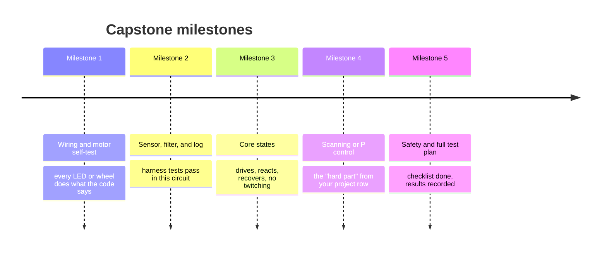

:::objectives
- Choose a capstone robot that stretches you without stalling you.
- Write a one-page plan: behavior, pin map, state diagram, safety features, and a first test list.
- Estimate a real robot's average and peak current, and what each one decides.
- Set five milestones that each end with something you can demonstrate.
:::

The most common capstone disaster isn't a bug. It's discovering, two days before the deadline, that the servo and the left motor's speed pin both want pin 9, or that nobody decided what the robot does when its path never clears. Both are five-minute fixes on paper and two-day fixes in code.

So this lesson has no code to run on the robot. You'll leave with a plan, and the next lesson turns it into a build.

## What you'll hand in

Whichever robot you choose, the finished capstone has seven parts. They're the same seven things a robotics team presents at a design review:

1. **A working robot** in Wokwi (a saved project link, or copies of `sketch.ino` and `diagram.json`), or optionally a real chassis.
2. **A circuit**: the diagram, with every pin in your pin plan.
3. **Sensor logic**: filtered readings, with "no echo" or "line lost" handled on purpose.
4. **Motor control** through driver signals (ENA/IN1/IN2 and ENB/IN3/IN4), never straight from a pin to a motor.
5. **Explicit states**: a state diagram, and code with one `case` per state.
6. **A safety checklist**, with each item either done or explained.
7. **A test plan with results, and an iteration report**: what failed, what you changed, and what happened next.

## Pick a project

All five ideas run entirely in Wokwi. The LEDs from module 5 stand in for the motor driver, and you play the world with the sensor sliders.

| Idea | Level | What it does | Wokwi parts | The hard part |
| --- | --- | --- | --- | --- |
| Bumper bot | Starter | Drives, backs up, and turns away when something is closer than 20 cm | HC-SR04, 6 driver LEDs, button | Hysteresis and minimum times so it never twitches |
| Scanning avoider | Intermediate | When blocked, stops, looks left and right with a servo, and turns toward the clearer side | Add a servo under the sensor | Waiting for the servo and the filter before trusting a reading |
| Line follower with recovery | Intermediate | Follows a dark line with P control; searches when it loses the line; gives up after 3 s | Two photoresistor modules instead of the HC-SR04 | Calibration and choosing the gain |
| Line follower with a stop zone | Advanced | Follows a line, and pauses (not crashes) when something blocks the track | Both sensors | Two behaviors that must never fight over the motors |
| Real chassis | Any level, optional | Any of the above on a two-wheel kit with an L298N or TB6612FNG | Real parts | Power, wiring, and a floor that isn't perfect |

Pick the one where you can name the hard part but don't yet know how you'll solve it. If you're unsure, the scanning avoider is the best balance: it uses every module of this course.

:::video 6QQta3Cc568 start=2:30
What to watch for: how this kit robot scans with a servo-mounted ultrasonic sensor before choosing a direction (through the demo, around 19:00), then how its line-following mode uses three sensors where our design uses two.
:::

## Fix the pin plan first

Every project in this course uses the same pin plan, chosen so the PWM pins survive the `Servo` library. Copy it, then cross out what your robot doesn't use:

| Pin | Job | Why this pin |
| --- | --- | --- |
| 5 | ENA, left motor speed | PWM, unaffected by the Servo library |
| 7, 8 | IN1, IN2, left motor direction | Any digital pin works |
| 6 | ENB, right motor speed | PWM, unaffected by the Servo library |
| 4, 3 | IN3, IN4, right motor direction | Any digital pin works |
| 9 | Scanning servo | Servo signal can use any pin; 9 and 10 lose PWM anyway |
| 10, 11 | HC-SR04 TRIG, ECHO | Plain digital I/O |
| 2 | Start/stop button to GND | `INPUT_PULLUP`, pressed reads LOW |
| A0, A1 | Left and right line sensors | Analog inputs |

## Draw the states before the code

Your state diagram is the contract between your plan and your code. Here's the scanning avoider's. Every arrow is a rule you'll write as an `if`, and every bubble becomes a `case`:

```mermaid caption="Scanning avoider. A button press in any moving state returns to WAITING, which is left out to keep the diagram readable."
stateDiagram-v2
    [*] --> WAITING
    WAITING --> DRIVING: button pressed
    DRIVING --> BACKING_UP: obstacle under 20 cm
    BACKING_UP --> SCANNING: 400 ms passed
    SCANNING --> TURNING: left and right measured
    TURNING --> DRIVING: path clear beyond 35 cm
    TURNING --> WAITING: still blocked after 3 s
```

Two things to check in your own diagram. Every state needs a way out (or a good reason to be final, like a stuck robot waiting for a human). And the robot must power up in a state where the motors are off: WAITING here.

## Fill in the planning template

Copy this into a document and fill in every line. Short answers are fine; blank ones are not.

```text
PROJECT: ______________________   LEVEL: ____________

ONE-SENTENCE BEHAVIOR:
  The robot ______ until ______, then ______.

INPUTS (sensor, pin, what "bad data" looks like):
  -
OUTPUTS (actuator, pin, safe resting value):
  -

STATES (name: what the motors do, and how it exits):
  WAITING:
  ...

NUMBERS I WILL TUNE (start value, why):
  stop distance:      cm
  cruise speed:       /255
  turn time limit:    ms
  KP (line follower):

SAFETY FEATURES (see checklist):
  -

FIRST 6 TESTS (setup / action / pass if):
  T1 baseline:
  T2:
  ...

BIGGEST RISK, AND MY PLAN B:
```

## If you build it for real: the power check

Skip this section if you're staying in Wokwi. For a real robot, two currents matter, and they answer different questions. **Peak** current (both wheels stalled) decides whether the driver and wiring can cope. **Average** current decides how long the battery lasts. Here's an estimate for the scanning avoider on 4 × AA NiMH cells, using Adafruit's TT motor figures and assumed values for the rest:

```python run alt="Bar chart of current by activity: driving 370 mA, turning 420 mA, scanning 310 mA, backing up 370 mA, with a dashed line at the weighted average of about 368 mA" caption="Average current sets runtime; the peak (not shown, about 2.7 A) sets the wiring and driver"
import matplotlib.pyplot as plt

ELECTRONICS = 60                  # mA: Arduino, sensor, LEDs (assumed)
activities = {                    # share of the run, current in mA
    "driving":    (0.65, 2 * 155 + ELECTRONICS),
    "turning":    (0.15, 2 * 180 + ELECTRONICS),   # spinning in place loads the motors more (assumed)
    "scanning":   (0.15, 250 + ELECTRONICS),       # motors off, servo moving
    "backing up": (0.05, 2 * 155 + ELECTRONICS),
}

average = sum(share * ma for share, ma in activities.values())
peak = 2 * 1200 + 250 + ELECTRONICS              # both wheels stalled, servo moving
usable_mah = 2000 * 0.8

print(f"Average current: {average:.0f} mA -> about {usable_mah / average * 60:.0f} minutes of running")
print(f"Peak current:    {peak} mA -> the driver must handle 1.2 A per channel")

names = list(activities)
plt.bar(names, [activities[n][1] for n in names], color="#7892ee")
plt.axhline(average, color="#e8590c", linestyle="--", label=f"weighted average, {average:.0f} mA")
plt.ylabel("current (mA)")
plt.legend()
```

Over four hours of running is plenty for testing. The 2.7 A peak is why the motors get their own pack and why stall situations need a watchdog in code.

## The safety checklist

Every item applies in Wokwi too, because the habit is the point. In your report, mark each one done or explain why it doesn't apply.

| # | Safety item | How you show it |
| --- | --- | --- |
| S1 | Motors are off at power-up: `drive(0, 0)` runs first in `setup()`, and the robot starts in WAITING | Code and log |
| S2 | A button press stops the robot from any moving state, and it stays stopped until pressed again | Test |
| S3 | A top-speed limit in `drive()` that no other code can exceed | Code |
| S4 | No-echo readings and lost-line readings are handled on purpose, never as 0 cm | Code and test |
| S5 | A time limit on every state that waits for the world (turning, searching) | Code and test |
| S6 | Real robot: first run with wheels off the table | Photo or note |
| S7 | Real robot: separate motor battery, shared ground, no bare battery leads; AA cells, not loose lithium cells | Photo |

## Milestones

Each milestone ends with something you can demonstrate, so you're never more than one step from a working robot:



Before moving on, check your plan against these questions. Can you name the state your robot is in at every moment? Does every state have an exit? Which number are you least sure about, and which test will tell you? If you can answer all three, you're ready to build.

:::takeaways
- Plan first: pin conflicts and missing transitions are cheap on paper and expensive in code.
- Choose a project whose hard part you can name but haven't solved yet.
- Draw the state diagram before writing a `case`, and make the power-up state safe.
- Peak current sizes the driver and wiring; average current sets battery life.
- Milestones that each end in a demo keep a working robot in your hands the whole time.
:::
