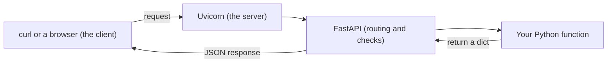

:::objectives
- Install Python 3.11 or newer, VS Code, and Microsoft's Python extension.
- Create a virtual environment for the course and activate it.
- Install FastAPI with `python -m pip install "fastapi[standard]"` and say what came with it.
- Check that curl works, and fix the install problems that stop most people.
:::

By the end of the next lesson, your laptop will be a web server. You'll type one command, open a URL, and get back JSON that your own Python function produced. Every app you use works this way underneath: your phone asks a server for data, and a function on that server answers.

Getting there takes four installs, and each one does a different job. Knowing which piece does what is the difference between fixing a setup error in a minute and staring at it for an hour.

## Five pieces, one request



- **Python** runs everything. FastAPI needs **3.11 or newer**.
- **FastAPI** is a library. It decides which of your functions handles each URL, checks the incoming data, and turns your return value into JSON.
- **Uvicorn** is the web server. It listens on a network port, receives raw HTTP, and hands it to FastAPI. It installs together with FastAPI.
- **curl** is a command-line client. It sends a request and prints exactly what came back, headers and all, which a browser hides from you.
- **VS Code** is where you write code. Its Python extension lets it run files, pick the right Python, and debug.

## Step 1: Install Python 3.11 or newer

If you already have Python, check the version first with `python --version` (Windows) or `python3 --version` (macOS, Linux). Anything from 3.11 up is fine, so skip to Step 2.

:::tabs
@tab Windows
1. Go to [python.org/downloads](https://www.python.org/downloads/) and download the **Python install manager**. (It's also in the Microsoft Store as Python Install Manager; the two are the same.)
2. Open the file and choose **Install**.
3. Open **PowerShell** from the Start menu and ask the manager for the newest Python:

```powershell
py install default
```

4. Close PowerShell, open a new window, and check:

```powershell
python --version
```
@tab macOS
1. Download the macOS installer from [python.org/downloads](https://www.python.org/downloads/) and run the `.pkg` with its default options.
2. Open **Terminal** (Cmd+Space, then type Terminal) and check:

```bash
python3 --version
```

macOS has no plain `python` command. Use `python3` until your virtual environment is active.
@tab Chromebook / Linux
1. On a Chromebook, open **Settings › About ChromeOS › Developers** and select **Set up** next to **Linux development environment**. A Terminal window opens when it's ready.
2. In that Terminal (or on Debian or Ubuntu Linux), install Python, its venv module, pip, and curl:

```bash
sudo apt update
sudo apt install python3 python3-venv python3-pip curl
python3 --version
```

If the version is below 3.11, your Linux is old; ask whoever manages the computer, or use GitHub Codespaces in the browser.
:::

## Step 2: Install VS Code and the Python extension

Download VS Code from [code.visualstudio.com](https://code.visualstudio.com/) and install it with the default options. On a Chromebook or Linux, download the `.deb` that matches what `dpkg --print-architecture` prints (`amd64` means x64, `arm64` means ARM64), move it into **Linux files** on a Chromebook, and install it from the Terminal with `sudo apt install ./code_*.deb`. Then open the Extensions view with **Ctrl+Shift+X** (Cmd+Shift+X on a Mac), search for `Python`, and install the one published by **Microsoft**.

## Step 3: Make the course folder and its virtual environment

A virtual environment is a private copy of Python that lives inside one project folder. Packages you install while it's active go into that folder, so this course's FastAPI never clashes with anything else on your computer.

In VS Code, choose **File › Open Folder…**, create a new folder named `backend-course`, and open it. Then open a terminal with **Terminal › New Terminal** and create the environment:

:::tabs
@tab Windows
```powershell
python -m venv .venv
.venv\Scripts\Activate.ps1
```
@tab macOS
```bash
python3 -m venv .venv
source .venv/bin/activate
```
@tab Chromebook / Linux
```bash
python3 -m venv .venv
source .venv/bin/activate
```
:::

Your prompt now starts with `(.venv)`. If VS Code offers to use the new environment for this workspace, say **Yes**. From here on, `python` means the environment's Python on every system, macOS included.

## Step 4: Install FastAPI

With `(.venv)` showing, run:

```bash
python -m pip install "fastapi[standard]"
```

The `[standard]` part is an **extra**: it asks pip for FastAPI plus the tools you'd want anyway. That includes Uvicorn, the `fastapi` command, and httpx, which FastAPI's TestClient uses to send requests in tests. Starting the command with `python -m` makes pip install into the Python you just activated, not some other one.

Now check that the `fastapi` command exists:

```bash
fastapi --version
```

It prints a line like `FastAPI CLI version: 0.0.x`. The exact number will be newer than anything printed on this page.

## Step 5: Check curl

curl comes with Windows 10 and 11, macOS, and the Linux install above. Check it:

:::tabs
@tab Windows
```powershell
curl.exe --version
```

Type `curl.exe`, not `curl`. In Windows PowerShell, plain `curl` is a nickname for a different command, `Invoke-WebRequest`, which prints its results in another format.
@tab macOS
```bash
curl --version
```
@tab Chromebook / Linux
```bash
curl --version
```
:::

The first line names the version, for example `curl 8.7.1`. Any version from the last few years works.

## Step 6: Prove it all fits together

Create `check_setup.py` in `backend-course` and run it with the play button at the top right of the editor:

```python run title="check_setup.py"
import sys
from importlib.metadata import PackageNotFoundError, version

print("Python", sys.version.split()[0])
print("Inside a virtual environment:", sys.prefix != sys.base_prefix)

for package in ["fastapi", "uvicorn", "pydantic", "httpx"]:
    try:
        print(f"  {package:<9} {version(package)}")
    except PackageNotFoundError:
        print(f"  {package:<9} MISSING")

if sys.version_info < (3, 11):
    print("Python is too old for current FastAPI. Install 3.11 or newer.")
```

This output came from the computer that built this page. It isn't inside a virtual environment, so it says `False`. On yours, the second line should say `True` and all four packages should show a version. `importlib.metadata.version()` asks the running Python which version of a package it can see, so a `MISSING` here means VS Code is running a different Python than the one you installed into.

:::try
Click the Python version in the bottom-right corner of VS Code. The list that opens shows every Python VS Code found. The one marked with `.venv` is the one you want selected.
:::

## When it doesn't work

:::warning `zsh: no matches found: fastapi[standard]`
On macOS (and zsh on Linux), square brackets mean "match file names", so the shell rejects the command before pip ever sees it. Put the package name in quotes, exactly as shown: `python -m pip install "fastapi[standard]"`.
:::

:::warning Windows: `Activate.ps1 cannot be loaded because running scripts is disabled on this system`
PowerShell blocks scripts by default. Allow scripts you create yourself by running this once, then activate again:

```powershell
Set-ExecutionPolicy -ExecutionPolicy RemoteSigned -Scope CurrentUser
```
:::

:::warning `fastapi: command not found` or `'fastapi' is not recognized`
The environment isn't active in this terminal, so the shell can't see the commands installed into it. Look for `(.venv)` at the start of the prompt and activate it again if it's missing. `python -m fastapi --version` also works, because it goes through the active Python directly.
:::

:::warning `ModuleNotFoundError: No module named 'fastapi'` when you press Run
FastAPI is installed, but VS Code ran a different Python. Open the Command Palette (Ctrl+Shift+P or Cmd+Shift+P), run **Python: Select Interpreter**, and choose the one inside `.venv`. Then open a fresh terminal.
:::

## See a virtual environment made from scratch

:::video Y21OR1OPC9A
Tech With Tim builds and activates a virtual environment on screen. Watch how the prompt changes after activation and where the installed packages end up: that folder is why this course's FastAPI can't collide with another project's.
:::

:::quiz
Q: You install FastAPI, close VS Code, reopen it, and `fastapi dev` now says `command not found`. What's the most likely cause?
- [ ] FastAPI uninstalled itself
  Packages stay in `.venv` until you delete the folder.
- [x] The new terminal doesn't have the virtual environment activated
  Activation only lasts for one terminal session. Check for `(.venv)` and activate again.
- [ ] Uvicorn is missing
  Uvicorn came with `fastapi[standard]`, and a missing server would give a different error.

Q: Why does this course install with `python -m pip` instead of plain `pip`?
- [ ] It installs faster
  Speed is the same; the difference is where the package goes.
- [x] It installs into the exact Python that `python` runs, so the package and the code can't end up in two different places
  Plain `pip` can belong to a different Python than the one you run, which is the classic "I installed it but Python can't find it" problem.
- [ ] Plain `pip` can't install extras like `[standard]`
  Both can install extras. The quotes matter for zsh; `python -m` matters for picking the right Python.

Q: In Windows PowerShell, `curl --version` prints a red error instead of a version number. What's going on?
- [ ] curl isn't installed on Windows
  Windows 10 and 11 include it as `curl.exe`.
- [x] `curl` there means `Invoke-WebRequest`, so you need to type `curl.exe`
  Windows PowerShell maps the short name to its own command. Adding `.exe` runs the real curl.
:::

:::takeaways
- Uvicorn receives HTTP, FastAPI routes and checks it, and your function produces the answer.
- Every project gets its own `.venv`. Activate it in each new terminal and look for `(.venv)` in the prompt.
- Install with `python -m pip install "fastapi[standard]"`. The quotes protect the brackets and `python -m` picks the right Python.
- On Windows PowerShell, type `curl.exe`.
:::

## Further reading

- [FastAPI: Virtual Environments](https://fastapi.tiangolo.com/virtual-environments/): FastAPI's own guide, with diagrams of what activation changes and why it matters.
- [Python Environments in VS Code](https://code.visualstudio.com/docs/python/environments): how VS Code finds, creates, and selects environments.
- [venv in the Python docs](https://docs.python.org/3/library/venv.html): the activation command for every shell, including the PowerShell execution policy note.
