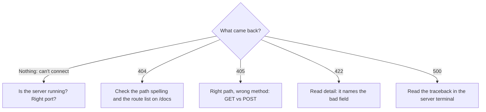

:::objectives
- Lay out `backend-course` so every module has a home and one shared virtual environment.
- Work with two terminals: one runs the server, one sends requests.
- Use the status code to decide where to look, and find the traceback behind a `500`.
- Pause a live request in the VS Code debugger and inspect its variables.
- Save a `requirements.txt` that rebuilds your environment on any computer.
:::

Sooner or later, the browser will show you two words and nothing else:

```text
Internal Server Error
```

That's not much to go on, and it's on purpose. A server shouldn't tell strangers what broke inside it. The full story went somewhere else: to the terminal running the server. Backend work means getting used to the fact that the client and the server see different halves of every problem, and learning to check both.

## A layout that lasts the whole course

Keep everything for this course in the folder you made in the first lesson, with one shared `.venv` at the top and a folder per project:

```text
backend-course/
├── .venv/              the virtual environment (never edit or share it)
├── requirements.txt    the packages this course needs
├── check_setup.py
├── hello/              Module 1: first app
│   └── main.py
├── http-practice/      Modules 2 and 3: scripts that read and design HTTP
└── notes-api/          Module 4 onward: the notes API you keep extending
    ├── main.py
    └── test_main.py
```

Open the `backend-course` folder itself in VS Code, not a subfolder, so VS Code keeps finding `.venv`. To run a server, `cd` into its folder first (`cd notes-api`) and then run `fastapi dev main.py`.

## Two terminals, two jobs

A running server holds onto its terminal. So the course always uses two:

1. **Server terminal**: `fastapi dev main.py`. Leave it running and watch it, because every request and every crash shows up here.
2. **Client terminal**: curl commands, `python -m unittest`, anything else. Open it with the **+** button in the terminal panel, or select the split icon to see both side by side.

If you lose track of which is which, the server terminal is the one where you can't type.

## How the code on these pages runs

Code blocks with an **Output** box underneath were run when this page was built. For an API, that means a TestClient sent a real request to a real FastAPI app, and the box shows exactly what came back. Your output can differ in small ways (newer package versions, today's date in a header), but status codes and JSON should match. Blocks without an Output box are files to save or commands to type.

## Let the status code tell you where to look

Every response carries a status code, and the code narrows down where the problem is before you read a single line of your own code.



Here's a small app with a bug in it. Predict what each of the four requests gets before you read the output.

```python run title="hello/scores.py"
from fastapi import FastAPI
from fastapi.testclient import TestClient

app = FastAPI()
scores = {"ana": 12, "ben": 9}


@app.get("/scores/{name}")
def get_score(name: str):
    return {"name": name, "score": scores[name]}


# raise_server_exceptions=False makes TestClient act like curl:
# a crash comes back as a 500 response instead of a Python exception.
client = TestClient(app, raise_server_exceptions=False)
requests = [("GET", "/scores/ana"), ("GET", "/scores/Ana"), ("POST", "/scores/ana"), ("GET", "/scores")]
for method, path in requests:
    response = client.request(method, path)
    print(f"{method:4} {path:12} {response.status_code}  {response.text}")
```

Line by line: `ana` works. `Ana` with a capital A isn't a key in the dict, so the function crashed and the client got a bare `500`. The `POST` found the path but no POST route, so it's `405 Method Not Allowed`. And `/scores` by itself matches nothing, so `404`.

Now the other half. When `curl` got that 500, the server terminal printed this (shortened here; the real one runs past 60 lines):

```text
      INFO   127.0.0.1:55460 - "GET /scores/Ana HTTP/1.1" 500
     ERROR   Exception in ASGI application
Traceback (most recent call last):
  File ".../site-packages/uvicorn/protocols/http/httptools_impl.py", line 409, in run_asgi
  ...
  File ".../site-packages/anyio/_backends/_asyncio.py", line 962, in run
    result = context.run(func, *args)
  File ".../backend-course/hello/main.py", line 9, in get_score
    return {"name": name, "score": scores[name]}
                                   ~~~~~~^^^^^^
KeyError: 'Ana'
```

Most of that traceback is FastAPI's and Uvicorn's machinery, so skip to the bottom. The **last file that's yours** (`main.py`, line 9) and the **last line** (`KeyError: 'Ana'`) are the whole story. The fix is to handle the missing key on purpose and send a proper `404` with a reason:

```python run title="hello/scores.py (fixed)"
from fastapi import FastAPI, HTTPException
from fastapi.testclient import TestClient

app = FastAPI()
scores = {"ana": 12, "ben": 9}


@app.get("/scores/{name}")
def get_score(name: str):
    key = name.lower()
    if key not in scores:
        raise HTTPException(status_code=404, detail=f"No score for {name}")
    return {"name": key, "score": scores[key]}


client = TestClient(app)
for path in ["/scores/Ana", "/scores/zoe"]:
    response = client.get(path)
    print(response.status_code, response.json())
```

`raise HTTPException(...)` stops the function and sends that status and message to the client. You'll use it constantly from Module 4 on. A rule worth keeping: a `500` always means the server has a bug, even when the client sent something silly. The server's job is to answer bad input with a `4xx` that says what was wrong.

## Pause a request with the debugger

When reading the traceback isn't enough, stop the server mid-request and look around. Stop `fastapi dev` with Ctrl+C, open `main.py`, and click in the margin to the left of a line number inside your route to set a breakpoint (a red dot appears). Press **F5** and choose the **FastAPI** option from the list (if VS Code asks for a debugger first, pick **Python Debugger**).

The server starts under the debugger. Send a request from the browser or curl, and it seems to hang: your code is paused on the breakpoint. The **Run and Debug** view shows every variable, including `name` exactly as it arrived. Press F5 again to continue, and the response goes out.

:::tip
The debugger runs the app without reload, so stop it (Shift+F5) and go back to `fastapi dev main.py` once you've found the bug.
:::

## Save your setup, not just your code

`.venv` is big and specific to your computer, so never copy or share it. Record what's in it instead. The simplest version is a one-line `requirements.txt` in `backend-course`:

```text title="requirements.txt"
fastapi[standard]
```

On a new computer (or after deleting a broken `.venv`), make a fresh environment, activate it, and run:

```bash
python -m pip install -r requirements.txt
```

:::warning `pip freeze` from a Mac breaks on Windows
`python -m pip freeze > requirements.txt` pins the exact version of every installed package, which sounds safer. But FastAPI's standard extras include `uvloop` on macOS and Linux only, and `freeze` writes it down without that condition, so the same file fails to install on Windows. For this course, the one-line file is more portable. If you use Git, add `.venv/` to your `.gitignore`.
:::

## Asking for help that gets a useful answer

When you post a question to a classmate, a forum, or a teacher, include four things. With all four, most people can spot the problem in a minute:

1. The exact request: the full curl command, or the method and URL.
2. The full response, from `curl -i` so the status and headers are included.
3. The route function's code.
4. The bottom of the server traceback, from the last line that's yours to the end.

## See the debugger in action

:::video 06eQ41TuJRs
The VS Code team debugs a small Python API with the Python debugger. Focus on where they set breakpoints and how they read variables while a request is paused: it's the same routine you'll use on your own routes.
:::

:::quiz
Q: curl prints `Internal Server Error` and nothing else. Where is the useful information?
- [ ] In the response headers
  The headers say it's a 500 and plain text, but not why.
- [x] In the traceback printed by the terminal running the server
  The server logs the crash where only you can see it, and the last lines name the file, line, and exception.
- [ ] In the browser's address bar
  The URL tells you what was asked, not what went wrong.

Q: `POST /scores/ana` returns `405 Method Not Allowed`. What does that tell you?
- [x] The path exists, but no route accepts POST there
  A 405 means "found the path, not that method". The response even includes an `Allow: GET` header.
- [ ] The server crashed while handling the POST
  A crash is a 500. A 405 is the router saying no before your code runs.
- [ ] The path is misspelled
  A misspelled path would give a 404.

Q: Why does this course suggest a one-line `requirements.txt` instead of `pip freeze`?
- [ ] Frozen files are slower to install
  Speed isn't the issue.
- [x] A frozen file from macOS lists `uvloop`, which won't install on Windows
  The one-line file lets pip choose the right packages for each operating system.
- [ ] `pip freeze` doesn't include FastAPI
  It includes FastAPI and everything else in the environment, which is the problem.
:::

:::takeaways
- Keep one `.venv` at the top of `backend-course` and a folder per project. Open the top folder in VS Code.
- Run the server in one terminal and send requests from another.
- Use the status code to decide where to look first. For a 500, read the bottom of the server traceback.
- A 500 is always the server's bug: catch the problem and send a 4xx with a reason instead.
- Share `requirements.txt`, never `.venv`.
:::

## Further reading

- [Python debugging in VS Code](https://code.visualstudio.com/docs/python/debugging): every debugger feature, including conditional breakpoints for "only stop when name is Ana".
- [FastAPI: Handling Errors](https://fastapi.tiangolo.com/tutorial/handling-errors/): more on `HTTPException`, which Module 4 uses for every missing resource.
- [pip User Guide: Requirements Files](https://pip.pypa.io/en/stable/user_guide/): how `-r requirements.txt` works and what else you can put in the file.
