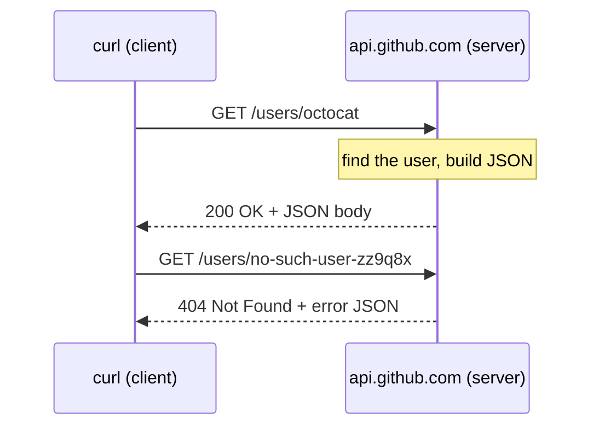

:::objectives
- Name the parts of an HTTP request (method, URL, headers, body) and of a response (status, headers, body).
- Split a URL into scheme, host, path, and query string, and encode a query safely.
- Choose between GET, POST, PUT, PATCH, and DELETE, and explain which are safe and idempotent.
- Read a status code's class at a glance and know what 200, 201, 204, 304, 400, 401, 404, 422, and 500 mean.
- Parse a JSON body and check the status before trusting it.
:::

A weather app on your phone says "Couldn't load data." Three suspects: the phone sent a bad request, the server broke, or the answer came back in a shape the app didn't expect. Picking the right suspect is most of backend debugging, and you can do it because HTTP is **plain text**. You can read the whole conversation.

Here's a real one. `curl -v` prints the lines it sends (starting with `>`) and the lines it receives (starting with `<`). This asked GitHub's public API about a user named `octocat`:

```text
> GET /users/octocat HTTP/2
> Host: api.github.com
> User-Agent: curl/8.7.1
> Accept: */*
>
< HTTP/2 200
< content-type: application/json; charset=utf-8
< cache-control: public, max-age=60, s-maxage=60
< etag: W/"937b358ed9a13d1e1e536f857ef7716ad2d274226f0b3f4b73fa4bb7c3b0b70b"
< x-ratelimit-limit: 60
< x-ratelimit-remaining: 49
< content-length: 1350
<
{
  "login": "octocat",
  "id": 583231,
  "name": "The Octocat",
  "public_repos": 8,
  ...
}
```

The request is four lines. The response is a status line, some headers, a blank line, and a body. Everything in this module is about reading those parts.

## Clients ask, servers answer

HTTP has two roles. The **client** (a browser, a phone app, curl, your Python script) always speaks first. The **server** waits, answers each request with exactly one response, and then forgets about it. That forgetting is called being **stateless**: each request has to carry everything the server needs, because the server keeps no memory of the conversation so far.



## A URL is four parts

`https://api.github.com/users/octocat/repos?per_page=2&sort=updated` packs a lot into one line. Python's `urllib.parse` will take it apart for you:

```python run title="http-practice/url_parts.py"
from urllib.parse import parse_qs, urlencode, urlsplit

url = "https://api.github.com/users/octocat/repos?per_page=2&sort=updated"
parts = urlsplit(url)
print("scheme:", parts.scheme)
print("host:  ", parts.netloc)
print("path:  ", parts.path)
print("query: ", parts.query)
print("parsed:", parse_qs(parts.query))

# Building a query string safely: spaces and & get encoded.
print(urlencode({"q": "fastapi tutorial", "note": "fish & chips"}))
```

The **scheme** (`https`) says how to connect, the **host** says which computer, and the **path** says which thing on that computer. The **query string** after `?` holds optional settings as `name=value` pairs joined with `&`. Notice that `parse_qs` gives you lists, since a name can appear more than once, and every value is a **string**: `'2'`, not `2`. In the last line, the space became `+` and the `&` inside a value became `%26`, so it can't be mistaken for a separator.

## Watch a server pull a request apart

What reaches a server is just text. Here's the core of what a server does first with every request, stripped down to plain Python. Step through it and watch `headers` fill up.

:::trace Parse a raw HTTP request
```python
raw = "GET /notes?limit=2 HTTP/1.1\r\nHost: localhost\r\nAccept: application/json\r\n\r\n"
head, body = raw.split("\r\n\r\n")
lines = head.split("\r\n")
method, target, version = lines[0].split(" ")
path, _, query = target.partition("?")
headers = {}
for line in lines[1:]:
    name, value = line.split(": ", 1)
    headers[name.lower()] = value
print(method, path, query)
print(headers)
```
:::

The blank line (`\r\n\r\n`) is what separates the head from the body, which is empty for this GET. Header names are lowercased because HTTP treats `Accept` and `accept` as the same header. That's why GitHub's response above uses all-lowercase names. Uvicorn does all of this for you, with many more checks.

## Methods say what you want done

The first word of the request is the **method**. It tells the server what kind of action you want on the thing the path names.

| Method   | Means                            | Has a body? | Safe? | Idempotent? |
| -------- | -------------------------------- | ----------- | ----- | ----------- |
| `GET`    | Read it                          | No          | Yes   | Yes         |
| `POST`   | Create something new under it    | Yes         | No    | No          |
| `PUT`    | Replace it completely            | Yes         | No    | Yes         |
| `PATCH`  | Change some of its fields        | Yes         | No    | Usually not |
| `DELETE` | Remove it                        | Usually no  | No    | Yes         |

**Safe** means the request doesn't change anything on the server, so browsers and tools may send it freely. **Idempotent** means sending it twice leaves the server in the same state as sending it once. Deleting note 3 twice still leaves note 3 deleted, even though the second response is a 404. Posting the same new note twice makes two notes, which is why a payment form warns you not to click "Pay" twice.

## Status codes are the server's one-word answer

The first digit tells you who should act next:

- **2xx success**: `200 OK`, `201 Created` (something new exists now), `204 No Content` (it worked; nothing to send back).
- **3xx look elsewhere**: `301`/`302` redirects, and `304 Not Modified` ("your saved copy is still good").
- **4xx the client must change something**: `400 Bad Request`, `401 Unauthorized` (who are you?), `403 Forbidden` (I know who you are; still no), `404 Not Found`, `422 Unprocessable Content` (I understood the request, but the data breaks the rules).
- **5xx the server failed**: `500 Internal Server Error`, `503 Service Unavailable`.

Python ships with the official list:

```python run title="http-practice/status_codes.py"
from http import HTTPStatus

for code in [200, 201, 204, 304, 400, 401, 404, 405, 500]:
    status = HTTPStatus(code)
    print(code, status.phrase)
```

GitHub's API shows several of these in practice. Asking for a user who doesn't exist gets `404` with the body `{"message": "Not Found", ...}`. Trying to create a repository with `POST /user/repos` without logging in gets `401` and `{"message": "Requires authentication", ...}`. Same server, same format, different code, and the code alone already tells you whose move it is.

## Headers carry the details

Headers are `name: value` lines about the message itself. A few you'll see constantly:

- `content-type` says what the body is. `application/json` means "parse me as JSON."
- `content-length` is the body's size in **bytes** (1350 for octocat).
- `accept` (from the client) says what formats it can handle. curl's `*/*` means "anything."
- `user-agent` names the client program.
- `cache-control` and `etag` let clients reuse a response instead of downloading it again.
- `x-ratelimit-remaining` is GitHub's own header: 49 more requests allowed this hour from this address without logging in.

## The body is usually JSON

JSON is text that looks a lot like Python literals, with a few differences: strings always use double quotes, `true`/`false`/`null` are lowercase, and there are no tuples or comments. `json.loads` turns JSON text into Python objects:

```python run title="http-practice/read_json.py"
import json

body = '{"login": "octocat", "public_repos": 8, "site_admin": false, "email": null}'
user = json.loads(body)
print(type(user).__name__, user)
print(user["login"], "has", user["public_repos"] + 1, "repos after one more")
```

`false` became `False` and `null` became `None`. Numbers stay numbers, so `public_repos + 1` works. Values in a query string are always strings, while a JSON body keeps its types.

:::warning Python's dict syntax isn't JSON
A dict printed by Python uses single quotes, and pasting it as JSON fails:

```python run raises
import json

json.loads("{'login': 'octocat'}")
```

The error points at character 1, the first single quote. Use `json.dumps(data)` to make JSON from Python, never `str(data)`.
:::

:::warning Unquoted `&` and `?` in the terminal
Type `curl https://api.github.com/users/octocat/repos?per_page=2&sort=updated` without quotes and zsh answers `no matches found`, bash quietly drops everything after `&`, and PowerShell refuses with an error about the ampersand. Wrap every URL that has a query string in double quotes.
:::

:::warning Check the status before using the body
A 404 still has a JSON body, just a different one. Code that reads `data["login"]` without checking the status first will crash with a `KeyError` the first time a user doesn't exist. Check `status_code` (or the `HTTP/2 404` line) first.
:::

## Hear it explained another way

:::video 4axL8Gfw2nI
CS50's short on HTTP. As you watch, line up the request and response it describes with the octocat exchange at the top of this page: the method and path, the host header, and the status line.
:::

:::quiz
Q: In `https://api.github.com/users/octocat/repos?per_page=2&sort=updated`, what is `per_page=2&sort=updated`?
- [ ] The path
  The path is `/users/octocat/repos`; it ends at the `?`.
- [x] The query string, two name=value settings
  Everything after `?` is the query, split into pairs at each `&`.
- [ ] Two headers
  Headers travel on their own lines, not in the URL.

Q: A client sends `DELETE /notes/3`, gets `204`, then sends it again and gets `404`. Is DELETE still idempotent here?
- [x] Yes, because the server ends up in the same state either way: note 3 is gone
  Idempotence is about the effect on the server, not about getting identical responses.
- [ ] No, because the two responses are different
  The responses differ, but the state of the server after one call and after two calls is the same.

Q: What does `json.loads('{"done": true, "due": null}')` return?
- [ ] `{'done': 'true', 'due': 'null'}`
  JSON keeps its types: `true` is a boolean, not text.
- [x] `{'done': True, 'due': None}`
  JSON `true` becomes Python `True`, and `null` becomes `None`.
- [ ] An error, because of the lowercase `true`
  Lowercase is correct in JSON. Python's `True` would be the error.

Q: An app gets `401` back from an API. Who needs to change something?
- [ ] The server, because 4xx means it broke
  Server failures are 5xx.
- [x] The client, which needs to say who it is (log in or send a key)
  4xx codes ask the client to change the request, and 401 specifically asks for authentication.
- [ ] Nobody; 401 is a kind of success
  Only 2xx codes mean success.
:::

:::takeaways
- A request is a method, a URL, headers, and an optional body. A response is a status, headers, and a body.
- The URL's query string holds optional `name=value` settings, and every value arrives as text.
- GET reads, POST creates, PUT replaces, PATCH changes part, DELETE removes. GET, PUT, and DELETE are idempotent.
- 2xx worked, 3xx look elsewhere, 4xx the client must fix something, 5xx the server failed.
- Check the status first, then parse the JSON body.
:::

## Further reading

- [MDN: An overview of HTTP](https://developer.mozilla.org/en-US/docs/Web/HTTP/Guides/Overview): clear diagrams of clients, servers, and proxies, from the people who document the web platform.
- [MDN: HTTP messages](https://developer.mozilla.org/en-US/docs/Web/HTTP/Guides/Messages): the exact layout of requests and responses, including the blank line.
- [MDN: HTTP response status codes](https://developer.mozilla.org/en-US/docs/Web/HTTP/Reference/Status): every code with a short description. Worth bookmarking.
