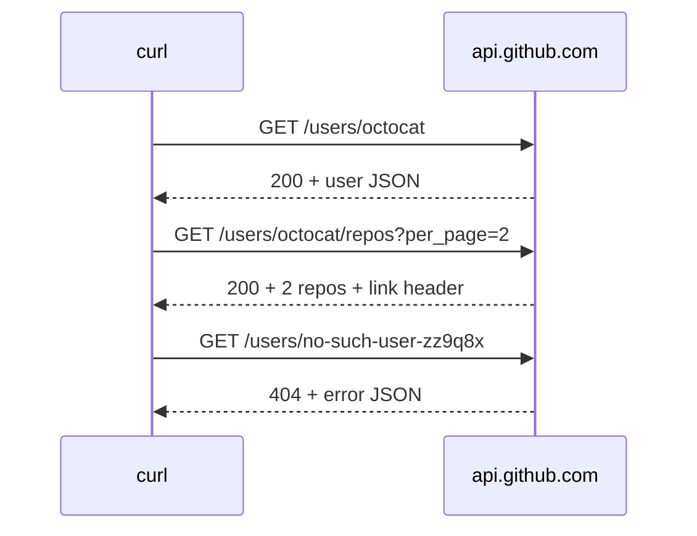

:::objectives
- Send GET requests with `curl` and `curl -i`, and save full responses with `-o`.
- Use a query string to ask for one page of results, and find the next page in the `link` header.
- Write `parse_response()`, which splits a saved response into status, headers, and parsed body.
- Handle an error response without crashing.
:::

You'll ask GitHub's API three questions from the terminal, save each answer to a file, and then write `read_response.py`, a script that reads all three files and reports what happened. Here's what it prints when it's done:

```text
octocat.txt   200  octocat: The Octocat, 8 public repos   (rate limit left: 55)
repos.txt     200  2 items: boysenberry-repo-1, git-consortium   next page: 2 of 4   (rate limit left: 56)
missing.txt   404  error: Not Found   (rate limit left: 54)
```

One line per exchange, with exactly the facts you'd want when debugging: did it work, what came back, is there more, and how many requests you have left. Make a folder called `http-practice` inside `backend-course` and work there.



On Windows, type `curl.exe` wherever these steps say `curl`.

## Step 1: A request with no surprises

Start with the simplest endpoint GitHub has. It returns one line of plain text:

```bash
curl https://api.github.com/zen
```

```text
Approachable is better than simple.
```

You'll get a different saying each time, because the server picks one at random. Now add `-i` to include the response head:

```bash
curl -i https://api.github.com/zen
```

```text
HTTP/2 200
content-type: text/plain;charset=utf-8
x-ratelimit-limit: 60
x-ratelimit-remaining: 48
content-length: 35

Approachable is better than simple.
```

That's trimmed to five of the 22 headers GitHub sent. The `content-type` is `text/plain`, so this body isn't JSON. `content-length: 35` counts the bytes in the saying, and `x-ratelimit-remaining` dropped by one, because every request you send without logging in counts against the 60 you're allowed each hour.

## Step 2: Ask for JSON and save it

Now ask about a user, and save the whole response, head and body, to a file:

```bash
curl -s -i https://api.github.com/users/octocat -o octocat.txt
```

`-s` (silent) hides curl's progress meter and `-o octocat.txt` writes the output to a file instead of the screen. Use `-o` rather than `> octocat.txt`: Windows PowerShell saves redirected output as UTF-16, which Python then reads as gibberish, while `-o` lets curl write the bytes itself.

Open `octocat.txt` in VS Code. It's the same response you saw in the last lesson: a status line, about 25 headers, a blank line, and a JSON body.

## Step 3: Get the files onto this page

This page can't use the network, so the next cell recreates your three files exactly as curl saved them, trimmed to the headers and fields this build uses. On your computer, skip this cell: you'll have real files from curl. (Run the two curl commands in Steps 5 and 6 now if you want all three files before writing any Python.)

```python run title="captured responses (page only)"
from pathlib import Path

Path("octocat.txt").write_text("""HTTP/2 200
content-type: application/json; charset=utf-8
etag: W/"937b358ed9a13d1e1e536f857ef7716ad2d274226f0b3f4b73fa4bb7c3b0b70b"
x-ratelimit-limit: 60
x-ratelimit-remaining: 55

{"login": "octocat", "id": 583231, "name": "The Octocat", "company": "@github",
 "location": "San Francisco", "public_repos": 8, "followers": 25144}
""")

Path("repos.txt").write_text("""HTTP/2 200
content-type: application/json; charset=utf-8
link: <https://api.github.com/user/583231/repos?per_page=2&page=2>; rel="next", <https://api.github.com/user/583231/repos?per_page=2&page=4>; rel="last"
x-ratelimit-limit: 60
x-ratelimit-remaining: 56

[{"name": "boysenberry-repo-1", "fork": true, "stargazers_count": 490},
 {"name": "git-consortium", "fork": false, "stargazers_count": 627}]
""")

Path("missing.txt").write_text("""HTTP/2 404
content-type: application/json; charset=utf-8
x-ratelimit-limit: 60
x-ratelimit-remaining: 54

{"message": "Not Found", "documentation_url": "https://docs.github.com/rest", "status": "404"}
""")
print("wrote", sorted(p.name for p in Path(".").glob("*.txt")))
```

## Step 4: Split a response into its parts

Every response has the same layout, so one function can read them all. The blank line separates the head from the body, the first line of the head is the status line, and every other head line is `name: value`.

```python run title="read_response.py (step 4)"
import json
from pathlib import Path


def parse_response(text):
    head, _, body = text.partition("\n\n")
    status_line, *header_lines = head.splitlines()
    status = int(status_line.split()[1])
    headers = {}
    for line in header_lines:
        name, _, value = line.partition(":")
        headers[name.strip().lower()] = value.strip()
    if "json" in headers.get("content-type", ""):
        body = json.loads(body)
    return status, headers, body


status, headers, user = parse_response(Path("octocat.txt").read_text())
print(status, headers["content-type"])
print(user["name"], "has", user["public_repos"], "public repos")
```

A few decisions in there are worth a second look. `partition("\n\n")` splits at the **first** blank line only, so a body that contains blank lines stays in one piece. `int(...)` turns the status into a number, so later code can write `status >= 400`. Lowercasing header names means `Content-Type` and `content-type` land on the same key. And the body only goes through `json.loads` when the server said it was JSON.

:::note
curl writes the head with `\r\n` line endings, as HTTP requires. `read_text()` converts them to `\n` as it reads, which is why splitting on `"\n\n"` works on the real files too.
:::

## Step 5: Ask for one page at a time

A user with thousands of repos can't get them all in one response, so GitHub hands them out in **pages**. You choose the page size with a query string, which means quotes around the URL:

```bash
curl -s -i "https://api.github.com/users/octocat/repos?per_page=2" -o repos.txt
```

The body is a JSON list of two repos, and the head includes a `link` header that says where the rest are:

```text
link: <https://api.github.com/user/583231/repos?per_page=2&page=2>; rel="next", <https://api.github.com/user/583231/repos?per_page=2&page=4>; rel="last"
```

Two links, each labeled with a `rel`: `next` is page 2, and `last` is page 4. Four pages of two is eight repos, matching octocat's `public_repos: 8`. Pull the labels out with a function:

```python run title="read_response.py (step 5)"
from urllib.parse import parse_qs, urlsplit


def parse_links(value):
    links = {}
    for part in value.split(","):
        url_part, rel_part = part.split(";")
        url = url_part.strip().strip("<>")
        rel = rel_part.strip().removeprefix('rel="').removesuffix('"')
        links[rel] = url
    return links


def page_number(url):
    return parse_qs(urlsplit(url).query)["page"][0]


status, headers, repos = parse_response(Path("repos.txt").read_text())
links = parse_links(headers["link"])
print([repo["name"] for repo in repos])
print("next page:", page_number(links["next"]), "of", page_number(links["last"]))
```

`page_number` reuses the URL tools from the last lesson: split the link into parts, parse its query, and take the first `page` value. A client that wants every repo keeps following `next` until a response arrives without one.

## Step 6: An answer you didn't want

Ask for a user who doesn't exist:

```bash
curl -s -i https://api.github.com/users/no-such-user-zz9q8x -o missing.txt
```

The body is still JSON, just a different shape: `{"message": "Not Found", ...}`. Code that expects a user would crash here, so the summary function checks the status **first** and only then decides how to read the body:

```python run title="read_response.py (step 6)"
def summarize(filename):
    status, headers, data = parse_response(Path(filename).read_text())
    left = f"(rate limit left: {headers.get('x-ratelimit-remaining', '?')})"
    if status >= 400:
        return f"{filename:13} {status}  error: {data['message']}   {left}"
    if isinstance(data, list):
        names = ", ".join(item["name"] for item in data)
        line = f"{filename:13} {status}  {len(data)} items: {names}"
        if "link" in headers:
            links = parse_links(headers["link"])
            if "next" in links:
                line += f"   next page: {page_number(links['next'])} of {page_number(links['last'])}"
        return f"{line}   {left}"
    return f"{filename:13} {status}  {data['login']}: {data['name']}, {data['public_repos']} public repos   {left}"


print(summarize("missing.txt"))
```

## The finished script

Here's `read_response.py` in one piece. Save it in `http-practice` next to your three files and run it with the play button.

```python run title="http-practice/read_response.py"
import json
from pathlib import Path
from urllib.parse import parse_qs, urlsplit

FILES = ["octocat.txt", "repos.txt", "missing.txt"]


def parse_response(text):
    head, _, body = text.partition("\n\n")
    status_line, *header_lines = head.splitlines()
    status = int(status_line.split()[1])
    headers = {}
    for line in header_lines:
        name, _, value = line.partition(":")
        headers[name.strip().lower()] = value.strip()
    if "json" in headers.get("content-type", ""):
        body = json.loads(body)
    return status, headers, body


def parse_links(value):
    links = {}
    for part in value.split(","):
        url_part, rel_part = part.split(";")
        url = url_part.strip().strip("<>")
        rel = rel_part.strip().removeprefix('rel="').removesuffix('"')
        links[rel] = url
    return links


def page_number(url):
    return parse_qs(urlsplit(url).query)["page"][0]


def summarize(filename):
    status, headers, data = parse_response(Path(filename).read_text())
    left = f"(rate limit left: {headers.get('x-ratelimit-remaining', '?')})"
    if status >= 400:
        return f"{filename:13} {status}  error: {data['message']}   {left}"
    if isinstance(data, list):
        names = ", ".join(item["name"] for item in data)
        line = f"{filename:13} {status}  {len(data)} items: {names}"
        if "link" in headers:
            links = parse_links(headers["link"])
            if "next" in links:
                line += f"   next page: {page_number(links['next'])} of {page_number(links['last'])}"
        return f"{line}   {left}"
    return f"{filename:13} {status}  {data['login']}: {data['name']}, {data['public_repos']} public repos   {left}"


for filename in FILES:
    if Path(filename).exists():
        print(summarize(filename))
    else:
        print(f"{filename:13} missing: run the curl command for it first")
```

:::try
Save a fourth response with `curl -s -i "https://api.github.com/users/octocat/repos?per_page=2&page=4" -o last.txt`, add `"last.txt"` to `FILES`, and run it again. The last page has no `next` link, so that part of the line disappears.
:::

## Watch curl used on a different API

:::video iLVoA1DTE60
Steve Griffith tests an API from the command line with curl. Watch how he changes the method and sends data along with a request: you've only sent GETs so far, and Module 4 sends JSON to your own server the same way.
:::

:::quiz
Q: Why does `summarize` check `status >= 400` before reading `data["login"]`?
- [ ] Because error responses have no body
  GitHub's 404 has a JSON body. It just has `message` instead of `login`.
- [x] Because an error body has a different shape, and reading `login` from it would raise a KeyError
  The status tells you which shape to expect, so it has to be read first.
- [ ] Because `parse_response` can't read error responses
  It reads them fine. The status line has the same layout for every response.

Q: Why does the build save responses with `curl -o file` instead of `curl > file`?
- [x] On Windows PowerShell, `>` saves the text as UTF-16, which Python then misreads
  With `-o`, curl writes the bytes itself on every system, so the file is the same everywhere.
- [ ] `>` drops the headers
  The headers come from `-i`. Redirection would keep them.
- [ ] `-o` makes the request faster
  The request is identical; only where the output goes differs.

Q: The `last` link says `page=4` and you asked for `per_page=2`. What does that tell you?
- [ ] There are exactly 4 repos
  Four is the number of pages, not repos.
- [x] There are 7 or 8 repos, two per page, and the last page may be partly empty
  Pages 1 to 3 hold two each, and page 4 holds the rest. octocat's profile says 8.
:::

:::takeaways
- `curl -i` shows the head and body. `-s -i URL -o file` saves both exactly as received.
- Quote every URL that has a query string.
- One parser fits every response: status line, `name: value` headers, blank line, body.
- Paginated APIs say where the next page is. GitHub puts it in the `link` header.
- Check the status before you assume what the body looks like.
:::

## Ideas to extend it

- Add the `etag` header to each summary line. Then look up the `If-None-Match` request header in the MDN guide below and work out what a `304` response would mean for your script.
- Show the rate limit's reset time: `x-ratelimit-reset` is a Unix timestamp, which `datetime.fromtimestamp()` converts.
- Open your browser's developer tools on any website, choose the **Network** tab, and reload. Every row is a request like the ones you just made, with the same headers.

## Further reading

- [Getting started with the REST API](https://docs.github.com/en/rest/using-the-rest-api/getting-started-with-the-rest-api): GitHub's own guide, with curl examples for every concept used here.
- [Using pagination in the REST API](https://docs.github.com/en/rest/using-the-rest-api/using-pagination-in-the-rest-api): how the `link` header works and how to follow it in a loop.
- [Everything curl](https://everything.curl.dev/): the free book by curl's creator, for when you want a flag this page didn't cover.
