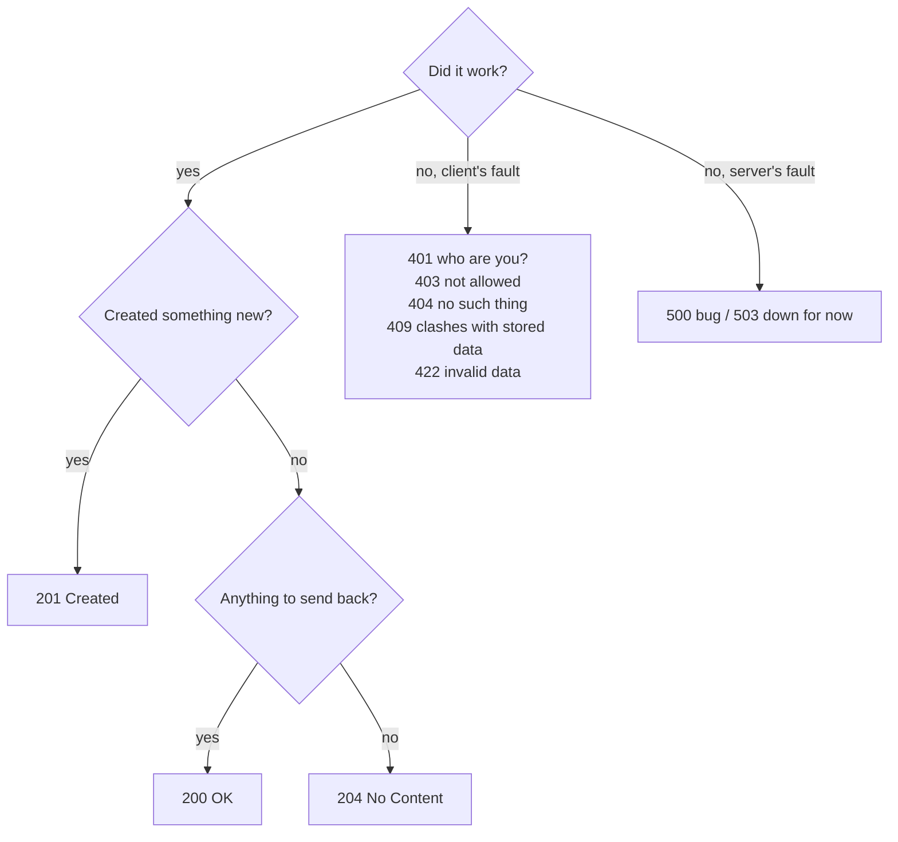

:::objectives
- Name endpoints after resources (nouns) and let the HTTP method be the verb.
- Choose the right status code for success and for each kind of failure.
- Write a JSON contract: field names, types, and what `null` and missing mean.
- Use one error shape across every endpoint.
- Explain limit/offset pagination and which changes force a new API version.
:::

A student team built a task app over a weekend. The phone app and the website both talk to its API, and both keep breaking. Here's what the API looks like from the outside:

```text
GET  /getTasks         200  [{"id": 1, "Title": "Read ch. 4", "done": "no"}]
POST /task_create      200  {"ok": true, "task": {"id": 2, "title": "Lab report"}}
GET  /task?id=99       200  {"error": "no such task"}
POST /deleteTask?id=3  200  deleted
```

Each route works, more or less. But a client has to memorize four naming styles, two spellings of `title`, a boolean spelled `"no"`, two different wrappers, an error that claims success, and one response that isn't JSON at all. Every one of those quirks has to be special-cased in every client, forever.

An API's **contract** is the set of promises it makes: these URLs, these methods, these status codes, these JSON shapes. REST is a widely used style for writing that contract so that clients can guess correctly. By the end of this lesson, the same API looks like this:

```text
GET    /tasks         200  [Task, ...]
POST   /tasks         201  Task
GET    /tasks/{id}    200  Task      or  404 {"detail": "Task 99 not found"}
PATCH  /tasks/{id}    200  Task      or  404, 422
DELETE /tasks/{id}    204  no body   or  404
```

## Name things, and let the method be the verb

The core move of REST is to treat your data as **resources** with addresses. Tasks are a resource. `/tasks` is the **collection** of all tasks and `/tasks/7` is one **item**. The HTTP method then says what to do with it, so the path never needs a verb:

| Instead of | Write | Why |
| ---------- | ----- | --- |
| `GET /getTasks` | `GET /tasks` | GET already means "get". |
| `POST /task_create` | `POST /tasks` | POST to a collection means "add one". |
| `GET /task?id=99` | `GET /tasks/99` | An item's id belongs in the path. |
| `POST /deleteTask?id=3` | `DELETE /tasks/3` | DELETE is idempotent; a POST would look unsafe to retry. |
| `GET /tasks/byProject/7` | `GET /projects/7/tasks` | Tasks that belong to project 7 live under it. |

A few conventions go with it: plural nouns for collections, lowercase paths with hyphens between words (`/study-groups`), and the query string for optional things like filters and sorting (`/tasks?done=false&sort=due`). The path says **which** resource; the query says **how** you want it.

A few actions don't fit, like "email a reminder now." Model them as a small resource you create, such as `POST /tasks/7/reminders`, and use that trick sparingly.

## Choose status codes on purpose

The status code is the one part of a response every client reads, so it must be right. This chart covers most decisions you'll make:



The rule the task app broke: **never send 200 with an error inside**. Monitoring tools, browsers, `fetch()`, and every HTTP library treat 2xx as success. A `200 {"error": "no such task"}` gets cached, counted as a success, and passed on to code that expects a task.

`409 Conflict` means the data is fine on its own but clashes with what's stored, like a username that's taken. `422` means the data itself breaks a rule, like an empty title.

## A JSON contract is a promise about shapes

The contract for a task is short:

| Field | Type | Rule |
| ----- | ---- | ---- |
| `id` | integer | Set by the server. Never changes. |
| `title` | string | 1 to 100 characters. |
| `done` | boolean | `true` or `false`, never `"no"`. |
| `due` | string or `null` | A date like `"2026-11-20"`, or `null` for no due date. |

Every endpoint that returns a task returns this shape. Names use one case (this course uses `snake_case`), dates use ISO 8601 (`YYYY-MM-DD`) so they sort correctly as text, and `null` means only "this field exists and has no value."

A contract is only real if something checks it. Here's a tiny checker run against the old API's response and a correct one:

```python run title="http-practice/check_task.py"
CONTRACT = {"id": int, "title": str, "done": bool, "due": (str, type(None))}


def problems(task):
    found = []
    for field, expected in CONTRACT.items():
        if field not in task:
            found.append(f"missing {field!r}")
        elif not isinstance(task[field], expected):
            found.append(f"{field!r} is {type(task[field]).__name__}")
    extra = set(task) - set(CONTRACT)
    if extra:
        found.append(f"unexpected {sorted(extra)}")
    return found or ["OK"]


old = {"id": 1, "Title": "Read ch. 4", "done": "no"}
new = {"id": 1, "title": "Read ch. 4", "done": False, "due": None}
print("old:", problems(old))
print("new:", problems(new))
```

The old response fails four ways from one object. In Module 4 you'll get this checking for free: a Pydantic model is a contract written in Python, and FastAPI enforces it on every request and response.

## One error shape, everywhere

Clients need to show errors to people, and they can only do that if errors always look the same. This course uses FastAPI's default shape, because your server will produce it automatically:

```json
{"detail": "Task 99 not found"}
```

When the problem is invalid data, `detail` is a list naming each bad field, with `loc` giving its location (trimmed here to the three most useful keys):

```json
{"detail": [{"type": "string_too_short", "loc": ["body", "title"], "msg": "String should have at least 1 character"}]}
```

There's also a standard, RFC 9457 "Problem Details", with fields like `type`, `title`, and `detail`. Either choice is fine. Mixing them is not: a client written for `{"detail": ...}` shows "undefined" when one endpoint answers `{"error": ...}`.

## Big lists come in pages

`GET /tasks` might match 50,000 rows. Sending them all is slow for the server, slow over the network, and useless to a person looking at a screen of ten. So list endpoints return **pages**, controlled by two query parameters: `limit` (how many) and `offset` (how many to skip). The server should also cap `limit`, say at 100, so nobody can ask for a million.

Some APIs return a bare list and put the next page's URL in a header, as GitHub does. Others wrap it in an **envelope** like `{"items": [...], "total": 57, "limit": 20, "offset": 40}`. Either way, the client loops until it runs out. Step through one that collects seven tasks, three per page:

:::trace Collect every page
```python
tasks = ["t1", "t2", "t3", "t4", "t5", "t6", "t7"]


def get_page(limit, offset):
    return tasks[offset:offset + limit]


collected = []
offset = 0
while True:
    page = get_page(limit=3, offset=offset)
    collected += page
    if len(page) < 3:
        break
    offset += 3
print(collected)
```
:::

Watch `offset` go 0, 3, 6; the loop stops when a page comes back short. With exactly six tasks, the client would make one extra request that returns `[]`, which is harmless.

## Plan for change: what breaks clients

You can't update a phone app on thousands of devices whenever you like, so some API changes are safe and some break every old client:

| Change | Safe? |
| ------ | ----- |
| Add a new endpoint | Safe |
| Add a new field to a response | Safe, if clients ignore fields they don't know |
| Add an optional request field with a default | Safe |
| Rename or remove a response field | **Breaks** clients reading it |
| Change a field's type (`"8"` to `8`) | **Breaks** |
| Make an optional request field required | **Breaks** clients that don't send it |

Breaking changes go into a new **version** while the old one keeps running for a while. The simplest scheme puts it in the path, `/v1/tasks` and `/v2/tasks`. GitHub uses a header instead: remember `x-github-api-version-selected: 2022-11-28` in the octocat response? That told you which version of the contract answered.

:::warning Verbs in paths multiply forever
`/getTasks`, `/getTask`, `/getTasksForProject`, `/getDoneTasks`: every new question becomes a new endpoint. With resources, they're all `GET /tasks` or `GET /tasks/7` plus a query string like `?project=7&done=true`.
:::

:::warning Renaming a field "to be consistent"
Changing `Title` to `title` is the right fix for the task app, and it's also a breaking change. Ship it as `/v2`, or return both fields for a while and tell clients when the old one goes away.
:::

## Hear it from another angle

:::video lsMQRaeKNDk
IBM Technology explains REST on a lightboard in about nine minutes. Listen for how it connects HTTP methods to creating, reading, updating, and deleting data, and compare that with the method table in Module 2.
:::

:::quiz
Q: A user marks task 7 as done. Which request fits REST best?
- [ ] `POST /markTaskDone?id=7`
  A verb in the path, and POST suggests creating something.
- [x] `PATCH /tasks/7` with body `{"done": true}`
  Task 7 is the resource, PATCH changes part of it, and the body says which part.
- [ ] `GET /tasks/7?done=true`
  GET must not change anything. Browsers and caches may send GETs on their own.

Q: `POST /tasks` creates task 8 and returns it. What status should it send?
- [ ] `200 OK`
  It worked, but 200 hides the most useful fact: something new now exists.
- [x] `201 Created`
  201 says a new resource was made, and the body holds it.
- [ ] `204 No Content`
  204 means there's no body, but this response returns the new task.

Q: `GET /tasks/99` and task 99 doesn't exist. Which response is right?
- [ ] `200 {"error": "no such task"}`
  Every tool will count this as a success. That's the task app's bug.
- [x] `404 {"detail": "Task 99 not found"}`
  The status tells machines what happened, and `detail` in the usual shape tells people.
- [ ] `500 Internal Server Error`
  Nothing crashed. The client asked for something that isn't there.

Q: You change `due` from `"2026-11-20"` to a number of days, like `5`. Is that safe for existing clients?
- [x] No, changing a field's type breaks clients that parse it as a date
  Same name, different meaning and type. That needs a new version.
- [ ] Yes, because the field name didn't change
  Clients depend on the type and meaning too, not just the name.
:::

:::takeaways
- Paths name resources (`/tasks`, `/tasks/7`). Methods are the verbs. Queries hold options.
- 201 for created, 204 for no body, 4xx when the client must change something, 5xx only for server failures. Never 200 with an error inside.
- A JSON contract fixes names, types, and the meaning of `null`, and the same shape appears everywhere.
- Use one error shape. This course uses `{"detail": ...}`.
- Page long lists with `limit` and `offset`, cap the limit, and version any change that breaks old clients.
:::

## Further reading

- [Microsoft REST API Guidelines](https://github.com/microsoft/api-guidelines): the rules Microsoft's own teams follow, with reasoning for each.
- [RFC 9457: Problem Details for HTTP APIs](https://www.rfc-editor.org/rfc/rfc9457): the standard error format, short and readable for an RFC.
- [Stripe API: Errors](https://docs.stripe.com/api/errors): a widely admired API's error contract, with every field explained.
