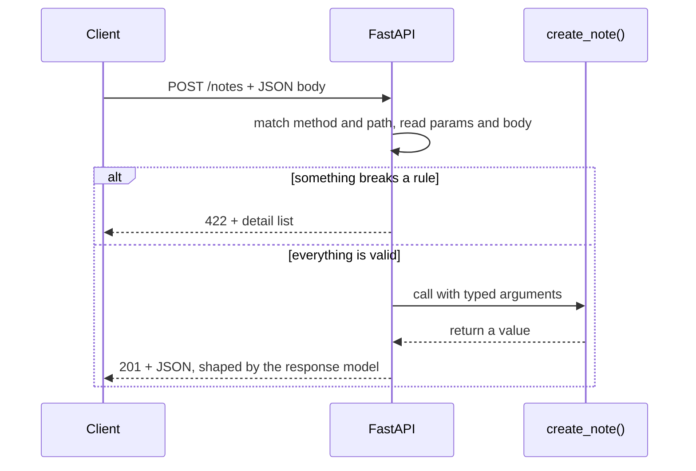

:::objectives
- Register routes with `@app.get`, `@app.post`, `@app.patch`, and `@app.delete`.
- Read path parameters and query parameters, and let type hints convert and check them.
- Accept a JSON request body with a Pydantic model and read FastAPI's 422 errors.
- Control what goes out with a response model and `status_code`.
- Send a 404 with `HTTPException`, and avoid the route-order trap.
:::

In the last module, your mock needed six lines to reject `/notes/abc`. Here's the FastAPI version. The only check is a type hint:

```python run title="routes_demo.py"
from fastapi import FastAPI
from fastapi.testclient import TestClient

app = FastAPI()


@app.get("/notes/{note_id}")
def get_note(note_id: int):
    return {"id": note_id, "type": type(note_id).__name__}


client = TestClient(app)
print(client.get("/notes/7").json())
response = client.get("/notes/abc")
print(response.status_code, response.json())
```

`note_id: int` did two jobs. For `/notes/7`, FastAPI converted the text `"7"` from the URL into the integer `7` before calling your function. For `/notes/abc`, it never called your function at all: it answered `422` with `loc: ["path", "note_id"]`, the same shape your contract promised. That's the idea behind FastAPI: **you describe what the input should look like with types, and it does the checking**.

Every cell on this page shares one Python session, so later cells reuse `client` and the imports.

## What happens between the request and your function



A **route** is three things: a method, a path, and a function. `@app.get("/notes/{note_id}")` adds one to the app's list. You can look at that list yourself:

```python run title="routes_demo.py (route list)"
for route in app.routes:
    if not route.path.startswith(("/docs", "/redoc", "/openapi")):
        print(sorted(route.methods), route.path, "->", route.name)
```

When a request arrives, FastAPI walks that list **in order** and uses the first route whose method and path match. If the path matches but no method does, that's a `405`; if no path matches, a `404`.

## Path parameters, and the route-order trap

A path parameter is a `{name}` slot in the path that becomes a function argument of the same name. Its type hint decides how it's converted. Without a hint, it stays a string.

The first-match rule causes a classic bug. Suppose you add a "latest note" route **after** the item route:

```python run title="order_bug.py"
app = FastAPI()


@app.get("/notes/{note_id}")
def get_note(note_id: int):
    return {"id": note_id}


@app.get("/notes/latest")
def latest_note():
    return {"id": 3, "title": "Call Sam"}


client = TestClient(app)
response = client.get("/notes/latest")
print(response.status_code, response.json()["detail"][0]["msg"])
```

`/notes/latest` matched `/notes/{note_id}` first, with `note_id = "latest"`, and that failed the `int` check. The `latest_note` function never ran. Step through a stripped-down router to see the first-match rule happen:

:::trace First matching route wins
```python
routes = ["/notes/{note_id}", "/notes/latest"]


def match(pattern, path):
    want, got = pattern.split("/"), path.split("/")
    if len(want) != len(got):
        return None
    params = {}
    for w, g in zip(want, got):
        if w.startswith("{"):
            params[w[1:-1]] = g
        elif w != g:
            return None
    return params


for pattern in routes:
    params = match(pattern, "/notes/latest")
    if params is not None:
        print("matched", pattern, params)
        break
```
:::

The fix is to declare fixed paths **before** paths with parameters: put `/notes/latest` above `/notes/{note_id}` in the file.

## Query parameters: every other argument

Any function argument that isn't in the path and isn't a Pydantic model is read from the **query string**. Give it a default and it's optional; leave the default off and it's required. Extra rules, like a range, go in `Query(...)`, wrapped in `Annotated`:

```python run title="query_demo.py"
from typing import Annotated

from fastapi import Query

app = FastAPI()
TITLES = ["Buy milk", "Milk the cow", "Essay outline", "Call Sam"]


@app.get("/notes")
def list_notes(
    q: str = "",
    limit: Annotated[int, Query(ge=1, le=100)] = 2,
    offset: Annotated[int, Query(ge=0)] = 0,
):
    matches = [t for t in TITLES if q.lower() in t.lower()]
    return matches[offset : offset + limit]


client = TestClient(app)
for url in ["/notes", "/notes?q=MILK", "/notes?q=milk&limit=1&offset=1", "/notes?limit=500", "/notes?limit=two"]:
    response = client.get(url)
    body = response.json()
    print(f"{url:32} {response.status_code}", body if response.status_code == 200 else body["detail"][0]["msg"])
```

`ge=1, le=100` means "greater than or equal to 1, less than or equal to 100". Compare this with `read_int` in your mock: the conversion from text, the range check, and the 422 with a precise message all came from one line of type information. The defaults also show up on the `/docs` page, so clients can see them.

## Request bodies: a Pydantic model

For POST, PUT, and PATCH, the data travels as JSON in the body. Describe its shape with a **Pydantic model**, a class that lists fields with types and rules, and use it as a parameter type. FastAPI reads the body, parses the JSON, and validates it against the model:

```python run title="body_demo.py"
from fastapi import status
from pydantic import BaseModel, Field


class NoteIn(BaseModel):
    title: str = Field(min_length=1, max_length=100)
    body: str = Field(default="", max_length=2000)


app = FastAPI()


@app.post("/notes", status_code=status.HTTP_201_CREATED)
def create_note(note: NoteIn):
    print("  function got:", repr(note))
    return {"id": 1, **note.model_dump()}


client = TestClient(app)
for payload in [{"title": "Buy milk"}, {"body": "no title"}, {"title": ""}, {"title": "Hi", "admin": True}]:
    response = client.post("/notes", json=payload)
    print(response.status_code, response.json())
```

Read the output slowly. The first request reached your function (the `function got:` line) as a real `NoteIn` object with `body` filled in from its default. The next two never reached it: `422`, with `loc` naming the field and `msg` saying what's wrong. The last one shows that unknown fields like `admin` are **dropped** silently; Module 6 shows how to reject them instead.

`status_code=status.HTTP_201_CREATED` sets the success code. `status.HTTP_201_CREATED` is just the number 201 with a readable name, and without it every route answers `200`. `note.model_dump()` turns the model back into a plain dict.

## Response models: control what goes out

The return type tells FastAPI what the response must look like. It validates your return value against it and **drops any fields the model doesn't list**. That protects you from leaking something by accident:

```python run title="response_demo.py"
class Note(BaseModel):
    id: int
    title: str
    body: str


app = FastAPI()
STORED = {"id": 1, "title": "Buy milk", "body": "", "owner_email": "ana@example.com"}


@app.get("/notes/1")
def get_first_note() -> Note:
    return STORED


client = TestClient(app)
print(client.get("/notes/1").json())
```

The stored record has an `owner_email`, the function returned all of it, and the client got only the three fields `Note` declares. You can write `response_model=Note` in the decorator instead of `-> Note`; they do the same thing. A return type of `-> list[Note]` describes a list of them.

## Sending errors with HTTPException

For a missing note, raise `HTTPException` with a status and a `detail`. FastAPI stops the function and sends `{"detail": ...}`:

```python run title="error_demo.py"
from fastapi import HTTPException

app = FastAPI()
NOTES = {1: {"id": 1, "title": "Buy milk", "body": ""}}


@app.get("/notes/{note_id}")
def get_note(note_id: int) -> Note:
    if note_id not in NOTES:
        raise HTTPException(status.HTTP_404_NOT_FOUND, f"Note {note_id} not found")
    return NOTES[note_id]


client = TestClient(app)
for url in ["/notes/1", "/notes/99"]:
    response = client.get(url)
    print(response.status_code, response.json())
```

`raise`, not `return`. Returning an `HTTPException` would try to send the exception object itself as a response.

:::warning A missing type hint makes every lookup fail
Write `def get_note(note_id):` without `: int`, and `note_id` arrives as the string `"1"`. The dict's keys are integers, so `"1" not in NOTES` is true and **every** note returns 404, including ones that exist. The fix is the type hint, which converts the text before your code runs.
:::

:::warning curl `-d` without a Content-Type header
`curl -X POST http://127.0.0.1:8000/notes -d '{"title": "Hi"}'` sends the body labeled as form data, not JSON. FastAPI answers `422` with `loc: ["body"]` and "Input should be a valid dictionary or object". Add `-H "Content-Type: application/json"`. TestClient's `json=` sets that header for you.
:::

## Watch the same ideas in a bigger app

:::video WRjXIA5pMtk
Corey Schafer adds path parameters to a FastAPI app, lets type hints validate them, and raises `HTTPException` for missing posts. He also builds HTML pages along the way; you can skim those parts. Watch for what happens when he requests an id that isn't a number.
:::

:::quiz
Q: With `def get_note(note_id: int)`, what does `GET /notes/007` return?
- [x] `{"id": 7}`
  FastAPI converts `"007"` to the integer 7 before calling your function.
- [ ] `{"id": "007"}`
  That's what you'd get with no type hint. The hint makes it an integer.
- [ ] `422`
  `"007"` is a valid integer, so it passes. `"abc"` or `"1.5"` would fail.

Q: `/notes/{note_id}` is declared above `/notes/latest`. A client requests `/notes/latest`. What happens?
- [ ] `latest_note()` runs, because it's an exact match
  FastAPI doesn't prefer exact matches. It uses the first route in the list that fits.
- [x] `get_note()` is chosen with `note_id = "latest"`, which fails the int check, so the client gets 422
  First match wins. Declare `/notes/latest` first to fix it.
- [ ] Both run
  Exactly one route handles each request.

Q: A route returns `{"id": 1, "title": "Hi", "body": "", "password": "x"}` and its return type is `-> Note` (fields `id`, `title`, `body`). What does the client get?
- [ ] All four fields
  The response model filters the output.
- [x] `id`, `title`, and `body` only
  Fields the response model doesn't declare are dropped before the JSON is sent.
- [ ] A 500 error because of the extra field
  Extra fields in the return value are dropped, not treated as errors.

Q: Your `POST /notes` route works, but clients see `200` instead of `201`. What's missing?
- [ ] `return 201`
  That would send the number 201 as the body.
- [x] `status_code=status.HTTP_201_CREATED` in the decorator
  The default success code is 200. The decorator sets a different one.
:::

:::takeaways
- A route is a method, a path, and a function. FastAPI uses the first route that matches, so declare fixed paths before `{param}` paths.
- Path and query parameters are converted and checked by their type hints. `Annotated[int, Query(ge=1, le=100)]` adds a range.
- A Pydantic model as a parameter means "read this from the JSON body". Bad data gets a 422 before your function runs.
- The return type (or `response_model`) filters and checks what goes out. `status_code=` sets the success code.
- `raise HTTPException(404, "...")` sends `{"detail": "..."}`.
:::

## Further reading

- [FastAPI: Path Parameters](https://fastapi.tiangolo.com/tutorial/path-params/): type conversion, the order trap, and predefined values with enums.
- [FastAPI: Request Body](https://fastapi.tiangolo.com/tutorial/body/): how FastAPI decides whether a parameter comes from the path, the query, or the body.
- [FastAPI: Response Model](https://fastapi.tiangolo.com/tutorial/response-model/): filtering output, and separate input and output models.
