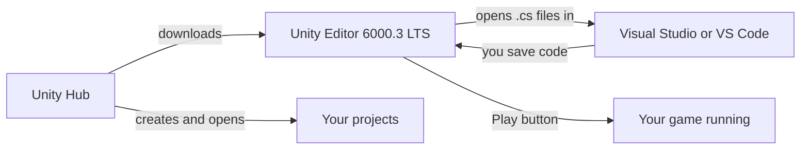

:::objectives
- Check that your computer can run the Unity 6 Editor.
- Install Unity Hub, activate a free Unity Personal license, and install Unity 6.3 LTS.
- Install a C# editor and tell Unity to use it.
- Recognize and fix the install problems beginners hit most often.
:::

Hollow Knight, Cuphead, and Among Us were all made in Unity. The Editor their teams used is the same one you are about to install, and for students it costs nothing.

Unity arrives in two pieces. **Unity Hub** is a small launcher that downloads Editors, opens projects, and holds your license. The **Unity Editor** is the multi-gigabyte program where you build games. You install the Hub once; the Hub then installs Editor versions side by side. That matters because every Unity project is tied to one Editor version, and opening it in a different one can trigger an upgrade you didn't plan for.

This course uses **Unity 6.3 LTS** (version numbers that start with `6000.3`). LTS means Long Term Support: Unity fixes bugs in it for two years without changing how things work. If the Hub offers a newer Unity 6 LTS by the time you read this, that's fine too. Every script in the course uses APIs that exist across Unity 6.

## Can your computer run it?

| | Windows | macOS | Linux |
| --- | --- | --- | --- |
| System | Windows 10 (21H1 or newer, 64-bit) or Windows 11 | macOS 13 Ventura or newer | Ubuntu 22.04 or 24.04 |
| Processor | 64-bit Intel or AMD, or Arm64 on Windows 11 | Apple silicon (M1 or newer) or Intel | 64-bit Intel or AMD |
| Graphics | DirectX 11/12 or Vulkan capable | Metal capable (every Mac that runs Ventura) | OpenGL 3.2+ or Vulkan, with NVIDIA or AMD drivers |

Unity recommends at least **8 GB of RAM**. Plan for roughly **15 GB of free disk space**: the Editor itself takes several gigabytes, and each project grows a `Library` folder of cache files that can pass a gigabyte.

:::warning Chromebooks can't run the Editor
Unity supports the Editor only on real Windows, macOS, and Ubuntu machines, not inside an emulator or container, and ChromeOS's Linux environment is a container. If a Chromebook is your only computer, ask your school or public library for time on a Windows PC or Mac. You can still read every lesson and write the C# files; you just can't press Play until you're on a supported machine.
:::

## The free license, and who can sign up

**Unity Personal** is the free plan. It's for individuals and small groups with less than $200,000 USD of revenue and funding in the last 12 months, which covers every student project. You need a free Unity account to use it.

Unity's terms say you must be old enough to consent to the use of your personal data where you live: 13 in the US, 16 in much of the EU. If you're younger than that, a parent, guardian, or teacher should create the account and sign in for you.

## Step 1: Install Unity Hub

:::tabs
@tab Windows
1. Go to **unity.com/download**. The site asks you to sign in or create a free Unity account before it shows the download links.
2. Download the Windows version of Unity Hub and open the file.
3. Follow the setup window. Recent versions of the Hub (4.0 and later) install as a Windows app package, so there's no folder to choose.
4. Open **Unity Hub** from the Start menu. If Windows Firewall asks whether the Hub can use the network, allow it; the Hub needs the internet to download Editors.
@tab macOS
1. Go to **unity.com/download**. The site asks you to sign in or create a free Unity account before it shows the download links.
2. Download the macOS version of Unity Hub.
3. Open the downloaded `.dmg` file and drag **Unity Hub** into **Applications**.
4. Open Unity Hub from Applications. If macOS offers to install **Rosetta**, accept: Unity lists Rosetta 2 as a requirement on Apple silicon Macs.
@tab Linux (Ubuntu)
Unity publishes the Hub as an apt package. Open a terminal and run these commands one block at a time (they're copied from Unity's install page):

```bash
sudo apt install curl
sudo install -d /etc/apt/keyrings
curl -fsSL https://hub.unity3d.com/linux/keys/public | sudo gpg --dearmor -o /etc/apt/keyrings/unityhub.gpg
```

```bash
sudo tee /etc/apt/sources.list.d/unityhub.sources > /dev/null << EOF
Types: deb
URIs: https://hub.unity3d.com/linux/repos/deb
Suites: stable
Components: main
Signed-By: /etc/apt/keyrings/unityhub.gpg
EOF
```

```bash
sudo apt update
sudo apt install unityhub
```

Then open **Unity Hub** from your applications menu.
:::

## Step 2: Sign in and activate Unity Personal

Open the Hub and sign in with your Unity account (or choose **Create account**). For Unity Personal, signing in normally activates the license by itself.

To check, click the **Settings** (gear) icon and open **Licenses**. If no license is listed:

1. Click **Add license**.
2. Choose **Get a free personal license**.
3. Read the terms and click **Agree and get personal edition license**.

## Step 3: Install the Unity 6.3 LTS Editor

1. In the Hub's left sidebar, click **Installs**.
2. Click **Install Editor** (top right). The **Official releases** tab lists the LTS versions.
3. Find the newest version that starts with **6000.3** and click **Install**.
4. A list of optional modules appears. Tick only what you need:
    -   **Microsoft Visual Studio Community** (Windows only): tick it if you want Visual Studio as your code editor. Skip it if you'll use VS Code.
    -   **Web Build Support**: optional. It lets you export a version of your game that runs in a browser, which is handy for sharing it later.
    -   **Documentation**: optional. It installs the manual for offline reading.
5. Click **Install** and watch progress in the Hub's **Downloads** panel. Expect 10 to 40 minutes, depending on your connection.

You can add modules later: **Installs**, then **Manage** next to the version, then **Manage modules**.



## Step 4: Pick a C# editor and connect it

Unity scripts are C# files. You write them in a separate code editor, and Unity compiles them when you switch back to it. Either option below is free.

:::tabs
@tab Windows
-   **Visual Studio Community** is the smoothest choice. If you ticked its module in Step 3, the Hub installed it for you. Either way, open the **Visual Studio Installer**, choose **Modify**, and make sure the **Game development with Unity** workload is ticked.
-   **VS Code** also works. Install it from code.visualstudio.com, open the Extensions view, and install **Unity** (published by Microsoft). It installs the C# extensions it needs on its own.
@tab macOS
-   Use **VS Code**. Microsoft retired Visual Studio for Mac in 2024, so it's no longer an option.
-   Install VS Code from code.visualstudio.com, open the Extensions view (**⌘⇧X**), and install **Unity** by Microsoft. It brings the C# Dev Kit with it.
@tab Linux (Ubuntu)
-   Use **VS Code**. Install the `.deb` package from code.visualstudio.com, then install the **Unity** extension by Microsoft from the Extensions view.
:::

You'll point Unity at your editor in the next lesson, once a project is open: **Edit > Preferences > External Tools** (on macOS, **Unity > Settings > External Tools**), then set **External Script Editor**.

## What success looks like

The Hub's **Installs** page shows a version starting with `6000.3`, tagged **LTS**, with no warning icon. Under **Settings > Licenses** you see an active Unity Personal license. That's everything; the next lesson creates a project and runs your first script.

## Fixes for the problems people actually hit

-   **The download stalls or ends with "Validation failed."** Usually it's a full disk or an interrupted connection. Free up space, pause antivirus scanning for the download folder if you're allowed to, and click **Install** again; the Hub resumes from what it already has.
-   **"No valid Unity Editor license found."** The Hub signed you in but didn't activate Personal. Use **Settings > Licenses > Add license > Get a free personal license**. If it still fails, sign out of the Hub, sign back in, and try again.
-   **School or work computer refuses to install.** Installing an Editor may need administrator rights. Ask whoever manages the computer, or check the Hub's **Settings** for the Editor install location and choose a folder inside your own user account.
-   **Linux: `apt` can't find `unityhub`.** One of the first two command blocks failed silently. Check that `/etc/apt/keyrings/unityhub.gpg` exists and that `/etc/apt/sources.list.d/unityhub.sources` contains the five lines above, then run `sudo apt update` again.

:::video j3wlBRrzlkM
A short walkthrough of installing Unity Hub and a Unity 6 Editor. Watch for the **Install Editor** button and the module checklist; your Hub may look slightly newer, and you should pick the 6000.3 LTS version rather than the one shown in the video.
:::

:::quiz
Q: Your friend's project was made in Unity 6000.3. You have 6000.0 installed. What's the safest move?
- [ ] Open it in 6000.0 anyway
  Opening a project in an older Editor than the one that made it can fail or break assets.
- [x] Install 6000.3 through the Hub and open the project with it
  The Hub keeps Editor versions side by side, so matching the project's version avoids surprise upgrades or downgrades.
- [ ] Uninstall the Hub and reinstall everything
  The Hub isn't the problem; it can hold several Editors at once.

Q: You're on a Mac and want a code editor for Unity scripts. Which fits?
- [ ] Visual Studio for Mac
  Microsoft retired it in 2024.
- [x] VS Code with Microsoft's Unity extension
  It's free, supported on macOS, and the extension adds Unity-aware autocomplete and debugging.
- [ ] Any text editor; Unity doesn't care
  Unity will compile the file, but without the C# tooling you lose error highlighting and autocomplete for Unity's APIs.

Q: Which part of the install needs the most disk space over time?
- [ ] Unity Hub
  The Hub is small; it's a launcher.
- [ ] Your C# scripts
  Script files are tiny text files.
- [x] The Editor plus each project's `Library` cache
  The Editor takes several gigabytes, and every project rebuilds a large `Library` folder of cached assets.
:::

:::takeaways
- Unity Hub installs and launches Editors; the Editor is where you build. Each project belongs to one Editor version.
- This course uses Unity 6.3 LTS (6000.3) with a free Unity Personal license.
- Windows users can use Visual Studio Community or VS Code; macOS and Linux users should use VS Code with the Unity extension.
- Chromebooks can't run the Editor, so plan for access to a Windows, Mac, or Ubuntu computer.
:::

## Further reading

-   [Install the Unity Hub](https://docs.unity.com/en-us/hub/install-hub): Unity's own steps for each operating system, kept up to date as the Hub changes.
-   [Unity 6.3 system requirements](https://docs.unity3d.com/6000.3/Documentation/Manual/system-requirements.html): the full hardware and OS list, including graphics driver notes for Linux.
-   [Unity development with VS Code](https://code.visualstudio.com/docs/other/unity): how the Unity extension works and how to debug a running game from VS Code.
