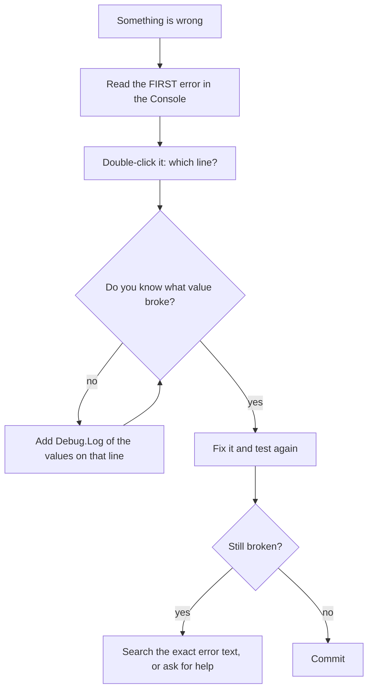

:::objectives
- Tell the difference between saving a scene, saving a script, and changes that vanish when Play mode ends.
- Organize `Assets` so files are easy to find, and move them without breaking references.
- Back up a project with Git and a Unity `.gitignore`, or with a zip that skips the cache.
- Read Console errors, find the line that caused them, and use a repeatable routine to fix them.
- Set up the Editor so it's comfortable to use, and keep yourself and your players safe.
:::

You spend twenty minutes in Play mode tuning a jump until it feels perfect. You press Play to stop, and every number snaps back to the old values. Almost every Unity developer does this once. This lesson is about the habits that keep it from happening twice, plus the routine for when something breaks.

## Three kinds of "saved"

Unity has more than one thing to save, and each works differently.

-   **Scenes** are saved from Unity: **File > Save** (**Ctrl+S**, or **⌘S** on macOS). An asterisk after the scene name in the Hierarchy means it has unsaved changes.
-   **Scripts** are saved in your code editor. When you switch back to Unity, it notices the change and recompiles.
-   **Play mode changes** aren't saved anywhere. Unity restores the scene when you stop.

To keep a value you found during Play mode, right-click the component's title bar in the Inspector and copy the component. Stop playing, right-click the same title bar, and paste the component values. Every field you tuned comes back.

:::tip Make Play mode impossible to miss
Open **Edit > Preferences > Colors** (macOS: **Unity > Settings > Colors**) and set **Playmode tint** to a strong color. The whole Editor turns that color while the game runs, so you'll notice before you start a long edit.
:::

## What's inside a project folder

Open your project folder in File Explorer or Finder. Only some of it is yours.

| Folder | What it holds | Back it up? |
| --- | --- | --- |
| `Assets` | Your scenes, scripts, sprites, prefabs, sounds | Yes |
| `Packages` | The list of packages the project uses (`manifest.json`) | Yes |
| `ProjectSettings` | Input, physics, tags, layers, and player settings | Yes |
| `Library` | Unity's cache of imported assets | No, Unity rebuilds it |
| `Temp`, `Logs`, `UserSettings` | Scratch files and your personal Editor layout | No |

Deleting `Library` while Unity is closed is a safe fix when a project acts strangely after an update. The next launch takes longer while Unity rebuilds it.

Inside `Assets`, make a folder for each kind of thing. Right-click in the Project window and choose **Create > Folder**:

```text
Assets/
  Scenes/
  Scripts/
  Prefabs/
  Sprites/
  Audio/
```

:::warning Move files inside Unity, not in File Explorer or Finder
Every asset has a `.meta` file beside it that holds its unique ID. Scenes and prefabs refer to assets by that ID, not by name. If you move `Player.png` in Finder without its `.meta` file, Unity makes a new ID and every object that used the sprite shows **Missing**. Drag files between folders in Unity's Project window and the `.meta` files move with them.
:::

## Back up with Git (or a zip)

Git keeps a history of your project, so a bad change can be undone in seconds. New Unity 6 projects already use the two settings Git needs, visible `.meta` files and scenes saved as text, so there's nothing to change.

The key file is `.gitignore`, which tells Git to skip the cache. GitHub maintains a standard one for Unity. Here are its most important lines:

```text title=".gitignore (excerpt)"
/[Ll]ibrary/
/[Tt]emp/
/[Oo]bj/
/[Bb]uild/
/[Bb]uilds/
/[Ll]ogs/
/[Uu]ser[Ss]ettings/
*.csproj
*.sln
```

Save the full file from GitHub (link at the end of this lesson) as `.gitignore` in the project folder, next to `Assets`. Then, in a terminal opened in that folder:

```bash
git init
git add .
git commit -m "Empty Universal 2D project"
```

Commit whenever something works: "Player jumps", "Saws hurt the player". If you'd rather not use Git yet, close Unity and zip the project folder **without** `Library`, `Temp`, and `Logs`. The zip stays small and opens on any computer with the same Editor version.

## Reading the Console

The Console's toolbar has three counters (messages, warnings, errors) that double as filters. Two toggles help too: **Collapse** merges identical lines, and **Error Pause** pauses the game the moment an error is logged. Double-clicking any error opens your code editor at the line that caused it.

Errors come in two kinds:

-   **Compile errors** (codes like `CS0103`) mean the code isn't valid C#. Nothing runs until they're fixed.
-   **Runtime errors**, or exceptions, happen while the game plays. The game keeps running, but the script that failed stops for that frame.

Here's a runtime error you'll meet often. This script is meant to change a sprite's color:

```csharp title="Tint.cs"
using UnityEngine;

public class Tint : MonoBehaviour
{
    [SerializeField] private SpriteRenderer target;

    void Start()
    {
        target.color = Color.red;
    }
}
```

If you forget to drag a Sprite Renderer into the **Target** slot in the Inspector, pressing Play logs:

```text
UnassignedReferenceException: The variable target of Tint has not been assigned.
You probably need to assign the target variable of the Tint script in the inspector.
Tint.Start () (at Assets/Scripts/Tint.cs:9)
```

Read it bottom-up. The last line names the method, file, and line number (`Tint.cs:9`). The first line names the field that was empty. The fix is in the Inspector, not the code. Its cousin, `NullReferenceException: Object reference not set to an instance of an object`, means the same thing for a variable your code was supposed to fill, such as a `GetComponent` call that found nothing.

## A routine for getting unstuck



Fix the **first** error before any others. One missing semicolon can produce ten errors below it, and they all disappear together.

When you search or ask for help, give people what they need to answer: your Unity version (from the Hub), the exact error text, the script, and what you expected versus what happened. Good places to look are the Unity Manual and Scripting Reference (check the version picker says 6000.3) and the **Unity Discussions** forum.

:::video 5irv30-bTJw
Code Monkey's four-step process for tracking down a `NullReferenceException`. Watch how he uses `Debug.Log` to find which variable is null before changing any code; that habit fixes most runtime errors in this course.
:::

## Comfort, privacy, and safety

-   **Readable Editor.** **Preferences > General > Editor Theme** switches between Light and Dark. The Editor follows your operating system's display scaling, so raise that if the text is small. **Edit > Shortcuts** (macOS: **Unity > Shortcuts**) lets you rebind any key.
-   **Breaks.** Game development is a lot of screen time. Every 20 minutes, look at something about 20 feet away for 20 seconds.
-   **Privacy.** Your Unity account holds your email and name; don't put either in a game you share. Keep real names, school names, and photos of people out of projects you post publicly.
-   **Downloads.** Asset packs and scripts run with your computer's permissions inside the Editor. Get them from the Unity Asset Store or creators you trust.
-   **Players' safety.** Flashing effects can trigger seizures. Keep any flashing effect to three flashes or fewer in any one second, and avoid large, bright red flashes.

:::quiz
Q: Unity shows 14 errors after you edit one script. Where do you start?
- [x] The first error in the list
  Later errors are often side effects of the first one and vanish when it's fixed.
- [ ] The last error in the list
  The last one is usually a consequence, not the cause.
- [ ] Whichever is easiest
  Fixing an easy side effect wastes time if the real cause is still there.

Q: Which folder can you safely leave out of a backup?
- [ ] `Assets`
  That's your actual game.
- [ ] `ProjectSettings`
  It holds your layers, tags, physics, and input settings.
- [x] `Library`
  It's a cache that Unity rebuilds from `Assets` and `Packages`.

Q: You move a sprite to a new folder using Finder, and objects now show "Missing". Why?
- [ ] The sprite file was corrupted
  The file is fine; Unity just lost track of it.
- [x] Its `.meta` file, which holds the ID other assets refer to, didn't move with it
  Without the old `.meta`, Unity assigns a new ID and old references break. Move files inside the Project window.
- [ ] Sprites can't be moved after they're used
  They can, as long as you move them inside Unity.
:::

:::takeaways
- Save scenes with Ctrl+S or ⌘S; Play mode changes are temporary unless you copy them out.
- Back up `Assets`, `Packages`, and `ProjectSettings`; skip `Library`, `Temp`, and `Logs`.
- Move and rename assets in the Project window so `.meta` files stay attached.
- Fix the first Console error first, read stack traces for the file and line, and log values before guessing.
:::

## Further reading

-   [The Console window](https://docs.unity3d.com/6000.3/Documentation/Manual/Console.html): every Console filter and option, including stack trace settings.
-   [GitHub's Unity.gitignore](https://github.com/github/gitignore/blob/main/Unity.gitignore): the full ignore file to copy into your project.
-   [Unity Discussions](https://discussions.unity.com/): the official forum, where most error messages have already been asked about and answered.
