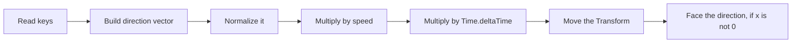

:::objectives
- Explain why movement must be scaled by `Time.deltaTime`, and predict what happens without it.
- Avoid the C# mistakes that come up in Unity scripts: float literals, integer division, and mixing `Vector2` with `Vector3`.
- Expose tunable values with `[SerializeField]`, and know why the Inspector value wins over the code.
- Read keys with `Keyboard.current`, build a movement vector, and normalize it.
- Flip a character to face its direction of travel.
:::

You test your game at home and the hero crosses the screen in four seconds. Your friend's gaming laptop runs it at 144 frames per second, and the hero crosses in under two. Same code, same level. The script says `transform.position += Vector3.right * 0.1f;` inside `Update`, which means "0.1 units per frame". More frames per second means more distance per second.

This module's job is movement that feels identical everywhere. It comes down to one idea and a handful of C# details.

## Movement is a rate, not a step

Think of a car's speedometer. "60 miles per hour" says how far you go *per unit of time*, and the distance after a trip is speed times time. Frames are just how often you check in.

In Unity, `Time.deltaTime` is the number of seconds since the previous frame: about 0.0167 at 60 FPS and about 0.0069 at 144 FPS. Multiply a speed in units per second by it and you get the distance for *this* frame:

```csharp
transform.position += Vector3.right * speed * Time.deltaTime;
```

At 60 FPS each frame moves less than it would at 30 FPS, but there are twice as many frames, so a second of play covers exactly `speed` units either way. Step through this model of both versions, written in Python so you can watch every frame. It moves "0.5 per frame" on one line and "speed × deltaTime" on the next, at 4 and 8 frames per second:

:::trace Watch the two versions drift apart
```python
speed = 5.0
for fps in [4, 8]:
    dt = 1 / fps
    per_frame_x = 0.0
    delta_x = 0.0
    for frame in range(fps):
        per_frame_x += 0.5
        delta_x += speed * dt
    print(fps, "fps after 1 second:", per_frame_x, "vs", delta_x)
```
:::

The per-frame version doubles its distance when the frame rate doubles. The `deltaTime` version lands on 5.0 both times. Real frame rates also wobble from frame to frame, which the per-frame version turns into visible stutter.

## C# details that trip people up in Unity

Unity's math uses `float`, not `double`, and C# is strict about that.

-   **Float literals need an `f`.** `float speed = 5.5;` fails with `error CS0664: Literal of type double cannot be implicitly converted to type 'float'; use an 'F' suffix to create a literal of this type`. Write `5.5f`. Whole numbers like `5` are fine without it.
-   **Integer division drops the fraction.** `float half = 1 / 2;` stores 0, because both sides are integers, so the division happens before the conversion. Write `1f / 2f`.
-   **`Vector2` and `Vector3` don't mix in arithmetic.** Each converts to the other automatically, so `transform.position + someVector2` is ambiguous and fails with `error CS0034: Operator '+' is ambiguous on operands of type 'Vector3' and 'Vector2'`. Cast one side explicitly: `transform.position + (Vector3)move`.
-   **Fields remember; locals forget.** A variable declared inside `Update` is created fresh every frame. Anything that must last between frames, like the current velocity or a cooldown timer, belongs in a field on the class.

## Tune it in the Inspector

Hard-coding `speed = 5f` means editing code and waiting for a recompile every time you want to try 6. Serialized fields put the value in the Inspector instead:

```csharp title="Mover.cs"
using UnityEngine;

public class Mover : MonoBehaviour
{
    [Header("Movement")]
    [Tooltip("Units per second")]
    [SerializeField, Range(0f, 20f)] private float speed = 5f;

    void Update()
    {
        transform.position += Vector3.right * speed * Time.deltaTime;
    }
}
```

`[SerializeField]` shows a `private` field in the Inspector and saves its value with the scene or prefab, while other scripts still can't change it. That's usually better than `public`, which also shows in the Inspector but lets any script anywhere write to it. `[Range]` turns the field into a slider, `[Header]` adds a bold label above it, and `[Tooltip]` shows a hint on hover.

:::warning You changed the default in code and nothing happened
Once a component exists, the Inspector stores its own copy of every serialized value. Changing `speed = 5f` to `speed = 8f` in the script affects only components added *after* the change. Existing ones keep 5. Change the value in the Inspector, or open the component's menu and choose **Reset** to reload the code defaults.
:::

## Direction times speed, and why diagonals need fixing

A `Vector2` is an arrow: an x part and a y part. For movement it helps to split it into a direction (which way) and a speed (how fast). Pressing right gives the direction (1, 0). Pressing up gives (0, 1). Pressing both gives (1, 1), which is longer:

```python run title="vector_lengths.py"
import math

def length(x, y):
    return math.sqrt(x * x + y * y)

for name, (x, y) in [("right", (1, 0)), ("up", (0, 1)), ("up-right", (1, 1))]:
    n = length(x, y)
    print(f"{name:8}  length {n:.3f}  normalized ({x / n:.3f}, {y / n:.3f})")
```

A length of 1.414 means a player holding two keys moves 41% faster than one holding a single key. **Normalizing** divides a vector by its own length, keeping the direction and setting the length to 1. In Unity that's `input.normalized`. Multiply the normalized direction by your speed and every direction moves at the same rate.

## Reading the keyboard with the Input System

This course reads devices directly. `Keyboard.current` is the keyboard in use (or `null` if there isn't one), and each key is a control with three questions you can ask:

| Property | True when | Use it for |
| --- | --- | --- |
| `isPressed` | Every frame the key is held | Walking, sprinting |
| `wasPressedThisFrame` | Only the frame it goes down | Jumping, dashing, menu selection |
| `wasReleasedThisFrame` | Only the frame it comes up | Cutting a jump short, releasing a charge |

Building a movement direction from WASD and the arrow keys looks like this:

```csharp title="MoveInput.cs (excerpt)"
using UnityEngine;
using UnityEngine.InputSystem;

// Inside a MonoBehaviour:
Vector2 ReadMoveInput()
{
    Keyboard keyboard = Keyboard.current;
    if (keyboard == null) return Vector2.zero;

    Vector2 input = Vector2.zero;
    if (keyboard.aKey.isPressed || keyboard.leftArrowKey.isPressed) input.x -= 1f;
    if (keyboard.dKey.isPressed || keyboard.rightArrowKey.isPressed) input.x += 1f;
    if (keyboard.sKey.isPressed || keyboard.downArrowKey.isPressed) input.y -= 1f;
    if (keyboard.wKey.isPressed || keyboard.upArrowKey.isPressed) input.y += 1f;
    return input;
}
```

Holding A and D together gives x = 0, so opposite keys cancel instead of one winning. The null check matters on machines without a keyboard; without it, the first line that touches `keyboard.aKey` would throw a `NullReferenceException`.

:::warning InvalidOperationException: You are trying to read Input using the UnityEngine.Input class
Many older tutorials use `Input.GetAxis("Horizontal")` or `Input.GetKey(KeyCode.Space)`. That's the old Input Manager. When **Active Input Handling** is set to **Input System Package (New)**, every one of those calls throws this exception. Translate them instead: `Input.GetKey(KeyCode.Space)` becomes `Keyboard.current.spaceKey.isPressed`, and `Input.GetKeyDown` becomes `wasPressedThisFrame`.
:::

## Facing the way you move

Most 2D characters are drawn facing right. To face left, mirror them. There are two ways, and they behave differently:

-   **`SpriteRenderer.flipX = true`** mirrors only that one sprite. Children (a sword, a hat, an eye) and colliders don't flip.
-   **Setting `transform.localScale.x` to a negative value** mirrors the object and everything under it.

Use `flipX` for a single sprite and the scale method when children must follow. Either way, only change facing when there's horizontal input. If you set facing from `input.x` every frame, releasing the keys gives 0 and the character snaps back to facing right.



:::video yGhfUcPjXuE
Jonas Tyroller, who made Thronefall and Will You Snail, explains what deltaTime really is and how to use it correctly. The first eight minutes cover exactly this lesson; the later sections on changing speeds and lerping are worth coming back to after the build-along.
:::

:::quiz
Q: A script does `transform.position += Vector3.right * 0.1f;` in `Update`. The game runs at 30 FPS on one laptop and 120 FPS on another. How far does the object move in one second on each?
- [ ] 0.1 units on both
  That's the distance per frame, not per second.
- [x] 3 units at 30 FPS and 12 units at 120 FPS
  It moves 0.1 every frame, so distance per second is 0.1 times the frame rate.
- [ ] 6 units on both
  It would only be the same on both if the step were multiplied by `Time.deltaTime`.

Q: A player holds W and D with this code: `transform.position += (Vector3)(input * speed * Time.deltaTime);`, and `speed` is 4. How fast do they move?
- [ ] 4 units per second
  That's true only if `input` is normalized first.
- [x] About 5.66 units per second
  `input` is (1, 1), whose length is 1.414, and 1.414 × 4 ≈ 5.66.
- [ ] 8 units per second
  The x and y parts aren't added; the speed is the length of the combined vector.

Q: Which key property should trigger a jump?
- [ ] `isPressed`
  It's true every frame the key is held, so holding Space would try to jump every frame.
- [x] `wasPressedThisFrame`
  It's true only on the frame the key goes down, so one press means one jump.
- [ ] `wasReleasedThisFrame`
  That fires when the key comes up, which would delay every jump.

Q: Your character has a child torch. When it faces left with `spriteRenderer.flipX = true`, the torch stays on the right side. Why?
- [x] `flipX` mirrors only that sprite, not its children
  Use a negative `localScale.x` on the parent so children mirror too.
- [ ] Children can't be flipped in 2D
  They can, by flipping the parent's scale.
- [ ] The torch needs its own `flipX`
  That would mirror the torch image in place, but it would still sit on the right.
:::

:::takeaways
- Write speeds in units per second and multiply by `Time.deltaTime` every frame.
- Use `f` on decimal literals, avoid integer division, and cast when mixing `Vector2` and `Vector3`.
- Prefer `[SerializeField] private` fields for tuning; the Inspector's saved value overrides the code default.
- Build input from `Keyboard.current`, normalize it so diagonals aren't faster, and only update facing when x isn't zero.
:::

## Further reading

-   [Time.deltaTime](https://docs.unity3d.com/6000.3/Documentation/ScriptReference/Time-deltaTime.html): the official reference, including what deltaTime returns inside `FixedUpdate`.
-   [SerializeField](https://docs.unity3d.com/6000.3/Documentation/ScriptReference/SerializeField.html): which field types Unity can save, and the rules for serialization.
-   [Input System: Keyboard support](https://docs.unity3d.com/Packages/com.unity.inputsystem@1.18/manual/Keyboard.html): every key control and how keyboard layouts affect key names.
