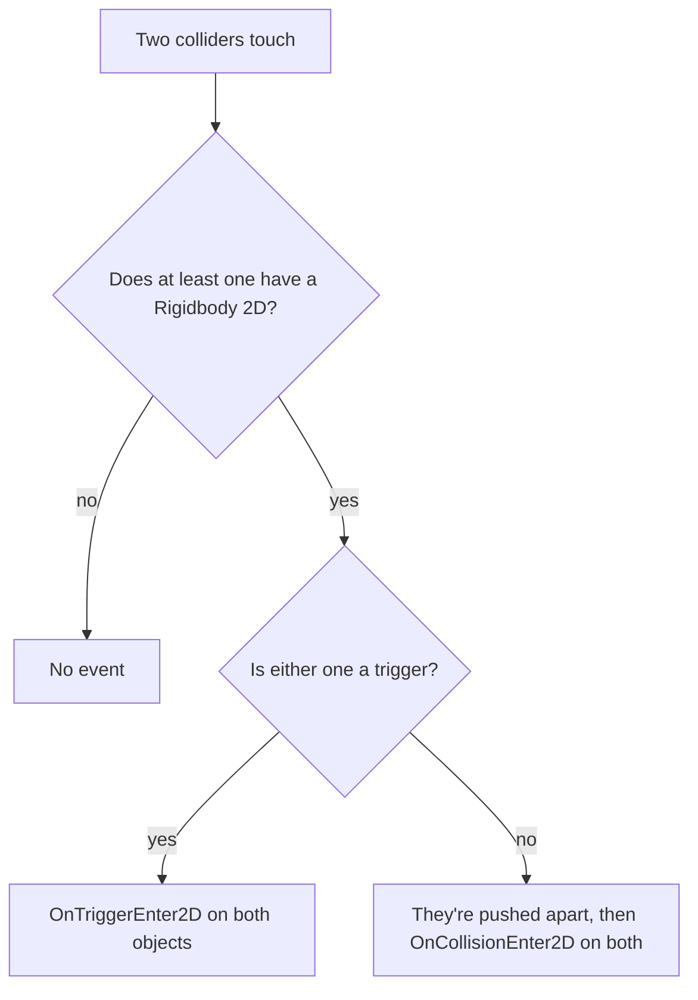

:::objectives
- Choose between Dynamic, Kinematic, and Static bodies, and move a Rigidbody 2D the right way.
- Explain the fixed physics clock, and split work between `Update` and `FixedUpdate`.
- Predict when `OnCollisionEnter2D` and `OnTriggerEnter2D` fire, and use the data they pass.
- Prevent tunneling with Continuous collision detection.
- Filter physics with layers, and set up a follow camera that doesn't make players queasy.
:::

Put a wall in the top-down scene from Module 3 and walk at it. The explorer slides straight through. Nothing is broken: the script sets `transform.position`, and a Transform is just three numbers. Nothing in that code ever asks "is something in the way?"

A platformer asks it constantly: fall, land, stop at walls, notice coins and saws. Unity's 2D physics engine answers it once you hand movement over to it.

## Who moves the object: the Transform or the Rigidbody

Add a **Rigidbody 2D** and the physics engine owns the object's position: each step it applies gravity and velocity, checks overlaps, and pushes things apart. The **Body Type** sets how much control physics has:

| Body Type | Moved by | Pushed by others? | Use it for |
| --- | --- | --- | --- |
| **Dynamic** | Gravity, forces, and velocity you set | Yes | The player, crates, falling rocks |
| **Kinematic** | Only your script (`linearVelocity` or `MovePosition`) | No | Moving platforms, scripted enemies |
| **Static** | Nothing; it doesn't move | No | Walls and ground |

An object with a collider and no Rigidbody 2D at all behaves like Static, which is how most level geometry works.

The rule that follows: **once an object has a Rigidbody 2D, move it through the Rigidbody** with `rb.linearVelocity`, `rb.AddForce`, or `rb.MovePosition`. Writing `transform.position` every frame teleports it behind the engine's back, causing jitter and sinking. (Older tutorials call `linearVelocity` by its pre-Unity 6 name, `velocity`.)

## Colliders give the engine a shape

A Rigidbody 2D says *how* something moves; a **collider** says *what shape* it is: **Box**, **Circle**, **Capsule**, or **Polygon Collider 2D**, sized to the sprite automatically. Objects interact only through colliders, so a Rigidbody 2D with no collider falls through everything.

Friction comes from a **Physics Material 2D** (**Assets > Create > 2D > Physics Material 2D**) in a collider's **Material** slot. A player with normal friction who holds right against a wall sticks to it in mid-air, because wall friction cancels gravity. **Friction** 0 on the player fixes it.

## Physics runs on its own clock

Frames come 30, 60, or 144 times a second, but physics steps every 0.02 seconds (**Edit > Project Settings > Time > Fixed Timestep**). Unity banks elapsed time and runs as many steps as fit, calling **FixedUpdate** before each. This model shows the result frame by frame:

```python run title="fixed_steps.py"
def fixed_steps_per_frame(fps, frames=10, fixed_step=0.02):
    banked = 0.0
    counts = []
    for _ in range(frames):
        banked += 1 / fps
        steps = 0
        while banked >= fixed_step:
            banked -= fixed_step
            steps += 1
        counts.append(steps)
    return counts

for fps in [30, 60, 144]:
    print(f"{fps:3} FPS -> FixedUpdate calls per frame: {fixed_steps_per_frame(fps)}")
```

At 144 FPS most frames run no physics step at all. At 30 FPS some frames run two. That's the reason for the usual split:

-   **Read input in `Update`.** `wasPressedThisFrame` is true for exactly one frame. If you check it in `FixedUpdate`, a frame with zero steps misses the press entirely, and a frame with two steps sees it twice.
-   **Change velocity and apply forces in `FixedUpdate`.** That keeps physics changes in step with the physics engine.

Stepping slower than the screen makes a body appear to move in small jumps. Setting the Rigidbody 2D's **Interpolate** to **Interpolate** draws it between physics positions, which removes the stutter.

## Tunneling: when fast objects skip walls

By default each step checks overlaps only *at* the new positions (**Discrete** detection), so something fast can be before a thin wall at one step and past it at the next:

```python run title="tunneling.py"
wall_left, wall_right, radius = 10.0, 10.5, 0.1

for speed in [15, 60]:
    x = 9.5
    hits = []
    for step in range(4):
        touching = wall_left - radius <= x <= wall_right + radius
        hits.append(f"x={x:5.2f} {'HIT' if touching else '-'}")
        x += speed * 0.02
    print(f"speed {speed:2}: " + " | ".join(hits))
```

At 60 units per second the bullet moves 1.2 units per step and hops a 0.5-unit wall. Setting the Rigidbody 2D's **Collision Detection** to **Continuous** sweeps the shape along its path between steps. It costs more, so save it for small, fast bodies like the player and bullets.

## Collisions versus triggers

Every collider has an **Is Trigger** checkbox:

-   **Off (solid):** objects can't overlap, and when two touch, both get **`OnCollisionEnter2D(Collision2D collision)`**. For ground, walls, and bouncing things.
-   **On (trigger):** objects pass through, and both get **`OnTriggerEnter2D(Collider2D other)`**. For coins, hazards, checkpoints, and zones.

In both cases, **at least one of the two objects needs a Rigidbody 2D**, or no event is sent. For two solid colliders, make that a Dynamic one: by default a Kinematic body doesn't generate collisions with Static colliders. There are matching `Stay` and `Exit` methods (`OnTriggerExit2D`, for example) for "still touching" and "stopped touching."

```csharp title="Coin.cs"
using UnityEngine;

public class Coin : MonoBehaviour
{
    void OnTriggerEnter2D(Collider2D other)
    {
        if (!other.CompareTag("Player")) return;

        Debug.Log("Coin collected");
        Destroy(gameObject);
    }
}
```

```csharp title="ImpactLogger.cs"
using UnityEngine;

public class ImpactLogger : MonoBehaviour
{
    void OnCollisionEnter2D(Collision2D collision)
    {
        float impact = collision.relativeVelocity.magnitude;
        Debug.Log($"Hit {collision.gameObject.name} at {impact:F1} units/s");
    }
}
```

A trigger event passes only the other collider, since nothing physical happened. A collision passes a `Collision2D` with details like `relativeVelocity`, how fast the two met, which a crate could use for a louder thud on harder landings. `CompareTag("Player")` checks the **Tag** set at the top of the Inspector.



## Layers decide who interacts with whom

Every GameObject has one **Layer** (the dropdown at the top right of the Inspector; **Add Layer...** makes new ones). Layers do two physics jobs:

-   The **Layer Collision Matrix** (**Edit > Project Settings > Physics 2D**, **Layer Collision Matrix** tab) says which layers can touch at all. Untick Enemy against Enemy and enemies pass through each other but still stand on the ground.
-   Physics queries take a **`LayerMask`**, a set of layers to look for. The build-along uses one to ask "is there *ground* under my feet?" without counting the player's own collider.

## Cameras that follow without making people sick

A 2D camera is **orthographic**, and its **Size** is half the view's height in world units. How a follow camera moves decides how the game feels, and for some players whether they feel sick. The trouble is motion the player didn't cause or can't predict: rigid locking to a jittery body, snapping on every turn, constant shake. Good follow cameras use three ideas:

-   **Damping**: the camera eases toward the player instead of matching it every frame.
-   **A dead zone**: a box mid-screen where the player can move without the camera moving, absorbing small back-and-forth steps.
-   **Bounds**: the camera stops at the level's edges instead of showing empty space.

**Cinemachine**, a free Unity package, provides all three: a **Cinemachine Camera** with a **Position Composer** frames a **Tracking Target**, a **Cinemachine Brain** on the Main Camera applies the result, and a **Cinemachine Confiner 2D** extension adds bounds.

:::video Bc9lmHjqLZc
Code Monkey's checklist for "my OnTriggerEnter isn't firing": Rigidbodies, Is Trigger, and 2D versus 3D methods. The Unity version is older but the rules are the same; watch for the case where neither object has a Rigidbody.
:::

## The mistake that makes events silently fail

:::warning OnCollisionEnter (3D) in a 2D game
`void OnCollisionEnter(Collision c)` and `void OnTriggerEnter(Collider c)` are the 3D versions. In a 2D game they compile and never run. Use the `2D` names. If you write the 2D name with a 3D parameter type, Unity logs `Script error: OnCollisionEnter2D` followed by "This message parameter has to be of type: Collision2D" and "The message will be ignored."
:::

:::quiz
Q: A coin has a Circle Collider 2D with Is Trigger on, and no Rigidbody 2D. The player has a Dynamic Rigidbody 2D and a Capsule Collider 2D. What happens when they overlap?
- [x] `OnTriggerEnter2D` runs on both, and the player passes through the coin
  One Rigidbody 2D in the pair is enough, and a trigger never blocks movement.
- [ ] Nothing, because the coin has no Rigidbody 2D
  Only one of the two needs a Rigidbody 2D.
- [ ] `OnCollisionEnter2D` runs and the player bounces off
  A trigger collider produces trigger events, not collisions.

Q: A jump script checks `Keyboard.current.spaceKey.wasPressedThisFrame` inside `FixedUpdate`. At 144 FPS, what will players notice?
- [ ] Every jump happens twice
  That's the risk at low frame rates, when one frame can run two physics steps.
- [x] Some presses don't jump at all
  Most frames at 144 FPS run no FixedUpdate, so the one frame where the press is true is often skipped.
- [ ] Nothing; FixedUpdate always sees every press
  FixedUpdate doesn't run every frame, so it can miss one-frame events.

Q: Players say the camera "lurches" every time they tap left and right. What's the gentlest fix?
- [ ] Lock the camera to the player's exact position
  Rigid locking passes every small movement straight to the screen.
- [x] Add a dead zone and some damping to the follow camera
  Small movements inside the dead zone don't move the camera, and damping eases the rest.
- [ ] Add camera shake to hide it
  Shake adds more unplanned motion, the main cause of discomfort.
:::

:::takeaways
- Dynamic bodies for the player, Kinematic for scripted movers, Static or none for level geometry; move bodies with `linearVelocity`, not the Transform.
- Read input in `Update`, change velocity in `FixedUpdate`, and interpolate the player.
- Solids send `OnCollisionEnter2D`, triggers send `OnTriggerEnter2D`, and one of the pair needs a Rigidbody 2D.
- Continuous detection stops tunneling, layers filter contacts, and damping, a dead zone, and bounds make a comfortable camera.
:::

## Further reading

-   [Introduction to Rigidbody 2D](https://docs.unity3d.com/6000.3/Documentation/Manual/class-Rigidbody2D.html): Unity's explanation of body types and why colliders should be moved through the Rigidbody.
-   [MonoBehaviour.OnTriggerEnter2D](https://docs.unity3d.com/6000.3/Documentation/ScriptReference/MonoBehaviour.OnTriggerEnter2D.html): the trigger event's exact rules and an example.
-   [Cinemachine Position Composer](https://docs.unity3d.com/Packages/com.unity.cinemachine@3.1/manual/CinemachinePositionComposer.html): every framing setting for 2D follow cameras, including dead zones and lookahead.
