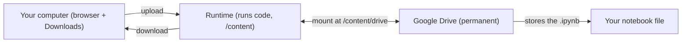

:::objectives
- Find your way around Colab: code cells, text cells, the Files panel, and the runtime.
- Get a CSV from your computer into Colab two ways, and load it with `pd.read_csv`.
- Draw a chart from the file and write a summary file back out.
- Mount Google Drive so your data and results outlive the runtime.
:::

You've downloaded a survey export called `lunch_survey.csv`, and it's sitting in your Downloads folder. You open Colab and type `pd.read_csv("lunch_survey.csv")`, and get `FileNotFoundError`. The file is right there on your laptop, but your code doesn't run on your laptop. It runs on the runtime, a separate machine that has never seen your Downloads folder.

That one fact explains most of this lesson. Three places are involved, and you need to know which one holds what:



The runtime is temporary. When it shuts down, everything on it goes too: variables, uploaded files, files your code wrote. Your notebook survives because it lives in Drive, but data has to be put somewhere safe on purpose.

## A quick tour of the Colab window

Open the `ds-setup.ipynb` notebook from the last lesson (or make a new one). Five parts of the window matter:

-   **The cells in the middle.** Gray **code cells** run Python. **Text cells** hold notes written in Markdown. The **+ Code** and **+ Text** buttons near the top add a new cell below the one you're on.
-   **The left sidebar.** The folder icon opens the **Files** panel, a view of the runtime's disk. The `{x}` icon opens **Variables**, which lists every name currently in memory with its type and value. The list icon at the top is a **Table of contents** built from your text-cell headings.
-   **The Runtime menu.** Run all cells, run everything above the current cell, interrupt a cell that's stuck, or restart with empty memory.
-   **The RAM and Disk bars** at the top right, which only appear while you're connected.
-   **The File menu.** Rename, save a copy, or download the notebook as `.ipynb`.

Double-click a text cell to edit it. A few lines of Markdown give your notebook a structure you'll thank yourself for later:

```text
# Lunch survey: first look
Data: `lunch_survey.csv`, exported from the student council form on 3 Nov.

**Question:** which meal do students rate highest, and does it differ by grade?
```

Press **Shift + Enter** and the text cell renders as a heading and formatted notes.

## Step 1: Get a CSV into the runtime

You have two ways to upload a file from your computer.

**Option A, the Files panel.** Click the folder icon in the left sidebar, then the upload button at the top of the panel (a page with an upward arrow). Pick your CSV. It appears in the list, inside the runtime's working folder, `/content`. Colab shows a reminder that uploaded files are deleted when the runtime ends; it means it.

**Option B, from code.** Run this in a cell. A **Choose Files** button appears under the cell:

```python
from google.colab import files

uploaded = files.upload()   # pick one or more files from your computer
print(list(uploaded))       # the names of the files that arrived
```

Both options put the file in `/content`, which is the folder `read_csv` looks in when you give it a bare file name.

Don't have a CSV handy? This cell writes one into the runtime, so the rest of the lesson works for everyone. A CSV is plain text: a header line naming the columns, then one line per row, with commas between values.

```python run title="make_lunch_csv.py"
csv_text = """response_id,grade,favorite_meal,rating,brings_lunch
1,9,Pizza,4,no
2,10,Tacos,5,no
3,9,Pasta,3,yes
4,11,Pizza,3,no
5,12,Salad bar,5,yes
6,10,Pizza,3,no
7,9,Tacos,4,no
8,11,Pasta,2,yes
9,12,Pizza,4,no
10,10,Salad bar,4,yes
11,9,Pizza,5,no
12,11,Tacos,4,yes
13,12,Pizza,3,no
14,10,Pasta,3,no
15,9,Tacos,3,no
16,11,Pizza,4,no
17,12,Salad bar,5,yes
18,10,Tacos,4,no
"""
with open("lunch_survey.csv", "w") as f:
    f.write(csv_text)
print("Wrote lunch_survey.csv")
```

Click the refresh button in the Files panel and `lunch_survey.csv` shows up, as if you had uploaded it.

## Step 2: Load it and look

```python run
import pandas as pd

survey = pd.read_csv("lunch_survey.csv")
print(survey.shape)
print(survey.head())
```

`survey.shape` is `(rows, columns)`: 18 responses, 5 columns. `head()` shows the first five rows, so you can see that the header became column names and the values landed in the right places. Those two lines are the first thing to run on any file you load. Module 2 covers the rest of the first-look checklist.

:::try
Open the `{x}` Variables panel now. You'll see `survey` listed as a DataFrame with its shape. Run `survey = 5` in a new cell and watch the entry change. Then rerun the `read_csv` cell to put it back.
:::

## Step 3: Turn it into a chart

Which meal is most popular, and which is rated highest? Those are two different questions, so they get two different numbers:

```python run alt="Two bar charts side by side: on the left, Pizza is chosen by 7 students, Tacos by 5, and Pasta and Salad bar by 3 each; on the right, the average rating is highest for Salad bar at about 4.7 and lowest for Pasta at about 2.7"
import matplotlib.pyplot as plt

votes = survey["favorite_meal"].value_counts()
avg_rating = survey.groupby("favorite_meal")["rating"].mean().sort_values()

print(votes)
print(avg_rating.round(2))

fig, (left, right) = plt.subplots(1, 2, figsize=(9, 3.2))
votes.plot(kind="bar", ax=left, color="#2a78d6", rot=0)
left.set_title("How many students chose each meal")
left.set_ylabel("Students")
left.set_xlabel("")
avg_rating.plot(kind="barh", ax=right, color="#2a78d6")
right.set_title("Average rating (1 to 5)")
right.set_xlim(0, 5)
right.set_ylabel("")
fig.tight_layout()
```

Read the printed numbers before the chart. Pizza has the most fans by far, yet the Salad bar has the highest average rating, and that average comes from only three students. A single "most popular" answer would have hidden both facts.

## Step 4: Save results so they survive

Write the summary to a CSV in the runtime:

```python run
summary = pd.DataFrame({"students": votes, "avg_rating": avg_rating.round(2)})
summary.to_csv("lunch_summary.csv")
print(pd.read_csv("lunch_summary.csv"))
```

Reading the file straight back is a cheap way to check that what you saved is what you meant to save. To get it onto your laptop, find `lunch_summary.csv` in the Files panel, open its three-dot menu, and choose **Download**, or run `files.download("lunch_summary.csv")` after the `files` import above.

Downloading by hand gets old fast. The better habit is to keep your course data in Google Drive and let Colab read and write there directly. **Mounting** Drive makes it appear as a folder inside the runtime. Run this in Colab:

```python
from google.colab import drive
import os

drive.mount("/content/drive")

folder = "/content/drive/MyDrive/ds-course"
os.makedirs(folder, exist_ok=True)                  # create the folder the first time
summary.to_csv(f"{folder}/lunch_summary.csv")       # this copy survives the runtime
```

When `drive.mount` runs, Colab asks you to pick your Google account and allow access. Once it prints `Mounted at /content/drive`, your Drive is the folder `/content/drive/MyDrive`, and anything saved under it really is in Drive. Loading works the same way: `pd.read_csv(f"{folder}/lunch_survey.csv")`, once the file is in that folder.

Put your raw CSV files in `MyDrive/ds-course` once (drag them into drive.google.com), and every future notebook can load them with one line after mounting.

:::warning
**`FileNotFoundError: [Errno 2] No such file or directory: 'lunch_survey.csv'`** has three usual causes. The runtime restarted and deleted your upload, so upload it again or load it from Drive. The name is slightly different (`lunch_survey (1).csv` after a second download is common), so copy the exact name from the Files panel. Or the file is in Drive and you forgot the folder, so use the full `/content/drive/MyDrive/...` path. In the Files panel, a file's three-dot menu has **Copy path**, which avoids typos.
:::

:::video VCllZKM7Njk
Two ways to read a CSV in Colab: uploading from your computer and loading from Google Drive. Watch how the Drive path is copied from the Files panel instead of typed.
:::

## Proof it works: a checklist

Your setup is done when you can tick all five:

1.  A notebook named `ds-setup.ipynb` exists in **Colab Notebooks** in your Drive.
2.  It has at least one text cell with a heading.
3.  It loads a CSV with `pd.read_csv` and prints its `shape`.
4.  It draws a chart under a cell.
5.  It writes a file into `MyDrive/ds-course` and that file shows up at drive.google.com.

:::quiz
Q: You upload `scores.csv` through the Files panel, work for an hour, take a long break, and come back. `pd.read_csv("scores.csv")` now fails with `FileNotFoundError`. What happened?
- [ ] Colab renamed the file
  Colab doesn't rename uploads; check the Files panel and you'll find it's gone, not renamed.
- [x] The idle runtime was shut down, and its files went with it
  Uploads live on the temporary runtime. Keep data in Drive to avoid uploading it again.
- [ ] `read_csv` only works once per file
  You can read a file as many times as you like while it exists.

Q: After `drive.mount("/content/drive")`, where should you save a results file so you can find it tomorrow?
- [ ] `/content/results.csv`
  That's the runtime's own disk, which is wiped when the runtime ends.
- [x] `/content/drive/MyDrive/ds-course/results.csv`
  Anything under `/content/drive/MyDrive` is really in your Google Drive.
- [ ] Anywhere; Colab saves all files to Drive automatically
  Colab autosaves the notebook, not the files your code writes.
:::

:::takeaways
- Your code runs on the runtime, a temporary machine. Its working folder is `/content`.
- Upload with the Files panel or `files.upload()`; download with the file's menu or `files.download()`.
- Mount Drive with `drive.mount("/content/drive")` and keep data and results under `/content/drive/MyDrive`.
- Check every load with `shape` and `head()`, and every save by reading the file back.
:::

## Further reading

-   [pandas: How do I read and write tabular data?](https://pandas.pydata.org/docs/getting_started/intro_tutorials/02_read_write.html): the official short tutorial on `read_csv`, `to_csv`, and friends.
-   [Markdown Guide: Basic Syntax](https://www.markdownguide.org/basic-syntax/): everything you can write in a Colab text cell.
