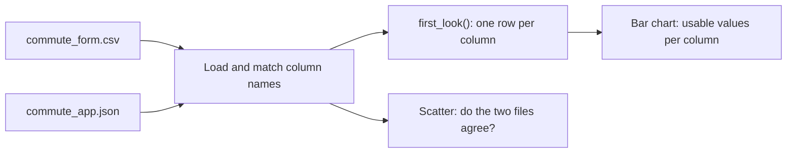

:::objectives
- Load a CSV export and a nested JSON export of the same survey and give them matching column names.
- Write `problem_values()`, which lists the entries that stop a column from being numeric.
- Write `first_look()`, a one-row-per-column report you can reuse on any dataset.
- Chart how much of each column is usable, and check where the two exports disagree.
:::

Your school surveyed 40 students about their trip to school. The answers exist twice: a **CSV** from the paper-style web form, where students typed their own numbers, and a **JSON** export from a commute app that recorded the same trips. Before anyone averages anything, you need to know which file to trust and what's wrong with each. You'll build a report that answers that in one call:



## Step 1: Create the two export files

In real life you'd upload the exports (Module 1 showed how). Here, this cell plays the part of the survey website and writes both files into the runtime. Run it and move on; the interesting work starts in Step 2.

```python run title="make_exports.py"
import json
import numpy as np
import pandas as pd

pd.set_option("display.width", 110)
pd.set_option("display.max_columns", 12)

rng = np.random.default_rng(7)
modes = rng.choice(["walk", "bike", "bus", "car"], 40, p=[0.25, 0.15, 0.35, 0.25])
km_range = {"walk": (0.3, 2), "bike": (1, 5), "bus": (2, 12), "car": (2, 15)}
speed_kmh = {"walk": 5, "bike": 15, "bus": 20, "car": 30}
wait_min = {"walk": 0, "bike": 0, "bus": 8, "car": 3}

records = []
for i, mode in enumerate(modes):
    km = round(rng.uniform(*km_range[mode]), 1)
    records.append({
        "student_id": f"R{i + 1:03d}",
        "grade": int(rng.integers(9, 13)),
        "trip": {"mode": str(mode), "distance_km": km,
                 "minutes": round(km / speed_kmh[mode] * 60 + wait_min[mode])},
        "late_days": int(rng.poisson(0.8)),
    })
records[5]["trip"]["minutes"] = None        # the app lost two readings
records[22]["trip"]["distance_km"] = None
with open("commute_app.json", "w") as f:
    json.dump(records, f, indent=1)

# The form version: same trips, but typed by students
rows = [[r["student_id"], r["grade"], r["trip"]["mode"], r["trip"]["distance_km"],
         r["trip"]["minutes"], r["late_days"]] for r in records]
typed = {(3, 4): "15 min", (8, 4): "about 20", (14, 4): "20-25", (5, 4): "-", (35, 4): "",
         (11, 3): "1.5km", (22, 3): "", (27, 1): "10th", (31, 5): "none",
         (17, 3): str(round(rows[17][3] * 10))}   # a missed decimal point
for (row, col), text in typed.items():
    rows[row][col] = text
with open("commute_form.csv", "w") as f:
    f.write("student_id,grade,mode,distance_km,minutes,late_days\n")
    for row in rows:
        f.write(",".join("" if v is None else str(v) for v in row) + "\n")
print("Wrote commute_form.csv and commute_app.json")
```

## Step 2: Read the raw CSV, then load it

Look at the file as text first. It takes one line, and it shows you things `read_csv` will hide:

```python run
with open("commute_form.csv") as f:
    print("".join(f.readlines()[:7]))
```

Already you can see `15 min` and a lone `-`. Now load it and check the types:

```python run
csv = pd.read_csv("commute_form.csv")
print(csv.shape)
print(csv.dtypes)
```

Every column is `object`. Even `grade` and `late_days`, which are small whole numbers, loaded as text. Somewhere in each column there's at least one value `read_csv` couldn't read as a number.

## Step 3: Load the JSON and match the column names

```python run
with open("commute_app.json") as f:
    app = pd.json_normalize(json.load(f))
print(app.columns.tolist())
```

The nested `trip` object became `trip.mode`, `trip.distance_km`, and `trip.minutes`. To compare the two files column by column, give the JSON columns the CSV's names, then put them in the same order:

```python run
app = app.rename(columns={"trip.mode": "mode",
                          "trip.distance_km": "distance_km",
                          "trip.minutes": "minutes"})
app = app[csv.columns]          # same columns, same order as the CSV
print(app.head(3))
print(app.dtypes)
```

The JSON gives you real numbers straight away. `minutes` is `float64` rather than `int64` because one reading is `NaN`, and `NaN` only exists as a float.

## Step 4: List the values that block a number column

Here's the trick from the Notes lesson turned into a function. It returns the distinct entries that are present but won't convert:

```python run
def problem_values(column):
    """Entries that are filled in but can't be read as numbers."""
    numbers = pd.to_numeric(column, errors="coerce")
    bad = column[numbers.isna() & column.notna()]
    return sorted(bad.astype(str).unique())

print(problem_values(csv["minutes"]))
print(problem_values(csv["grade"]))
```

Read the list for `minutes` carefully, because each item needs a different decision. `15 min` and `about 20` carry a usable number. `20-25` is a range. And `-` isn't an answer at all: it's how this form marks "no answer". pandas only treats certain strings as missing, and `-` isn't one of them, so tell `read_csv` about it:

```python run
csv = pd.read_csv("commute_form.csv", na_values=["-"])
print(problem_values(csv["minutes"]))
print("missing minutes:", csv["minutes"].isna().sum())
```

`-` moved from "problem" to "missing", which is where it belongs. That's the only fix you make in this lesson. Repairing `15 min` and friends is a cleaning job, and cleaning comes in Module 4, once you know exactly what's broken.

## Step 5: Build the first-look report

Now combine every check into one function. For each column it records the type, how many values are filled and missing, how many are distinct, what share of the filled values read as numbers, and how many rows are **unreadable**: filled in, but not a number in a column that's mostly numbers.

```python run
def first_look(df):
    report = []
    for name in df.columns:
        column = df[name]
        filled = column.notna().sum()
        numbers = pd.to_numeric(column, errors="coerce")
        numeric_share = numbers.notna().sum() / filled if filled else 0
        mostly_numbers = numeric_share >= 0.8
        report.append({
            "column": name,
            "dtype": str(column.dtype),
            "filled": filled,
            "missing": column.isna().sum(),
            "unique": column.nunique(),
            "numeric_share": round(numeric_share, 2),
            "unreadable": (numbers.isna() & column.notna()).sum() if mostly_numbers else 0,
            "problems": problem_values(column) if mostly_numbers else [],
        })
    return pd.DataFrame(report).set_index("column")

csv_report = first_look(csv)
app_report = first_look(app)
print(csv_report)
print()
print(app_report)
```

The two reports tell the story at a glance. In the CSV, `student_id` and `mode` have a numeric share of 0, so they're genuinely text and nothing is flagged. The four number columns are 92 to 98% numbers with a few stray entries, which is exactly the pattern of "numbers with typing mistakes". The JSON report has no problems at all, just two missing readings.

The 0.8 threshold is a judgment call. A column where only half the values are numbers is probably a text column with some numbers in it, and listing "problems" there would be noise.

## Step 6: Chart how much of each column you can use

A table of counts is precise; a chart makes the comparison instant. Add missing and unreadable together, since you can't compute with either:

```python run alt="Horizontal grouped bar chart of unusable values per column. CSV form: minutes 5, distance_km 2, grade 1, late_days 1. JSON app: distance_km 1 and minutes 1. student_id and mode have none in either file." caption="Unusable values per column, by export"
import matplotlib.pyplot as plt

unusable = pd.DataFrame({
    "CSV form": csv_report["missing"] + csv_report["unreadable"],
    "JSON app": app_report["missing"] + app_report["unreadable"],
})
ax = unusable.iloc[::-1].plot(kind="barh", color=["#eb6834", "#2a78d6"], width=0.75, figsize=(7, 3.6))
ax.set_xlabel("Rows that can't be used as numbers (out of 40)")
ax.set_ylabel("")
ax.set_title("The form export needs more repair than the app export")
ax.legend(frameon=False, loc="lower right")
```

The `iloc[::-1]` flips the row order so the chart lists columns top to bottom in the same order as the table.

## Step 7: Check whether the two files agree

Fewer problems doesn't prove the JSON is *right*. Line the two `distance_km` columns up by student and plot one against the other. If the files agree, every point sits on the diagonal:

```python run alt="Scatter plot of distance in the form export against distance in the app export. 37 points lie on the diagonal line where the two agree, and one point sits far above it at 68 km in the form versus 6.8 km in the app." caption="Each dot is one student; the dashed line means the files agree"
form_km = pd.to_numeric(csv.set_index("student_id")["distance_km"], errors="coerce")
app_km = app.set_index("student_id")["distance_km"]
gap = (form_km - app_km).abs()
print(pd.DataFrame({"form": form_km, "app": app_km})[gap > 0.05])

fig, ax = plt.subplots(figsize=(4.5, 4.5))
ax.plot([0, 70], [0, 70], linestyle="--", color="#9aa0a6", linewidth=1)
ax.scatter(app_km, form_km, color="#2a78d6", s=30)
ax.set_xlabel("App distance (km)")
ax.set_ylabel("Form distance (km)")
ax.set_title("Form vs. app distance")
```

`set_index("student_id")` makes pandas line rows up **by student** rather than by position, so the subtraction compares each student's two answers even if the files were in different orders. One student typed `68` for a 6.8 km trip. That value was a perfectly valid number, so `first_look` couldn't catch it. Only comparing with a second source, or a sanity range, can. Hold that thought for Module 4.

## The finished program

Here's everything in one cell, ready to reuse. Change the two file names and it reports on any pair of exports with the same columns:

```python run title="first_look.py"
import json
import pandas as pd


def problem_values(column):
    numbers = pd.to_numeric(column, errors="coerce")
    bad = column[numbers.isna() & column.notna()]
    return sorted(bad.astype(str).unique())


def first_look(df):
    report = []
    for name in df.columns:
        column = df[name]
        filled = column.notna().sum()
        numbers = pd.to_numeric(column, errors="coerce")
        numeric_share = numbers.notna().sum() / filled if filled else 0
        mostly_numbers = numeric_share >= 0.8
        report.append({
            "column": name,
            "dtype": str(column.dtype),
            "filled": filled,
            "missing": column.isna().sum(),
            "unique": column.nunique(),
            "numeric_share": round(numeric_share, 2),
            "unreadable": (numbers.isna() & column.notna()).sum() if mostly_numbers else 0,
            "problems": problem_values(column) if mostly_numbers else [],
        })
    return pd.DataFrame(report).set_index("column")


form = pd.read_csv("commute_form.csv", na_values=["-"])
with open("commute_app.json") as f:
    app = pd.json_normalize(json.load(f))
app = app.rename(columns=lambda name: name.removeprefix("trip."))[form.columns]

for label, table in [("FORM (CSV)", form), ("APP (JSON)", app)]:
    report = first_look(table)
    print(label, "|", len(table), "rows |", report["unreadable"].sum(), "unreadable,",
          report["missing"].sum(), "missing")
    flagged = report[report["problems"].str.len() > 0]
    for name, problems in flagged["problems"].items():
        print("   ", name, problems)
```

The rename now uses a function, `name.removeprefix("trip.")`, which strips the prefix from every nested column at once. It's shorter than the dictionary and keeps working if the app adds more `trip.` fields.

:::quiz
Q: Why reload the CSV with `na_values=["-"]` instead of counting `-` as a problem value?
- [ ] Because `-` crashes `read_csv`
  It loads fine, as plain text; that's why it slipped through.
- [x] Because `-` means "no answer" on this form, so it is missing, not mistyped
  Missing and mistyped values need different fixes. Labeling `-` correctly keeps the problem list honest.
- [ ] Because `na_values` converts every column to numbers
  It only changes which strings count as missing; columns with other text stay `object`.

Q: Why does `first_look` skip the problem list for columns with a numeric share under 0.8?
- [x] Mostly-text columns such as `mode` would list every value as a "problem"
  For `mode`, every entry fails to convert, and that's correct. Flagging them would bury the real issues.
- [ ] `pd.to_numeric` can't run on text columns
  With `errors="coerce"` it runs on anything and returns `NaN` where it can't convert.
- [ ] To make the function faster
  Speed isn't the reason; the report would be noisy and misleading.

Q: The student who typed `68` for 6.8 km: why didn't `first_look` flag that row?
- [ ] Because the column was `object`
  The column type doesn't matter here; the value itself is the issue.
- [x] Because `68` is a valid number, and the report only finds values that aren't numbers
  Plausible-looking wrong numbers need range checks or a second source, like the scatter plot.
- [ ] Because `first_look` ignores the `distance_km` column
  It checks every column, and it flagged `1.5km` in this one.
:::

:::takeaways
- Look at the raw text of a file before loading it; a few lines reveal markers like `-` and units like `km`.
- Tell `read_csv` about the file's own missing-value markers with `na_values`.
- `pd.json_normalize` plus a rename gives JSON exports the same column names as their CSV twins.
- `first_look()` reports type, filled, missing, unique, numeric share, and unreadable values for any DataFrame.
- Aligning on an ID with `set_index` compares records by who they belong to, not by row position.
- A report finds values that aren't numbers; only range checks or a second source find wrong numbers.
:::

## Ideas to extend it

-   Add a `range` entry to the report with each numeric column's minimum and maximum, so `68` km would stand out.
-   Add an `example` entry that shows one filled value per column.
-   Make `first_look` draw the bar chart itself when called with `chart=True`.

## Further reading

-   [pandas read_csv reference](https://pandas.pydata.org/docs/reference/api/pandas.read_csv.html): every option, including `na_values`, `sep`, `decimal`, and `dtype`.
-   [pandas.to_numeric reference](https://pandas.pydata.org/docs/reference/api/pandas.to_numeric.html): what `errors="coerce"` does, with examples.
