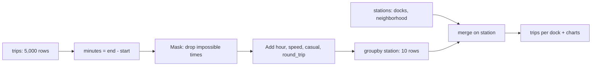

:::objectives
- Compute a new column from two datetime columns without a loop.
- Remove impossible rows with a boolean mask and keep a record of how many went.
- Summarize every station at once with `groupby` and named aggregations.
- Join a lookup table with `merge` and use it to compare stations fairly.
- Chart trips per dock and riders by hour.
:::

A city bike-share runs ten stations. The operations team has one month of trip records, 5,000 rows, and one question: **which stations need more docks?** Last year someone answered it by hand in a spreadsheet, copying totals station by station, and the numbers never matched the next time anyone checked. You'll build the answer as code, so it reruns in a second on next month's file.



## Step 1: Load a month of trips

The cell below generates the month of trips with a fixed random seed, so your numbers will match this page exactly. With real data, this is where `pd.read_csv` would go.

```python run title="make_trips.py"
import numpy as np
import pandas as pd
import matplotlib.pyplot as plt

pd.set_option("display.width", 110)
pd.set_option("display.max_columns", 12)

rng = np.random.default_rng(42)
names = ["Union Sq", "Library", "Riverside", "Stadium", "City Hall",
         "Market St", "College Ave", "Harbor Pt", "Park Gate", "Museum"]
pull = np.array([18, 14, 12, 6, 10, 15, 9, 5, 7, 4]) / 100
commute_hours = np.array([1, 1, 1, 1, 1, 3, 8, 16, 18, 8, 4, 4, 5, 4, 4, 6, 12, 18, 12, 6, 4, 3, 2, 1])
leisure_hours = np.array([1, 1, 1, 1, 1, 1, 1, 2, 3, 5, 8, 11, 13, 14, 14, 13, 11, 9, 7, 5, 4, 3, 2, 1])

n = 5000
rider = rng.choice(["member", "casual"], n, p=[0.7, 0.3])
hour = np.where(rider == "member",
                rng.choice(24, n, p=commute_hours / commute_hours.sum()),
                rng.choice(24, n, p=leisure_hours / leisure_hours.sum()))
start = (pd.Timestamp("2026-09-01") + pd.to_timedelta(rng.integers(0, 30, n), unit="D")
         + pd.to_timedelta(hour, unit="h") + pd.to_timedelta(rng.integers(0, 60, n), unit="min"))
km = rng.uniform(0.6, 7, n).round(2)
kmh = np.where(rider == "member", rng.normal(14, 2.5, n), rng.normal(10, 2.5, n)).clip(5, 25)
ride_min = km / kmh * 60 + rng.exponential(3, n)

trips = pd.DataFrame({
    "trip_id": np.arange(1, n + 1),
    "start_time": start,
    "end_time": start + pd.to_timedelta(ride_min.round(1), unit="min"),
    "start_station": rng.choice(names, n, p=pull),
    "end_station": rng.choice(names, n, p=pull),
    "rider_type": rider,
    "distance_km": km,
})
glitch = rng.choice(n, 6, replace=False)        # six trips with broken clocks
trips.loc[glitch[:4], "end_time"] = trips.loc[glitch[:4], "start_time"] - pd.Timedelta(minutes=5)
trips.loc[glitch[4:], "end_time"] = trips.loc[glitch[4:], "start_time"] + pd.Timedelta(hours=30)
raw_trips = trips.copy()                         # an untouched copy for the end of the lesson

print(trips.shape)
print(trips.head(3))
```

Each row is one ride: when it started and ended, where, who rode (a `member` with a yearly pass or a `casual` rider), and how far.

## Step 2: Compute every trip's length at once

Subtracting two datetime columns gives a column of time spans. `.dt.total_seconds()` turns each span into seconds, for all 5,000 rows in one expression:

```python run
trips["minutes"] = (trips["end_time"] - trips["start_time"]).dt.total_seconds() / 60
print(trips["minutes"].describe().round(1))
```

Always read `min` and `max` first. A trip of `-5` minutes ended before it started, and `1800` minutes is 30 hours on a bike. These are clock glitches, not rides. A mask keeps only believable trips, and printing the count keeps the decision visible:

```python run
believable = (trips["minutes"] > 0) & (trips["minutes"] <= 24 * 60)
print("Removing", (~believable).sum(), "trips with impossible times")
trips = trips.loc[believable].copy()
print(trips.shape)
```

`~believable` flips the mask, so its sum counts the rows being dropped. The `.copy()` makes `trips` a real, independent table instead of a view into the old one, which lets you add columns in the next step without pandas warnings.

## Step 3: Add the columns the questions need

Each new column is one vectorized expression:

```python run
trips["hour"] = trips["start_time"].dt.hour
trips["speed_kmh"] = (trips["distance_km"] / (trips["minutes"] / 60)).round(1)
trips["casual"] = trips["rider_type"] == "casual"
trips["round_trip"] = trips["start_station"] == trips["end_station"]

print(trips[["start_station", "minutes", "hour", "speed_kmh", "casual", "round_trip"]].head(4))
print(trips.groupby("rider_type")[["minutes", "speed_kmh"]].median())
```

`casual` and `round_trip` are boolean columns. Storing a yes/no fact as `True`/`False` pays off in the next step, because the mean of a boolean column is the share of `True` values and its sum is the count.

The quick groupby at the end already says something useful: members ride faster and shorter. They're commuting; casual riders are touring.

## Step 4: Summarize every station in one call

**Named aggregation** lets you choose a name, a column, and a function for each result column. That turns 5,000 rows into a 10-row table:

```python run
by_station = trips.groupby("start_station").agg(
    trips=("trip_id", "count"),
    median_min=("minutes", "median"),
    casual_share=("casual", "mean"),
    round_trips=("round_trip", "sum"),
).round(2).sort_values("trips", ascending=False)
print(by_station)
```

Read each line inside `agg` as "new column = (source column, function)". `casual_share` is the mean of a True/False column, so it's a proportion: about 30% of rides at most stations are casual. Union Sq is by far the busiest station.

But is Union Sq the most *crowded*? Not necessarily. A station with 40 docks can handle far more trips than one with 15. To answer the real question you need each station's size, and that lives in a different table.

## Step 5: Merge in station details

The city's station table has one row per station:

```python run
stations = pd.DataFrame({
    "station": names,
    "neighborhood": ["Downtown", "Downtown", "Riverfront", "Eastside", "Downtown",
                     "Midtown", "University", "Riverfront", "Eastside", "Midtown"],
    "docks": [40, 25, 20, 30, 25, 30, 15, 12, 15, 10],
})

report = (by_station.reset_index()
          .rename(columns={"start_station": "station"})
          .merge(stations, on="station", how="left", validate="one_to_one"))
report["trips_per_dock"] = (report["trips"] / report["docks"]).round(1)
report = report.sort_values("trips_per_dock", ascending=False)
print(report[["station", "neighborhood", "trips", "docks", "trips_per_dock"]])
```

Three choices in that chain are worth naming. `reset_index()` turns the station names from the index back into a column. `rename` gives that column the same name as in `stations`, so `on="station"` can match them. And `validate="one_to_one"` makes `merge` raise an error if either table has a station listed twice, which would otherwise quietly duplicate rows and inflate every total.

The ranking flips. Union Sq handles the most trips, but it also has the most docks. **College Ave**, with only 15 docks, works each dock hardest. Stadium, with 30 docks and few riders, has spare capacity that could move.

```python run alt="Horizontal bar chart of trips per dock in September for ten stations, from College Ave at 31 down to Stadium at about 10; Union Sq, the busiest station by total trips, ranks sixth at 23" caption="Trips per dock: which stations work their docks hardest"
ax = report.set_index("station")["trips_per_dock"].iloc[::-1].plot(
    kind="barh", color="#2a78d6", figsize=(6.5, 3.6))
ax.set_xlabel("Trips per dock in September")
ax.set_ylabel("")
ax.set_title("College Ave is the most crowded station")
```

## Step 6: When do people ride?

Group by **two** keys and count the rows in each pair with `size()`. `unstack()` then turns the inner key, rider type, into columns, which is exactly the shape a line chart wants:

```python run alt="Line chart of trips by hour of the day. Members show two sharp peaks, at 7 to 8 a.m. and at 5 p.m. Casual riders rise slowly to a broad afternoon peak around 1 to 3 p.m. and stay below members at rush hour." caption="Members commute; casual riders ride in the afternoon"
hourly = trips.groupby(["hour", "rider_type"]).size().unstack(fill_value=0)
print(hourly.loc[[8, 13, 17]])

ax = hourly.plot(color={"member": "#2a78d6", "casual": "#eb6834"}, linewidth=2, figsize=(7, 3.2))
ax.set_xlabel("Hour the trip started")
ax.set_ylabel("Trips in September")
ax.set_xticks(range(0, 24, 3))
ax.legend(title="", frameon=False)
```

Members produce the two rush-hour peaks, and casual riders own the early afternoon. For the operations team, this means docks at commuter stations fill and empty fastest from 7 to 9 a.m. and around 5 p.m.

## The finished program

Everything after the data generation, in one function. It starts from the untouched `raw_trips` saved in Step 1. Point it at next month's trips and station tables and it produces the same report:

```python run title="station_report.py"
def station_report(trips, stations):
    trips = trips.copy()
    trips["minutes"] = (trips["end_time"] - trips["start_time"]).dt.total_seconds() / 60
    believable = (trips["minutes"] > 0) & (trips["minutes"] <= 24 * 60)
    print(f"Dropped {(~believable).sum()} of {len(trips)} trips with impossible times")
    trips = trips.loc[believable].copy()
    trips["casual"] = trips["rider_type"] == "casual"
    trips["round_trip"] = trips["start_station"] == trips["end_station"]

    summary = trips.groupby("start_station").agg(
        trips=("trip_id", "count"),
        median_min=("minutes", "median"),
        casual_share=("casual", "mean"),
        round_trips=("round_trip", "sum"),
    ).reset_index().rename(columns={"start_station": "station"})

    report = summary.merge(stations, on="station", how="left", validate="one_to_one")
    report["trips_per_dock"] = report["trips"] / report["docks"]
    return report.sort_values("trips_per_dock", ascending=False).round(2)


september = station_report(raw_trips, stations)
print(september[["station", "trips", "docks", "trips_per_dock"]].head(3))
```

The function works on a copy of the trips table, so calling it never changes the data you pass in. Running it twice gives the same answer, which is the reproducibility habit from Module 1 built into the code.

:::quiz
Q: Why does the report rank stations by `trips_per_dock` rather than by `trips`?
- [ ] Because `trips` contains errors
  The counts are fine; they just answer a different question.
- [x] Because big stations naturally get more trips, so raw counts hide which docks are overworked
  Dividing by capacity compares stations of different sizes fairly. That's why College Ave rises to the top.
- [ ] Because `merge` removes the `trips` column
  `merge` keeps every column from both tables.

Q: What would `validate="one_to_one"` catch?
- [x] A station that appears twice in the `stations` table
  The merge would duplicate that station's row and double-count it. `validate` raises an error instead.
- [ ] A station with zero trips
  A station missing from the trips just wouldn't appear in the left table; that's not a one-to-one violation.
- [ ] A misspelled column name
  That raises a `KeyError` with or without `validate`.

Q: `casual_share=("casual", "mean")` gives 0.31 for Union Sq. What does that mean?
- [ ] The average casual rider rode 0.31 hours
  `casual` is True/False, not a time.
- [x] 31% of Union Sq trips were by casual riders
  `True` counts as 1 and `False` as 0, so the mean is the share of `True`.
- [ ] Union Sq had 0.31 casual riders per dock
  Docks aren't involved until after the merge.
:::

:::takeaways
- Datetime columns subtract like numbers; `.dt.total_seconds()` and `.dt.hour` pull out parts for every row at once.
- Drop impossible rows with a mask, and print how many you dropped.
- Store yes/no facts as booleans, so `mean` gives a share and `sum` gives a count.
- Named aggregation (`new=("column", "function")`) builds a clean summary table in one call.
- `merge(..., validate="one_to_one")` joins lookup data safely; normalizing by it (trips per dock) can reverse a ranking.
- `groupby([a, b]).size().unstack()` reshapes counts into a chart-ready table.
:::

## Ideas to extend it

-   Count trips by **end** station too, and find stations where more bikes arrive than leave. Those are the stations where bikes pile up.
-   Split `trips_per_dock` into weekday and weekend using `start_time.dt.dayofweek >= 5`.
-   Add a neighborhood summary: group `report` by `neighborhood` and sum `trips` and `docks` before dividing.

## Further reading

-   [pandas: Merge, join, concatenate and compare](https://pandas.pydata.org/docs/user_guide/merging.html): every join type, with diagrams of which rows survive.
-   [pandas: Time deltas](https://pandas.pydata.org/docs/user_guide/timedeltas.html): what you get when you subtract datetimes, and how to convert it.
