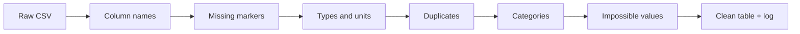

:::objectives
- Inspect a messy file and record the "before" answer to your question.
- Clean column names, missing-value markers, units, duplicates, categories, and impossible values in that order.
- Keep a cleaning log that says what each step changed.
- Compare the answer before and after cleaning with a chart.
- Package every step into one reusable function.
:::

Volunteers in three neighborhoods walked their streets in June and recorded every street tree: species, trunk diameter, height, and condition. The city will spend its tree-care budget where trees are in the worst shape, so the question is simple: **which neighborhood has the highest share of trees in poor condition?** The file the volunteers produced is anything but simple. By the end of this build you'll have a clean table, a log of every change, and an answer you can defend:



The order matters. Types come before range checks, because you can't test `height > 60` on text. Duplicates come before categories, so you don't spend effort fixing rows you're about to delete.

## Step 1: Create the survey file

This cell stands in for the volunteers' spreadsheet export. It builds 60 trees, then adds the kinds of mess real surveys have. Run it and treat `tree_survey.csv` as a file you were handed.

```python run title="make_tree_survey.py"
import numpy as np
import pandas as pd
import matplotlib.pyplot as plt

pd.set_option("display.width", 110)
pd.set_option("display.max_columns", 12)

rng = np.random.default_rng(21)
n = 60
areas = rng.choice(["Eastside", "Northgate", "Riverbend"], n)
species = rng.choice(["Red Maple", "London Plane", "Pin Oak", "Honey Locust", "Ginkgo"], n)
poor_chance = {"Eastside": 0.15, "Northgate": 0.10, "Riverbend": 0.35}
condition = [rng.choice(["Good", "Fair", "Poor"], p=[0.85 - poor_chance[a], 0.15, poor_chance[a]]) for a in areas]
diam = rng.uniform(8, 70, n).round()
height = (diam * 0.35 + rng.normal(0, 2, n)).clip(2).round(1)
dates = pd.Timestamp("2026-06-01") + pd.to_timedelta(rng.integers(0, 20, n), unit="D")

rows = pd.DataFrame({"Tree ID": [f"T{i:03d}" for i in range(1, n + 1)], "Neighborhood": areas,
    "Species": species, "Trunk Diameter": diam.astype(int).astype(str), "Height (m)": height.astype(str),
    "Condition": condition, "Survey Date": dates.strftime("%Y-%m-%d")})
spellings = {"Red Maple": ["red maple", "Maple, red", "Acer rubrum"], "London Plane": ["london plane", "London plane tree"],
             "Pin Oak": ["pin oak", "Pin oak "], "Honey Locust": ["honeylocust", "Honey locust"], "Ginkgo": ["gingko", "GINKGO"]}
for i in rng.choice(n, 18, replace=False):
    rows.loc[i, "Species"] = rng.choice(spellings[rows.loc[i, "Species"]])
for i in rng.choice(n, 10, replace=False):
    c = rows.loc[i, "Condition"]
    rows.loc[i, "Condition"] = rng.choice([c.lower(), c.upper(), c + " "])
for i in rng.choice(n, 6, replace=False):
    rows.loc[i, "Trunk Diameter"] = rows.loc[i, "Trunk Diameter"] + "cm"
for i in rng.choice(n, 4, replace=False):
    rows.loc[i, "Trunk Diameter"] = f"{float(rows.loc[i, 'Trunk Diameter'].removesuffix('cm')) / 2.54:.0f} in"
rows.loc[[7, 33], "Trunk Diameter"] = "?"
rows.loc[[12, 40, 51], "Height (m)"] = "-1"           # "not measured"
rows.loc[25, "Height (m)"] = "250"                    # a typo
rows.loc[44, "Condition"] = "unknown"
rows.loc[[5, 18], "Neighborhood"] = ["riverbend", "Northgate "]
resurvey = rows.loc[[3, 9, 22, 30, 47]].copy()        # five trees checked again later
resurvey["Survey Date"] = "2026-06-28"
resurvey["Condition"] = ["Poor", "Fair", "Poor", "Good", "Poor"]
messy = pd.concat([rows, resurvey, rows.loc[[14, 36]]], ignore_index=True)
messy.sample(frac=1, random_state=4).to_csv("tree_survey.csv", index=False)
print("Wrote tree_survey.csv")
```

## Step 2: Look before you touch anything

Load the file and get the answer **as the data stands**. You'll compare against it at the end:

```python run
raw = pd.read_csv("tree_survey.csv")
print(raw.shape)
print(raw.dtypes)
print(raw["Condition"].value_counts(dropna=False))

naive = (raw["Condition"] == "Poor").groupby(raw["Neighborhood"]).mean().round(2)
print(naive)
```

There are 67 rows for 60 trees, `Trunk Diameter` is text, and `Condition` has nine spellings of three words, plus `unknown`. The naive answer is a mess too: five "neighborhoods", one of which (`Northgate ` with a trailing space) has 100% of its trees in poor condition, because it has exactly one tree. Eastside and Riverbend look tied. Hold on to those numbers.

## Step 3: Start the log and fix the column names

Every step will add a line to a log, so anyone reading the notebook can see what changed:

```python run
log = []

def record(step, changed, rows):
    log.append({"step": step, "values_changed": int(changed), "rows": rows})

trees = raw.copy()
trees.columns = trees.columns.str.strip().str.lower().str.replace(" ", "_")
trees = trees.rename(columns={"height_(m)": "height_m"})
record("Rename columns", len(trees.columns), len(trees))
print(trees.columns.tolist())
```

Lowercase names with underscores mean `trees["tree_id"]` instead of `trees["Tree ID"]`, with no spaces or capitals to mistype. `trees` is a copy, so `raw` stays untouched for the final comparison.

## Step 4: Mark the missing values

The volunteers used three different markers for "don't know": `?` for diameter, `unknown` for condition, and `-1` for height:

```python run
before = trees.isna().sum().sum()
trees = trees.replace({"?": np.nan, "unknown": np.nan})
trees["height_m"] = trees["height_m"].replace(-1, np.nan)
after = trees.isna().sum().sum()
record("Missing markers to NaN", after - before, len(trees))
print(trees.isna().sum())
```

`height_m` loaded as a number (every entry was numeric text), so `-1` is the number −1, not the string `"-1"`. That's why it gets its own `replace`. Six values are now honestly missing.

## Step 5: Fix types and units

Diameters come as `43`, `43cm`, or `17 in`. Strip the units, convert to numbers, and convert inches to centimeters:

```python run
text = trees["trunk_diameter"].str.strip()
inches = text.str.endswith("in", na=False)
number = pd.to_numeric(text.str.removesuffix("in").str.removesuffix("cm").str.strip(), errors="coerce")
trees["diameter_cm"] = np.where(inches, number * 2.54, number).round()
trees["survey_date"] = pd.to_datetime(trees["survey_date"])

record("Diameter to cm, dates parsed", inches.sum() + text.str.endswith("cm", na=False).sum(), len(trees))
print(trees.loc[inches, ["trunk_diameter", "diameter_cm"]])
```

`na=False` tells `endswith` to answer `False` for missing diameters instead of `NaN`, so the mask stays purely True/False. Without the inch conversion, four trees would be recorded as less than half their real size.

## Step 6: Remove duplicates

There are two kinds. Two rows were uploaded twice, word for word. Five trees were surveyed a second time on June 28, and the later visit is the one to trust:

```python run
rows_before = len(trees)
trees = trees.drop_duplicates()
record("Drop exact duplicates", rows_before - len(trees), len(trees))

rows_before = len(trees)
trees = trees.sort_values("survey_date").drop_duplicates(subset="tree_id", keep="last")
record("Keep latest survey per tree", rows_before - len(trees), len(trees))
print(len(trees), "rows, one per tree:", trees["tree_id"].is_unique)
```

Sorting by date first is what makes `keep="last"` mean "keep the latest visit". Without the sort, "last" would just mean "whichever row happened to be lower in the file". `is_unique` confirms the result: exactly one row per tree.

## Step 7: Make the categories agree

Neighborhoods and conditions only need spacing and capitals fixed. Species names need a lookup table, since `Acer rubrum` and `Maple, red` are both Red Maples:

```python run
fixed_before = trees[["neighborhood", "condition", "species"]].copy()

trees["neighborhood"] = trees["neighborhood"].str.strip().str.title()
trees["condition"] = trees["condition"].str.strip().str.title()
species_map = {
    "red maple": "Red Maple", "maple, red": "Red Maple", "acer rubrum": "Red Maple",
    "london plane": "London Plane", "london plane tree": "London Plane",
    "pin oak": "Pin Oak", "honey locust": "Honey Locust", "honeylocust": "Honey Locust",
    "ginkgo": "Ginkgo", "gingko": "Ginkgo",
}
trees["species"] = trees["species"].str.strip().str.lower().map(species_map)

changed = (trees[["neighborhood", "condition", "species"]] != fixed_before).sum().sum()
record("Standardize categories", changed, len(trees))
print("Unmapped species:", trees["species"].isna().sum())
print(trees["condition"].value_counts(dropna=False))
```

`Unmapped species: 0` is the check that the dictionary covered every spelling. If a new survey brings `Gingko biloba`, that count goes up and tells you to add it. (The `changed` count also includes the one missing condition, because `NaN` never equals `NaN`.)

## Step 8: Remove impossible values

No street tree is 250 meters tall; the tallest trees on Earth are about 115 m, and street trees rarely pass 30. A ceiling of 60 m catches typos without touching any real tree:

```python run
impossible = (trees["height_m"] <= 0) | (trees["height_m"] > 60)
print(trees.loc[impossible, ["tree_id", "species", "diameter_cm", "height_m"]])
trees.loc[impossible, "height_m"] = np.nan
record("Impossible heights to NaN", impossible.sum(), len(trees))
```

Maybe the 250 was meant to be 25.0, or 2.50. But this Ginkgo's trunk is only 20 cm across, which makes even 25 m doubtful, so there's no safe guess. Marking it missing is honest. A guessed value would look exactly like a measured one in the clean table, and nobody reading it would know a guess was made.

## Step 9: Answer the question, before and after

```python run alt="Grouped bar chart of the share of trees in poor condition by neighborhood, before and after cleaning. Eastside 31% before and 33% after; Northgate 8% before and 10% after; Riverbend 32% before and 39% after." caption="Cleaning separates Riverbend from Eastside"
clean = trees[["tree_id", "neighborhood", "species", "diameter_cm",
               "height_m", "condition", "survey_date"]].sort_values("tree_id").reset_index(drop=True)
known = clean.dropna(subset=["condition"])
after = (known["condition"] == "Poor").groupby(known["neighborhood"]).mean()

compare = pd.DataFrame({"Before cleaning": naive, "After cleaning": after}).dropna()
print((compare * 100).round(0))
print(pd.DataFrame(log))

ax = (compare * 100).plot(kind="bar", rot=0, color=["#b8c7dc", "#2a78d6"], figsize=(6.5, 3.2))
ax.set_ylabel("Trees in poor condition (%)")
ax.set_xlabel("")
ax.legend(frameon=False)
```

The `.dropna()` on `compare` drops the two misspelled neighborhoods, which only exist in the "before" column. Before cleaning, Eastside and Riverbend looked equally bad. After cleaning, Riverbend has the worst trees by a clear margin. Three fixes moved it: two Riverbend trees were recorded as `POOR` and `poor`, which the exact match `== "Poor"` never counted; a June 28 re-survey found another Riverbend tree had declined; and the tree with an `unknown` condition no longer counts as healthy. The log underneath shows every change that led there.

## The finished program

All the steps as one function. It takes the raw table and returns the clean one plus its log, so the whole cleaning reruns in one call when next year's survey arrives:

```python run title="clean_trees.py"
SPECIES = {
    "red maple": "Red Maple", "maple, red": "Red Maple", "acer rubrum": "Red Maple",
    "london plane": "London Plane", "london plane tree": "London Plane",
    "pin oak": "Pin Oak", "honey locust": "Honey Locust", "honeylocust": "Honey Locust",
    "ginkgo": "Ginkgo", "gingko": "Ginkgo",
}


def clean_tree_survey(raw):
    log = []
    df = raw.copy()
    df.columns = df.columns.str.strip().str.lower().str.replace(" ", "_")
    df = df.rename(columns={"height_(m)": "height_m"})

    df = df.replace({"?": np.nan, "unknown": np.nan})
    df["height_m"] = pd.to_numeric(df["height_m"], errors="coerce").replace(-1, np.nan)

    text = df["trunk_diameter"].str.strip()
    inches = text.str.endswith("in", na=False)
    number = pd.to_numeric(text.str.removesuffix("in").str.removesuffix("cm").str.strip(), errors="coerce")
    df["diameter_cm"] = np.where(inches, number * 2.54, number).round()
    df["survey_date"] = pd.to_datetime(df["survey_date"])

    start = len(df)
    df = df.drop_duplicates().sort_values("survey_date").drop_duplicates(subset="tree_id", keep="last")
    log.append(f"removed {start - len(df)} duplicate rows")

    df["neighborhood"] = df["neighborhood"].str.strip().str.title()
    df["condition"] = df["condition"].str.strip().str.title()
    df["species"] = df["species"].str.strip().str.lower().map(SPECIES)
    log.append(f"{df['species'].isna().sum()} species names not in the lookup table")

    impossible = (df["height_m"] <= 0) | (df["height_m"] > 60)
    df.loc[impossible, "height_m"] = np.nan
    log.append(f"{impossible.sum()} impossible heights set to missing")

    columns = ["tree_id", "neighborhood", "species", "diameter_cm", "height_m", "condition", "survey_date"]
    return df[columns].sort_values("tree_id").reset_index(drop=True), log


clean, notes = clean_tree_survey(pd.read_csv("tree_survey.csv"))
print(clean.shape)
print(clean.head(3))
for line in notes:
    print("-", line)
```

The function converts `height_m` with `to_numeric` even though this year's file loaded it as numbers. Next year's file might contain a `?` in that column, and the function shouldn't break when it does.

:::quiz
Q: Why does the pipeline sort by `survey_date` before `drop_duplicates(subset="tree_id", keep="last")`?
- [ ] Sorting is required before any `drop_duplicates`
  `drop_duplicates` works on unsorted data; the sort changes *which* copy is kept.
- [x] So that "last" means the most recent visit, which is the one to trust
  Without the sort, "last" just means lower in the file, which could be the older visit.
- [ ] To make the output easier to read
  Readability is a side effect; the sort decides which condition each tree ends up with.

Q: The 250 m height might be a slipped decimal point. Why set it to `NaN` instead of dividing by 10?
- [ ] Because pandas can't divide a single value
  `trees.loc[mask, "height_m"] / 10` works fine.
- [x] Because nobody knows the true value, and a guess would look exactly like a measurement
  With a 20 cm trunk, even 25 m is doubtful. Marking it missing is honest; if you ever do repair a value, the log must say so.
- [ ] Because heights aren't used in the final answer
  Even unused columns should be correct; someone else may use them.

Q: In Step 9, why are poor-condition shares computed on `known` (rows with a condition) rather than all trees?
- [x] So a tree with unknown condition doesn't count as "not poor"
  `NaN == "Poor"` is `False`, which would quietly treat unknown trees as healthy and lower the share.
- [ ] Because `groupby` fails on missing values
  `groupby` handles them; the issue is what the comparison counts.
- [ ] To make the numbers larger
  The goal is accuracy; here it happens to raise the share slightly.
:::

:::takeaways
- Record the "before" answer first; the comparison shows what cleaning actually changed.
- Clean in an order that makes each step possible: names, missing markers, types, duplicates, categories, then ranges.
- Units hide inside text (`cm`, `in`); split them out and convert to one unit.
- Sort before `drop_duplicates(keep="last")` so "last" means "latest".
- Map spelling variants with a dictionary and always print the count of unmapped values.
- A cleaning log and a single `clean_...()` function make the work repeatable and checkable.
:::

## Ideas to extend it

-   Add a check that flags trees whose height is unusually large or small for their diameter, rather than only impossible heights.
-   Make `clean_tree_survey` raise an error if any species is unmapped, so a new spelling can never slip through.
-   Break the after-cleaning poor share down by species within Riverbend. Is one species driving it?

## Further reading

-   [pandas: Working with text data](https://pandas.pydata.org/docs/user_guide/text.html): every `.str` method used here, plus `extract` and `split` for harder cases.
-   [pandas.DataFrame.drop_duplicates reference](https://pandas.pydata.org/docs/reference/api/pandas.DataFrame.drop_duplicates.html): `subset`, `keep`, and `ignore_index`.
