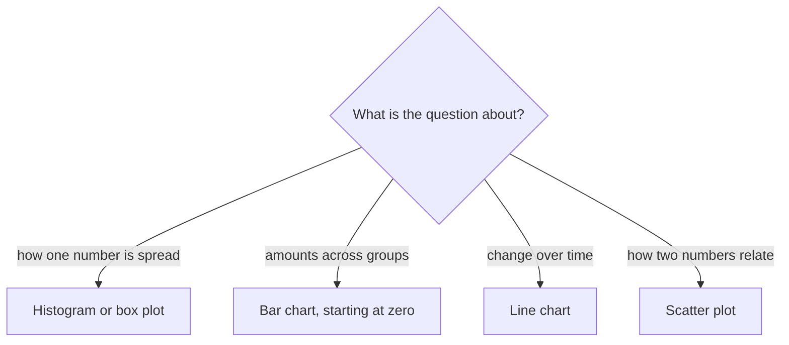

:::objectives
- Explain why one outlier moves the mean but barely touches the median.
- Measure spread with standard deviation and the interquartile range (IQR).
- Draw and read a histogram, and see how the number of bins changes the story.
- Read a box plot, and name what it can hide.
- Choose a bar, line, scatter, or distribution chart from the question being asked.
:::

Two pizza shops near you both advertise "average delivery: 30 minutes." Your party starts in 35 minutes. Which one do you call?

If averages told the whole story, it wouldn't matter. It matters a lot. One shop delivers in 28 to 32 minutes almost every time. The other usually arrives in about 20 minutes, but a third of its orders come from a kitchen across town and take closer to 50. Same average, very different chance of cold guests. This lesson is about the numbers and charts that tell those two shops apart.

## Mean and median react differently to one bad night

The **mean** adds every value and divides by how many there are. The **median** sorts the values and takes the middle one (or the average of the two middle ones). Here are nine ordinary deliveries, and then the same nine plus one driver who got lost:

```python run
import numpy as np
import pandas as pd
import matplotlib.pyplot as plt

times = pd.Series([27, 29, 30, 31, 28, 32, 30, 29, 31])
print("mean:  ", round(times.mean(), 1))
print("median:", times.median())

with_lost_driver = pd.concat([times, pd.Series([95])], ignore_index=True)
print("\nafter one 95-minute delivery")
print("mean:  ", round(with_lost_driver.mean(), 1))
print("median:", with_lost_driver.median())
```

One value out of ten dragged the mean up by more than six minutes. The median didn't move, because sorting puts 95 at the end and the middle stays where it was. Step through the hand calculation and watch where 95 ends up:

:::trace Mean versus median, by hand
```python
times = [31, 28, 95, 30, 29]
total = 0
for t in times:
    total = total + t
mean = total / len(times)
ordered = sorted(times)
middle = len(ordered) // 2
median = ordered[middle]
print("mean:", mean, " median:", median)
```
:::

The mean is 42.6 minutes, which is longer than four of the five deliveries. That's the rule of thumb: when data is **skewed** (a long tail on one side) or has outliers, report the median, or report both and say why they differ. Incomes, house prices, and wait times are usually skewed.

## Spread: how far values wander from the center

Two datasets can share a center and still be nothing alike. **Spread** measures how far values sit from the middle. Let's build a month of deliveries for both shops. Crust Club sends 140 orders from its nearby kitchen and 60 from the far one:

```python run
BLUE, ORANGE = "#2a78d6", "#eb6834"
plt.rcParams.update({"axes.spines.top": False, "axes.spines.right": False})

rng = np.random.default_rng(7)
slice_house = rng.normal(30, 2.5, 200)
crust_club = np.concatenate([rng.normal(22, 3, 140), rng.normal(48, 6, 60)])
deliveries = pd.DataFrame({
    "shop": ["Slice House"] * 200 + ["Crust Club"] * 200,
    "minutes": np.concatenate([slice_house, crust_club]).round(1),
})

by_shop = deliveries.groupby("shop")["minutes"]
summary = pd.DataFrame({
    "mean": by_shop.mean(),
    "median": by_shop.median(),
    "std": by_shop.std(),
    "IQR": by_shop.quantile(0.75) - by_shop.quantile(0.25),
    "% within 35 min": by_shop.apply(lambda m: (m <= 35).mean() * 100),
}).round(1)
print(summary)
```

Read across the rows. The means are within half a minute of each other, but almost everything else differs:

- **Standard deviation** (`std`) is roughly the typical distance from the mean. About 2 minutes for Slice House, more than 12 for Crust Club.
- **IQR** is the width of the middle half of the data: the 75th percentile minus the 25th. It ignores the top and bottom quarters, so a few wild values can't inflate it the way they inflate the standard deviation.
- The last column answers the question you actually care about. Slice House makes it within 35 minutes nearly every time; Crust Club, about 70% of the time.

`deliveries.groupby("shop")["minutes"].describe()` prints count, mean, std, min, quartiles, and max in one call. It's usually the first summary to run on a numeric column.

:::warning
**pandas and NumPy disagree about standard deviation.** `pd.Series([2, 4, 4, 4, 5, 5, 7, 9]).std()` gives `2.138`, but `np.std([2, 4, 4, 4, 5, 5, 7, 9])` gives `2.0`. pandas divides by n − 1 (the *sample* standard deviation, `ddof=1`), and NumPy divides by n (`ddof=0`). Neither is wrong. Pick one, pass `ddof=` explicitly when you mix libraries, and say which you used.
:::

## Histograms show the shape the summary hides

A **histogram** splits the number line into equal bins and draws a bar for how many values land in each. Stack the two shops on the same x-axis so their shapes line up:

```python run alt="Two stacked histograms on a shared 10-to-70-minute axis. Slice House forms one narrow peak around 30 minutes. Crust Club has a tall peak near 22 minutes and a smaller one near 48, with its dashed mean line at about 30 minutes falling in the gap between them." caption="The dashed line is each shop's mean"
fig, axes = plt.subplots(2, 1, figsize=(7, 5), sharex=True)
bins = np.arange(10, 72, 2)
for ax, shop, color in zip(axes, ["Slice House", "Crust Club"], [BLUE, ORANGE]):
    minutes = deliveries.loc[deliveries["shop"] == shop, "minutes"]
    ax.hist(minutes, bins=bins, color=color, edgecolor="white")
    ax.axvline(minutes.mean(), color="#0b0b0b", linestyle="--", linewidth=1)
    ax.set_title(f"{shop}: mean {minutes.mean():.1f} min", loc="left")
    ax.set_ylabel("Deliveries")
axes[1].set_xlabel("Delivery time (minutes)")
fig.tight_layout()
```

Crust Club is **bimodal**: two humps, one per kitchen. Its mean lands in the valley between them, so a "typical" 30-minute Crust Club delivery barely exists. When a mean falls where there's almost no data, it's describing nobody.

The bin count is a choice, and it changes what you see. Here is the same Crust Club column three ways:

```python run alt="Three histograms of the same Crust Club delivery times. With 3 bins there is one tall block and two short ones, and the gap between the kitchens disappears. With 15 bins two separate peaks are clear. With 80 bins the bars become spiky and noisy." caption="Too few bins hide structure; too many turn noise into spikes"
crust = deliveries.loc[deliveries["shop"] == "Crust Club", "minutes"]
fig, axes = plt.subplots(1, 3, figsize=(9, 2.8))
for ax, n_bins in zip(axes, [3, 15, 80]):
    ax.hist(crust, bins=n_bins, color=ORANGE, edgecolor="white")
    ax.set_title(f"bins={n_bins}", loc="left")
    ax.set_xlabel("Minutes")
axes[0].set_ylabel("Deliveries")
fig.tight_layout()
```

Matplotlib's default is 10 bins, whatever the data. Try a few counts before you trust a shape, and use the same bin edges when you compare groups.

## Box plots: five numbers in one picture

A **box plot** draws the five-number summary. The box runs from the 25th to the 75th percentile (so its width is the IQR), the line inside is the median, and the whiskers reach the furthest points within 1.5 × IQR of the box. Anything beyond the whiskers is drawn as a separate dot. seaborn draws one per group from a DataFrame:

```python run alt="Horizontal box plots for the two shops. Slice House has a narrow box around 30 minutes. Crust Club has a wide box from about 21 to 41 minutes with its median near 23. Dots for every delivery are scattered over the boxes, and Crust Club's dots form two clumps that the box itself does not show." caption="The box summarizes; the dots show what it summarized"
import seaborn as sns

fig, ax = plt.subplots(figsize=(7, 3))
palette = {"Slice House": BLUE, "Crust Club": ORANGE}
sns.boxplot(data=deliveries, x="minutes", y="shop", hue="shop", palette=palette,
            legend=False, width=0.5, fliersize=0, boxprops={"alpha": 0.35}, ax=ax)
sns.stripplot(data=deliveries, x="minutes", y="shop", hue="shop", palette=palette,
              legend=False, size=2.5, alpha=0.6, jitter=0.2, ax=ax)
ax.set_xlabel("Delivery time (minutes)")
ax.set_ylabel("")
fig.tight_layout()
```

Box plots are compact, so they shine when you compare many groups side by side. Their blind spot is shape: Crust Club's box is wide, but nothing about a box says "two humps." That's why the dots are layered on top. With a few hundred points or fewer, show the points; with thousands, pair the box plot with a histogram.

:::video R4yfNi_8Kqw
What to watch for: how range, IQR, variance, and standard deviation each measure spread, and which of them a single extreme value (like our lost driver) can distort.
:::

## Let the question pick the chart

Charts aren't decoration. Each form answers one kind of question well:



Here is the delivery data answering four different questions:

```python run alt="Four small charts. Top left, a bar chart of late deliveries per shop: Slice House about 1, Crust Club about 60. Top right, a line chart of Slice House's weekly average delivery time over 8 weeks, nearly flat between 29 and 31 minutes on an axis from 0 to 40. Bottom left, a scatter plot of Crust Club distance against minutes rising from lower left to upper right in two clusters. Bottom right, a histogram of Slice House times peaking near 30." caption="Four questions, four charts"
crust_df = deliveries[deliveries["shop"] == "Crust Club"].copy()
crust_df["km"] = ((crust_df["minutes"] - 10) / 3.5 + rng.normal(0, 0.8, len(crust_df))).clip(0.5)
late = deliveries[deliveries["minutes"] > 35].groupby("shop").size().reindex(["Slice House", "Crust Club"], fill_value=0)

fig, axes = plt.subplots(2, 2, figsize=(9, 6))
axes[0, 0].bar(late.index, late.values, color=[BLUE, ORANGE])
axes[0, 0].set_title("Which shop is late more often?", loc="left")
axes[0, 0].set_ylabel("Deliveries over 35 min")

slice_df = deliveries[deliveries["shop"] == "Slice House"].copy()
slice_df["week"] = np.arange(len(slice_df)) // 25 + 1
weekly = slice_df.groupby("week")["minutes"].mean()
axes[0, 1].plot(weekly.index, weekly.values, color=BLUE, marker="o", linewidth=2)
axes[0, 1].set_ylim(0, 40)
axes[0, 1].set_title("Is Slice House getting faster?", loc="left")
axes[0, 1].set_xlabel("Week")
axes[0, 1].set_ylabel("Mean minutes")

axes[1, 0].scatter(crust_df["km"], crust_df["minutes"], s=10, color=ORANGE, alpha=0.6)
axes[1, 0].set_title("Do longer trips take longer?", loc="left")
axes[1, 0].set_xlabel("Distance (km)")
axes[1, 0].set_ylabel("Minutes")

axes[1, 1].hist(slice_df["minutes"], bins=15,
                color=BLUE, edgecolor="white")
axes[1, 1].set_title("How consistent is Slice House?", loc="left")
axes[1, 1].set_xlabel("Minutes")
fig.tight_layout()
```

Two rules travel with these forms. **Bars encode amounts by length, so the axis must start at zero**, or a bar twice as tall won't mean twice as much. A **line** implies the points are connected in order, so only use one when the x-axis has a real order like time; a line across shop names suggests a trend between them that doesn't exist.

:::try
In the four-chart cell, change `axes[0, 1].set_ylim(0, 40)` to `axes[0, 1].set_ylim(29, 30.6)` and run it. The same flat wobble now looks like a dramatic rollercoaster. You'll take that trick apart in the next lesson.
:::

:::warning
**Reporting a mean for bimodal or skewed data.** "Crust Club averages 29.5 minutes" is true and useless. If a histogram shows two humps, describe the groups separately ("about 70% of orders arrive in roughly 20 minutes; the rest take closer to 50"). If it shows a long tail, lead with the median.
:::

:::quiz
Q: You add one delivery of 300 minutes to a column of 200 deliveries that each took about 30 minutes. What happens?
- [ ] The median jumps, and the mean barely changes
  Backwards. Sorting puts 300 at the end, so the middle value hardly moves.
- [x] The mean rises by more than a minute, and the median barely changes
  The mean shares the extra 270 minutes across 201 deliveries (about 1.3 minutes each), while the middle of the sorted list stays put.
- [ ] Both move by the same amount
  Only the mean uses the size of every value. The median only cares about order.

Q: Crust Club's box plot shows a wide box from 21 to 41 minutes. What can't you learn from the box alone?
- [ ] Where the middle half of the deliveries falls
  That's exactly what the box shows: the 25th to 75th percentile.
- [ ] The median delivery time
  The line inside the box is the median.
- [x] That the deliveries form two separate clumps
  A box summarizes with five numbers, and two humps or one wide hump give similar boxes. A histogram or the raw points reveal the shape.

Q: A café owner asks, "Did our average wait time change over the last 12 months?" Which chart fits best?
- [x] A line chart with month on the x-axis
  Months have a real order, and a line shows change from one to the next.
- [ ] A histogram of all wait times
  A histogram pools the year together and loses the order of the months, which is the whole question.
- [ ] A scatter plot of wait time against customer name
  Names have no order and no meaning as numbers, so the pattern would be noise.

Q: `np.std(data)` prints `4.47` but `data_series.std()` prints `4.71` for the same numbers. Why?
- [ ] One of them has a rounding bug
  Both are computed correctly; they use different formulas.
- [x] pandas divides by n − 1 and NumPy divides by n
  pandas defaults to the sample standard deviation (`ddof=1`). Pass `ddof=1` to NumPy, or `ddof=0` to pandas, to make them match.
- [ ] pandas skips the largest value
  pandas skips missing values (`NaN`), not large ones.
:::

:::takeaways
- The mean feels every value, so outliers and long tails pull it. The median only cares about order.
- Report spread with the center: standard deviation for roughly symmetric data, IQR when there are outliers.
- A histogram shows shape, including two humps that summary numbers hide. Try more than one bin count.
- A box plot compares groups compactly but hides shape, so layer the points or add a histogram.
- Pick the chart from the question: bars for amounts (from zero), lines for ordered time, scatter for two numbers, histogram or box for one number's spread.
:::

## Further reading

- [pandas `DataFrame.describe`](https://pandas.pydata.org/docs/reference/api/pandas.DataFrame.describe.html): what each row of the summary means, plus the `percentiles=` option.
- [Fundamentals of Data Visualization: histograms and density plots](https://clauswilke.com/dataviz/histograms-density-plots.html): Claus Wilke's free book shows how bin width and density smoothing can each mislead.
- [Matplotlib `Axes.hist`](https://matplotlib.org/stable/api/_as_gen/matplotlib.axes.Axes.hist.html): every option for bins, ranges, and stacked or step histograms.
