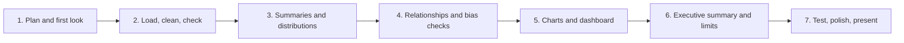

:::objectives
- Describe what the finished capstone includes and how it will be judged.
- Pick a project idea and dataset that match your time and skills.
- Rewrite a vague topic as a specific question with a comparison, a change, or a relationship.
- Run a first look that tests whether a dataset can answer your question before you commit to it.
- Fill in a planning template, including the biases you expect before you see results.
:::

Every skill from this course comes together here: loading and cleaning data, summarizing it, choosing honest charts, questioning your own claims, and packaging it all in a notebook anyone can rerun. The finished product is a **reproducible data investigation**, the kind of analysis you could hand to a teacher, a club, or a future employer and have them get your exact results.

## What you'll hand in

A Google Colab notebook (shared as a link or downloaded as an `.ipynb` file) that:

1. States one clear question at the top, with where the data came from and its license or terms.
2. Runs from top to bottom with **Runtime › Restart session and run all**, with no errors.
3. Loads the raw data without hand edits, cleans it in code, and logs what each cleaning step removed.
4. Checks its own assumptions with assertions.
5. Summarizes the data with appropriate centers and spreads.
6. Includes at least three charts, each chosen for a different question, with titles that state findings.
7. Discusses bias and limitations: who's in the data, who isn't, and what you can and can't conclude.
8. Opens (or closes) with an executive summary whose numbers are computed, not typed.
9. Exports its figures, and combines the key ones into a dashboard figure or a one-page report.

The last lesson of this module has the full rubric. You'll build in milestones, so no single sitting has to do everything.

## Five project ideas, from starter to stretch

Pick one, or adapt one to something you care about. Every option is free, and the first three need no download at all.

| Level | Project | Data | A good starting question |
| --- | --- | --- | --- |
| Starter | **Your own two-week log** | Track something about yourself daily: sleep, screen time, steps, practice minutes | Do I sleep less on nights I use my phone after 10 p.m.? |
| Starter | **What makes a wine a wine** | `sklearn.datasets.load_wine`: 178 wines from three growers in one region of Italy | Which chemical measurements differ most between the three growers? |
| Intermediate | **BMI and diabetes progression** | `sklearn.datasets.load_diabetes(scaled=False)`: 442 patients from one medical study | Is higher BMI linked to faster disease progression, and does it hold across age groups? |
| Intermediate | **Your city, in numbers** | A city or national open-data portal (such as [data.gov](https://data.gov/)): service requests, bike-share trips, library checkouts | Have pothole reports changed over the last three years, and in which neighborhoods? |
| Stretch | **Check a published chart** | A chart from the news plus its source data (for example from [Our World in Data](https://ourworldindata.org/)) | Does the chart's claim hold up when I rebuild it honestly and check for confounders? |

A few cautions. If you log your own data, keep it to things you're comfortable sharing, and don't collect data about other people without their permission. For open-data portals, read the dataset's documentation page before anything else: it tells you what each column means, how the data was collected, and what you're allowed to do with it.

:::tip
The starter projects aren't "easier grades." A two-week log has only 14 rows, which makes the limitations section genuinely interesting: what can 14 nights about one person tell you, and what can't they?
:::

## Turn a topic into a question

"Sleep" is a topic. "Screen time and sleep" is still a topic. A question you can answer has three parts: **what you'll measure**, **what you'll compare** (between groups, over time, or against another variable), and **who or when** it's about.

| Vague | Answerable |
| --- | --- |
| Wine chemistry | Which three of the 13 measurements differ most between the three growers? |
| Is BMI bad? | Among the 442 patients in this study, is BMI correlated with disease progression one year later, and does the link hold within age groups? |
| City potholes | Did pothole reports per month rise or fall from 2023 to 2025, and was the change similar across neighborhoods? |

Notice what the answerable versions avoid: "cause," "everyone," and "prove." Those words promise more than observational data can deliver, and Module 6 showed you why.

## Run a 15-minute first look

Before you commit to a dataset, spend fifteen minutes checking it can answer your question. Here's a first look at the wine data for the starter question above:

```python run
import numpy as np
import pandas as pd
import matplotlib.pyplot as plt
from sklearn.datasets import load_wine

wine = load_wine(as_frame=True).frame
print("Shape:", wine.shape)
print("Missing values:", int(wine.isna().sum().sum()))
print("Wines per grower:", wine["target"].value_counts().sort_index().to_dict())
print(wine[["alcohol", "flavanoids", "color_intensity", "proline"]].describe().round(2))
```

Four questions decide whether this dataset works. **Is it big enough?** 178 rows, roughly 50 to 70 per group: enough to compare groups, not enough for fine detail. **Is it clean?** No missing values, which is rare and worth noting. **Does it have the columns I need?** Yes, a group label and 13 measurements. **Do the groups differ at all?** One chart answers that:

```python run alt="Three stacked histograms of flavanoid levels on a shared axis, one per grower. Grower 0's wines sit between about 2.2 and 3.9. Grower 1's spread from about 0.6 to 5.1, with the middle half between 1.6 and 2.5. Grower 2's sit lowest, between about 0.3 and 1.6, with no overlap with grower 0." caption="A first look: one measurement already separates two of the growers"
BLUE, ORANGE, AQUA = "#2a78d6", "#eb6834", "#1baf7a"
fig, axes = plt.subplots(3, 1, figsize=(7, 4.6), sharex=True, sharey=True)
bins = np.arange(0, 5.6, 0.25)
for ax, grower, color in zip(axes, [0, 1, 2], [BLUE, ORANGE, AQUA]):
    values = wine.loc[wine["target"] == grower, "flavanoids"]
    ax.hist(values, bins=bins, color=color, edgecolor="white")
    ax.set_title(f"Grower {grower}: median {values.median():.2f}", loc="left", fontsize=10)
    ax.spines[["top", "right"]].set_visible(False)
axes[1].set_ylabel("Wines")
axes[2].set_xlabel("Flavanoids")
fig.tight_layout()
```

That's a promising first look: grower 2's wines don't overlap grower 0's at all on this one measurement, while grower 1 sits in between and overlaps both. The question clearly has an answer worth finding, and it already hints that you'll need more than one measurement to tell grower 1 apart. If your first look shows a dataset is tiny, mostly empty, or missing the column your question needs, change the question or the dataset *now*, not after a week of work.

:::warning
**Reading the documentation late.** The wine data's documentation says only that the wines come from one region of Italy and three growers. Nothing in the data tells you about wines from anywhere else, and a claim about "red wines" in general would go beyond it. Read the data's description before you write your question, so your question stays inside what the data covers.
:::

## Write your plan

Copy this template into the first text cell of your capstone notebook and fill it in. Some answers will change as you work; update them, and keep the old versions in a "changes" note at the bottom so a reader can see how the plan evolved.

```text
PROJECT PLAN
Question:            (measure + comparison + who/when)
Data source:         (link, who collected it, when, license or terms)
One row is:          (one wine? one patient? one day?)
Columns I need:      (name, type, and what it means)
Cleaning I expect:   (duplicates, missing values, impossible values, types)
Summaries:           (which centers and spreads, for which groups)
Charts (at least 3): 1. ... answers ...
                     2. ... answers ...
                     3. ... answers ...
Bias pre-mortem:     Who or what is missing from this data?
                     How was it measured, and by whom?
                     What confounders could explain a pattern I find?
What I will NOT be able to claim:
Milestone dates:     (see below)
```

The **bias pre-mortem** is the most important part. Writing down possible problems *before* you see any results keeps you honest later: you can't quietly decide a confounder doesn't matter just because your finding is exciting.

## Milestones

Build in stages, and run **Restart session and run all** at the end of every one. A notebook that breaks at milestone 2 is easy to fix; one that breaks at milestone 6 with five milestones of hidden state behind it is not.



The next lesson walks through milestones 2 to 6 on a worked example with a starter notebook you can adapt. The one after covers milestone 7: testing, polishing, and presenting.

:::video lgCNTuLBMK4
What to watch for: the steps of the data analysis process, from defining the question to sharing results. Match each step to one of the seven milestones above.
:::

:::takeaways
- The capstone is a notebook that reruns cleanly and turns raw data into an honest, well-charted answer to one question.
- Pick a project for the question you care about; small datasets make for rich limitations sections.
- An answerable question names a measurement, a comparison, and who or when.
- A 15-minute first look tests size, cleanliness, columns, and whether groups differ before you commit.
- Write the bias pre-mortem before you see results, and end every milestone with Restart session and run all.
:::

## Further reading

- [scikit-learn toy datasets](https://scikit-learn.org/stable/datasets/toy_dataset.html): the documentation for the wine and diabetes datasets, including where they came from.
- [Our World in Data](https://ourworldindata.org/): thousands of documented charts on health, energy, and the economy, each with a downloadable CSV and sources.
- [Kaggle Learn: Data Visualization](https://www.kaggle.com/learn/data-visualization): free short lessons to practice more chart types once your capstone is done.
