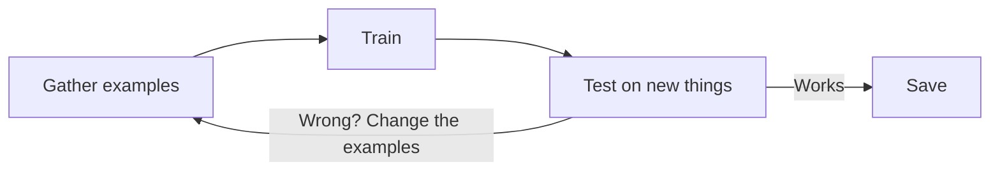

:::objectives
- Record examples for two classes using Hold to Record or uploaded photos.
- Train a model and read the Output bars in Preview.
- Test the model on new situations and predict the result before you look.
- Explain why a two-class model still picks a class when you show it nothing.
- Fix the problems that stop a first training run.
:::

Here's the plan for the next ten minutes. You'll show your webcam about a hundred pictures of your hand, half giving a thumbs-up and half a thumbs-down. You'll click one button. Then you'll hold up your hand and watch a bar jump to "Thumbs up" in real time.

After that comes the part most tutorials skip: trying to break it. A model that works on the pictures you just took proves very little. A model that works on situations you didn't record is the real test, and the very first one you try will probably surprise you.



## Step 1: Name your two classes

Open a new **Image Project** with the **Standard image model**, as in the last lesson.

1.  Click the pencil next to **Class 1** and type `Thumbs up`.
2.  Click the pencil next to **Class 2** and type `Thumbs down`.

Names matter more than they seem. The model never reads them; it only sees pictures. But the names are your promise about what each pile *should* contain, and later you'll check the model against that promise.

## Step 2: Record your examples

On the **Thumbs up** card, click **Webcam**. Make a thumbs-up and **press and hold Hold to Record**. While holding, move: bring your hand closer and farther, tilt it, slide it left and right. Let go after three or four seconds. The card now says something like "84 Image Samples", with thumbnails beside the camera view.

Now do the same on the **Thumbs down** card, from the same seat, with roughly the same number of samples.

Why all the moving? Every thumbnail is one example. If every example shows your hand in exactly the same spot, the model learns "a hand in that spot". If the examples vary, the only thing they all share is the thing you care about: the direction of the thumb.

:::tip
**No webcam, or the camera is blocked?** Take 30 photos of each gesture on a phone, copy them to your computer, and on each card click **Upload**, then "Choose images from your files, or drag & drop here." Teachable Machine crops every image to a square, so keep your hand near the middle of the shot.
:::

## Step 3: Train

Click **Train Model**. You'll see "Preparing training data...", then the button changes to "Training..." with a counter. A message appears: **Don't switch tabs!** It means it: the browser slows down tabs you aren't looking at, and training can stall. On most laptops this takes under a minute; an older Chromebook can take a few.

When the button reads **Model Trained**, you're done.

## Step 4: Read the Preview

The Preview panel now shows your webcam with **Input** switched on, and an **Output** section with one bar per class. Hold up a thumbs-up. You should see something like this:

```text
Output
Thumbs up     ███████████████████  98%
Thumbs down   ▏                     2%
```

Flip your thumb down and the bars swap. That's a working machine learning model, trained by you, running on your computer.

The percentages add up to 100. They show how strongly the model leans toward each class for the picture it's seeing right now. They are **not** a promise that it's right; Module 5 spends a whole lesson on why a model can be 99% sure and wrong.

## Step 5: Prove it works on things it hasn't seen

Before each test, write down your prediction: which bar will win, and roughly how high? Then try it.

| Test | Your prediction | What happened |
| --- | --- | --- |
| Thumbs-up with your **other** hand | | |
| Thumbs-up in a corner of the frame | | |
| Thumbs-up with the lights dimmed | | |
| A thumbs-sideways | | |
| **Nothing at all**: move out of the frame | | |

The last row is the one to think hardest about. Take your hand away, so the camera sees only the wall behind you.

The model still picks a class. Often with high confidence.

That's not a bug in Teachable Machine; it's how this kind of model works. You gave it exactly two answers to choose from, so it must choose one. It has no idea "neither" is an option, because you never showed it what "neither" looks like. A thumbs-sideways gets forced into one of the two piles the same way.

## Step 6: Teach it "nothing"

1.  Click **Add a class** and name the new card `Nothing`.
2.  Click **Webcam**, step out of the frame, and hold to record the empty background for about the same number of samples as the other classes. Move the camera slightly, or turn a lamp on and off, so the empty scene varies.
3.  Click **Train Model** again.

Repeat the empty-frame test. Now the **Nothing** bar should win. You changed nothing about the model's settings, you only changed the examples, and the model's behavior changed with them. That idea, *the examples decide what the model learns*, runs through this entire course.

:::video CO67EQ0ZWgA
Google's one-minute clip of the training step. Watch where the Train Model button sits and how the Preview panel comes alive afterward, so you know what "it worked" looks like.
:::

## When something goes wrong

:::warning
**A card says `"Class 2" requires at least 1 sample.`** Training needs at least two classes, and every class that's switched on needs samples. Record into the empty card, or remove it: the three-dot menu on a class card has **Delete Class** and **Disable Class**.
:::

:::warning
**Training seems frozen.** You probably switched tabs or minimized the window. Come back to the tab and wait. If it's still stuck after a few minutes, close other tabs (especially video sites), reload, and train again. Your samples are lost on reload unless you saved, so keep the class sizes small (50 to 100 each) on slow computers.
:::

:::warning
**It always says the same class, whatever you do.** Look at your samples. Usually one class has far more examples than the other, or the two classes were recorded in different places, so the model learned the background instead of your hand. Record both classes from the same seat with similar numbers of samples, then retrain.
:::

:::quiz
Q: You trained Thumbs up and Thumbs down only. You point the camera at an empty chair and see "Thumbs down 91%". What's the best explanation?
- [ ] The chair looks like a thumbs-down
  The model isn't reasoning about shapes like you do. It has to pick from the two answers it knows.
- [x] The model can only answer with the classes it was given, so it picked the closer one
  With no "Nothing" class, every picture gets forced into Thumbs up or Thumbs down, often with high confidence.
- [ ] Training failed and needs to be run again
  Training worked; the model is doing exactly what two classes allow. The fix is a new class, not a rerun.

Q: Your thumbs-up samples were recorded in your bedroom and your thumbs-down samples in the kitchen. The model scores perfectly in each room. What has it most likely learned?
- [ ] Thumb direction, very accurately
  It might have, but you can't tell, because the room alone separates the two classes.
- [x] Which room the picture was taken in
  Background is the biggest, easiest difference between the two piles, so the model can lean on it. Test with a thumbs-down in the bedroom to find out.
- [ ] Nothing, because backgrounds are ignored
  The model sees the whole picture. Nothing tells it to ignore the background.

Q: What changed the model's behavior when you added the Nothing class?
- [ ] A different training setting
  You didn't touch Advanced; the settings were identical.
- [x] Different examples
  New examples gave the model a third answer and showed it what that answer looks like.
- [ ] Teachable Machine updated itself
  Nothing outside your tab changed between the two training runs.
:::

:::takeaways
- The workflow is gather, train, test on new things, then change the examples if it's wrong.
- Varied examples teach the thing you care about; identical examples teach the spot, the light, or the background.
- The Output bars show how strongly the model leans, not whether it's right.
- A model can only answer with the classes it was given, so "nothing" needs its own class.
- Keep the tab in front of you while training.
:::
