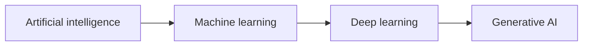

:::objectives
- Decide whether a system follows rules a person wrote or patterns it learned from examples.
- Explain how AI, machine learning, deep learning, and generative AI fit inside each other.
- Name the task family of a system (classification, regression, clustering, recommendation, or generation) from the kind of answer it gives.
- Describe what a chatbot is actually doing when it answers, and what that means for trusting it.
:::

A school newsletter announces five "AI-powered" upgrades:

1.  The bell rings automatically at 8:05.
2.  The email system moves spam to a junk folder.
3.  The attendance system emails a parent after three absences.
4.  The library website says "students who borrowed this also borrowed…"
5.  A help-desk chatbot answers questions about the timetable.

Two of these involve no learning at all. Someone wrote the bell time and the "three absences" rule down, and the computer follows them exactly. The other three were shaped by examples. By the end of this lesson you'll be able to sort any system like this in about ten seconds, and say what kind of task it's doing.

## Rules: a person wrote the decision down

A **rule-based system** follows instructions someone typed in: *if absences ≥ 3, email the parent.* Rules are predictable, easy to explain, and easy to change. Ask "why did it email my mom?" and the answer is one sentence.

Rules break in a specific way: on cases the writer didn't imagine. Try writing rules for spam. "If the email contains FREE, it's spam" catches some spam, but also your friend's message about free pizza at the club meeting. Add an exception, then another, and soon you have hundreds of rules that still miss spam written in new ways.

## Machine learning: the decision is learned from examples

Machine learning flips the job around. Instead of writing the rule, you collect examples where the right answer is already known (thousands of emails people marked as spam or not spam) and a training process finds the pattern for you. The result is a **model**: something that takes a new email and returns an answer.

```mermaid caption="Same goal, opposite inputs: rules come from a person, or from examples"
flowchart LR
    subgraph R [Rule-based]
        R1[Data] --> R3[Program]
        R2[Rules a person wrote] --> R3
        R3 --> R4[Answers]
    end
    subgraph M [Machine learning]
        M1[Data] --> M3[Training]
        M2[Known answers] --> M3
        M3 --> M4[Model: learned rules]
    end
```

That's exactly what you did with thumbs up and thumbs down. You never described what a thumbs-up looks like. You gave labeled pictures, and training worked out the pattern.

The test for "is this machine learning?" is one question: **who wrote the decision, a person or a training process?** It's not whether the system uses data (the attendance rule uses data), and it's not whether the company calls it AI.

## AI is the umbrella; machine learning is one way to get there

**Artificial intelligence** is the broadest term: any system that does something we'd normally say takes intelligence, like playing chess, recognizing speech, or planning a route. Older AI was often built mostly from rules. IBM's Deep Blue, which beat the world chess champion in 1997, searched through millions of moves using scoring rules written with help from chess experts.



-   **Machine learning** is the part of AI where behavior is learned from examples.
-   **Deep learning** is machine learning with neural networks that have many layers. Module 4 shows how one learns. The model inside Teachable Machine is one.
-   **Generative AI** is deep learning used to produce new text, images, audio, or video, like chatbots and image generators.

So every chatbot is deep learning, which is machine learning, which is AI. But not all AI is machine learning, and plenty of things labeled "AI" in advertising are plain rules.

## Five task families, told apart by the answer

Once you know a system learned from data, the next question is: what kind of answer does it give? That decides almost everything else, including what data it needs and how you'd check it.

| Task family | The answer is… | Everyday examples |
| --- | --- | --- |
| **Classification** | one label from a fixed list | spam or not spam; which bird is at the feeder; thumbs up or down |
| **Regression** | a number on a scale | minutes until the bus arrives; tomorrow's high temperature; a house price |
| **Clustering** | groups that nobody labeled in advance | a photo app grouping faces; a store grouping shoppers by habits |
| **Recommendation** | a ranked list chosen for one person | the next video; songs "for you"; "also borrowed" at the library |
| **Generation** | something new: text, an image, a sound | a chatbot's reply; an image from a prompt; autocomplete |

Three of these are easiest to tell apart in a picture. Each dot below is one example:

```python run alt="Three scatter plots side by side. Left: blue circles and orange triangles separated by a dashed line, labeled classification. Middle: dots rising with an orange trend line, labeled regression. Right: three separate groups of dots in three colors, labeled clustering." caption="Same kind of data, three different jobs"
import numpy as np
import matplotlib.pyplot as plt
from sklearn.cluster import KMeans

rng = np.random.default_rng(7)
BLUE, ORANGE, AQUA, GREY = "#2a78d6", "#eb6834", "#1baf7a", "#888888"
fig, axes = plt.subplots(1, 3, figsize=(11, 3.6))

# Classification: each email is a dot, the answer is a label
spam = rng.normal([7, 6], 1.0, size=(25, 2))
ham = rng.normal([3, 2.5], 1.0, size=(25, 2))
ax = axes[0]
ax.scatter(*ham.T, color=BLUE, marker="o", label="Not spam")
ax.scatter(*spam.T, color=ORANGE, marker="^", label="Spam")
ax.plot([1, 9], [8.5, 0.5], "--", color=GREY)
ax.set_title("Classification\nanswer = a label", loc="left")
ax.set_xlabel("Links in the email")
ax.set_ylabel("Words like 'FREE!'")
ax.legend(frameon=False, loc="upper left")

# Regression: the answer is a number on a scale
km = rng.uniform(0.5, 8, 30)
minutes = 6 + 4 * km + rng.normal(0, 3, 30)
ax = axes[1]
ax.scatter(km, minutes, color=BLUE)
slope, intercept = np.polyfit(km, minutes, 1)
xs = np.array([0, 8.5])
ax.plot(xs, slope * xs + intercept, color=ORANGE, linewidth=2)
ax.set_title("Regression\nanswer = a number", loc="left")
ax.set_xlabel("Distance (km)")
ax.set_ylabel("Delivery time (min)")

# Clustering: no labels at all; the groups are found
shoppers = np.vstack([
    rng.normal([2, 8], 0.8, size=(20, 2)),
    rng.normal([7, 7], 0.8, size=(20, 2)),
    rng.normal([5, 2], 0.8, size=(20, 2)),
])
groups = KMeans(n_clusters=3, n_init=10, random_state=0).fit_predict(shoppers)
ax = axes[2]
for g, (color, marker) in enumerate([(BLUE, "o"), (ORANGE, "^"), (AQUA, "s")]):
    ax.scatter(*shoppers[groups == g].T, color=color, marker=marker)
ax.set_title("Clustering\nanswer = groups nobody labeled", loc="left")
ax.set_xlabel("Visits per month")
ax.set_ylabel("Average spend ($)")

for ax in axes:
    ax.spines[["top", "right"]].set_visible(False)
    ax.set_xticks([])
    ax.set_yticks([])
fig.tight_layout()
```

**Left, classification.** Every email arrives already labeled, and the model's job is to draw a dividing line (the dashed one) so a new email can be put on the right side. The answer is a category.

**Middle, regression.** The answer is a number that can land anywhere on a scale. The model draws a trend line, and a new delivery 5 km away gets the time on the line above 5.

**Right, clustering.** Nobody labeled these shoppers. The colors were *found* by an algorithm that grouped dots close to each other. A store might then notice "the frequent small spenders" and treat them differently. Nobody told it those groups existed.

A quick way to separate the first two: ask whether an answer halfway between two others makes sense. Halfway between 20 and 30 minutes is 25 minutes, so delivery time is regression. Halfway between "spam" and "not spam" isn't a thing, so that's classification.

## What a chatbot is actually doing

A chatbot like ChatGPT, Gemini, or Claude is built on a **large language model**. It was trained on an enormous amount of text to do one thing: given some text, predict what comes next, one small piece at a time. It was then trained further, with people rating its answers, to follow instructions and be helpful. That makes it a generation system.

That one fact explains most of its behavior:

-   **It writes what is *likely*, not what is *checked*.** Fluent, confident text is what it's built to produce, whether or not the facts are right. Made-up book titles, quotes, and citations are a well-known result.
-   **Its knowledge stops at its training data.** Some chatbot apps add tools like web search. Then the model can read current pages, but it still writes the answer by predicting text, so it can misread or misquote them.
-   **It isn't looking answers up in a database**, and sounding sure doesn't mean it is sure. Module 5 is about exactly this gap.

Chatbots are very good at drafting, explaining, rephrasing, and brainstorming. They're risky when you need a fact to be true and don't check it.

:::video X-AWdfSFCHQ
Code.org's "How AI Works" episode on chatbots. Watch for the moment it shows the model choosing the next word from a list of likely ones; that's the "predict what comes next" idea above.
:::

:::warning
**"It uses data, so it's machine learning."** Rules use data too: the attendance system reads absence counts. The question is whether the *decision* was written by a person or learned from examples.
:::

:::warning
**"The answer is a number, so it's regression."** Numbers can be names. A zip code or a jersey number is a label: halfway between zip 94110 and 94112 isn't a place. Use the halfway test, not the digits.
:::

:::video a0_lo_GDcFw
Crash Course AI's first episode. Watch for how it separates what today's AI can do (narrow, specific tasks) from the general intelligence in movies. It's the same "what kind of task?" thinking as this lesson.
:::

:::quiz
Q: Thermostat A turns the heat on whenever the room drops below 19°C. Thermostat B notices when you turn the heat up each day and starts doing it for you. Which one uses machine learning?
- [ ] A, because it measures temperature
  Measuring something is data, but the 19°C rule was written by a person.
- [x] B, because its behavior comes from patterns in your past adjustments
  Nobody typed in your schedule; it was learned from examples of what you did.
- [ ] Both, because both are automatic
  Automatic isn't the same as learned. A light timer is automatic too.

Q: A music app shows a list of 20 songs "picked for you", best match first. Which task family is that?
- [ ] Classification
  It isn't putting each song into one of a few fixed labels.
- [ ] Generation
  The songs already exist; nothing new is being created.
- [x] Recommendation
  It ranks existing items for one particular person. That's the shape of a recommendation answer.

Q: Which of these is a regression task?
- [ ] Will the bus be late: yes or no?
  Two possible answers from a fixed list is classification.
- [x] How many minutes late will the bus be?
  The answer is a number on a scale, and halfway between 4 and 6 minutes (5 minutes) makes sense.
- [ ] Which route number is this bus?
  Route numbers are names. Halfway between route 12 and route 14 is not route 13.

Q: A chatbot gives you a perfect-sounding quote and the book it came from for your essay. What's the sensible next step?
- [ ] Use it; chatbots are trained on books
  Training on text doesn't mean it retrieves exact quotes. It predicts likely text, which can include invented quotes.
- [x] Find the quote in the actual book or a library catalog before using it
  A generation system produces plausible text. Checking the source is the only way to know it's real.
- [ ] Ask the chatbot whether it's sure
  Its answer to that is also predicted text. Confidence in its reply doesn't verify anything.
:::

:::takeaways
- Rule-based systems follow decisions a person wrote; machine learning systems learn decisions from examples with known answers.
- AI contains machine learning, which contains deep learning, which contains generative AI.
- Name the task by its answer: a label (classification), a number (regression), unlabeled groups (clustering), a ranked list for one person (recommendation), or something new (generation).
- The halfway test separates regression from classification.
- Chatbots generate likely text; that's why they're fluent, and why their facts need checking.
:::

## Further reading

-   [What is Machine Learning? (Google for Developers)](https://developers.google.com/machine-learning/intro-to-ml/what-is-ml): a short, clear page on the main types of machine learning, from Google's machine learning courses.
-   [Elements of AI, Chapter 1](https://course.elementsofai.com/1/1): a free course from the University of Helsinki that's excellent on what does and doesn't count as AI.
-   [How AI Works (Code.org)](https://code.org/ai/how-ai-works): the full video series, including the chatbot episode above.
