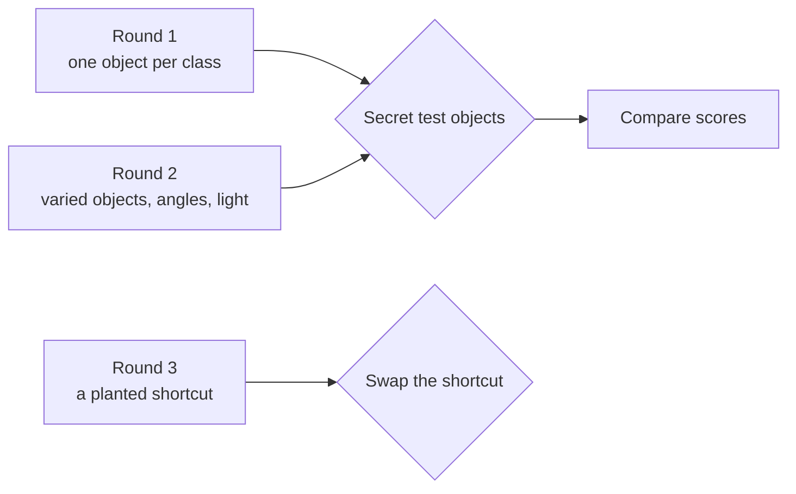

:::objectives
- Plan a dataset on paper: classes, a labeling rule, and a secret test set.
- Train a three-class image model and test it on objects it has never seen.
- Improve a model by changing only its examples, with every setting left the same.
- Design an experiment that reveals a shortcut the model learned instead of the real idea.
:::

In the last lesson the recycling sorter got to measure weight and shininess. Teachable Machine doesn't let you pick features: a pre-trained network computes them from each picture. So how do you control what your model pays attention to?

You'll find out by running one experiment three times. Same classes, same settings, same Train Model button. Only the examples change, and you'll watch the model's behavior change with them.



## What you need

-   **Three paper items**: say an envelope, a sheet of newspaper, and a cardboard tube.
-   **Three plastic items**: say a water bottle, a yogurt cup, and a plastic bag.
-   **One more of each, kept hidden**: a paper cup or cereal box, and a different plastic container. These are your **secret test objects**. They never go in front of the camera during training.
-   An empty patch of desk.

No objects handy? Do the same experiment with drawings: pencil sketches versus pen sketches work, or apples versus oranges from photos you take.

## Step 1: Plan the dataset on paper

Write this in your journal before touching the computer:

| Class | Objects used for training | Secret test object |
| --- | --- | --- |
| Paper | envelope, newspaper, tube | cereal box |
| Plastic | bottle, yogurt cup, bag | different container |
| Empty | the empty desk | the desk with a pencil on it |

Then write a **labeling rule** for the hard cases. Is a paper cup with a plastic lining paper? Is a bottle with a paper label plastic? Decide now ("anything with a plastic body is Plastic") so you label the same way every time.

The secret test objects are the most important part of this plan. A model's score on things it trained on tells you almost nothing. Its score on things it has never seen is the score that counts.

## Step 2: Round 1, a narrow dataset

1.  Start a new **Image Project** (Standard image model).
2.  Rename the classes `Paper`, `Plastic`, and `Empty` (use **Add a class** for the third).
3.  For **Paper**, record only the envelope: hold it still, close to the camera, same angle, about 50 samples.
4.  For **Plastic**, record only the water bottle, the same way.
5.  For **Empty**, record the empty desk, about 50 samples.
6.  Click **Train Model**.

Point the camera at the envelope and the bottle. It works, of course. Now save this version (**Download project as file**, `m3-sorter-v1.tm`) before you test.

## Step 3: Test Round 1 with the secret objects

Predict first: will the cereal box be called Paper? Write it down. Then show each secret object, in two positions each, and record the top class:

| Test | Prediction | Round 1 result | Round 2 result |
| --- | --- | --- | --- |
| Cereal box, close | Paper | | |
| Cereal box, far | Paper | | |
| Other plastic container, close | Plastic | | |
| Other plastic container, far | Plastic | | |
| Desk with a pencil | Empty | | |

Expect several misses. The model learned from exactly one paper object and one plastic object. As far as it knows, "Paper" means *that envelope at that distance*. A cereal box shares the material but almost nothing in the picture.

## Step 4: Round 2, varied examples

Keep the same project. For each class, add samples, and keep the old ones:

-   **Paper**: record the newspaper and the tube too. Rotate each object while recording. Move it closer and farther. Tilt the camera a little.
-   **Plastic**: add the yogurt cup and the bag the same way.
-   **Empty**: record the desk with the lamp on and off, and from a slightly different angle.
-   Keep the class sizes roughly equal (around 150 each).

Don't touch **Advanced**. Click **Train Model**, then run exactly the same five tests and fill in the Round 2 column.

The scores should rise. Nothing about the model changed: the same pre-trained network computed features in the same way, and the training settings were identical. The only difference is that the one thing all the Paper examples now share is *being paper-like*, rather than being a particular envelope. Save as `m3-sorter-v2.tm`.

## Step 5: Round 3, plant a shortcut and catch it

Now break the model on purpose, to see what it really learns.

1.  Open the menu and choose **New Project**, then make an image project with classes `Paper` and `Plastic` only.
2.  Record every **Paper** sample with the object **held in your hand**.
3.  Record every **Plastic** sample with the object **sitting on the desk**, no hand in view.
4.  Train.

Before you test, predict: if you hold a plastic bottle in your hand, what will the model say?

Try it. Most likely: **Paper**. Then put a paper item on the desk without your hand: probably **Plastic**.

The model did exactly what it was asked: find whatever reliably separates the two piles. In these examples, "a hand is in the picture" separated them perfectly, and it's much easier to spot than paper versus plastic. Your class names said one thing; your examples taught another. When a model latches onto a feature that happens to go with the label in the training data but isn't the real reason, that's called a **shortcut**, and it's one of the most common ways real models fail.

## Step 6: See it as a table

Put the three rounds side by side:

| Round | What the examples had in common | What the model learned |
| --- | --- | --- |
| 1 | one object, one distance per class | "that envelope" versus "that bottle" |
| 2 | many objects, angles, and lighting | closer to paper-ness versus plastic-ness |
| 3 | hand in every Paper picture, never in Plastic | hand versus no hand |

That's the lesson of Module 3 in one table: a model learns whatever is consistent within each class and different between classes. Your job, when you can't choose features, is to make sure the only consistent difference is the one you mean.

## The finished project

```text
Project:   m3-sorter-v2.tm
Task:      classification, 3 labels (Paper, Plastic, Empty)
Examples:  ~150 per class; 3 objects per class, varied angle, distance, light
Test set:  2 secret objects + 1 desk scene, never trained on
Result:    record your Round 1 and Round 2 scores, e.g. "2/5 then 4/5"
Watch for: shortcuts like hands, backgrounds, or distance
```

:::video kwcillcWOg0
The Coding Train trains an image classifier in Teachable Machine. Watch the opening section, where objects are recorded into classes and then tested live; notice how the presenter varies the samples. The later code part isn't needed.
:::

:::quiz
Q: Why did you keep the cereal box and the extra container hidden during training?
- [ ] So the model would train faster
  Two extra objects make almost no difference to training time.
- [x] So you could measure how the model does on objects it has never seen
  A model can do well on its own training objects without having learned the idea. Only unseen objects reveal that.
- [ ] Because Teachable Machine only allows three objects per class
  There's no such limit; you can record as many as you like.

Q: In Round 2 you changed only the examples, and the scores went up. What does that show?
- [x] The examples decide what the model learns, even when every setting stays the same
  The network and the training settings were identical. The new variety gave the model a better pattern to find.
- [ ] More samples always means a better model
  Not always. Round 3 could have had thousands of samples and still learned "hand versus no hand".
- [ ] The first model was trained incorrectly
  It was trained correctly on narrow examples. It learned exactly what those examples showed.

Q: A friend's sorter calls everything on their kitchen counter "Plastic". All their Plastic samples were recorded on the counter and all their Paper samples on the table. What's the best fix?
- [ ] Rename the classes
  The model never reads the names.
- [ ] Increase the number of epochs
  More training on the same examples makes the shortcut stronger, not weaker.
- [x] Record both classes on both surfaces
  When the background appears in both classes, it no longer separates them, so the model has to rely on the objects.
:::

:::takeaways
- In Teachable Machine you choose examples, not features, so the examples are how you steer the model.
- Test on secret objects the model never trained on; that's the only score that counts.
- Variety in angle, distance, lighting, and object makes the real idea the only thing each class has in common.
- A model learns any consistent difference between classes, including shortcuts like hands or backgrounds.
- Change one thing per round and keep the settings fixed, so you know what caused the change.
:::

## Extend it

-   Add a `Metal` class with cans and foil. Which plastic items get confused with it?
-   Test your Round 2 model in another room. If it drops, add samples from that room and retest.
-   Ask a friend to bring three objects you've never seen. They're the toughest secret test set you can get.

## Further reading

-   [Data Collection and Evaluation (Google People + AI Guidebook)](https://pair.withgoogle.com/chapter/data-collection/): how professional teams plan what examples to collect, written for designers rather than programmers.
-   [Teachable Machine FAQ: "Why isn't it working like I want it to?"](https://teachablemachine.withgoogle.com/faq): Google's suggestions for confusing a model on purpose, including changing backgrounds and showing a drawing of the object.
