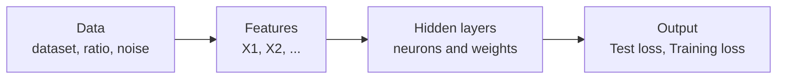

:::objectives
- Train a neural network in TensorFlow Playground and read its training loss and test loss.
- Explain what the neurons, lines, and background colors show while it learns.
- Make a network overfit on purpose by changing the data split, the noise, and the network size.
- Fix overfitting three ways, changing one thing at a time and recording the result.
- Connect the Playground's two loss numbers to the charts in Teachable Machine's Under the hood panel.
:::

Teachable Machine hides its network. You press Train Model and a minute later it works, but you never see a neuron. Today you'll use a different free tool, **TensorFlow Playground**, made by Google researchers to show exactly what a small network is doing while it learns. Every neuron is a little picture, every weight is a line, and two numbers at the top right tell you how it's doing on training data and on test data.

You'll train one network that works, then deliberately build one that memorizes, then fix it. By the end you'll have a page of journal notes like this:

| Run | What I changed | Training loss | Test loss | Verdict |
| --- | --- | --- | --- | --- |
| 1 | Defaults, Circle data | | | |
| 2 | Noisy data, 10% training, big network | | | |
| 3 | Training data back up to 70% | | | |



## Step 1: Open the Playground and find the controls

Go to `playground.tensorflow.org`. It runs in any modern browser, needs no account, and, as the page itself promises, you can't break it. You'll see:

-   **Top bar**: a play button (Run/Pause), a reset button, a step button, the **Epoch** counter, and drop-downs for **Learning rate** (0.03), **Activation** (Tanh), **Regularization**, and **Problem type** (Classification).
-   **Data** (left): four small pictures under "Which dataset do you want to use?" (Circle, Exclusive or, Gaussian, Spiral), then sliders for **Ratio of training to test data** (50%), **Noise** (0), and **Batch size** (10).
-   **Features**: inputs the network gets. By default only **X1** and **X2**, a dot's horizontal and vertical position, are on.
-   **Hidden layers** (middle): two layers, of 4 and 2 neurons, with **+** and **−** buttons to add or remove layers and neurons.
-   **Output** (right): **Test loss** and **Training loss**, a small chart of both over time, and a big picture of the data.

The colors follow one rule: **blue means positive, orange means negative.** Each dot is an example, labeled blue or orange. The background shows what the network predicts for every spot, and stronger color means a more confident prediction.

## Step 2: Train the default network

Leave everything as it is (Circle dataset: a blue cluster surrounded by an orange ring). Press **play**.

Watch three things for about 20 seconds:

1.  **The background.** It starts as a blur and quickly forms a blue blob in the middle with orange around it. That's the decision boundary from Module 3, forming live.
2.  **The lines between neurons.** They change thickness and color as training nudges the weights. Thick means a large weight; blue lines are positive weights and orange lines negative.
3.  **The two losses.** Both fall toward zero and stay close together.

Press **pause** after a few hundred epochs. Write the epoch count, training loss, and test loss in Run 1 of your journal.

Remember the trace in the last lesson, where one weight crept toward 5? This network has a couple of dozen weights, and every one of them was being nudged at the same time, epoch after epoch, in whatever direction lowered the loss.

## Step 3: Look inside the neurons

Hover over a neuron in the **first** hidden layer. A larger version of its picture appears on the right. Each first-layer neuron draws a **straight** split across the data: blue on one side, orange on the other. It's one weighted vote of X1 and X2, exactly like the neuron chart from the last lesson, just with two inputs instead of one.

Now hover over a neuron in the **second** layer. Its picture has curved edges. It combined several straight splits from the first layer into something more complex. That's the whole idea of depth: each layer builds on the pieces made by the layer before it, which is how a deep network goes from edges to shapes to "thumbs up".

:::try
Remove neurons with the **−** button until the first layer has only 1, then press reset and play. A single straight split can't surround a circle, so the losses stay high. Add neurons back until it works. How many does the circle need?
:::

## Step 4: Make it overfit on purpose

Now set up the conditions for memorizing. Press reset, then change these one by one:

1.  Click the **Gaussian** dataset (two clusters, blue and orange).
2.  Drag **Noise** up to **50**. The clusters now overlap, with many dots on the "wrong" side. Those are the noisy examples.
3.  Drag **Ratio of training to test data** down to **10%**, so the network learns from very few dots.
4.  Make the network big: add hidden layers until there are **4**, and give each layer **8** neurons.
5.  Tick **Show test data** under the output, so you can see the dots the network never trains on.

Before pressing play, predict in your journal: will the training loss and test loss stay together, as in Run 1?

Now press **play** and let it run for at least 1,000 epochs. In most runs, you'll see the **training loss keep dropping** while the **test loss stops improving and then creeps up**. Look at the background: little islands and fingers of color appear around individual training dots. The network is bending its boundary to swallow single noisy examples. It's the "memorized" panel from the last lesson, with a real network.

Record Run 2. Your exact numbers will differ (every run starts from different random weights), but the gap between the two losses is what matters.

:::warning
**"The training loss is tiny, so it's a great model."** That's the trap. The training loss only tells you how well it fits the dots it learned from. With noisy data and few examples, a low training loss and a rising test loss means memorizing. Always read both numbers.
:::

## Step 5: Fix it three ways, one change at a time

Starting from the Run 2 settings each time, change exactly **one** thing, press reset and play, and record training loss and test loss after about the same number of epochs as Run 2:

1.  **More data.** Drag **Ratio of training to test data** back up to **70%**. With more examples, single noisy dots matter less, and the boundary smooths out.
2.  **A smaller network.** Back to 10% data, but cut the network to **1 hidden layer** with **2 neurons**. It doesn't have enough freedom to wrap around individual dots.
3.  **Stop early.** Back to the big network and 10% data. Watch the test loss and press **pause** when it's at its lowest, before it starts climbing. You keep the version that was best on new data.

Which fix gave the lowest test loss in your runs? There's no single right answer. All three show the same principle from the curve in the last lesson: you want the model that does best on data it hasn't seen, not the one that fits its training data most perfectly.

:::tip
Changing one thing per run is what makes your journal useful. If you changed the data *and* the network size at once and the test loss improved, you'd have no idea which change did it.
:::

## Step 6: Push the learning rate

Go back to the defaults by typing `playground.tensorflow.org` into the address bar again. (Reloading isn't enough: the Playground saves your settings in the page's address, after the `#`.) Set **Learning rate** to **3** and press play. The background flickers and the loss jumps around instead of settling: each nudge is so large it overshoots. Then try **0.0001**: almost nothing happens for a long time, because each nudge is tiny. The default, 0.03, sits in between. This is the same overshooting you'll see in the practice lesson, live.

## Step 7: Find the same two lines in Teachable Machine

Open your recycling sorter from Module 3 (**Open project from file**). Under **Train Model**, open **Advanced**, click **Under the hood**, and train again. Teachable Machine draws **Accuracy per epoch** and **Loss per epoch**, each with a training line and a test line, just like the Playground's two numbers. Its test samples are a random 15% of your samples.

Notice one difference. In the Playground, test dots are drawn from the same pattern but are truly separate examples. In Teachable Machine, your samples are webcam frames recorded a split second apart, so the 15% test bucket is full of near-twins of training frames. That's why its test line can look excellent even for a model that fails in another room. Module 5 builds a proper stress test for that.

## The finished journal page

```text
Run 1  Circle, defaults                    train ____  test ____   healthy
Run 2  Gaussian, noise 50, 10%, 4x8 net    train ____  test ____   overfit
Run 3  same, ratio 70%                     train ____  test ____
Run 4  same as 2, 1 layer of 2 neurons     train ____  test ____
Run 5  same as 2, paused at lowest test    train ____  test ____
Best fix in my runs: ______  because ______
```

:::video EuBBz3bI-aA
StatQuest on bias and variance. Watch for the squiggly line that fits every training point but misses the test points: it's what the background in Step 4 was doing, explained with a different example.
:::

:::quiz
Q: In Run 2, training loss is 0.05 and test loss is 0.45 and rising. What's happening?
- [ ] The network is underfitting
  An underfit network does badly on training data too. This one fits its training dots very well.
- [x] The network is memorizing noisy training dots, so it does worse on new ones
  A large and growing gap between training loss and test loss is the signature of overfitting.
- [ ] The test data is broken
  The test dots come from the same pattern. They're revealing what the training loss hides.

Q: Why did you change only one setting per run in Step 5?
- [x] So that any change in test loss can be traced to that one setting
  If two things change at once, you can't tell which one helped or hurt.
- [ ] Because the Playground only allows one change per run
  You can change as many settings as you like; the limit is your ability to explain the result.
- [ ] To make training faster
  Changing fewer settings doesn't affect speed.

Q: A first-layer neuron's picture shows a straight split, but a second-layer neuron's picture has curves. Why?
- [ ] Second-layer neurons use a different kind of math
  They do the same weighted sum and squash. The difference is what they receive.
- [x] The second layer combines the outputs of several first-layer neurons
  Mixing several straight splits, each with its own weight, can produce curved and closed shapes.
- [ ] The second layer has seen more epochs
  Every layer trains for the same number of epochs.
:::

:::takeaways
- TensorFlow Playground shows a real network learning: neurons as pictures, weights as lines, and the boundary as background color.
- Early layers draw simple splits; later layers combine them into complex shapes.
- Overfitting shows up as training loss falling while test loss rises, and it's most likely with noisy data, few examples, and a big network.
- More data, a smaller network, and stopping early all reduce overfitting; test one change at a time.
- Teachable Machine's Under the hood charts show the same training and test lines, but near-duplicate webcam frames can make its test line too optimistic.
:::

## Extend it

-   Try the **Spiral** dataset with only X1 and X2 as features. Then switch on more features (like sin(X1) and sin(X2)) and see how much smaller a network can solve it.
-   Change **Regularization** to **L2** with a **Regularization rate** of 0.03 on your Run 2 settings. It's a fourth fix: it penalizes large weights, so the boundary stays smoother.

## Further reading

-   [Neural networks: interactive exercises (Google ML Crash Course)](https://developers.google.com/machine-learning/crash-course/neural-networks/interactive-exercises): guided Playground challenges with answers, a good next step after this lesson.
-   [Interpreting loss curves (Google ML Crash Course)](https://developers.google.com/machine-learning/crash-course/overfitting/interpreting-loss-curves): a gallery of real loss charts and what each shape usually means.
