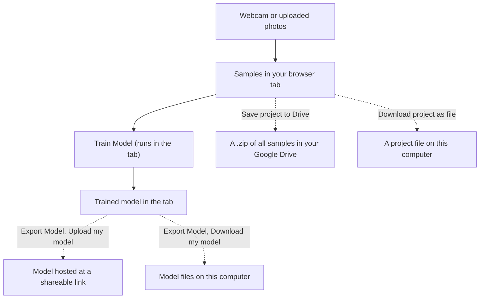

:::objectives
- Write a one-sentence purpose that limits what data a project may collect.
- Inventory every piece of data a Teachable Machine project creates, and where each one goes.
- Choose the least sensitive data that still does the job.
- Write a consent request that is informed, specific, voluntary, and revocable.
- Set retention and deletion rules, and test the plan against "what if" cases.
:::

Here's the pitch from your school's robotics club: "Let's put a laptop by the door that recognizes members' faces and says hi by name. And let's record everyone's voice too, since we might do a voice project later."

It's a fun idea, and every part of that second sentence is a privacy problem. Nobody has said why voices are needed, how long they'll be kept, or what happens if someone says no. You're going to turn the pitch into a plan the club could actually show to members and their parents.

The finished plan has six parts, and each step below builds one of them:

```mermaid caption="The six parts of the data plan, in the order you'll write them"
flowchart LR
    A[Purpose] --> B[Data inventory]
    B --> C[Least data that works]
    C --> D[Consent]
    D --> E[Keep and delete]
    E --> F["What if...?"]
```

## Step 1: Write the purpose in one sentence

A purpose is a promise about what the data is for. Everything not covered by the purpose doesn't get collected. Write it with the decision the system makes:

```text
PURPOSE: When someone arrives at the club room, the laptop shows a welcome
message. It does not record attendance and is not used for anything else.
```

Notice what this sentence already rules out. Taking attendance, tracking who's late, and "a voice project later" are all different purposes. If the club wants them, each needs its own plan and its own consent. The voice recordings are already gone: nothing in the purpose needs them.

## Step 2: List every piece of data

Go through the original pitch and list everything the project would create. Include things that don't feel like data:

| Data | Why it would exist | Sensitive? |
| --- | --- | --- |
| Face photos of each member | Training samples, one class per person | Yes: biometric, can't be changed |
| Members' names | They'd be the **class names** | Yes, once linked to faces |
| Voice clips | "Might be useful later" | Yes, and no purpose |
| The trained model | Result of training | Yes: it can pick out those faces |
| Faces of passers-by | The camera sees the hallway | Yes, and they never agreed |

Two rows surprise most people. The class names turn a pile of photos into "this face is Priya." And the camera at the door sees everyone walking past, not just members.

## Step 3: Map where the data goes

Teachable Machine's FAQ is clear about where things live, so you can draw it exactly:



Solid arrows happen every time. Dotted arrows only happen if someone clicks that option. Close the tab without clicking any of them and nothing is kept anywhere. The plan's job is to decide which dotted arrows the club is allowed to use.

For this project the answer is: **one** place to save the project, and **never** Upload my model. A face model at a public link is a tool anyone with the link can use to recognize your members.

## Step 4: Choose the least data that works

The purpose is "show a welcome message." Does that need to know *who* someone is? Compare the options:

| Option | What it records | Problems |
| --- | --- | --- |
| Face recognition by name | Every member's face, plus names | Biometric data; visitors who aren't members get forced into a member's name (no "Nothing" class covers every stranger); younger members need parent consent |
| Wave to be greeted | Hands waving at chest height, plus an empty-doorway class | Very little; point the camera so faces aren't in frame |
| Name badge or tapping your name on a screen | Nothing recorded | Not machine learning at all, but works perfectly |

Remember the forced-choice problem from Module 5: a model with one class per member has to pick *some* member for every face it sees. A friend dropping by gets greeted as "Hi, Marcus!" with 90% confidence. That's a privacy problem (it's guessing identities) and a fairness problem (it'll be wrong more for faces unlike the training set).

The club picks **wave to be greeted**: a two-class image model, `Wave` and `Nothing`, with a generic "Welcome to Robotics Club!" It keeps the fun and drops the faces.

:::note
Choosing less data isn't giving up. The best privacy protection is data you never collected: it can't leak, be stolen, or be used for something else later.
:::

## Step 5: Write the consent request

Even waving hands are recordings of people, so the volunteers who train the model should agree first. A good request answers five questions in plain words: what, why, who sees it, how long, and how to say no.

```text
Help train our door greeter (optional)

WHAT:   About 30 seconds of webcam video of your hand waving, at chest height.
        No faces, no voices, no names.
WHY:    To train a model that shows "Welcome!" when someone waves at the door.
        It is not used for attendance or anything else.
WHO:    Only the two club officers running the project.
WHERE:  Stored as a project file in one folder on the club laptop. Never uploaded.
UNTIL:  Deleted on the last day of term (June 12).
NO?:    Saying no changes nothing. The greeter works for everyone either way.
CHANGE: Tell an officer any time and your recordings are deleted that week.

Under 13? Please ask a parent or guardian to sign below as well.
```

The last line borrows COPPA's idea. COPPA is a law for online services, not a club laptop, but its principle (a parent agrees for children under 13) is good practice for any project. Many schools require parent permission for older students too, so check your school's rules.

## Step 6: Decide how data is kept and deleted

Withdrawal is easy to promise and hard to do. Teachable Machine mixes everyone's samples in one class, so deleting "Sam's waves" later is messy. Plan for it now:

1.  Each volunteer records on a phone or the laptop camera, and their photos go into their **own folder** named with a number, not their name.
2.  Build the project by clicking **Upload** on the `Wave` card and choosing photos from those folders.
3.  If someone withdraws: delete their folder, start a new project, upload the remaining folders, and click **Train Model** again.
4.  Keep one copy of the project with **Download project as file** in the club folder. Don't also save it to Drive; two copies means two places to forget.
5.  On the deletion date, delete the folders and the project file, and write down that you did.

## Step 7: Test the plan with "what if" questions

A plan is only good if it survives awkward situations. Answer each in one line:

| What if... | Answer in the plan |
| --- | --- |
| A member withdraws in March? | Delete their folder, rebuild, retrain that week. |
| A visitor's face appears in the camera? | Nothing is recorded while the greeter runs, the model only knows Wave and Nothing, and the camera points below face height. |
| Someone wants to add voices later? | New purpose, new plan, new consent. Not covered by this one. |
| The laptop is shared with another club? | Project file stays in a folder only club officers can open. |
| Someone asks "is my data in the model?" | The model contains patterns from the volunteers' hand photos, not the photos themselves; withdrawing removes them at the next retrain. |

## The finished plan

```text
DATA PLAN: Robotics Club door greeter

1. PURPOSE   Show a welcome message when someone waves at the door.
             Not used for attendance or any other purpose.
2. DATA      Hand-wave photos from volunteers (about 80 each) and empty-doorway photos.
             No faces, voices, or names. Camera points at chest height.
3. FLOW      Photos in numbered folders -> uploaded to Teachable Machine -> trained in
             the browser. One project file on the club laptop. Never uploaded or
             saved to Drive.
4. MINIMUM   Wave/Nothing model instead of face recognition: same welcome,
             no biometric data, no identity guesses.
5. CONSENT   Written, optional, with an equal alternative. Parent signature if
             under 13. Withdraw any time.
6. KEEPING   Deleted on the last day of term. Withdrawals handled within a week by
             deleting that folder and retraining. Deletion logged.
7. CHECKS    "What if" table reviewed by both officers before recording starts.
```

That's the whole build. It fits on a page, every line has a reason, and a parent could read it in two minutes.

:::video zNxw5gJtHLc
Code.org's short film on AI ethics, featuring researchers and engineers including Deb Raji of the Algorithmic Justice League. Listen for how the speakers weigh collecting more data against respecting the people it comes from. The film also covers AI and jobs, which you can skip for this lesson.
:::

:::quiz
Q: Why did the plan drop the voice recordings in Step 1, before anyone discussed risks?
- [x] They didn't serve the stated purpose, so collecting them wasn't justified
  A purpose limits collection. "Might be useful later" isn't a purpose, so the data doesn't get collected.
- [ ] Voice data is illegal to collect
  It isn't illegal in general. It just needs a reason and consent, and this project had neither.
- [ ] Teachable Machine can't train on sound
  It can (Audio Project). The problem was purpose, not the tool.

Q: Why is face recognition by name a poor fit for a door greeter, even with every member's consent?
- [ ] Teachable Machine can't recognize faces
  An image model can learn faces. The problem is what happens with faces it wasn't trained on.
- [x] Visitors who aren't members get forced into a member's class, so the model guesses identities for people who never agreed
  With one class per member, every face must get some member's name, often with high confidence.
- [ ] Faces take too long to train
  Training time is similar. The issues are consent, identity guesses, and data that can't be changed.

Q: Why does the plan store each volunteer's photos in a separate numbered folder?
- [ ] Teachable Machine requires one folder per person
  It doesn't. The folders are for the club's benefit, not the tool's.
- [x] So one person's data can be found and deleted if they withdraw, without guessing which samples are theirs
  Once samples are mixed in a class, removing one person's is hard. Separate folders make withdrawal real.
- [ ] To make the model more accurate
  Folder structure doesn't change what the model learns.
:::

:::takeaways
- Start with a one-sentence purpose. Data the purpose doesn't need doesn't get collected.
- Inventory everything, including class names, the trained model, and people the camera sees by accident.
- Map where data can go; in Teachable Machine, samples leave the tab only if you save to Drive or download the project.
- Choose the least sensitive data that does the job. Often that removes faces entirely.
- Consent answers what, why, who, how long, and how to say no, with an equal alternative and a real way to withdraw.
:::

## Extend it

-   Write a data plan for a project you actually want to build, using the seven-line format above.
-   Swap roles: give your plan to a friend and have them play a worried parent. Every question they ask that the plan doesn't answer is a missing line.
-   Find the privacy policy of an app you use. Which of the five consent questions (what, why, who, how long, how to say no) does it answer clearly?

## Further reading

-   [Teachable Machine FAQ](https://teachablemachine.withgoogle.com/faq): the "Saving and Exporting" section is the source for the data-flow diagram in Step 3.
-   [Data Collection + Evaluation](https://pair.withgoogle.com/chapter/data-collection/): a chapter of Google's People + AI Guidebook on collecting training data responsibly.
-   [Data minimisation](https://ico.org.uk/for-organisations/uk-gdpr-guidance-and-resources/data-protection-principles/a-guide-to-the-data-protection-principles/data-minimisation/): the UK privacy regulator's plain-English guide to collecting only what you need.
