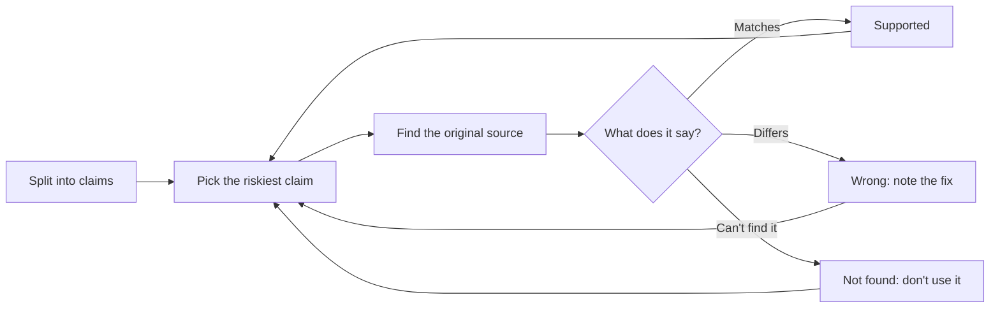

:::objectives
- Split a paragraph of AI-generated text into separate, checkable claims.
- Decide which claims to check first by their type and the damage if they're wrong.
- Read laterally: verify claims against original sources in other tabs, not against the answer itself.
- Recognize an invented quote and an invented citation.
- Apply the same process to an image that's going viral.
:::

You asked a chatbot about the Gender Shades study from Module 5, and it gave you this. It reads well. It has numbers, a quote, and a reference. Before you put any of it in a school report, you're going to check every sentence.

```text
The Gender Shades study was published in 2018 by Joy Buolamwini and Timnit
Gebru at MIT. It tested facial recognition systems from Microsoft, IBM,
Google, and Face++. The researchers used 1,270 photos of politicians from six
countries. The worst error rate, 34.7%, was for darker-skinned women, while
lighter-skinned men had error rates under 1%. Overall, the systems were about
99% accurate. Buolamwini later said, "Code is never neutral, and neither are
cameras." For more detail, see Buolamwini & Gebru (2016), "Skin Tone Errors in
Phone Cameras," Journal of Machine Vision Fairness, 3(2), 45-61. As a result of
the study, the United States banned facial recognition in 2019.
```

:::note
This answer was written for this lesson to imitate a chatbot. Its mistakes are deliberate, and they're the kinds real chatbots make: a wrong detail mixed into true ones, an inflated number, an invented quote, and a reference that doesn't exist.
:::

By the end you'll have a **verification log** and a corrected answer. The loop you'll follow for every claim:



## Step 1: Split the answer into claims

A **claim** is one statement that could be true or false on its own. Long sentences often hide two or three. Break the answer apart and number each piece:

1.  It was published in 2018.
2.  The authors were Joy Buolamwini and Timnit Gebru, at MIT.
3.  It tested systems from Microsoft, IBM, Google, and Face++.
4.  It used 1,270 photos of politicians from six countries.
5.  The worst error rate was 34.7%, for darker-skinned women; lighter-skinned men were under 1%.
6.  Overall, the systems were about 99% accurate.
7.  Buolamwini said, "Code is never neutral, and neither are cameras."
8.  There's a 2016 paper called "Skin Tone Errors in Phone Cameras."
9.  The United States banned facial recognition in 2019.

Claim 2 is the classic hiding place. "Buolamwini and Gebru" might be right while "at MIT" is wrong, and a quick reader checks only the names.

## Step 2: Decide what to check first

You may not have time to check everything, so rank. These types of claim are most often invented, and do the most damage when wrong:

| Type | Claims | Why it's risky |
| --- | --- | --- |
| Quotes | 7 | Putting words in a real person's mouth |
| Citations | 8 | Easy to invent, and readers assume they're checked |
| Numbers | 4, 5, 6 | Precise-looking, easy to get slightly or badly wrong |
| Big real-world claims | 9 | A false claim about a law misleads everyone who reads it |
| Names, dates, places | 1, 2, 3 | Usually right, sometimes subtly wrong |

Order for this answer: 7, 8, 6, 9, then the rest.

## Step 3: Find the original source

Don't search for the chatbot's sentences; you'll find pages that copied the same error. Search for the **thing itself**: the paper. Open a new tab and search `Gender Shades Buolamwini Gebru 2018 paper`.

You should find the paper in the *Proceedings of Machine Learning Research* (volume 81), and the MIT Media Lab's project page. Keep both tabs open. This is **lateral reading**: you leave the answer and read across other sources, instead of reading the answer more closely.

:::video GoQG6Tin-1E
Crash Course's John Green on lateral reading. Watch how he opens new tabs to learn about a source from *other* sites instead of judging it from its own page. That's exactly what Steps 3 to 5 ask you to do.
:::

## Step 4: Check the quote and the citation

**Claim 7, the quote.** Search for the exact words in quotation marks: `"Code is never neutral, and neither are cameras"`. A real, memorable quote from a well-known researcher shows up in interviews, talks, or articles with a date and place. This one appears nowhere except copies of this kind of answer. Verdict: **not found**. An unverified quote never goes into your work, even if it sounds like something the person might say.

**Claim 8, the citation.** Search Google Scholar for the title. Then search for the journal. There's no paper by that title, and no journal called *Journal of Machine Vision Fairness*. The detail (volume 3, issue 2, pages 45 to 61) is what makes invented references convincing. Verdict: **not found; fabricated.** This is exactly what happened in *Mata v. Avianca*.

## Step 5: Check the numbers and the big claim

Open the paper's PDF. The abstract and Table 4 cover most of it.

-   **Claim 5** matches: darker-skinned females had error rates "of up to 34.7%," and the paper says "the maximum error rate for lighter-skinned males is 0.8%." **Supported.**
-   **Claim 6** doesn't. Table 4's overall accuracy is 93.7% (Microsoft), 90.0% (Face++), and 87.9% (IBM). "About 99%" isn't a rounding slip; it erases the point of the study. **Wrong.**
-   **Claim 4**: the Pilot Parliaments Benchmark has 1,270 people, members of parliament from Rwanda, Senegal, South Africa, Iceland, Finland, and Sweden. **Supported.**
-   **Claim 9**: search news coverage for `facial recognition ban 2019`. You'll find San Francisco banning its city agencies from using it in May 2019, followed by a few other cities. There was no national ban. **Wrong.**

## Step 6: Check the names, dates, and companies

-   **Claim 1**: the paper appears in the proceedings of the 2018 Conference on Fairness, Accountability, and Transparency. **Supported.**
-   **Claim 2**: the paper's first page lists Buolamwini at the MIT Media Lab and Gebru at Microsoft Research. **Partly wrong.**
-   **Claim 3**: the paper evaluated three products: Microsoft, IBM, and Face++. It notes that Google did not offer a public gender classifier at the time. The products also classified *gender* from a face, which is different from *recognizing who someone is*. **Wrong**, in two ways.

## Step 7: Write the log and the corrected answer

Here's the finished log:

```text
VERIFICATION LOG: chatbot answer on Gender Shades
Sources: Buolamwini & Gebru (2018), PMLR vol. 81; MIT Media Lab project page;
         news coverage of the 2019 San Francisco ordinance

#  Claim                                   Verdict       What the source says
1  Published 2018                          Supported     FAT* 2018 proceedings
2  Both authors at MIT                     Partly wrong  Gebru: Microsoft Research
3  Microsoft, IBM, Google, Face++          Wrong         Microsoft, IBM, Face++ only;
                                                         gender classification
4  1,270 politicians, six countries        Supported     Parliament members, 6 countries
5  34.7% worst; light men under 1%         Supported     Max 34.7%; light men max 0.8%
6  About 99% accurate overall              Wrong         87.9% to 93.7%
7  "Code is never neutral..." quote        Not found     No source anywhere
8  2016 "Skin Tone Errors" paper           Not found     Paper and journal don't exist
9  US banned facial recognition in 2019    Wrong         San Francisco city agencies only

Score: 3 supported, 1 partly wrong, 3 wrong, 2 not found
```

And the rewrite, keeping only what survived:

```text
The Gender Shades study was published in 2018 by Joy Buolamwini (MIT Media
Lab) and Timnit Gebru (Microsoft Research). It tested gender classification
products from Microsoft, IBM, and Face++ on photos of 1,270 members of
parliament from six countries. Overall accuracy ranged from 87.9% to 93.7%,
but errors were uneven: up to 34.7% for darker-skinned women, and at most 0.8%
for lighter-skinned men. In 2019, San Francisco became the first major US city
to ban its agencies from using face recognition.
```

Five of the original nine sentences needed fixing or removing. The corrected version is shorter, and every sentence in it can be traced to a source.

## Step 8: The same method for a viral image

Images get the same treatment, with different tools. Suppose a dramatic photo of a flooded city street is spreading after a storm, captioned with today's date and a town name.

1.  **Stop.** Notice that you want to share it. That's the moment to check.
2.  **Reverse image search.** In Chrome, right-click the image and choose to search it with Google Lens, or upload it to TinEye. Sort by oldest. If copies exist from years ago, it isn't from today's storm.
3.  **Check Content Credentials** at contentcredentials.org/verify. If credentials are present, they may show the camera or the AI tool that made it. If they're absent, you've learned nothing either way.
4.  **Find better coverage.** Do local news outlets or the town's official accounts show the same scene?
5.  **Log it** like the claims above: what the image claims to show, what you found, and your verdict.

:::try
If you're old enough to use a chatbot under its terms (many require users to be at least 13), ask one to "summarize the Gender Shades study in one paragraph with a source." Split its answer into claims and check three of them against the paper. Did it get the overall accuracy right?
:::

:::quiz
Q: Why search for the original paper instead of searching for the chatbot's sentences?
- [ ] Search engines can't handle long sentences
  They can. The problem is what you'd find.
- [x] Searching the chatbot's wording finds pages that repeat the same claim, not the source that settles it
  Copies of an error agree with each other. Only the original can confirm or correct a claim.
- [ ] The chatbot's sentences are copyrighted
  Copyright isn't the issue. Accuracy is.

Q: You search for a quote in every way you can think of and find it nowhere. What's the right call?
- [ ] Use it, but add "reportedly"
  "Reportedly" still puts unverified words in a real person's mouth.
- [x] Leave it out; an untraceable quote shouldn't be attributed to anyone
  A real quote from a public figure leaves a trail. No trail means you can't use it.
- [ ] Use it if it sounds like something the person would say
  Sounding plausible is exactly how invented quotes get through.

Q: Why were the quote and the citation checked before the publication year?
- [x] Quotes and citations are the claims most often invented and do the most damage if wrong
  Rank claims by risk. Dates are usually right; references and quotes are frequently made up.
- [ ] They appear later in the answer
  Order in the answer doesn't matter. Risk does.
- [ ] The year can't be checked
  It can, easily. It's just lower risk.
:::

:::takeaways
- Split AI-written text into single claims before checking. Long sentences hide wrong details next to right ones.
- Check the riskiest claims first: quotes, citations, numbers, and big real-world claims.
- Read laterally. Verify against original sources in other tabs, never against the answer or its copies.
- A detailed citation can be completely invented. If you can't find it, it doesn't go in your work.
- For images: reverse search, sort by oldest, check Content Credentials, and look for trusted coverage.
:::

## Extend it

-   Check a chatbot answer in a subject you know well, such as a sport, a game, or a book. Experts spot hallucinations faster, so notice which errors you'd have missed in an unfamiliar topic.
-   Give the original answer to a friend without telling them it's wrong. Time how long it takes them to find a problem, then show them your log.
-   Add a "confidence" column to your log: how sure are you of each verdict, and what would change your mind?

## Further reading

-   [Gender Shades paper](https://proceedings.mlr.press/v81/buolamwini18a.html): the original source used in this lesson. Practice finding claims 4 to 6 in it yourself.
-   [Google Scholar](https://scholar.google.com/): the quickest way to check whether an academic paper exists, who wrote it, and who cites it.
-   [Civic Online Reasoning](https://cor.inquirygroup.org/): free lessons on lateral reading and checking sources, from the researchers who studied how professional fact-checkers work.
