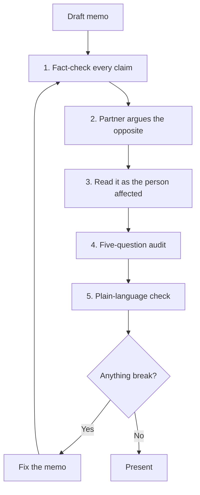

:::objectives
- Test a recommendation by fact-checking it, arguing against it, and reading it as the person most affected.
- Check that the memo answers every question this course has taught you to ask.
- Present a verdict and its evidence clearly in three minutes.
- Grade your work against a rubric and reflect on what changed your mind.
- Pick a next step for learning more about AI.
:::

In Module 5 you learned that a model which scores 100% on its own test can fall to 56% on someone else's hand. Your memo has the same weakness: it's been checked only by the person who wrote it. Before you present it, try to break it.

## Five tests for your memo

### Test 1: Fact-check yourself

Make a verification log of your own memo, exactly as in Module 7. Every number, name, date, quote, and study gets a row and a source. Then re-derive every number you calculated: if your memo says "75% of flagged students were innocent," redo the division.

Common finds: a statistic you remembered but can't trace, a percentage without its denominator, a quote you paraphrased into quotation marks. Fix or cut each one.

### Test 2: Let a partner argue the opposite

Give your memo to a partner. Their job is to argue for the **opposite verdict** for five minutes, as convincingly as they can. If you said "Don't," they argue "Go"; if you said "Go with conditions," they argue "Don't."

Write down every argument. For each one, either answer it in your memo or admit it in "What I don't know." An argument you can't answer and didn't mention is the weakest point in your work, and your audience will find it if you don't.

### Test 3: Read it as the person most affected

Reread the memo as one of your **subjects** or **bystanders**: the student who gets flagged, the visitor walking past the camera, the child whose voice is recorded. Ask:

-   Does the memo say what happens to me when the system is wrong?
-   Can I find out a decision was made about me, and can I appeal it to a person?
-   Did anyone ask for my consent, and could I say no without losing something?

If the memo is silent on any of these, add it. It's the part most professional proposals leave out.

### Test 4: The five-question audit

Check that your memo answers every question the course has taught you to ask. Mark each row with the section number where it's answered:

| Question | Where it's answered |
| --- | --- |
| Task: is there a checkable right answer? | |
| Data: enough, representative, and consented? | |
| Stakes: who is hurt by an error, and how badly? | |
| Errors: what kinds (false positives, negatives), and are they spread evenly across groups? | |
| Confidence: what happens when the system isn't sure? | |
| Privacy: what's collected, where it goes, when it's deleted? | |
| Misinformation: could it generate or spread false content? | |
| Oversight: who reviews decisions, and how do people appeal? | |
| Alternatives: was a no-AI option compared fairly? | |

Not every row needs a long answer. "Not applicable: the system generates no text" is a fine answer for misinformation in an image classifier. A blank is not.

### Test 5: The plain-language check

Read your summary to someone outside the course, such as a parent, a younger sibling, or a friend. Ask them to tell you the verdict and one reason. If they can't, rewrite the summary.

Swap jargon for plain words, or explain it the first time: "confusion matrix" becomes "a table of which items the model mixed up"; "false positive" becomes "a false alarm". Write numbers with their denominators: "8 of 12 bags" is clearer and more honest than "67%".

## Present in three minutes

Three minutes is short. Spend it on the verdict and the evidence, not on background.

| Time | Slide | What to say |
| --- | --- | --- |
| 0:00 to 0:20 | 1. The problem | One concrete story: "Last term, 300 items were donated because nobody knew they were found." |
| 0:20 to 1:00 | 2. The proposal and the test | What AI would do, and what evidence you gathered |
| 1:00 to 2:00 | 3. What you found | One chart, explained: the finding that most affected your verdict |
| 2:00 to 2:40 | 4. The verdict | Verdict plus conditions, in one sentence each |
| 2:40 to 3:00 | 5. What would change my mind | Your honest uncertainty |

A few presenting habits help a lot. Say your verdict in the first minute *and* the last, because people remember beginnings and endings. Point at the part of the chart you're talking about. And practise out loud, with a timer, at least twice: almost everyone runs long the first time.

Prepare for the questions you'll probably get:

-   "Isn't the AI going to get better? Why not just wait?"
-   "What would it take for you to say yes?"
-   "Who did you actually talk to?"
-   "Your prototype isn't the real product, so how much does it prove?"

The last one is fair, and the best answer is honest: a prototype shows *how* this kind of system fails, not exactly how often the real one would.

## The rubric

Grade yourself first, then compare with your teacher's or a partner's grade. Each row is scored 1 to 4.

| Criterion | 1: Beginning | 2: Developing | 3: Strong | 4: Excellent |
| --- | --- | --- | --- | --- |
| **Problem and people** | Problem described in terms of AI | Problem clear; only users considered | Problem clear; users and subjects mapped | Users, subjects, and bystanders mapped; interviews inform the problem |
| **Evidence** | Opinion only | One source or test, numbers without limits | Prototype, log, or interviews with numbers and stated limits | Two kinds of evidence that agree or are reconciled; surprises reported |
| **Errors and fairness** | Not discussed | Overall accuracy only | False positives and negatives named; one group comparison | Errors split by group or condition; who bears them is explained |
| **Privacy and consent** | Not discussed | Mentions privacy generally | Data, consent, and deletion addressed | Data minimized; consent is real; quasi-identifiers and children's data handled |
| **Alternatives and oversight** | None | One alternative, not compared | No-AI option compared fairly; human review described | Several options compared on clear criteria; appeal path for affected people |
| **Verdict and uncertainty** | No clear verdict | Verdict without conditions | Verdict with conditions and limits | Conditions, what would change the verdict, and what's unknown all stated |
| **Communication** | Hard to follow | Clear but long or jargon-heavy | Clear summary; charts captioned; sources listed | A non-expert can state the verdict and a reason after the summary |

A total of 21 or more out of 28 is strong work. A score of 4 on **Verdict and uncertainty** is worth more than the rest, because it's the skill most professionals still struggle with.

## Reflect

Write a short paragraph answering these. They're for you, not for a grade:

1.  What was your first-guess verdict in the planning lesson? Did it change, and what moved it?
2.  Which piece of evidence surprised you most?
3.  Which question from the course would you now ask about *every* AI system you meet?
4.  If you built this system for real, what's the first test you'd run?

:::video iNdZFKfExZ8 start=1:13
Crash Course on how AI gets governed, starting at the chapter on decisions inside AI companies. Watch for how the same questions you asked in your memo (who's affected, who checks, what happens when it's wrong) come back at the scale of companies, countries, and treaties. Your recommendation is the smallest version of that job.
:::

## Where to go next

You can now judge AI systems better than many people who buy them. Here's how to keep going, depending on what you enjoyed:

-   **You liked the charts and the "why" behind them.** Learn Python next. Every chart in this course is a few lines of it, and Google Colab runs it for free in a browser.
-   **You want to build real models.** Once you know some Python, Google's Machine Learning Crash Course covers the ideas from this course (thresholds, confusion matrices, fairness) with code you run yourself.
-   **You want the big picture without code.** Elements of AI is a free online course from the University of Helsinki and MinnaLearn on what AI is and how it affects society.
-   **You liked the investigations.** Browse the AI Incident Database and pick a case. Try writing the recommendation someone *should* have written before that system launched.

:::takeaways
- Test your memo like a model: fact-check it, have someone argue the opposite, and read it as the person it affects most.
- Audit it against every question from the course; a blank is a gap, while "not applicable, because..." is an answer.
- Write in plain language with numbers and their denominators.
- In three minutes: one story, one chart, the verdict twice, and your honest uncertainty.
- Good AI judgement is a habit: ask about task, data, stakes, errors, privacy, and alternatives every time.
:::

## Further reading

-   [Google's Machine Learning Crash Course](https://developers.google.com/machine-learning/crash-course): free lessons with interactive exercises, for when you're ready to build models with code.
-   [Elements of AI](https://www.elementsofai.com/): a free, non-technical course on what AI can and can't do, from the University of Helsinki.
-   [AI Incident Database](https://incidentdatabase.ai/): real cases of AI systems going wrong, searchable by topic, for your next investigation.
