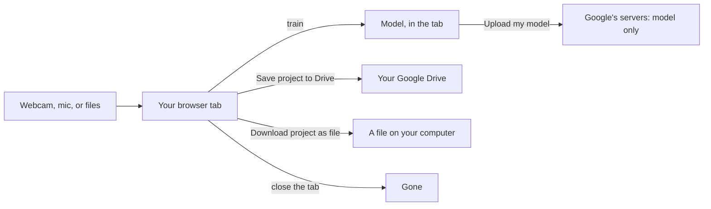

:::objectives
- Check that your computer, browser, and webcam are ready for Teachable Machine.
- Allow camera (and microphone) access in the browser and in your operating system.
- Explain where your samples are stored, and what leaves your computer only when you choose.
- Pick the webcam path or the photo-upload path for the course.
:::

By the end of this course you will have trained a computer to tell rock from paper from scissors, to sort recycling from trash, and to drive a small game with your hands. You won't write a line of code, install anything, or make an account to do it. All of it happens on one web page: **Teachable Machine**, a free tool from Google at **teachablemachine.withgoogle.com**.

Teachable Machine trains real machine learning models. The model it builds for your hand signs is the same kind of image classifier that sorts photos on a phone, just smaller. That also means it makes real mistakes, and much of this course is about spotting those mistakes and fixing the data that caused them.

## What you need

| Item | Needed? | Notes |
| --- | --- | --- |
| A laptop, desktop, or Chromebook | Yes | The page puts three panels side by side, so a full-size screen is much easier than a phone. |
| A current web browser | Yes | Chrome is the safest choice. Details below. |
| An internet connection | Yes, to load the page | Training itself runs on your computer, not on a server. |
| A webcam | Recommended | The built-in camera on a laptop or Chromebook is fine. |
| A microphone | Only for sound projects | Built-in is fine. |
| A Google account | No | Only needed if you want to save projects to Google Drive. |

No webcam? You can still do every project. Teachable Machine also accepts photos you upload, so you can take pictures with a phone, move them to the computer, and drag them in. The lessons point out where the upload path differs.

## Which browser to use

Teachable Machine runs inside the browser, and some browsers handle the camera and microphone better than others. When something goes wrong with recording, the site itself suggests Chrome or Firefox.

:::tabs
@tab Windows
Use **Google Chrome** or **Microsoft Edge**. Edge is built on the same engine as Chrome, so it behaves the same way here. Firefox also works.

Check that your browser is up to date: in Chrome, open the **⋮** menu, then **Help › About Google Chrome**. It updates itself if it's behind.
@tab macOS
Use **Google Chrome** or **Firefox**. Safari loads the site, but sound projects can misbehave in it: you may see *"Your browser does not support recording playable audio; however you can still create a model."* Image and pose projects are less affected, but switching to Chrome saves trouble.
@tab Chromebook
Use the built-in **Chrome** browser. Nothing to install.

On a school-managed Chromebook, your administrator controls camera access and can block some sites. If the camera never turns on in Teachable Machine but works in the Camera app, the block is probably a school setting, and the photo-upload path will still work.
:::

## Let the browser use your camera

The first time you click **Webcam** in a project, the browser asks whether the site may use your camera. In Chrome the choices are **Allow while visiting the site**, **Allow this time**, and **Never allow**. Choose one of the first two.

If you click **Never allow** by accident, the camera stays dark and Teachable Machine shows *"There was an error opening your webcam. Make sure permissions are enabled or switch to image uploading."* To undo it, click the site-information icon at the left end of the address bar, switch **Camera** on, and reload the page.

Your operating system has its own permission switch underneath the browser's, and both have to be on:

:::tabs
@tab Windows
Windows 11: open **Start › Settings › Privacy & security › Camera**. Turn on **Camera access**, and further down turn on **Let desktop apps access your camera**. Browsers count as desktop apps.

Windows 10: open **Start › Settings › Privacy › Camera**, check that camera access for this device is on, and switch on **Allow desktop apps to access your camera**.

If a video-call app such as Teams or Zoom has the camera open, close it first; Windows often lets only one app use the camera at a time.
@tab macOS
Open the **Apple menu › System Settings › Privacy & Security › Camera** and turn the switch on for your browser. The browser only appears in that list after it has asked for the camera once, so open Teachable Machine and click **Webcam** first. If the camera still doesn't start after you flip the switch, quit the browser completely and reopen it.
@tab Chromebook
Open **Settings** and search for *camera*. Make sure camera access is on for the Chromebook, then check the site permission in Chrome as described above. Some Chromebooks also have a physical privacy switch or shutter beside the camera, so check that it's open.
:::

For sound projects the steps are the same with **Microphone** in place of **Camera**.

## Where your samples go

This is the most important page of setup, because you'll be recording faces, hands, voices, and rooms. Teachable Machine's own FAQ is clear about it: your samples are not sent to any servers, and training happens inside your browser tab. The photos you record live in that tab's memory, on your computer.

Something leaves your computer only when you choose one of these actions:

- **Save project to Drive** copies your samples into your own Google Drive. They are yours, and only people you share the file with can see them.
- **Download project as file** saves everything to a file on your computer. Nothing goes online.
- **Upload my model** (in the export screen, covered later) publishes the trained model so you can use it in a website. The model goes to Google's servers; the photos and recordings you trained it with do not. Anyone who has the link can use the model.
- **Closing the tab** without saving throws everything away. Nothing stays in the browser or on a server.

So the default is private, and every step that shares something is one you take on purpose. Keep that in mind when other people appear in your samples. Module 1's third lesson sets the consent rules this course follows.

:::video T2qQGqZxkD0
Google's two-minute introduction. Watch for the three steps it repeats, gather, train, and export, because the screen you'll use is laid out in exactly that order from left to right.
:::

## Choose your path

You'll pick one of two ways to collect examples. You can switch at any time.

| | Webcam path | Upload path |
| --- | --- | --- |
| How you add samples | Hold a button and record frames live | Take photos elsewhere and drag them in |
| Speed | Fast: dozens of samples in seconds | Slower: you take each photo |
| Best for | Hand signs, poses, objects you can hold up | No webcam, a blocked camera, or a dataset you want to reuse |
| Testing the model | Live, in front of the camera | Upload new photos into the preview |

Most learners use the webcam path and fall back to uploads for testing, because uploading photos taken in a different room is an easy way to test a model on places it has never seen.

:::warning
**The classic setup trap: the camera works in one app but not in the browser.** That almost always means one of the two permission layers is off, or another app is holding the camera. Close video-call apps, check the operating system switch, check the browser's site permission, then reload the page. Reloading matters: the page asks for the camera when it opens it, not continuously.
:::

:::quiz
Q: You record 200 photos of your hands, train a model, and close the tab without saving. Where are the photos now?
- [ ] In your Google Drive
  Nothing goes to Drive unless you choose **Save project to Drive** and log in.
- [ ] On Google's servers
  The FAQ says samples are not sent to any servers; training happens in your tab.
- [x] Nowhere; they're gone
  The samples lived in the tab's memory. Closing it without saving deletes them, which is why the next lessons show you how to save.

Q: The browser says the camera is allowed, but Teachable Machine still shows an error opening your webcam. What should you check next?
- [x] The operating system's camera permission, and whether another app is using the camera
  The browser's permission sits on top of the system's. Both must allow it, and only one app may be able to use the camera at a time.
- [ ] Your Google account sign-in
  No account is needed for the camera or for training.
- [ ] The kind of image model you picked
  Both image models use the webcam the same way.

Q: You click **Upload my model** to use your model on a website. What does Google receive?
- [ ] Your model and all the samples you trained it on
  The FAQ says the training examples are not published with the model.
- [x] Only the trained model
  The model is a file of learned numbers. Your photos stay on your computer unless you save them to Drive.
- [ ] Nothing; uploading keeps the model on your computer
  Uploading publishes the model so a link can load it.
:::

:::takeaways
- Teachable Machine needs only a current browser on a laptop, desktop, or Chromebook; a webcam is recommended and uploads work without one.
- Camera access has two layers, the browser's site permission and the operating system's switch, and both must be on.
- Samples stay in your browser tab and training runs there too. Saving to Drive, downloading, and uploading a model are the only ways anything leaves, and each is your choice.
- Closing the tab without saving deletes your work.
:::

## Further reading

- [Teachable Machine FAQ](https://teachablemachine.withgoogle.com/faq): the official answers on privacy, saving, and exporting. The "Saving & Exporting" section is the one to read now.
- [Use your camera and microphone in Chrome](https://support.google.com/chrome/answer/2693767?hl=en): Google's help page for site permissions and choosing which camera Chrome uses.
- [Manage app permissions for your camera in Windows](https://support.microsoft.com/en-us/windows/manage-app-permissions-for-your-camera-in-windows-87ebc757-1f87-7bbf-84b5-0686afb6ca6b): Microsoft's step-by-step guide, with pictures, for Windows 10 and 11.
