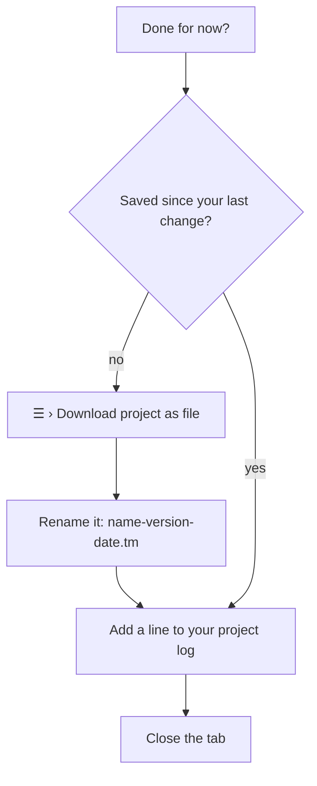

:::objectives
- Save a Teachable Machine project to a file or to Google Drive, and open it again later.
- Keep a short project log of classes, sample counts, and who appears in the data.
- Follow the consent rules for recording yourself and other people.
- Record without holding the mouse button, and fix the five most common problems.
:::

Teachable Machine has no autosave. If you record 300 samples, train a great model, and then your laptop restarts for an update, all of it is gone. The FAQ puts it plainly: if you close the tab without saving, nothing is saved in your browser or on any servers. If you try to leave a project with unsaved changes, the page asks you to confirm, but that only helps if you're there to see it.

So the first habit of this course is saving, and the second is knowing whose face is in your data.

## Four ways to keep your work

Open the menu with the **☰** icon at the top left of a project (next to the Teachable Machine name). The saving options live there, and the FAQ lists four ways to keep work:

| Option | Where to find it | What it keeps | Where it goes |
| --- | --- | --- | --- |
| **Download project as file** | ☰ menu | Classes, samples, and training settings | A `.tm` file on your computer |
| **Save project to Drive** | ☰ menu | The same, as a file | Your own Google Drive |
| **Download Samples** | **⋮** menu on one class card | That class's samples | A zip file on your computer |
| **Export Model** | Preview panel | The trained model only, no samples | A download or a link (Module 6) |

For this course, **Download project as file** is the one to use every time. It needs no account, works on school computers, and keeps everything private. Do it at the end of every session, and before any experiment that might wreck a model you like.

## Save to a file and open it again

1. In your project, open **☰** and choose **Download project as file**.
2. The browser saves a file ending in `.tm` to your **Downloads** folder. Rename it right away (see the naming pattern below).
3. To reopen it later, go to the home page, click **Get Started**, and choose **Open an existing project from a file**. Or, inside any project, open **☰ › Open project from file**.
4. Pick your `.tm` file. Your classes and samples come back, but the model doesn't: click **Train Model** again. With the same samples that takes a few seconds.

Opening a project replaces whatever is on screen, so save the current one first.

## Save to Google Drive (optional)

**☰ › Save project to Drive** asks you to **Log in to Google Drive**, then to name the project. Later, **Open project from Drive** brings it back, and you can share the Drive file with a teammate so they can keep working on it.

Two cautions. Many school Google accounts block third-party apps from Drive, so this may fail on a school login even though it works at home. And a Drive file can be shared by accident; if your samples include other people, keep them in a file on your own computer instead.

## Name and organize your files

Make one folder for the course, such as `c4t-ml-models`, and give every saved project a name that says what it is, which version it is, and when you made it:

```text
c4t-ml-models/
├── thumbs-up-v1-2026-11-16.tm
├── rock-paper-scissors-v1-2026-11-18.tm
├── rock-paper-scissors-v2-balanced-2026-11-20.tm
└── project-log.txt
```

Keep old versions instead of overwriting them. In Module 3 you'll compare a lopsided dataset with a balanced one, and you can only compare what you kept.

## Keep a project log

Machine learning projects go wrong in ways you can only diagnose if you remember what you did. Keep a plain text file (or a page in a notebook) with one entry per version:

```text
Project:   rock-paper-scissors   Version: v2   Date: 2026-11-20
Classes:   Rock 96 | Paper 91 | Scissors 94 | Nothing 90
Recorded:  my bedroom desk, lamp on, laptop webcam
People:    me; my brother (asked first, said yes)
Settings:  Epochs 50, Batch Size 16, Learning Rate 0.001
Result:    mixes up Paper and Nothing when my hand is far away
Next:      record Paper at arm's length
```

The **People** line is the one most projects skip, and the one that matters most.

## The consent rules for this course

The samples you record are personal data: faces, hands, voices, bedrooms. Treat them that way.

1. **Record only people who said yes,** after you told them what you're recording, what for, and where it will be kept. A shrug is not a yes. For anyone under 18, sharing their images beyond your own computer also needs a parent or guardian's okay.
2. **Check the background before you hold the button.** Family members walking past, photos on the wall, a screen showing messages, and mail with an address all end up in your samples.
3. **Don't use other people's photos from the internet** for classes about people. Objects (cans, bottles, fruit) are fine.
4. **Delete what you don't need.** If someone changes their mind, remove their samples with the class's **⋮** menu or the thumbnail viewer, retrain, and save a new version.
5. **Share models, not datasets.** An exported model doesn't contain your photos, which makes it much safer to share than the `.tm` file.

## Record without holding the button

**Hold to Record** asks you to keep a mouse button pressed while also posing for the camera. That's awkward with one hand, and impossible for some people. There's a setting for it:

1. Click **Webcam** on a class card, then the **Settings** button on the webcam view.
2. Switch **Hold to Record** to **OFF**.
3. Set **Delay** (seconds before recording starts; the default is 2) and **Duration** (how long it records; the default is 6). Leave **FPS** at 24.
4. Click **Save Settings**. Now one click starts a countdown, then records for the set time on its own.

This is also the best way to record yourself at a distance, such as full-body poses: click, step back, and pose.



## Fixes for the problems that stop beginners

| What you see | Likely cause | Fix |
| --- | --- | --- |
| *"There was an error opening your webcam."* | Permission blocked, or another app has the camera | Close video-call apps, allow the camera in the browser and the OS, reload |
| *"Could not open your camera. You may have denied access."* | You clicked **Never allow** | Site-information icon in the address bar › turn **Camera** on › reload |
| Training stops or crawls | You switched tabs | Stay on the tab until the button reads **Model Trained** |
| *"More than one class with label … was found."* | Two classes share a name | Rename one; every label must be unique |
| The project you opened has no model | Project files keep samples, not a trained model | Click **Train Model** |
| Everything vanished | Tab closed or browser restarted without saving | Nothing to recover; save to a file every session from now on |

:::note
Your microphone has the same two permission layers as your camera. If a sound project says *"There was an error opening your microphone,"* use the same fixes with **Microphone** in place of **Camera**.
:::

:::quiz
Q: You reopen yesterday's `.tm` file and the Preview panel says you must train a model first. What went wrong?
- [ ] The file is damaged
  A damaged file wouldn't open at all.
- [x] Nothing; project files store samples and settings, and you retrain after opening
  Click **Train Model**. With the same samples you'll get a very similar model in seconds.
- [ ] You needed to save to Drive instead
  Drive saves the same project contents as the file does.

Q: Your friend agreed to appear in your gesture dataset last month but now wants out. What's the right sequence?
- [ ] Keep the samples but don't mention their name
  Their face is still in the data. Agreement can be taken back, and the samples must go.
- [x] Delete their samples, retrain, and save a new version of the project
  Removing the samples and retraining means the new model was never trained on them, and saving a new version keeps your log accurate.
- [ ] Export the model, since models don't contain photos
  The current model was still trained on their images. Retrain without them first.
:::

:::takeaways
- Nothing saves automatically. Use **☰ › Download project as file** at the end of every session, and rename the `.tm` file with a name, version, and date.
- Reopening a project restores samples and settings; you retrain to get the model back.
- Record only people who agreed, check the background, and share models rather than datasets.
- Turn **Hold to Record** off in webcam **Settings** to record with a countdown instead of holding the button.
:::

## Further reading

- [Teachable Machine FAQ: Saving & Exporting](https://teachablemachine.withgoogle.com/faq): what each save option keeps and who can see a published model.
- [People + AI Guidebook: Data Collection + Evaluation](https://pair.withgoogle.com/chapter/data-collection/): Google's guide for designers on collecting data responsibly, including consent and who is represented.
