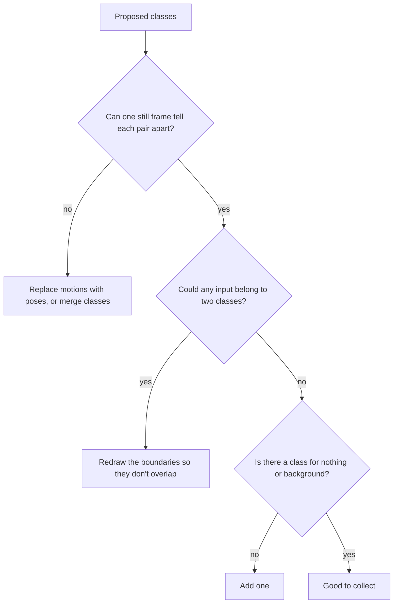

:::objectives
- Explain what a class is and why the model must always pick one of them.
- Test a set of classes for overlap and for differences a single frame can't show.
- Plan how many examples each class needs, and why similar counts matter.
- Vary lighting, angle, distance, background, and people across every class.
- Keep people who didn't agree out of your data.
:::

Priya builds a gesture controller for a racing game with four classes: **Left** (pointing left), **Right** (pointing right), **Boost** (waving), and **Stop** (open palm). In her room it works. At a friend's house it calls everything Boost, and pointing left is Stop half the time. Then she scrolls through her samples and finds her little brother in the background of forty of them. He never agreed to be in it.

None of these are training problems. Training did exactly what it was told. They're *data* problems, decided before she pressed **Train Model**: which classes she chose, and which examples she gave each one.

## A class is an answer the model has to choose

A **class** is one of the labels the model is allowed to output. The model's whole job is: given one input, decide which of your classes it belongs to. It cannot say "none of these," and it cannot say "two of these." Every input gets split across your classes, with the shares adding up to 100%.

That one fact gives you two rules:

1. **Classes must not overlap.** Each possible input should belong to exactly one class. "Open palm" and "Hand" overlap, because an open palm is a hand. When classes overlap, the model is trained to give two different answers to the same picture, and its scores land somewhere in the middle.
2. **You need a class for "none of the above."** If people will sometimes show the camera nothing useful, make a **Nothing** (or **Background**) class with examples of exactly that. Otherwise an empty chair gets labeled as whichever class it happens to resemble.

## Can one frame show the difference?

A Teachable Machine image model looks at **one frame at a time**. It has no idea what happened a moment ago. That's why Priya's **Boost** class failed: waving is a motion, and a single frame of a wave is just an open hand at an angle. It looks like **Stop**.

Before you commit to a set of classes, run this test on each pair: *if I showed a friend one still photo, could they name the class in a second?*



| Weak class set | Problem | Stronger version |
| --- | --- | --- |
| Wave, Still hand | Needs motion; one frame can't show it | Open palm, Fist |
| Hand, Thumbs up | Overlap: a thumbs-up is a hand | Thumbs up, Flat hand, Nothing |
| Happy, Excited | People can't agree on the boundary | Smiling, Not smiling |
| Plastic, Bottle | Overlap: many bottles are plastic | Recycling, Trash, Nothing |

## How many examples each class needs

Teachable Machine doesn't start from zero. The FAQ explains that image and pose models are built on a pretrained network called MobileNet, and your classes become only its last step. MobileNet already learned edges, textures, and shapes from more than a million labeled photos, so it needs your examples only to learn how *your* classes differ. That's why tens of examples can work instead of tens of thousands.

Some numbers to plan with:

- **Images:** Teachable Machine will train with as little as one sample per class, but plan on **50 to 150 per class** for a model you'd trust in front of other people.
- **Sounds:** Audio projects insist on at least **8 samples per class** and at least **20 seconds of background noise**. Each sample is a one-second clip.
- **Similar counts in every class.** If one class has 300 examples and another has 30, the model leans toward the big one. Module 3 shows exactly why.

There's a hidden reason to avoid tiny classes. When you train, Teachable Machine quietly sets aside **15%** of each class's samples as test samples it never trains on, to check itself. With 20 samples in a class, only 3 are held back, and a check based on 3 photos tells you very little.

## Variety: vary what shouldn't matter, in every class

A model learns **whatever is different between your classes**. It doesn't know which difference you meant. If every Rock sample was taken with the lamp on and every Paper sample after sunset, then brightness is a perfectly good way to tell the classes apart, and the model may learn that instead of hands. It looks brilliant in testing, until someone makes a rock in a dark room.

So when you collect, think in two lists:

- **What should decide the class:** the shape of the hand.
- **What shouldn't matter:** lighting, angle, distance from the camera, position in the frame, background, which hand, whose hand, sleeves, and the camera itself.

For every item on the second list, record **every class** under **several versions** of it. Here's a coverage table for a rock-paper-scissors dataset, with sample counts for each class under each condition:

```python run alt="Heatmap of sample counts for Rock, Paper, and Scissors under six recording conditions. Paper is filled in everywhere. Rock has no lamp-off, left-hand, or second-person samples. Scissors has almost nothing far from the camera or in dim light." caption="Sample counts per class and condition (made-up numbers). White cells are situations the model has never seen."
import matplotlib.pyplot as plt
import numpy as np

classes = ["Rock", "Paper", "Scissors"]
conditions = ["Lamp on", "Lamp off", "Close", "Far", "Left hand", "2nd person"]
counts = np.array([
    [45,  0, 30, 15,  0,  0],
    [30, 25, 20, 20, 15, 10],
    [50,  4, 45,  2,  0,  0],
])

fig, ax = plt.subplots(figsize=(8, 3))
ax.imshow(counts, cmap="Blues", vmin=0, vmax=55)
ax.set_xticks(range(len(conditions)), conditions)
ax.set_yticks(range(len(classes)), classes)
for row in range(len(classes)):
    for col in range(len(conditions)):
        value = counts[row, col]
        ax.text(col, row, value, ha="center", va="center",
                color="white" if value > 30 else "black")
ax.set_title("Where each class has examples")
plt.tight_layout()
```

Read it like a map of what the model has seen. Every class has plenty of lamp-on, close-up samples, so it will do well there. But look at **Lamp off**: Paper has 25 samples and Rock has none. In a dim room, the model's best clue is "dim pictures are usually Paper," so a dim rock is likely to come out as Paper. The same thing happens with **Left hand** and **2nd person**: only Paper has them, so any left hand starts to look like Paper.

The fix isn't more samples overall. It's filling the white cells, so that no condition belongs to just one class.

:::note
**Sound and pose have their own "shouldn't matter" lists.** For sound: distance from the mic, the room, background noise, and whose voice. For pose: the FAQ points out that the pose model tracks *where* you are in the frame as well as your body's shape, so standing on the left can look like a different pose than standing on the right. Record each pose in several spots.
:::

:::video x2mRoFNm22g
A short animated explainer from Code.org's AI series. Watch for the moment the AI learns something the trainers never intended, because of what happened to be in the examples. That's the lamp-on, lamp-off problem in a different costume.
:::

## People in your data, and people who shouldn't be

Priya's brother is a privacy problem because he didn't agree. He's also a data problem: if he was behind her mostly during Left samples, the model may partly learn "brother in the background means Left." Before every recording session, write down:

- **Who** will appear, and whether each person agreed after you told them what it's for and where it's kept.
- **Where** you'll record, and what's visible behind you: people, screens, mail, photos.
- **What** you'll do if someone asks to be removed: delete their samples, retrain, and save a new version.

:::warning
**Two recording habits that quietly ruin datasets.**

1. *Recording each class in one long burst.* All Rock in the first minute, all Paper in the second. Lighting drifts and you shift in your chair, so the model can learn the drift. Record the classes in turns, and change conditions between turns.
2. *Pressing record before the gesture is formed.* The class fills up with half-made shapes that belong to no class. Make the gesture first, then press.
:::

:::quiz
Q: A sign-language helper has classes **A**, **B**, and **J**. The letter J is signed by drawing a hook in the air. What's the problem?
- [ ] Three classes is too few
  The number of classes is fine; Teachable Machine takes as many as you add.
- [x] J is a motion, and an image model sees one frame at a time
  A single frame of J looks like the start or end of the movement, which can resemble other hand shapes. Motions need a different kind of model, or a still pose that stands in for them.
- [ ] B and J overlap
  Their hand shapes differ; the issue is that J depends on movement.

Q: All of your Scissors samples were recorded in the afternoon; all of your Rock samples at night. Testing at night, the model says Rock for almost everything. Why?
- [ ] Rock is an easier gesture
  Hand shape isn't the issue here; the model's scores are following the light, not the hand.
- [x] Brightness separates the classes in your data, so the model uses it
  The model learns whatever differs between classes. Record both classes in both kinds of light so brightness stops being a clue.
- [ ] The model needs more epochs
  More training would only learn the brightness shortcut more firmly.

Q: You have 25 samples in a class. How many does Teachable Machine hold back as test samples?
- [ ] None; it trains on everything
  It always sets aside a share to check itself.
- [x] About 4, because it keeps 15% aside
  15% of 25 is 3.75. With so few, the accuracy it reports for that class can swing wildly.
- [ ] About 12, half of them
  The split is 85% training and 15% test.

Q: Which class set needs a **Nothing** class most?
- [x] Rock, Paper, Scissors, for a game that watches the camera all the time
  Between rounds the camera sees no gesture at all, and without a Nothing class the model must still answer Rock, Paper, or Scissors.
- [ ] Ripe banana and Unripe banana, photographed one at a time on a plate
  If every photo always contains a banana, every input really does belong to one of the two classes.
- [ ] Neither; Teachable Machine adds one automatically
  Only audio projects come with a built-in Background Noise class. Image projects don't.
:::

:::takeaways
- The model must split 100% across your classes for every input, so classes can't overlap and you need a "nothing" class when inputs can be empty.
- Image models judge one frame at a time; choose classes a single still photo can separate.
- Plan 50 to 150 image samples per class, with similar counts in every class. Audio needs at least 8 per class plus 20 seconds of background noise.
- The model learns any difference between classes. Record every class under every lighting, angle, distance, background, and person you expect.
- Record only people who agreed, and check the background before you press the button.
:::

## Further reading

- [Teachable Machine FAQ](https://teachablemachine.withgoogle.com/faq): the "Tweaking your model" section suggests experiments with backgrounds, microphones, framing, and bias that match this lesson.
- [PAIR Explorables](https://pair.withgoogle.com/explorables/): interactive essays from Google's People + AI Research team on how data choices shape what models learn. Start with any one on fairness or bias.
