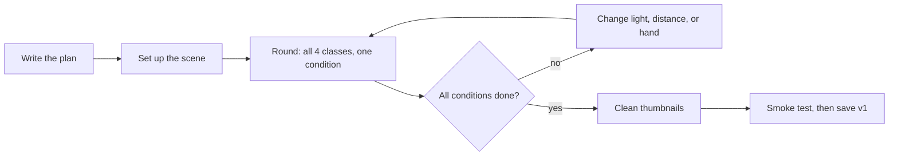

:::objectives
- Turn a project idea into a written data plan: classes, definitions, conditions, and people.
- Record four classes in short rotating sessions instead of one long burst per class.
- Inspect thumbnails and remove half-formed or misfiled samples.
- Run a quick smoke-test training and save the project as version 1.
:::

You're going to build the dataset behind a rock, paper, scissors game that watches your hand through the webcam. By the end you'll have a saved project that looks like this, with every class recorded in every condition:

```text
rock-paper-scissors-v1.tm
  Rock       96 samples   lamp on / lamp off · close / far · right / left hand
  Paper      94 samples   lamp on / lamp off · close / far · right / left hand
  Scissors   98 samples   lamp on / lamp off · close / far · right / left hand
  Nothing    92 samples   empty frame · face only · hand relaxed · arm moving
```

The goal of this build is the dataset, not the model. You'll train it properly and read its graphs in Module 3. A good model can't come out of a bad dataset, so this is where the real work is.



## Step 1: Write the data plan

Open your project log and write this before touching Teachable Machine. Three minutes of planning saves an hour of re-recording.

```text
Project:    rock-paper-scissors   Version: v1
Goal:       recognize one hand sign at a time, from a laptop webcam
Classes:
  Rock      closed fist, knuckles toward the camera
  Paper     flat open hand, fingers together, palm toward the camera
  Scissors  index and middle fingers out in a V, others folded
  Nothing   no hand sign: empty frame, my face, relaxed hand, arm moving
Conditions (every class, every condition):
  light:    lamp on, lamp off (room light only)
  distance: close (hand fills a third of the frame), far (arm's length)
  hand:     right, left
People:     me only
Target:     about 90 to 100 samples per class
```

Notice that each class definition describes what the *camera* sees, not what you mean. "Paper: palm toward the camera" rules out a sideways flat hand, which looks a lot like a karate chop.

## Step 2: Create the project and the classes

1. Go to **teachablemachine.withgoogle.com**, click **Get Started**, then **Image Project**, then **Standard image model**.
2. Rename **Class 1** to `Rock` and **Class 2** to `Paper` with the pencil icons.
3. Click **Add a class** twice, and name the new cards `Scissors` and `Nothing`.

Check the spelling now: class names travel with the model when you export it, and a game will later compare against those exact names.

## Step 3: Set up the scene

- Put the laptop on a table, not your lap, so the camera doesn't bounce.
- Check what's behind you in the webcam view. Move anything personal out of frame, and make sure nobody will walk through.
- Have a lamp you can switch on and off. If you don't have one, use "curtains open" and "curtains closed," or "facing the window" and "back to the window."

## Step 4: Record round 1 (lamp on, close, right hand)

For each class in turn, click **Webcam** on its card and record a short burst of about 12 samples:

1. Make the gesture **first**, then press and hold **Hold to Record**.
2. While holding, rotate your wrist slightly and move your hand around the frame. Keep the gesture the same.
3. Release after about half a second. At the default 24 frames a second, that gives roughly a dozen samples.

For **Nothing**, record a burst of the empty frame, one of your face with no hand up, and one with your hand moving in and out of view.

:::tip
If holding the button while posing is awkward, open the webcam's **Settings**, switch **Hold to Record** off, and set **Delay** to 2 and **Duration** to 1. Each click then gives you a two-second countdown and about a second of recording.
:::

## Step 5: Rounds 2 to 8, changing one condition each time

Repeat the four-class round for every combination in the plan. Two lights, two distances, and two hands make eight rounds:

| Round | Light | Distance | Hand |
| --- | --- | --- | --- |
| 1 | on | close | right |
| 2 | on | far | right |
| 3 | on | close | left |
| 4 | on | far | left |
| 5 | off | close | right |
| 6 | off | far | right |
| 7 | off | close | left |
| 8 | off | far | left |

Recording all four classes in each round is the key decision of this build. If you recorded all of Rock first and all of Scissors twenty minutes later, the light from the window would have changed between them, and the model could learn the time of day. Rotating means every class sees the same drift.

After eight rounds of about 12, each class has close to 100 samples. Each card shows its count, such as **96 Image Samples**.

## Step 6: Clean the data

Scroll through each class's thumbnails. Click any thumbnail to open it larger, and look for:

- **Half-formed gestures:** a fist that's halfway to a V belongs to no class. Delete it.
- **Misfiled samples:** a Paper photo that ended up in Scissors. Use the viewer's option to move it to the right class.
- **Blurry frames** where the hand is a smear. Delete a few; keep slightly blurry ones, since real play is blurry too.
- **Anything private** that slipped into the background.

Then compare the counts. If one class is more than about 15 samples short of the others, record one more round for it in a condition it's thin on.

## Step 7: Smoke test

Click **Train Model** and stay on the tab until it reads **Model Trained**. Leave the **Advanced** settings alone for now.

In **Preview**, make each sign a few times, in both lights and with both hands. You're not grading the model yet, just checking that the dataset isn't broken. A healthy first result looks like:

```text
Rock (right hand, close)     Rock 97%      Paper 1%    Scissors 1%   Nothing 1%
Scissors (left hand, far)    Scissors 71%  Paper 22%   Rock 4%       Nothing 3%
Empty frame                  Nothing 99%   Rock 1%     Paper 0%      Scissors 0%
```

Weaker scores far from the camera are normal, because a small hand gives the model fewer pixels to work with. A result where one class wins *everything* means something's wrong with the data: usually a class with far more samples, or a class recorded under different conditions from the rest.

## Step 8: Save version 1

1. Open **☰ › Download project as file**.
2. Rename the file to `rock-paper-scissors-v1-` followed by today's date, and move it into your course folder.
3. Add the actual counts and anything you noticed in the smoke test to your log:

```text
Saved:    rock-paper-scissors-v1-2026-11-16.tm
Counts:   Rock 96 | Paper 94 | Scissors 98 | Nothing 92
Smoke:    all four classes work close up; Scissors weaker far away
          (often 20-30% Paper)
Next:     train with Under the hood open (Module 3)
```

That log entry and the `.tm` file are the finished product of this build.

:::video DFBbSTvtpy4
The official "Gather" tutorial from the Teachable Machine team. Watch how the samples get grouped into classes, and how they hold each object at different angles while recording.
:::

:::quiz
Q: Why record all four classes in each round instead of finishing one class before starting the next?
- [x] So that slow changes like daylight affect every class equally
  If each class came from a different time, the light itself would differ between classes, and the model could learn that difference instead of hand shape.
- [ ] Because Teachable Machine only allows a dozen samples per burst
  You can record as long as you hold the button; the dozen is a choice that keeps rounds short.
- [ ] To keep the file smaller
  The total number of samples is the same either way.

Q: Your smoke test shows Scissors far from the camera scoring 60% Scissors and 35% Paper. What is the most useful next step?
- [ ] Delete the Paper class
  Then the model couldn't recognize Paper at all.
- [ ] Train for more epochs straight away
  Changing settings before looking at the data hides the cause. Module 3 covers settings.
- [x] Record more far-away Scissors, and check that far-away Paper samples really show a flat palm
  The confusion is specific to one condition, so add data for that condition and check that nothing is mislabeled there.

Q: Why does the Nothing class include your hand moving in and out of view?
- [ ] To make the class bigger than the others
  You want similar counts in every class, not a bigger Nothing class.
- [x] Because the camera sees those in-between moments during a real game, and they belong to none of the signs
  Without them, a hand on its way into the frame would be forced into Rock, Paper, or Scissors.
:::

:::takeaways
- Write the data plan first: class definitions in terms of what the camera sees, the conditions to cover, and who appears.
- Record in rounds, all classes per round, changing one condition each time.
- Clean thumbnails before training: remove half-formed gestures and move misfiled samples.
- A smoke test checks the dataset, not the model. Save a versioned `.tm` file and a log entry when you're done.
:::

## Ideas to extend it

- Add **Lizard** and **Spock** from the five-gesture version of the game. Do they pass the one-frame test against the existing classes?
- With their agreement, record one round of a friend's hands, then test the v1 model on a second friend who isn't in the data.
- Record only right-hand samples in a separate project and test it with your left hand. How much worse is it?

## Further reading

- [Teachable Machine FAQ](https://teachablemachine.withgoogle.com/faq): "Why isn't it working like I want it to?" lists changing backgrounds, framing, and confusing examples as experiments to try on your dataset.
- [Datasets: Data characteristics](https://developers.google.com/machine-learning/crash-course/overfitting/data-characteristics): Google's Machine Learning Crash Course page on what makes data reliable, including bad labels and duplicates.
