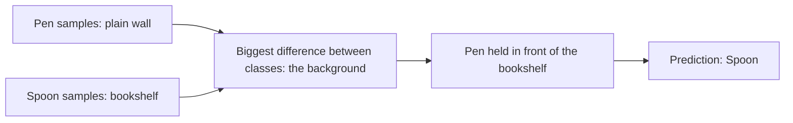

:::objectives
- Spot overlapping classes and classes that need motion, and rewrite them.
- Predict, then observe, how a missing "nothing" class changes a model's answers.
- Create a background shortcut on purpose and fix it.
- Find the gaps in a dataset's coverage, and write a consent plan for recording other people.
:::

These exercises mix paper problems with real experiments in Teachable Machine. For each experiment, **write your prediction in your log before you run it**. The point isn't to guess right; it's to notice when your picture of the model is wrong.

Keep your `rock-paper-scissors-v1` project handy. Exercises 2 and 4 use it.

## Warm-up: one frame or not?

For each pair, decide whether a single still photo is enough to tell the classes apart.

1. Thumbs up / Thumbs down
2. Clapping / Not clapping
3. Sitting / Standing
4. Nodding yes / Shaking head no
5. Ripe banana / Green banana

:::solution
1, 3, and 5 work from one frame: the shapes or colors differ in a still photo. 2 and 4 are motions. A single frame of a clap is two hands near each other, which also happens when you're not clapping, and one frame of a nod is just a tilted head. For a sound model, though, clapping is easy: it's a distinctive one-second sound.
:::

### Exercise 1: Repair a class list

A student's game controller has these classes: **Left** (arm pointing left), **Right** (arm pointing right), **Jump** (both arms up), **Arms up**, **Move** (any arm movement), and **Wave**. Rewrite the list so every class passes the one-frame test and no two overlap. Say what you removed and why.

:::hint
Look for one class that's just another name for another, one that contains several others, and one that needs motion.
:::

:::solution
- **Arms up** duplicates **Jump** (both describe both arms raised). Keep one.
- **Move** contains Left, Right, and Jump, because they're all arm movements. Remove it.
- **Wave** is a motion. Remove it, or replace it with a still pose such as "one hand on head."
- Add **Nothing** for standing with arms down, which the game will see most of the time.

Final list: **Left**, **Right**, **Jump**, **Nothing**. Four classes, each a still pose, with no overlaps.
:::

### Exercise 2: Take away the Nothing class

Open `rock-paper-scissors-v1`. On the **Nothing** card, open the **⋮** menu and choose **Disable Class**. Train, then point the camera at an empty wall.

Prediction first: what will the bars show for an empty wall?

:::hint
The model must split 100% across the classes that are switched on. Which of Rock, Paper, and Scissors looks most like a blank, evenly colored picture?
:::

:::solution
Expected result: one of the three hand classes gets most of the bar, often above 80%, even though there's no hand at all. Which one varies from dataset to dataset; Paper is common because a flat palm is a large, even patch of color. The model isn't broken. It has no way to say "none," so it picks the closest option, and it often picks it confidently.

Use **Enable Class** to switch Nothing back on and train again: the empty wall goes back to Nothing at nearly 100%. Keep this result in mind for Module 4, because high confidence on something the model was never trained on is one of the main ways models fool people.
:::

### Exercise 3: Build a background shortcut on purpose

Start a new image project with two classes, `Pen` and `Spoon`.

1. Record about 40 **Pen** samples holding the pen in front of a **plain wall**.
2. Record about 40 **Spoon** samples holding the spoon in front of something busy, like a bookshelf or a poster.
3. Train. Test each object in front of its *own* background, then swap: hold the pen in front of the bookshelf.

Predict the swapped result before you test.

:::hint
What is the biggest difference between the two classes in your samples: the small object, or everything behind it?
:::

:::solution
Expected result: in front of their own backgrounds, both objects score close to 100%. Swapped, the pen in front of the bookshelf is called **Spoon**, often with high confidence, and the spoon in front of the wall leans toward **Pen**. The background takes up most of each picture, so it's the easiest difference for the model to learn.

The fix: record 40 more samples of **each** object in front of **both** backgrounds, then train again. Now the background appears in both classes, so it stops being a clue, and the swapped test follows the object.
:::



### Exercise 4: How few is too few?

Make a new image project with the same four classes as rock-paper-scissors, but record only **5 samples** per class (a single quick tap of **Hold to Record**). Train it, and compare it side by side with your v1 model (open v1 in a second tab).

Move your hand slowly across the frame while holding Scissors. Count how many times the top class flips in ten seconds for each model.

:::hint
Five samples taken in a fraction of a second are nearly identical. What happens when your hand is somewhere none of the five were?
:::

:::solution
Expected result: the 5-sample model flips often (several times in ten seconds), especially at the edges of the frame and when you change distance, and its winning scores bounce between about 50% and 95%. The v1 model stays on Scissors almost all the time. Yet the small model can look perfect by its own measure: with 5 samples per class, Teachable Machine holds back just 1 per class for testing, so its self-check rests on 4 photos taken a split second after the ones it trained on.
:::

### Exercise 5: Find the gaps

A classmate recorded a recycling sorter and shares these counts:

| | Bright desk | Dim room | Held in hand | On the table |
| --- | --- | --- | --- | --- |
| Recycling | 40 | 0 | 35 | 5 |
| Trash | 10 | 30 | 0 | 40 |
| Nothing | 20 | 20 | 0 | 40 |

List the two worst gaps and predict what the model will do in each situation.

:::hint
For each column, ask: is this condition shared by the classes, or does it belong mostly to one? A condition that belongs to one class becomes a clue for that class.
:::

:::solution
1. **Dim room** has no Recycling at all. A can photographed in a dim room will probably come out as Trash or Nothing, because to the model "dim" means "not Recycling."
2. **Held in hand** has Recycling only. Anything held in a hand, including a banana peel, is likely to be called Recycling.

The chart below plots the same counts. The bars that are missing from a group are the gaps. The fix is to record Recycling in the dim room and on the table, and Trash in hand.

```python run alt="Grouped bar chart of the recycling sorter's sample counts. Recycling has no dim-room bar and a tiny on-the-table bar; Trash and Nothing have no held-in-hand bars." caption="Missing bars are conditions where only some classes were recorded."
import matplotlib.pyplot as plt
import numpy as np

conditions = ["Bright desk", "Dim room", "Held in hand", "On the table"]
counts = {
    "Recycling": [40, 0, 35, 5],
    "Trash": [10, 30, 0, 40],
    "Nothing": [20, 20, 0, 40],
}
x = np.arange(len(conditions))
width = 0.26
fig, ax = plt.subplots(figsize=(8, 3.5))
for i, (name, values) in enumerate(counts.items()):
    ax.bar(x + (i - 1) * width, values, width, label=name)
ax.set_xticks(x, conditions)
ax.set_ylabel("Samples")
ax.legend()
plt.tight_layout()
```
:::

### Exercise 6: Write a consent plan

You want to make a pose model with five classmates at lunch so it works on more than one body. Write the short script you'll say to each person, and the three rules you'll follow with the data.

:::hint
Cover what you're recording, what it's for, where it's stored, who will see it, and how they can get out later.
:::

:::solution
A good script: *"I'm making a pose model for a class project. I'd like to record about 30 seconds of you doing four poses on my laptop camera. The pictures stay in a file on my computer and won't be posted anywhere. Only the trained model, which doesn't contain pictures, might be shared. You can say no, and if you change your mind later I'll delete your part. Is that okay?"*

Rules: record only people who say yes, with nobody else in the background; keep the project file on your own computer, not in a shared folder; and if anyone asks to be removed, delete their samples, retrain, and save a new version. Write each person's yes in your log with the date.
:::

### Challenge: A pose model that works anywhere in the frame

Start a **Pose Project** with classes `Arms up`, `T pose`, and `Nothing` (arms down). Record every sample standing in the **center** of the frame. Train, then test each pose standing at the far left and far right of the frame. Then fix it.

:::hint
The pose model tracks the positions of your body's key points, such as wrists and shoulders, within the picture. What changes about those positions when you step to one side, even if your pose is identical?
:::

:::solution
Expected result: poses in the center score well. At the edges, scores drop and some poses get confused (often T pose with Nothing), because every key point has shifted sideways compared with the training samples. The Teachable Machine FAQ calls this out: the pose model tracks where you appear in the frame as well as your pose.

The fix is to record each class in three spots (left, center, right), and at two distances, then train again. Turning **Hold to Record** off in **Settings** with a 3-second **Delay** lets you click, step into place, and pose.
:::
