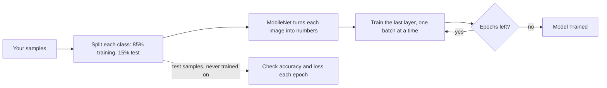

:::objectives
- Explain why a model trained on lopsided data favors the biggest class, using accuracy.
- Tell the difference between a balanced dataset and a representative one.
- Describe what happens when you click **Train Model**: transfer learning, the 85/15 split, epochs, batches, and learning rate.
- Read the **Accuracy per epoch** and **Loss per epoch** graphs, and spot overfitting.
:::

Jordan records his rock, paper, scissors dataset in a hurry. He holds **Hold to Record** for twenty seconds on Rock and two seconds each on Paper and Scissors. He trains, opens the graphs, and sees accuracy climb past 90%. Then he plays a round: Rock. Paper? Rock. Scissors? Rock, at 70%.

Ninety percent accurate and nearly useless. Both are true, and the reason is the most common trap in machine learning.

## A model that always says Rock is 83% accurate

Here are Jordan's sample counts, and what a "model" that ignores the picture and always answers Rock would score:

```python run alt="Bar chart of Jordan's sample counts: Rock 400, Paper 40, Scissors 40. The Rock bar is ten times taller than the other two." caption="Jordan's dataset (made-up counts). One class has ten times more examples than each of the others."
import matplotlib.pyplot as plt

counts = {"Rock": 400, "Paper": 40, "Scissors": 40}
total = sum(counts.values())
for name, n in counts.items():
    print(f"{name:9}{n:4} samples   {n / total:.0%} of the data")
print(f"Always answering Rock is right {counts['Rock'] / total:.0%} of the time.")

plt.figure(figsize=(6, 3.2))
plt.bar(counts.keys(), counts.values(), color=["#1967D2", "#E67701", "#E67701"])
plt.ylabel("Samples")
plt.title("Samples per class")
plt.tight_layout()
```

Look at the last printed line. **Accuracy** is the share of samples the model gets right, and it counts every sample equally. When 83% of the samples are Rock, answering Rock is a very good strategy for scoring well, even though it never recognizes a single paper.

Training is a search for settings that make fewer mistakes overall. In Jordan's data, a mistake on Paper costs the model the same as a mistake on Rock, but there are ten times fewer chances to make it. So the search leans hard toward Rock. When the model is unsure, Rock is its safest bet, and you see that as the Rock bar winning every close call.

The fix is in the data, not the settings: give every class a similar number of samples. Either record more Paper and Scissors (best, since you also add variety), or delete Rock samples until the counts are close.

## Balanced is not the same as representative

A **balanced** dataset has similar counts in every class. A **representative** one covers the situations the model will actually face: every lighting, distance, hand, and background from Module 2. You need both.

Here's a dataset that's perfectly balanced and still broken: 100 Rock, 100 Paper, 100 Scissors, all recorded with your right hand. It will struggle with every left hand, equally across all three classes.

And here's a subtle one. In a real game, the camera sees **Nothing** far more often than any sign. Should Nothing get extra samples to match? No. Extra samples teach the model that Nothing is usually the right answer, so it will lean toward Nothing whenever a sign is a bit unclear. Keep the counts similar, and handle "the camera mostly sees nothing" in the game's logic later.

:::warning
**Ways datasets become lopsided without you noticing.**

- Holding the record button longer for one class. At about 24 frames a second, three extra seconds is 70 extra samples.
- Adding a class late and recording it in a single quick burst.
- Deleting bad frames from one class and not re-recording.

Check the counts on every class card before every training run. Within about 10% of each other is a good target.
:::

## What happens when you click Train Model

Teachable Machine doesn't build a model from scratch. It uses **transfer learning**: a network called MobileNet, already trained on a huge collection of photos, turns each of your images into a long list of numbers describing its shapes, edges, and textures. Then Teachable Machine trains a small final layer that learns which patterns in those numbers go with which of your classes.



Before training, Teachable Machine sets aside **15% of each class** as **test samples**. They're never used for learning; after each round of training, the model is checked on them to see how it does on pictures it didn't learn from.

The **Advanced** section under **Train Model** has three settings that control the training itself.

**Epochs** (default 50 for image projects). One epoch means every training sample has gone through the model once. With 50 epochs, the model works through your whole training set 50 times, improving a little each pass.

**Batch Size** (default 16; the menu offers 16 up to 512). The model doesn't adjust itself after every single sample. It looks at a batch, works out how it should change, and adjusts once. Teachable Machine's own example: with 80 images and a batch size of 16, there are 80 ÷ 16 = 5 batches, and after all 5, one epoch is done. Step through it here:

:::trace Count the batches in two epochs
```python
samples = 80
batch_size = 16
epochs = 2
updates = 0
for epoch in range(1, epochs + 1):
    for start in range(0, samples, batch_size):
        end = min(start + batch_size, samples)
        updates = updates + 1
        print("epoch", epoch, "- batch of samples", start + 1, "to", end)
print("adjustments made:", updates)
```
:::

Watch `updates` climb by one per batch: 5 adjustments per epoch, 10 after two epochs. At the default 50 epochs, that's 250 adjustments.

**Learning Rate** (default 0.001 for image projects). How big each adjustment is. Too big, and the model overshoots and its accuracy jumps around; too small, and it barely moves in 50 epochs. Teachable Machine's tooltip warns that even small changes here have huge effects. Leave it alone unless an experiment calls for it, and use **Reset Defaults** to put all three back.

## Reading the graphs under the hood

In the **Advanced** section, click **Under the hood**. A panel opens with two line graphs that fill in as training runs, one point per epoch:

- **Accuracy per epoch**: `acc` (on training samples) and `test acc` (on the 15% test samples). 1.0 means every sample right.
- **Loss per epoch**: `loss` and `test loss`. Loss also counts how *confident* the right answers are. A correct answer at 60% confidence has more loss than a correct answer at 90%, so loss keeps falling after accuracy hits 1.0. Zero is perfect.

Here's a typical pair of graphs for a dataset like the one you built in Module 2:

```python run alt="Two line charts over 50 epochs. Left: training accuracy rises to 1.0 while test accuracy levels off near 0.92. Right: training loss falls toward zero; test loss falls until about epoch 20, then creeps up." caption="Made-up learning curves in Teachable Machine's colors: blue for training samples, orange for test samples."
import numpy as np
import matplotlib.pyplot as plt

epochs = np.arange(1, 51)
acc = 1 - 0.65 * np.exp(-epochs / 4)
test_acc = 0.92 - 0.55 * np.exp(-epochs / 5)
loss = 1.3 * np.exp(-epochs / 6) + 0.01
test_loss = 1.3 * np.exp(-epochs / 6) + 0.22 + 0.004 * np.clip(epochs - 20, 0, None)

fig, (left, right) = plt.subplots(1, 2, figsize=(9, 3.4))
left.plot(epochs, acc, color="#1967D2", label="acc")
left.plot(epochs, test_acc, color="#E67701", label="test acc")
left.set_ylim(0, 1.05)
left.set_title("Accuracy per epoch")
right.plot(epochs, loss, color="#1967D2", label="loss")
right.plot(epochs, test_loss, color="#E67701", label="test loss")
right.set_title("Loss per epoch")
for ax in (left, right):
    ax.set_xlabel("Epochs")
    ax.legend()
plt.tight_layout()
```

What to read from it:

1. **Both curves rise fast, then flatten.** Most learning happens in the first 10 to 15 epochs. More epochs mostly polish.
2. **There's a gap at the end:** training accuracy reaches 1.0, test accuracy settles near 0.92. Some gap is normal. The model has studied the training samples and is only meeting the test ones.
3. **Test loss bottoms out around epoch 20, then creeps up** while training loss keeps falling. That's the signature of **overfitting**, which Teachable Machine defines as learning the training samples so closely that the model does worse on the test samples. It's memorizing details of your training photos that don't carry over.

The opposite, **underfitting**, looks like both curves stuck low: the model hasn't captured the difference between classes. With Teachable Machine that usually means classes that look too alike, too few samples, or a learning rate that's been changed.

:::note
Test accuracy is checked on frames from the *same sessions* you trained on, often a split second apart from training frames. That makes it optimistic. A model with 0.95 test accuracy can still fail in a new room. Module 4 is about testing on truly new examples.
:::

:::video MANoa78BQAQ start=0:51
From the Raspberry Pi Foundation's Experience AI series, a DeepMind research scientist explains where bias in models comes from. Watch for the point that a model reflects whoever and whatever was over- or under-represented in its training data. Jordan's Rock-heavy dataset is a small version of the same thing.
:::

:::quiz
Q: A dataset has 300 Nothing samples, 100 Rock, 100 Paper, and 100 Scissors. What accuracy does a model get by always answering Nothing?
- [ ] 25%, because there are four classes
  That would be true if the classes were equal in size. Accuracy counts samples, not classes.
- [x] 50%
  300 of the 600 samples are Nothing, so always guessing Nothing is right half the time without looking at the picture.
- [ ] 75%
  Only 300 of 600 samples are Nothing.

Q: You have 120 training samples and a batch size of 16. About how many adjustments does the model make in one epoch?
- [ ] 16
  16 is the batch size, the number of samples in each batch.
- [x] 8
  120 ÷ 16 is 7.5, so there are 7 full batches and one smaller batch of 8: 8 adjustments per epoch.
- [ ] 120
  That would be a batch size of 1, where the model adjusts after every sample.

Q: Under the hood, training accuracy is 1.0 and test accuracy is 0.55. What does that tell you?
- [ ] The model is ready to use
  Test accuracy is the better guide to new data, and 0.55 is poor.
- [x] The model fits the training samples but doesn't carry over to samples it didn't learn from
  A large gap is overfitting, or a sign that the test samples differ from the training ones. Look at the data first: variety, balance, and mislabeled samples.
- [ ] The learning rate is too small
  A learning rate that's too small would keep training accuracy low too.

Q: Jordan's model says Rock for every close call. What's the best first fix?
- [ ] Increase epochs to 200
  More training on lopsided data learns the lean more firmly.
- [ ] Raise the learning rate
  The lean comes from the data, so changing step size doesn't remove it.
- [x] Record more Paper and Scissors samples, in varied conditions, until the counts are close
  Balancing removes the reason to favor Rock, and the new samples add variety at the same time.
:::

:::takeaways
- Accuracy counts samples, so a class with far more samples can earn high accuracy by itself. Keep class counts within about 10% of each other.
- Balanced (similar counts) and representative (covers real conditions) are separate goals; you need both.
- Teachable Machine trains only the last layer on top of MobileNet, holding back 15% of each class as test samples.
- An epoch is one pass over the training samples; a batch is how many samples go by before each adjustment; the learning rate is the size of each adjustment. Defaults for images: 50, 16, 0.001.
- In the graphs, a growing gap between training and test curves, or test loss rising, means overfitting.
:::

## Further reading

- [Datasets: Class-imbalanced datasets](https://developers.google.com/machine-learning/crash-course/overfitting/imbalanced-datasets): Google's Machine Learning Crash Course on why imbalance hurts and how experts rebalance.
- [Overfitting: Interpreting loss curves](https://developers.google.com/machine-learning/crash-course/overfitting/interpreting-loss-curves): a gallery of real loss curves with what each shape means.
- [Linear regression: Hyperparameters](https://developers.google.com/machine-learning/crash-course/linear-regression/hyperparameters): epochs, batch size, and learning rate explained with small examples. The math is optional; the ideas are the same ones in Teachable Machine's Advanced panel.
