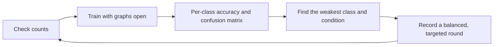

:::objectives
- Train with **Under the hood** open and describe what the accuracy and loss graphs show.
- Use **Calculate accuracy per class** and **Calculate confusion matrix** to find the weakest class.
- Watch what a ten-to-one imbalance does to close calls in the preview.
- Make one targeted, balanced change to the data, retrain, and compare versions in a log.
:::

Last module you built `rock-paper-scissors-v1`. Now you'll train it properly, find out exactly where it's weak, break it on purpose with lopsided data, and end with a better version 2. The finished product is this comparison in your project log:

```text
                  v1 (balanced)   v1 + 300 Rock    v2 (targeted fix)
Counts R/P/S/N    96/94/98/92     396/94/98/92     108/106/110/104
test acc (final)  0.95            0.97             0.97
Scissors, far     often Paper     usually Rock     mostly Scissors
Close calls go to (mixed)         Rock             (mixed)
```

Your numbers will differ. What matters is the pattern, and that you can explain every cell.



## Step 1: Reopen version 1 and check the counts

1. Go to **teachablemachine.withgoogle.com**, click **Get Started**, then **Open an existing project from a file**, and choose your `rock-paper-scissors-v1` file.
2. Read the sample count on each class card, and write the four numbers in your log.

If any class is more than about 10% smaller than the largest, record one more varied round for it before going on. Training on unbalanced counts would muddy everything that follows.

## Step 2: Train with the graphs open

1. Under **Train Model**, open **Advanced**. Check the defaults: **Epochs** 50, **Batch Size** 16, **Learning Rate** 0.001. If anything else shows, click **Reset Defaults**.
2. Click **Under the hood**. A panel opens; until you train, it says to train a model to see more detailed information.
3. Click **Train Model** and watch. Stay on the tab.

The two graphs fill in one epoch at a time. On a clean four-class dataset you should see something like this: `acc` and `test acc` shoot up within the first 10 epochs and level off near the top; `loss` and `test loss` drop steeply, then flatten, with test loss staying a little above training loss.

Write the final `test acc` in your log: read it off the accuracy graph where the orange line ends.

## Step 3: Find the weakest class

Overall accuracy hides which class is struggling. Under the graphs, click **Calculate accuracy per class** and then **Calculate confusion matrix**. Both are worked out on the test samples, the 15% the model never trained on.

The **confusion matrix** is a grid: each row is the true class of the test samples, and each column is what the model predicted. Correct answers sit on the diagonal. Anything off the diagonal is a mix-up, and its position tells you which two classes are being confused. Here's what one might look like, with roughly 15 test samples per class:

```python run alt="Four-by-four confusion matrix for Rock, Paper, Scissors, and Nothing. Most counts sit on the diagonal. Three Scissors test samples were predicted as Paper, and one Paper sample as Nothing." caption="A made-up confusion matrix. Rows are the true class, columns the prediction. The off-diagonal 3 is the problem to fix."
import matplotlib.pyplot as plt
import numpy as np

labels = ["Rock", "Paper", "Scissors", "Nothing"]
matrix = np.array([
    [15,  0,  0,  0],
    [ 0, 14,  0,  1],
    [ 0,  3, 12,  0],
    [ 0,  0,  0, 14],
])
fig, ax = plt.subplots(figsize=(4.6, 4))
ax.imshow(matrix, cmap="Blues")
ax.set_xticks(range(4), labels)
ax.set_yticks(range(4), labels)
ax.set_xlabel("Prediction")
ax.set_ylabel("Class")
for row in range(4):
    for col in range(4):
        ax.text(col, row, matrix[row, col], ha="center", va="center",
                color="white" if matrix[row, col] > 8 else "black")
plt.tight_layout()
```

Read the third row: of 15 Scissors test samples, 12 were right and 3 were called Paper. That's the weakest spot. To find out *which* Scissors samples, test in **Preview**: make Scissors close, far, in each light, with each hand, and note where the Paper bar grows. In most webcam datasets it's far away, where two fingers become a few pixels wide.

Write the weak class and the condition in your log.

## Step 4: Break it on purpose with lopsided data

Before fixing anything, see what imbalance does. You'll undo this in a minute, so make sure v1 is saved.

1. On the **Rock** card, click **Webcam** and record about 300 more Rock samples (around 12 to 15 seconds of holding), moving your hand as usual.
2. Check the card: Rock now has about four times the samples of each other class.
3. Train again with **Under the hood** open, and calculate accuracy per class.

The graphs may look as good as before or even better, since a big share of the test samples are now easy Rock frames. The damage shows up in the **Preview**, on hard cases. Hold Scissors far away, form Paper slowly, or dim the light: close calls now tip to **Rock**. Hand halfway into the frame? Rock.

```python run alt="Grouped bar chart comparing per-class accuracy on hard, far-away test gestures. With balanced data, Rock, Paper, and Scissors score 90, 85, and 70 percent. With 300 extra Rock samples, Rock rises to 98 percent but Paper drops to 70 and Scissors to 45." caption="Made-up results from testing 20 hard, far-away gestures per class in Preview, before and after adding 300 Rock samples."
import matplotlib.pyplot as plt
import numpy as np

classes = ["Rock", "Paper", "Scissors"]
balanced = [90, 85, 70]
lopsided = [98, 70, 45]
x = np.arange(len(classes))
plt.figure(figsize=(6, 3.2))
plt.bar(x - 0.2, balanced, 0.4, label="Balanced v1", color="#1967D2")
plt.bar(x + 0.2, lopsided, 0.4, label="v1 + 300 Rock", color="#E67701")
plt.xticks(x, classes)
plt.ylabel("% correct on hard gestures")
plt.ylim(0, 100)
plt.legend()
plt.tight_layout()
```

The extra Rock samples bought a few points on Rock and cost far more on the other two. Nothing about the hand shapes changed; the model simply learned that Rock is usually the right answer.

Now undo it: open **☰ › Open project from file** and choose the v1 file again. Don't save the lopsided version.

## Step 5: Make one targeted, balanced fix

Back on v1, fix the weak spot you found in Step 3. If it was Scissors far away:

1. Record a far-away round for **Scissors**, about 12 samples, with deliberate variety: both hands, both lights, fingers spread wide and narrow.
2. Record a far-away round for **every other class** too, about the same size.

Step 2 of the fix is the one people skip. Adding samples only to Scissors fixes Scissors and quietly unbalances the dataset. Adding a round to every class keeps the counts close and teaches the model what all four classes look like far away, which is exactly where it was guessing.

Check the counts on the cards and write them in the log.

## Step 6: Retrain and compare

Train with **Under the hood** open, calculate accuracy per class and the confusion matrix, and test the weak case in **Preview** again. Fill in the v2 column of your comparison. Expect the Scissors-as-Paper cell of the confusion matrix to shrink, and far-away Scissors to win more often in the preview. If it didn't improve, the cause may be different from the one you guessed: look again at which thumbnails are in the Paper class, and whether any are mislabeled.

## Step 7: Save version 2

Open **☰ › Download project as file**, rename it `rock-paper-scissors-v2-` plus the date, and finish the log entry: counts, settings (50 / 16 / 0.001), final test accuracy, the per-class result for your weak class, and one sentence on what changed. That entry, next to v1's, is the finished build.

:::video CO67EQ0ZWgA
The official one-minute "Train" tutorial. Watch where the **Advanced** settings and the preview sit, and how quickly the preview responds after training ends.
:::

:::quiz
Q: In Step 4, the overall test accuracy went *up* after adding 300 Rock samples, yet the model got worse in the preview. How?
- [x] Most of the new test samples were easy Rock frames, so the average rose while hard Paper and Scissors cases got worse
  Accuracy averages over samples. Adding many easy samples of one class lifts the average even as the other classes suffer.
- [ ] The graphs are wrong when classes are unbalanced
  The graphs are calculated correctly; they just answer a different question from "does it work on hard cases?"
- [ ] Adding samples always lowers preview quality
  Adding varied samples to every class usually helps. The problem was adding them to one class only.

Q: Why add a far-away round to every class instead of only to Scissors?
- [ ] Teachable Machine requires equal counts
  It will train on any counts; equal counts are your choice.
- [x] It keeps the classes balanced, and teaches the model what every class looks like far away
  If only Scissors had far-away samples, "far away" itself would become a clue for Scissors.
- [ ] Far-away samples are worth more than close ones
  Each sample counts the same in training; what matters is covering the conditions for every class.

Q: In a confusion matrix, where do you look to see how often Paper was mistaken for Nothing?
- [ ] The Nothing row, Paper column
  That cell counts Nothing samples predicted as Paper, the opposite mistake.
- [x] The Paper row, Nothing column
  Rows are the true class and columns are the prediction, so this cell counts Paper samples the model called Nothing.
:::

:::takeaways
- Open **Advanced › Under the hood** before training to watch accuracy and loss per epoch, then calculate per-class accuracy and the confusion matrix.
- Overall accuracy can rise while the model gets worse on the cases you care about; per-class results and preview tests show what the average hides.
- Extra samples in one class make close calls tip toward that class.
- Fix weaknesses with a targeted round in every class, so the counts stay balanced, then compare versions in your log.
:::

## Ideas to extend it

- Train v2 with **Epochs** set to 10, then 100, and compare the shape of the curves with the default 50.
- Ask a friend (who agrees to it) to try the model. Which class fails first on a hand that isn't in the data?
- Add a fifth class, **Thumbs up**, with the same number of samples as the others. Does it get confused with Rock?

## Further reading

- [Datasets: Class-imbalanced datasets](https://developers.google.com/machine-learning/crash-course/overfitting/imbalanced-datasets): how imbalance shows up in real projects and the standard ways to rebalance.
- [Classification: Accuracy, recall, precision](https://developers.google.com/machine-learning/crash-course/classification/accuracy-precision-recall): why accuracy alone can mislead, with a confusion-matrix walkthrough. You'll meet these ideas again in Module 5.
