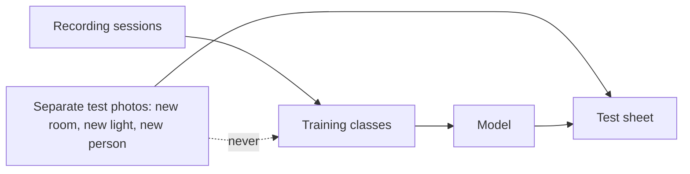

:::objectives
- Explain how the preview's percentages are made and why they always add up to 100%.
- Give three reasons a model can show 99% and still be wrong.
- Explain why Teachable Machine's own test samples flatter a model.
- Plan an unseen test that covers new people, places, lighting, and objects.
:::

Your rock, paper, scissors model reports a test accuracy of 0.97. You take the laptop to the kitchen, make a fist under the yellow ceiling light, and the preview says **Scissors 99%**. Back at your desk it's **Rock 100%** again.

Nothing is broken. The 0.97 and the 99% are both honest numbers. They just answer narrower questions than the ones you were asking, and this module is about reading them for what they are.

## Where the percentages come from

For every frame, the model computes a raw **score** for each class: a number that's higher the more the picture matches what it learned for that class. Scores can be any size, even negative. To show them as bars, Teachable Machine converts them so they're all positive and add up to 100%. The conversion (called **softmax**) exaggerates differences: a class whose score is a little ahead gets a much bigger share. Step through it with made-up scores:

:::trace Turn four scores into percentages
```python
import math
scores = {"Rock": 4.0, "Paper": 1.5, "Scissors": 1.0, "Nothing": -2.0}
total = 0
for name in scores:
    total = total + math.exp(scores[name])
for name in scores:
    share = math.exp(scores[name]) / total
    print(name, round(share * 100), "%")
```
:::

Rock's score is only 2.5 points above Paper's, but it ends up with about 88% of the bar. Notice what you *can't* see in the result: whether the scores were all large or all small. A strong match and a weak match can produce the same 88%, as long as the gap between classes is the same.

So the precise meaning of a confidence bar is: **how strongly the model prefers this class over the other classes you gave it.** It is not "the chance the model is right." Those can be close on pictures like the training data, and far apart on anything else.

## Three ways to be 99% sure and wrong

**1. The answer isn't on the menu.** Show your rock, paper, scissors model a coffee mug. The bars must still add up to 100% across Rock, Paper, Scissors, and Nothing. If the mug resembles Paper more than the others, Paper can take 99%. The model is extremely sure that, of the four options, Paper is the closest. It has no way to say "none of these."

**2. The picture is outside what it learned.** Your training samples covered your desk, your lamp, and your hands. A kitchen under yellow light shifts the colors and shadows of the whole picture. The model's scores for a frame like that are pushed around by features it never had a chance to learn about, and the push can land deep in one class's territory. Far from the training data, a large gap between scores is just as likely as a small one, so the confidence stops being informative.

**3. It's been trained to be extreme.** Loss rewards confident right answers, so training pushes the model to give big gaps on the training samples. A model trained for many epochs on near-identical frames learns to produce big gaps on almost anything. High confidence becomes a habit, not a judgment.

Here's what confidence looks like when a model meets photos it has never seen. Each dot is one unseen test photo: how confident the top answer was, and whether it was right.

```python run alt="Strip chart of 40 unseen test photos by confidence of the top answer. Correct answers cluster between about 75 and 100 percent. The 9 wrong answers spread from about 52 to 99 percent, and 4 of them are above 90 percent." caption="Made-up results from 40 unseen photos. Wrong answers aren't confined to low confidence."
import matplotlib.pyplot as plt
import numpy as np

right = [99, 98, 97, 99, 95, 92, 88, 99, 97, 84, 96, 99, 91, 86, 98, 99, 93, 81,
         99, 97, 94, 89, 99, 76, 98, 95, 99, 90, 87, 99, 96]
wrong = [99, 97, 94, 91, 78, 71, 64, 58, 52]
rng = np.random.default_rng(1)
plt.figure(figsize=(8, 2.6))
plt.scatter(right, rng.uniform(0.6, 1.4, len(right)), color="#1967D2", label="Right")
plt.scatter(wrong, rng.uniform(-0.4, 0.4, len(wrong)), color="#E67701", label="Wrong")
plt.yticks([0, 1], ["Wrong", "Right"])
plt.xlabel("Confidence of the top answer (%)")
plt.xlim(45, 101)
plt.legend(loc="upper left")
plt.tight_layout()
```

The blue dots, right answers, sit mostly near the top of the scale, which is what you'd hope. But look at the orange ones. Four of the nine mistakes came with more than 90% confidence. If you only trusted answers above 90%, you'd still have been fooled four times. Low confidence is a useful warning; high confidence is not a guarantee.

## Why the built-in test is too easy

In Module 3 you read `test acc` from the graphs under the hood. Those test samples are a random 15% of your own recordings, so they were taken in the same room, same light, same hand, often a fraction of a second after a training frame. Testing on them is like studying from a practice quiz and then taking the same quiz with the questions reshuffled.

Real use is different, so here's how accuracy typically falls as tests get further from the training sessions:

```python run alt="Bar chart of made-up accuracy for one model on five kinds of test: built-in test samples 97 percent, live at the same desk 94, new room 72, a friend's hand 76, and a new room with a friend's hand 58." caption="One model, five tests (made-up). The further from the training sessions, the lower the accuracy."
import matplotlib.pyplot as plt

tests = ["Built-in\ntest samples", "Same desk,\nlive", "New room", "Friend's\nhand", "New room +\nfriend"]
accuracy = [97, 94, 72, 76, 58]
plt.figure(figsize=(8, 3.2))
bars = plt.bar(tests, accuracy, color=["#1967D2", "#1967D2", "#E67701", "#E67701", "#E67701"])
plt.bar_label(bars, fmt="%d%%")
plt.ylabel("Accuracy (%)")
plt.ylim(0, 105)
plt.tight_layout()
```

The blue bars are the tests people usually run, and the orange bars are the ones that predict how the model behaves for someone else. An **unseen example** means one the model wasn't trained on *and* that wasn't recorded in the same session as the training data. The orange bars are where you learn something.

## Plan an unseen test

A good unseen test is planned before you see any results, so you can't steer it toward the answers you want.



1. **Decide what will change in real use.** People, rooms, lighting, distance, camera, and for objects, different brands and shapes than the ones you trained on.
2. **Collect at least 10 examples per class,** spread across those changes. Ten isn't many, but it's enough to see a pattern and few enough to finish.
3. **Write down the true class of each example before testing it.** File names do this for you: `r01.jpg` is a rock.
4. **Record the top class and its confidence** for every example, right or wrong.
5. **Never move a test photo into a class.** The moment you train on it, it stops being unseen, and you lose your ruler for measuring the next version.

Anyone who appears in the test needs to have agreed, just as for training. Testing with other people's hands is the single most useful test you can run, which makes asking properly worth the effort.

:::video TyT8i8YIcwI
A two-minute clip from Google's Machine Learning Crash Course on **generalization**: whether a model does well on new data, not just the data it trained on. Watch for the difference between doing well on the training data and doing well on data the model hasn't seen.
:::

:::warning
**Four mistakes that make a model look better than it is.**

1. *Testing on the training objects.* For a recycling sorter, if the test can is the same can you trained on, you've tested its memory, not its skill. Keep separate test objects.
2. *Testing only yourself, at your desk.* That's the blue bars above.
3. *Reading one frame.* In the live preview, bars jump between frames. Watch for a second or two; a sign that flickers between 95% Paper and 70% Scissors is an unsure answer, whatever any single frame says.
4. *"Fixing" the test.* Deleting the test photos the model gets wrong, or adding them to training, makes the next score meaningless.
:::

:::quiz
Q: The preview shows **Paper 99%** when you hold up a coffee mug to your rock, paper, scissors model. What does the 99% mean?
- [ ] There's a 99% chance the mug is paper
  The bars aren't the chance of being right; the model has no idea what a mug is.
- [x] Of the four classes it knows, the model strongly prefers Paper
  The bars always split 100% across your classes. A mug that resembles Paper more than the others can take nearly all of it.
- [ ] The model has learned to recognize mugs as paper
  It was never trained on mugs. It's forced to pick the closest of its four options.

Q: Two raw scores are Rock 6.0 and Paper 3.5 for one frame, and Rock 1.0 and Paper -1.5 for another. Ignoring the other classes, how do the Rock bars compare?
- [ ] The first frame's Rock bar is much bigger, because its scores are higher
  Softmax depends on the gaps between scores, not their size.
- [x] They're about the same, because Rock leads by 2.5 in both
  The same gap gives the same split, which is why the bar can't tell you whether the match was strong or weak.
- [ ] The second frame's Rock bar is bigger, because Paper's score is negative
  A negative score only matters relative to the others; the gap is what counts.

Q: Your model gets 97% on its built-in test samples and 60% on photos from a friend's house. Which number should you report to someone who'll use it at their house?
- [ ] 97%, because it's what Teachable Machine calculated
  The built-in test samples came from your own sessions, so they flatter the model.
- [x] 60%, and say where it was measured
  The unseen test is the better prediction of how it behaves somewhere new, and saying where it was measured keeps the number honest.
- [ ] The average, 78.5%
  Averaging two different tests hides what each one tells you.

Q: After your unseen test, three photos were wrong. A teammate suggests adding them to the training classes and testing again. What's the problem?
- [ ] Teachable Machine can't train on uploaded photos
  It can; that's exactly why the temptation exists.
- [x] Those photos would no longer be unseen, so the retest would measure memory
  The model would get those three right because it trained on them. Fix the data gap with *new* examples like them, and keep the test set untouched.
- [ ] Three photos are too few to matter
  Every error is worth investigating; the issue is reusing the test photos for training.
:::

:::takeaways
- The bars come from scores converted to shares of 100% (softmax). They show how strongly the model prefers one of *your* classes over the others, not the chance it's right.
- A model can be 99% sure and wrong when the right answer isn't a class, when the input is unlike its training data, or when training has made it habitually extreme.
- Teachable Machine's built-in test samples come from your own recording sessions, so they overestimate how the model does elsewhere.
- Plan unseen tests in advance, with new people, places, lighting, and objects, at least 10 per class, and never train on them.
:::

## Further reading

- [Datasets: Dividing the original dataset](https://developers.google.com/machine-learning/crash-course/overfitting/dividing-datasets): Google's Machine Learning Crash Course on training, validation, and test sets, and why test data must stay untouched.
- [Overfitting: Generalization](https://developers.google.com/machine-learning/crash-course/overfitting/generalization): the reading that goes with this lesson's video, with conditions a test set must meet.
- [People + AI Guidebook: Explainability + Trust](https://pair.withgoogle.com/chapter/explainability-trust/): how designers decide when to show confidence to users, and how to say it so people don't over-trust it.
