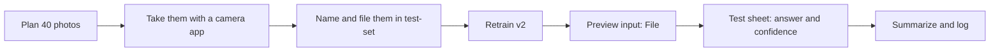

:::objectives
- Plan a 40-photo unseen test set that covers new rooms, lighting, and people.
- Take and name the photos outside Teachable Machine, so they can never leak into training.
- Test each photo through the preview's **File** input and fill in a test sheet with confidence.
- Summarize the sheet: accuracy per class, confidence when right and wrong, and the confident mistakes.
:::

So far you've judged your rock, paper, scissors model by its own graphs and by playing with it at your desk. Both are familiar tests. In this build you'll make the ruler you'll use for the rest of the course: a folder of 40 photos the model has never seen, and a test sheet of how it does on them. Here's the end result:

```text
test-set/      r01.jpg … r10.jpg   p01.jpg … p10.jpg
               s01.jpg … s10.jpg   n01.jpg … n10.jpg

RESULTS  rock-paper-scissors-v2
Familiar test (live, my desk, 40 tries)   38/40 right   95%
Unseen test   (test-set, 40 photos)       31/40 right   78%
Confident mistakes (90% or higher):       4
```

The gap between those two lines is the most useful number your model has produced so far.



## Step 1: Plan the photos

Each class gets 10 photos, spread across things that changed nowhere in your training data. Write the plan in your log first:

```text
UNSEEN TEST PLAN   rock-paper-scissors
Per sign (Rock, Paper, Scissors), 10 photos each:
  4  in a room I never recorded in (kitchen)
  3  in different light (window daylight, or only a ceiling light)
  3  with someone else's hand (my sister, who agreed)
Nothing, 10 photos:
  4  empty frames in the new room
  3  my face, no sign, in the new room
  3  holding an object that is not a sign (mug, phone, pen)
```

The last three Nothing photos test the "not on the menu" problem from the Notes: the correct answer is Nothing, but the model has never seen a mug.

No one to borrow a hand from? Use your other hand with a long sleeve, at a distance you didn't train on. It's a weaker test than a new person, and your log should say so.

## Step 2: Take the photos outside Teachable Machine

Use your computer's ordinary camera app, not Teachable Machine. Taking the photos somewhere else means they can't end up in a class by accident.

:::tabs
@tab Windows
Press **Start**, type **Camera**, and open the Camera app. Click the photo button for each picture. Photos are saved in **Pictures › Camera Roll**.
@tab macOS
Open **Photo Booth** from Applications and click the red camera button for each picture. To get the files out, select the photos and drag them from Photo Booth into a Finder folder.
@tab Chromebook
Open the **Camera** app from the Launcher and take each photo. They're saved in the **Files** app under **My files › Camera**.
:::

A phone works too, and a different camera is a good extra test. iPhones save HEIC files by default, which Teachable Machine won't accept; switch **Settings › Camera › Formats** to **Most Compatible** to get JPGs, or convert the files before testing.

## Step 3: Name and file them

Make a folder called `test-set` inside your course folder and rename each photo by its true class and a number: `r01.jpg` to `r10.jpg` for Rock, `p01` to `p10` for Paper, `s01` to `s10` for Scissors, and `n01` to `n10` for Nothing.

The name records the right answer, so you decide the truth *before* the model sees anything. Write one line per photo in your log saying what's in it ("s04: kitchen, sister's hand, fingers wide"), while you still remember.

:::warning
**This folder never goes into a class.** Not one photo, not even to fix a mistake. The moment the model trains on a test photo, that photo measures memory instead of skill, and you can't compare versions fairly any more. If a photo shows a gap in the data, collect *new* examples like it for training.
:::

## Step 4: Retrain version 2

Open `rock-paper-scissors-v2` from your file (**Get Started › Open an existing project from a file**) and click **Train Model** with the default settings. Don't change any samples today; you're measuring v2 as it is.

## Step 5: Run the familiar test first

For comparison, do a quick live test at your usual desk: make each sign 10 times (Nothing means hand down), and tally how many times the top bar is the right class. Watch for a second each time rather than reading one frame. This is the blue-bar kind of test from the Notes, and it should score high.

## Step 6: Run the unseen test

1. In the **Preview** panel, use the menu beside **Input** to switch from **Webcam** to **File**.
2. Drag `r01.jpg` into the file area (or click it to choose the file). The bars show the model's answer for that photo.
3. On your test sheet, write the photo, its true class, the top class, and that class's percentage. If it's wrong, add what you notice.
4. Repeat for all 40.

```text
TEST SHEET   model v2   unseen test-set
photo   truth      said       conf   notes
r01     Rock       Rock        99
r04     Rock       Nothing     62    kitchen, very dim
r08     Rock       Scissors    93    sister's hand, knuckles sideways
s07     Scissors   Paper       99    kitchen ceiling light, fingers wide
n03     Nothing    Paper       99    holding a white mug
…
```

Write the confidence for right answers too. You need both to see whether confidence tells right from wrong.

## Step 7: Summarize the sheet

You can do the tallies by hand. Here's an example sheet summarized, so you can see what to calculate and how to read it:

```python run title="summarize_test.py"
sheet = """
r01 Rock Rock 99      r02 Rock Rock 97      r03 Rock Rock 95      r04 Rock Nothing 62
r05 Rock Rock 88      r06 Rock Rock 99      r07 Rock Rock 91      r08 Rock Scissors 93
r09 Rock Rock 84      r10 Rock Rock 97      p01 Paper Paper 99    p02 Paper Paper 96
p03 Paper Paper 92    p04 Paper Paper 99    p05 Paper Paper 87    p06 Paper Nothing 71
p07 Paper Paper 98    p08 Paper Paper 94    p09 Paper Paper 99    p10 Paper Paper 90
s01 Scissors Scissors 89   s02 Scissors Paper 97     s03 Scissors Scissors 81
s04 Scissors Paper 66      s05 Scissors Scissors 96  s06 Scissors Scissors 76
s07 Scissors Paper 99      s08 Scissors Scissors 93  s09 Scissors Rock 58
s10 Scissors Scissors 86   n01 Nothing Nothing 99    n02 Nothing Nothing 98
n03 Nothing Paper 99       n04 Nothing Nothing 99    n05 Nothing Nothing 97
n06 Nothing Nothing 95     n07 Nothing Nothing 99    n08 Nothing Rock 77
n09 Nothing Nothing 98     n10 Nothing Nothing 99
"""
words = sheet.split()
rows = [words[i:i + 4] for i in range(0, len(words), 4)]

right = [r for r in rows if r[1] == r[2]]
wrong = [r for r in rows if r[1] != r[2]]
print(f"Unseen accuracy: {len(right)}/{len(rows)} = {len(right) / len(rows):.0%}")
for cls in ["Rock", "Paper", "Scissors", "Nothing"]:
    ok = sum(1 for r in right if r[1] == cls)
    print(f"  {cls:9}{ok}/10")

def average(group):
    return sum(int(r[3]) for r in group) / len(group)

print(f"Average confidence when right: {average(right):.0f}%")
print(f"Average confidence when wrong: {average(wrong):.0f}%")
print("Confident mistakes (90% or more):")
for photo, truth, said, conf in wrong:
    if int(conf) >= 90:
        print(f"  {photo}: {truth} called {said} at {conf}%")
```

How to read it:

- **Unseen accuracy is 78%**, against 95% at the desk. That drop is the honest size of the model's blind spots.
- **Scissors is the weak class.** Three of its four mistakes went to Paper, the same mix-up the confusion matrix hinted at in Module 3, now measured on photos the model never saw.
- **Confidence helps, a little.** Wrong answers averaged lower confidence than right ones. But four mistakes were at 93% or more, so a high bar alone can't be trusted.
- **Look at where the confident mistakes happened:** a new person's hand (r08, s02), new light (s07), and an object that isn't a class (n03). Those are three different data problems, and each needs a different fix.

## Step 8: Log it and keep the set safe

Add the results to your project log: familiar score, unseen score, per-class results, the confident mistakes with their notes, and your best guess at the cause of each. Then copy the `test-set` folder somewhere safe. Every future version of this model will be measured on the same 40 photos, which is the only way to know whether a change helped.

:::quiz
Q: Why take the test photos with a separate camera app instead of recording them in Teachable Machine?
- [ ] Teachable Machine's photos are lower quality
  Quality isn't the reason; it's about keeping test and training data apart.
- [x] It keeps them out of the classes entirely, so they can't be trained on by accident
  Photos recorded into a class become training data. A separate folder of files is much harder to mix up.
- [ ] The preview can't test webcam frames
  The preview tests live webcam frames too; the file input lets you test the same saved photos on every version.

Q: Photo `n03` (holding a mug) came back **Paper 99%**. Which fix fits this mistake?
- [ ] Add `n03.jpg` to the Nothing class
  That would spoil the test set. The photo would no longer be unseen.
- [x] Record new Nothing samples of you holding everyday objects, then retest on the same 40 photos
  The model has never been shown that objects aren't signs. New training examples like n03, but not n03 itself, fill the gap.
- [ ] Delete n03 from the test set because a mug isn't a fair test
  People will hold things in front of the camera. Keeping hard cases in the test is what makes it useful.

Q: Why test the same 40 photos on every future version of the model?
- [x] So that a change in score comes from the model, not from an easier or harder test
  If the test set changed between versions, you couldn't tell whether the model improved or the photos got easier.
- [ ] Because Teachable Machine remembers which photos you tested
  It doesn't keep anything about preview tests.
:::

:::takeaways
- An unseen test set is a separate folder of photos from new rooms, light, and people, named by their true class before testing.
- Never put a test photo into a class; collect new training examples like it instead.
- Record both the answer and its confidence for every photo, right or wrong.
- The gap between the familiar and unseen scores, and the list of confident mistakes, tell you what the model really can't do.
:::

## Ideas to extend it

- Test the same photos on your v1 project. Did the targeted fix from Module 3 help on unseen photos, or only on your desk?
- Take 10 more photos of each sign with a phone camera, and compare the score with your laptop photos.
- Sort the wrong answers by their notes (new person, new light, new object) and count which cause appears most.

## Further reading

- [Datasets: Dividing the original dataset](https://developers.google.com/machine-learning/crash-course/overfitting/dividing-datasets): why test data must never influence training, explained with examples of how it leaks.
- [Teachable Machine FAQ](https://teachablemachine.withgoogle.com/faq): "Why isn't it working like I want it to?" suggests testing against new backgrounds, lighting, and people, and tricking the model with a photo or drawing of an object.
