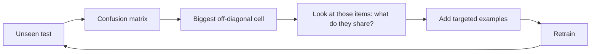

:::objectives
- Read a confusion matrix: rows are what each test item really was, columns are what the model said.
- Name a false positive and a false negative for any class you choose.
- Find the class pair a model confuses most, straight from the matrix.
- Decide which error type costs more in a given app, and say why.
:::

Two school clubs build recycling sorters with Teachable Machine. Each one points a webcam at an item and says **Recycling** or **Trash**. Both clubs test on the same 100 items, 50 of each kind, and both report the same score: 90 out of 100 right.

```python run
sorter_a = [[40, 10],   # really Recycling: 40 called Recycling, 10 called Trash
            [ 0, 50]]   # really Trash:      0 called Recycling, 50 called Trash
sorter_b = [[50,  0],
            [10, 40]]

for name, m in [("Sorter A", sorter_a), ("Sorter B", sorter_b)]:
    right = m[0][0] + m[1][1]
    total = sum(sum(row) for row in m)
    print(f"{name}: {right}/{total} right, accuracy {right / total:.0%}")
```

Same accuracy, but these are very different machines. Sorter A throws 10 clean cans and bottles into the trash. Sorter B sends 10 pieces of trash, like greasy pizza boxes and plastic bags, into the recycling. A recycling plant cares a lot about that difference, because a bale of paper with food waste in it can be rejected whole. One number hid the thing that mattered.

## Rows are the truth, columns are the guess

A **confusion matrix** is a table that counts every test result by two things: what the item really was, and what the model said. Teachable Machine draws one for you: in the Training panel, open **Advanced**, click **Under the hood**, then click **Calculate confusion matrix**. Its labels say **Class** down the side, for what the sample really is, and **Prediction** along the bottom, for what the model guessed. We'll use the same layout in this course.

You don't need to write the code below. It draws the two sorters' results so you can practice reading the picture.

```python run alt="Two 2-by-2 confusion matrices side by side. Sorter A has 40 and 50 on the diagonal and 10 in the top-right cell (recyclables called Trash). Sorter B has 50 and 40 on the diagonal and 10 in the bottom-left cell (trash called Recycling)." caption="Same accuracy, mistakes in opposite corners"
import matplotlib.pyplot as plt
from matplotlib.colors import LinearSegmentedColormap

BLUES = LinearSegmentedColormap.from_list("blues", ["#f2f7fd", "#86b6ef", "#1c5cab", "#0d366b"])

def draw_matrix(ax, counts, labels, title):
    top = max(max(row) for row in counts)
    ax.imshow(counts, cmap=BLUES, vmin=0, vmax=top)
    ax.set_xticks(range(len(labels)), labels)
    ax.set_yticks(range(len(labels)), labels)
    ax.set_xlabel("Prediction (what the model said)")
    ax.set_ylabel("Class (what it really was)")
    ax.set_title(title)
    for r, row in enumerate(counts):
        for c, n in enumerate(row):
            ax.text(c, r, n, ha="center", va="center", fontsize=13,
                    color="white" if n > top * 0.55 else "#1d1b22")

labels = ["Recycling", "Trash"]
fig, axes = plt.subplots(1, 2, figsize=(9, 3.8))
draw_matrix(axes[0], sorter_a, labels, "Sorter A")
draw_matrix(axes[1], sorter_b, labels, "Sorter B")
fig.tight_layout()
```

Here's how to read it. The **diagonal** from top-left to bottom-right holds the right answers: Recycling called Recycling, Trash called Trash. Every cell off the diagonal is a mistake, and its position tells you exactly which mistake. Sorter A's 10 sits in the **Recycling row, Trash column**: real recyclables that the model called trash. Sorter B's 10 sits in the **Trash row, Recycling column**: real trash that the model let into recycling.

A quick habit: read a row left to right and say "Of the things that were really *X*, the model called this many *A*, this many *B*." Each row adds up to how many test items of that class you used.

## False positives and false negatives: pick a class first

Here's the intuition. A smoke alarm has one job: shout "fire!" when there's a fire. If it goes off because you burned some toast, that's a **false positive**: it said yes, and the answer was no. If it stays quiet during a real fire, that's a **false negative**: it said no, and the answer was yes.

Now precisely. Choose the class you care about and call it the "positive" class. Then:

| | Model says the class | Model says something else |
| --- | --- | --- |
| **Item really is the class** | true positive | **false negative** (missed it) |
| **Item is something else** | **false positive** (false alarm) | true negative |

With **Recycling** as the class you care about, Sorter A makes 10 false negatives (recyclables it missed) and Sorter B makes 10 false positives (trash it wrongly accepted). Notice that the words flip if you pick **Trash** instead: Sorter B's mistakes become false negatives for Trash. That's why you always say which class you mean: "10 false positives *for Recycling*."

In matrix terms, for any class: its **false negatives** are the off-diagonal cells in its **row**, and its **false positives** are the off-diagonal cells in its **column**.

## Bigger matrices: find the cell that hurts most

Most models have more than two classes. Here are made-up results for a rock, paper, scissors model tested on 10 fresh tries of each sign, recorded on a different day from the training data.

```python run alt="A 4-by-4 confusion matrix for Rock, Paper, Scissors, and Nothing. The diagonal reads 9, 10, 6, 9. The largest off-diagonal cell is 4, in the Scissors row and Paper column. Rock and Nothing swap one item each." caption="One cell stands out: Scissors called Paper"
rps_labels = ["Rock", "Paper", "Scissors", "Nothing"]
rps = [[9,  0, 0, 1],
       [0, 10, 0, 0],
       [0,  4, 6, 0],
       [1,  0, 0, 9]]

fig, ax = plt.subplots(figsize=(5.4, 4.6))
draw_matrix(ax, rps, rps_labels, "Rock, paper, scissors: 40 unseen tries")
```

Your eye goes straight to the **4** in the Scissors row, Paper column. Four out of ten Scissors tries were called Paper. Everything else is a 1 or 0. That one cell tells you what to fix, and it also tells you what *not* to touch: Paper itself is perfect on its own row, so the problem is that Paper is too eager to claim things.

The same counts, as false positives and false negatives per class:

```python run
for i, name in enumerate(rps_labels):
    row_total = sum(rps[i])
    missed = row_total - rps[i][i]                       # rest of the row
    false_alarms = sum(rps[r][i] for r in range(4)) - rps[i][i]   # rest of the column
    print(f"{name:9} {rps[i][i]:>2}/{row_total} right   "
          f"false negatives {missed}   false positives {false_alarms}")
```

Scissors has 4 false negatives and Paper has 4 false positives. It's the same four mistakes, counted from each side. When you see a matching pair like that, you've found two classes the model can't separate well, and your next job is to figure out *why*. The next lesson does exactly that with a real model.



## Which mistake costs more depends on the app

A model doesn't know what its mistakes cost. You do. Before you fix anything, decide which error you'd rather have, because some fixes trade one for the other.

| App | False positive looks like | False negative looks like | Usually worse |
| --- | --- | --- | --- |
| Smart doorbell sound detector | Phone buzzes when the TV plays a ding | A real visitor gets no answer | False negative |
| Recycling sorter | Trash contaminates the recycling | A can goes to the landfill | False positive |
| Posture reminder | Nagged while sitting fine | Slouches for an hour, no reminder | Depends on the user |
| Sign-language letter helper | Types a letter you didn't sign | Ignores a letter you did sign | False positive (wrong text is confusing) |

The last column is a judgment, and reasonable people disagree. What matters is that you write it down before you look at the numbers, so you don't pick whichever story makes your model look good.

## Why Teachable Machine's own matrix often looks perfect

Teachable Machine holds back **15%** of your samples as test samples and trains on the other 85%. Its confusion matrix and **Calculate accuracy per class** both use that 15%. The catch: webcam samples are recorded in bursts at many frames a second, so a test frame is often nearly identical to a training frame grabbed a split second earlier. The model has, in effect, seen the answer.

So treat the built-in matrix as a smoke test. If it shows mistakes, take them seriously. If it shows a perfect diagonal, that proves very little. The matrix you trust is the one you fill in yourself from unseen tries, like the 40 rock, paper, scissors tries above.

:::warning
**Reading the matrix sideways.** If you read columns as the truth, you'll fix the wrong class. In the rock, paper, scissors example you'd conclude "Paper is being missed" and record more Paper, which makes Paper even greedier and the Scissors problem worse. Always check the axis labels first: in Teachable Machine, **Class** (the truth) runs down the side.
:::

:::warning
**Fixing errors with test items.** It's tempting to drag the four misread Scissors photos into the Scissors class and retrain. The next test on those same photos will look perfect, because the model has now studied them. Keep your unseen test set out of training forever, and collect *new* examples of the problem instead.
:::

:::video Kdsp6soqA7o
StatQuest explains the confusion matrix with a medical example. Notice which side of his table holds the known truth and which holds the prediction: tools don't all agree, which is why you read the axis labels before reading any numbers.
:::

:::quiz
Q: In a doorbell model, the matrix shows 6 in the **Doorbell** row, **Background Noise** column. What happened?
- [x] Six real doorbell rings were missed (false negatives for Doorbell)
  The row is the truth (it was a doorbell) and the column is the guess (background noise), so the model missed six rings.
- [ ] Six background sounds were wrongly called Doorbell
  That would be in the Background Noise row, Doorbell column.
- [ ] Six rings were correctly recognized
  Correct answers sit on the diagonal, where row and column are the same class.

Q: Two sorters both score 90%. What extra information do you need to choose between them?
- [ ] Nothing, they're equally good
  Equal accuracy can hide opposite kinds of mistakes, as Sorters A and B showed.
- [x] Which cells the mistakes are in, and which mistake costs more for this app
  The matrix shows where the errors land; your app decides which errors you can live with.
- [ ] Which one trained for more epochs
  Training settings don't tell you what kind of mistakes the model makes on real items.

Q: Scissors has 4 false negatives and Paper has 4 false positives, all in the same cell. What's the best first fix?
- [ ] Record 40 more Paper samples
  Paper is already over-claiming. More Paper data tends to make that worse.
- [ ] Delete the Scissors class
  Then the game can't recognize Scissors at all.
- [x] Look at the four misread Scissors tries to see what they share, then collect new Scissors examples like them
  The error is specific, so the fix should be too. Find the pattern first, then add data that covers it.

Q: Teachable Machine's built-in confusion matrix shows a perfect diagonal. What should you conclude?
- [ ] The model is ready to use
  The built-in test samples come from the same recording bursts as the training samples, so they're very easy.
- [x] Not much yet; run your own unseen test before trusting it
  A perfect score on near-duplicate frames says little about new hands, rooms, or lighting.
:::

:::takeaways
- In a confusion matrix, each row is what items really were, each column is what the model said, and the diagonal is right answers.
- A false positive is a false alarm for a class; a false negative is a miss. Always say which class you mean.
- For any class: false negatives are the rest of its row, false positives are the rest of its column.
- The biggest off-diagonal cell is where to start fixing, and a matching row and column usually means two classes look alike to the model.
- Decide which mistake costs more for your app before you start changing data.
:::

## Further reading

- [Thresholds and the confusion matrix](https://developers.google.com/machine-learning/crash-course/classification/thresholding): Google's Machine Learning Crash Course page, with an interactive example of how false positives and false negatives trade against each other.
- [Errors + Graceful Failure](https://pair.withgoogle.com/chapter/errors-failing/): Google's People + AI Guidebook chapter on how real products plan for the mistakes their models will make.
- [Teachable Machine FAQ](https://teachablemachine.withgoogle.com/faq): the "Why isn't it working like I want it to?" section suggests deliberately confusing your model to learn where it breaks.
