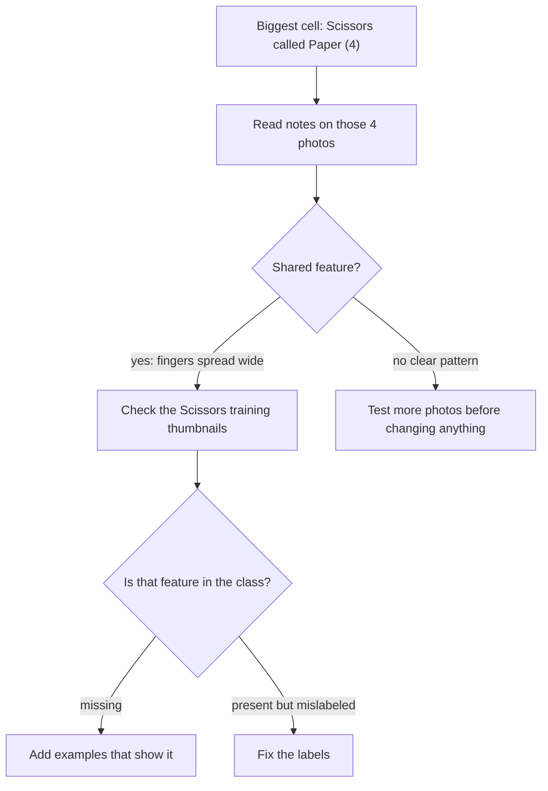

:::objectives
- Run an unseen test and record every result on a test sheet.
- Turn the sheet into a confusion matrix and pick the one error worth fixing first.
- Trace that error to a specific gap in the training data.
- Make one targeted data change, retrain, retest on the same photos, and log the result honestly.
:::

Your rock, paper, scissors model from earlier modules probably works well when you sit where you trained it. This build finds out where it doesn't, and fixes the worst case without breaking anything else. Here's the finished product, a log entry comparing two versions on the same 40 photos:

```text
CHANGE LOG  rock-paper-scissors
v1 → v2   one change: replaced 30 narrow-V Scissors samples with 30 wide-V ones
Unseen test: same 40 photos (10 per sign), never used for training
                        v1      v2
Scissors called Paper   4       1
Paper called Scissors   0       1
Total right             34/40   36/40
Decision: keep v2. Watch Paper → Scissors in the next test.
```

The numbers in this lesson are an example. Yours will differ, and that's the point: you'll make the same kind of entry from your own model.

## Step 1: Run the unseen test and fill in a test sheet

You need test photos the model has never seen. Use the unseen test set from Module 4. If you don't have one, make it now: with your computer's camera app (not Teachable Machine), take 10 photos of each sign in a room or light you didn't train in, and name them `r01.jpg` to `r10.jpg`, `p01.jpg` and so on. Put them in a folder called `test-set`. Those 40 photos never go into a class. Ever.

Then open your saved project (**☰ › Open project from file**), click **Train Model**, and in the **Preview** panel switch the input dropdown from **Webcam** to **File**. Drop in each photo and write down what the model says:

```text
TEST SHEET   model v1   40 unseen photos
             said Rock   said Paper   said Scissors   said Nothing
Rock            9           0             0              1
Paper           0          10             0              0
Scissors        0           4             6              0
Nothing         1           0             0              9

Wrong answers (photo, truth → said, confidence, what I notice)
s03.jpg  Scissors → Paper    71%  fingers spread wide
s05.jpg  Scissors → Paper    64%  side view, fingers spread wide
s08.jpg  Scissors → Paper    82%  left hand, fingers spread wide
s09.jpg  Scissors → Paper    58%  far away, fingers spread wide
r07.jpg  Rock → Nothing      55%  lamp off, very dark
n04.jpg  Nothing → Rock      61%  holding a mug near my face
```

The "what I notice" column is the most important part of the sheet. Write it while the photo is in front of you, before you've decided what the problem is.

## Step 2: Draw the matrix

Type your counts into the grid below and run it. The code is the same drawing helper as in the last lesson; you only edit the numbers.

```python run alt="Confusion matrix for model v1 on 40 unseen photos. Diagonal: Rock 9, Paper 10, Scissors 6, Nothing 9. The largest error is 4 in the Scissors row, Paper column; Rock and Nothing each have one error going to the other." caption="Model v1: the Scissors row leaks into Paper"
import matplotlib.pyplot as plt
from matplotlib.colors import LinearSegmentedColormap

BLUES = LinearSegmentedColormap.from_list("blues", ["#f2f7fd", "#86b6ef", "#1c5cab", "#0d366b"])
labels = ["Rock", "Paper", "Scissors", "Nothing"]

def draw_matrix(ax, counts, title):
    top = max(max(row) for row in counts)
    ax.imshow(counts, cmap=BLUES, vmin=0, vmax=top)
    ax.set_xticks(range(4), labels)
    ax.set_yticks(range(4), labels)
    ax.set_xlabel("Prediction")
    ax.set_ylabel("Class (truth)")
    ax.set_title(title)
    for r, row in enumerate(counts):
        for c, n in enumerate(row):
            ax.text(c, r, n, ha="center", va="center", fontsize=12,
                    color="white" if n > top * 0.55 else "#1d1b22")

v1 = [[9,  0, 0, 1],
      [0, 10, 0, 0],
      [0,  4, 6, 0],
      [1,  0, 0, 9]]

fig, ax = plt.subplots(figsize=(5.2, 4.4))
draw_matrix(ax, v1, "Model v1, unseen test")
```

Read the off-diagonal cells from biggest to smallest. The 4 in the Scissors row, Paper column is four times larger than anything else. The two 1s between Rock and Nothing are small enough to be bad luck on 10 photos; if they show up again next test, they'll get their own fix.

## Step 3: Find what the mistakes have in common

Now go back to the four Scissors photos the model called Paper and read your notes column. All four say **fingers spread wide**. That's your pattern: a wide V.

A pattern in the test photos is only half the story. The other half is in the training data. Open the **Scissors** class and scroll through its thumbnails. In this example, nearly every Scissors sample shows a narrow V, with the two fingers close together. The model was never shown a wide V labeled Scissors. What it *had* seen with spread fingers was Paper, so that's what it guessed.



Write the cause down as one sentence you could prove wrong: **"Wide-V Scissors look like Paper because training Scissors only had narrow V's."** If the fix doesn't help, that sentence was wrong, and you've still learned something.

## Step 4: Make one targeted change

The fix follows directly from the cause: show the model wide-V Scissors, labeled Scissors.

1. Open the **Scissors** class and click **Webcam**.
2. Record about 30 new samples of a **wide V**: right hand and left hand, close and far, facing the camera and slightly turned. Short bursts, moving your hand between them, like in Module 2.
3. Now look at the class count. It jumped from about 98 to 128, while the other classes sit near 95. Module 3 showed what an oversized class does: it starts winning arguments it shouldn't. So delete 30 of the old narrow-V samples, picking ones that look almost identical to their neighbors.

You've **replaced** 30 samples instead of piling on, which keeps the classes balanced, and you changed only one thing. Don't also tweak epochs, re-record Rock, or rename classes in the same round. If several things change at once and the results move, you can't tell which change did it.

:::warning
Don't drag `s03.jpg`, `s05.jpg`, `s08.jpg`, or `s09.jpg` into the Scissors class, even though they're exactly the examples the model needs. Once they're in training, your next test on them measures memory, not skill. Record *new* wide-V samples instead, and keep the test folder untouched.
:::

## Step 5: Retrain and retest on the same 40 photos

Click **Train Model** with the same **Advanced** settings as v1. Then repeat Step 1 exactly: same 40 photos, same order, same way of reading the top prediction. Using the same photos is what makes the comparison fair. New photos would change two things at once, the model and the test.

Put the v2 counts next to the v1 counts:

```python run alt="Two confusion matrices side by side. Model v1 has 4 in the Scissors row, Paper column. Model v2 has 1 there, and a new 1 in the Paper row, Scissors column. The diagonal for v2 reads 9, 9, 9, 9." caption="Before and after one targeted change"
v2 = [[9, 0, 0, 1],
      [0, 9, 1, 0],
      [0, 1, 9, 0],
      [1, 0, 0, 9]]

fig, axes = plt.subplots(1, 2, figsize=(10, 4.4))
draw_matrix(axes[0], v1, "v1")
draw_matrix(axes[1], v2, "v2: wide-V Scissors added")
fig.tight_layout()
```

Then let Python list exactly which cells moved, so you don't miss a small change:

```python run
for r in range(4):
    for c in range(4):
        if r != c and v1[r][c] != v2[r][c]:
            print(f"{labels[r]} called {labels[c]}: {v1[r][c]} → {v2[r][c]}")

right_v1 = sum(v1[i][i] for i in range(4))
right_v2 = sum(v2[i][i] for i in range(4))
print(f"Total right: {right_v1}/40 → {right_v2}/40")
```

The cell you targeted dropped from 4 to 1. The hypothesis held up. But a new mistake appeared: one Paper photo is now called Scissors. Look at it. In this example, it's a Paper photo taken side-on, where three fingers hide behind the other two and the hand looks like a wide V. That's a genuinely borderline photo, and it's the price of teaching the model that spread fingers aren't automatically Paper.

## Step 6: Decide, save, and log

Compare honestly. The big error shrank by three, a new small one appeared, and the total went from 34 to 36. That's a clear win, so keep v2. If the new error had been large, or in the class you care most about, you'd weigh it differently.

1. Open **☰ › Download project as file** and name it `rock-paper-scissors-v2-` plus today's date.
2. Add the change log entry from the top of this lesson to your project log, with your own numbers.
3. Leave the `test-set` folder exactly as it is. You'll use it again for every future version.

:::video pss3RKf9gP4
A short classroom explanation of a confusion matrix with more than two classes. Watch how the presenter reads one row at a time, the same way you read the Scissors row in Step 2.
:::

:::quiz
Q: Why retest v2 on the same 40 photos instead of taking fresh ones?
- [x] So the only thing that changed between the two tests is the model
  With the same photos, any difference in the matrix comes from your data change, not from an easier or harder test.
- [ ] Because Teachable Machine only accepts each file once
  You can upload the same file as often as you like; this is about fair comparison.
- [ ] Fresh photos would be added to training automatically
  Preview never adds anything to your classes.

Q: Why delete 30 old Scissors samples after recording 30 new ones?
- [ ] Teachable Machine has a limit of 100 samples per class
  There's no such limit. The reason is balance.
- [x] To keep Scissors about the same size as the other classes, so the fix doesn't create a new bias toward Scissors
  An oversized class tends to win close calls, which would trade one error for another.
- [ ] Old samples stop working after you retrain
  Every sample is used again each time you train.

Q: v2 fixed Scissors → Paper but added one Paper → Scissors error. What's the most reasonable conclusion?
- [ ] The change failed; go back to v1
  The targeted error dropped from 4 to 1 and the total rose from 34 to 36. That's an improvement with a small side effect.
- [x] Keep v2, note the new error, and check whether it repeats in the next test
  One new mistake on 10 photos might be a borderline photo. Logging it means you'll notice if it grows.
- [ ] Add the Paper photo to the Paper class and retest
  That puts a test photo into training, which makes the next test meaningless.
:::

:::takeaways
- A test sheet with a "what I notice" column is what turns a matrix into a diagnosis.
- Fix the biggest off-diagonal cell first; leave single stray errors until they repeat.
- Find the cause in two places: what the misread test photos share, and what the training class is missing.
- Change one thing per version, replace samples to keep balance, and never train on test photos.
- Retest on the same unseen photos, compare cell by cell, and log the trade-off you accepted.
:::

## Ideas to extend it

- Fix the Rock → Nothing error as a separate version (v3). Do the dark photos have something in common, and does your Rock class have any dark samples?
- With their permission, have a friend do 10 tries of each sign. Does your v2 still hold up on hands it has never seen?
- Compare the built-in **Calculate confusion matrix** result for v1 and v2. Did it notice the Scissors problem at all?

## Further reading

- [Dividing the original dataset](https://developers.google.com/machine-learning/crash-course/overfitting/dividing-datasets): Google's Machine Learning Crash Course on why a test set must stay separate from training, including the problem of near-duplicate examples.
- [Data Collection + Evaluation](https://pair.withgoogle.com/chapter/data-collection/): the People + AI Guidebook chapter on planning data so it matches the situations your model will meet.
