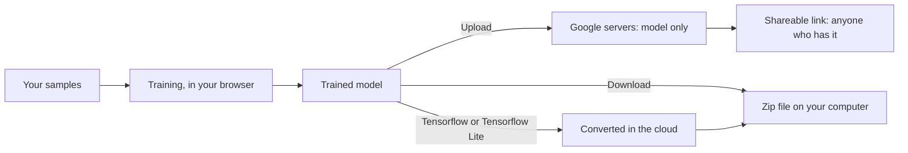

:::objectives
- Choose between **Upload (shareable link)** and **Download**, and between the Tensorflow.js, Tensorflow, and Tensorflow Lite tabs.
- Explain what leaves your computer at each step, and who can use a shared model.
- Spot what a model reveals through its labels and its behavior, even though your samples stay private.
- List the parts of a model card and say why a model file can't replace one.
:::

Here is everything a real, public Teachable Machine model says about itself. It's the example model used in the ml5.js documentation, and anyone can fetch this file from its link:

```json
{"tfjsVersion":"1.3.1","tmVersion":"1.1.0","packageVersion":"0.8.3",
 "packageName":"@teachablemachine/image","timeStamp":"2019-11-05T17:04:46.171Z",
 "userMetadata":{},"modelName":"tm-my-image-model","labels":["nighttime","daytime"]}
```

You learn two labels, a date, and some version numbers. You don't learn who trained it, on what pictures, whether it works at dusk, or what it should never be used for. If you built an app on this model and it failed at sunset, the file couldn't have warned you. Exporting is three clicks; exporting *responsibly* means sending the missing information along with the model.

## Three tabs, two destinations

When your model is trained, the **Export Model** button sits at the top of the **Preview** panel. It opens a window titled "Export your model to use it in projects," with three tabs. The tabs decide what kind of file you get; the choice inside the first tab decides where it lives.

| Tab and option | What you get | Where it runs |
| --- | --- | --- |
| **Tensorflow.js**, **Upload (shareable link)** | A link to your model, hosted by Teachable Machine, plus ready-made code snippets | Any web page or p5.js sketch |
| **Tensorflow.js**, **Download** | A zip with `model.json`, `weights.bin`, and `metadata.json` | Your own website or app, from your own files |
| **Tensorflow** (Keras or Savedmodel) | A model for Python programs, plus a `labels.txt` | Python on a computer |
| **Tensorflow Lite** (Floating point, Quantized, or EdgeTPU) | A small model file for devices, plus a `labels.txt` | Phones, Raspberry Pi, Coral boards |

Not every project gets every tab. Image projects have all three. Audio projects offer Tensorflow.js and Tensorflow Lite. Pose projects export as Tensorflow.js only. (Google has since renamed TensorFlow Lite to LiteRT, so newer guides may use that name.)

For this course you'll mostly use **Tensorflow.js**, because it runs in a browser, which is where Module 7's apps live.

## What leaves your computer, step by step

Teachable Machine is careful about your samples. Recording and training happen inside your browser tab. According to its FAQ, your samples aren't sent to any server unless you save the project to your own Google Drive.

Exporting is where things leave. The diagram follows each path:



Three facts from the FAQ and the export window are worth knowing exactly:

- **Upload sends the model, not the examples.** The FAQ calls the model "the mathematical program that predicts which class you're showing it." Your photos and recordings stay with you.
- **Anyone with the link can use it.** They can't change your model, but they can load it into their own projects. And if your web page loads the model, anyone who views your page's code can find the link.
- **Some conversions send a few samples.** The Tensorflow Lite **Quantized** and **EdgeTPU** options upload a subset of your data to do the conversion. The export window says it isn't stored on the server, but it does leave your computer.

A shared link is **unlisted**, not private. Treat an uploaded model as public: once someone has copied the link or downloaded the files, you can't pull those copies back.

## What a model reveals without its samples

"My photos weren't uploaded" doesn't mean nothing about you or your participants was shared. A model gives away information in two ways.

**Its labels.** Class names travel with the model. Here's a downloaded `metadata.json` from a model a student made to "check who's at the door":

```python run
import json

metadata = json.loads("""
{"modelName": "tm-my-image-model",
 "timeStamp": "2026-11-18T16:02:11.000Z",
 "labels": ["Maya", "Jordan", "Mrs. Okafor", "Nobody"]}
""")

print("Anyone with this file learns:")
print("  the model recognizes:", ", ".join(metadata["labels"]))
print("  it was made on:", metadata["timeStamp"][:10])
```

Three people's names are now attached to a tool that claims to recognize them. Nobody had to see a single photo.

**Its behavior.** Anyone can show the model new pictures and watch the scores. A model trained on your classmates' faces, shared publicly, is a working tool for picking those classmates out of *other* photos. A voice model can be probed to find out whose voice a clip sounds like. Researchers have also shown that, in some cases, trained models can leak details of the examples they learned from. The samples stayed home; what the model learned from them didn't.

## Consent covers the use, not only the recording

When a friend agreed to be recorded for your rock, paper, scissors project, they agreed to that: hand photos, in your browser, for a course project. Uploading a model trained on their face or voice is a different use, with a different audience. Ask again, and tell them exactly what will be shared and where.

A simple rule for this course: models that recognize **particular people** (faces, voices, names) stay on your computer. Models that recognize **things or gestures** can be shared once every person in the data has said yes to sharing.

## A model card is the label on the box

A **model card** is a short document that travels with a model and tells a stranger what it's for and how far to trust it. The idea comes from a 2019 paper by researchers at Google, "Model Cards for Model Reporting," and it's now common on sites that host models. A card for a Teachable Machine project fits on one page:

| Section | What to write |
| --- | --- |
| What it does | One sentence: input, output, purpose |
| Classes | The exact labels, and what each one means in camera terms |
| Data | How many samples per class, who appears, where and how they were recorded, and that everyone agreed |
| How it was tested | Your unseen test: how many items, and the confusion matrix results |
| Works well when | Lighting, distance, background, people similar to the data |
| Known weak spots | The errors you found, in plain words |
| Don't use it for | Uses it was never tested for, or that could hurt someone |
| Version, date, contact | So people know which model they have and who to tell about problems |

Compare that table with the `metadata.json` at the top of this lesson. The file covers part of one row (the labels) and a date. Everything else exists only if you write it.

:::warning
**Personal names as class labels.** A class called `Maya` publishes Maya's name with every copy of the model. Use labels that describe what the camera sees (`Person 1`, `Thumbs up`, `Doorbell`), and keep any key that maps them to real people off the internet.
:::

:::warning
**"I downloaded it, so it's private."** A downloaded zip is private only until you put it somewhere public. If your website loads `model.json` from a public folder (GitHub Pages, for example), anyone can download all three files, labels included. The privacy decision happens when you publish the files, not when you click **Download**.
:::

:::video n-zeeRLBgd0
The official one-minute tutorial from the Teachable Machine team. Watch where **Export Model** appears, and pause on the export window to find the upload and download choices from the table above.
:::

:::quiz
Q: You click **Upload my model**. What is now on Google's servers?
- [ ] Your model and all of your training samples
  The FAQ says the examples are not published with the model.
- [x] Your trained model, which anyone with the link can use
  The upload is the model only. The link works for anyone who has it, and they can't change the model.
- [ ] Nothing, until you share the link with someone
  The model is uploaded when you click the button; sharing the link only decides who knows where it is.

Q: A pose model for a dance game needs to run on a website. Which export do you choose?
- [x] **Tensorflow.js**, with Upload or Download
  Pose projects export as Tensorflow.js, which is the format browsers run.
- [ ] **Tensorflow Lite**, Quantized
  Pose projects don't offer Tensorflow Lite, and it's meant for phones and small devices anyway.
- [ ] **Tensorflow**, Keras
  Keras is for Python programs, and pose projects don't offer it.

Q: Your model recognizes three friends' faces. All three agreed to be recorded for a class project. What should happen before you upload it?
- [ ] Nothing more; they already agreed
  They agreed to a recording for a class project, not to a public tool that can recognize them.
- [ ] Rename the classes, then upload
  Renaming hides their names, but the model still recognizes their faces for anyone with the link.
- [x] Keep it on your computer; a model that recognizes particular people shouldn't be shared
  Sharing turns it into a tool that can pick them out of other photos, which is a much bigger use than they agreed to.

Q: Which information is in the exported model files, and which do you have to write in a model card yourself?
- [ ] All of it is in `metadata.json`
  The metadata has labels, a timestamp, and versions. It has nothing about data, testing, or limits.
- [x] Labels and a date are in the files; data, test results, weak spots, and intended use need a model card
  That's exactly the gap a model card fills.
:::

:::takeaways
- **Export Model** has three tabs: Tensorflow.js for browsers, Tensorflow for Python, and Tensorflow Lite for phones and small devices.
- **Upload (shareable link)** puts the model, not your samples, on Google's servers; anyone with the link can use it.
- A model reveals information through its labels and its behavior, even when no sample leaves your computer.
- Consent to be recorded isn't consent to be recognized by a public model. Keep people-recognizing models private.
- A model card tells people what the model does, what data and tests stand behind it, and where it fails. The files can't say any of that.
:::

## Further reading

- [Teachable Machine FAQ](https://teachablemachine.withgoogle.com/faq): the "Saving & Exporting" section answers who can access your samples and who can use a published model, in the team's own words.
- [Google Model Cards](https://modelcards.withgoogle.com/about): short, readable examples of real model cards for face detection and object detection models.
- [Model Cards for Model Reporting](https://arxiv.org/abs/1810.03993): the original 2019 paper. The first two pages explain the idea clearly, even if the rest is technical.
