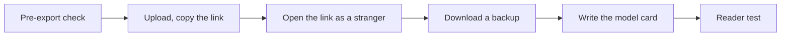

:::objectives
- Check labels, consent, and version before anything leaves your computer.
- Upload a model with **Upload my model** and see the link the way a stranger sees it.
- Download the Tensorflow.js files and read what `metadata.json` contains.
- Write a model card whose test numbers come from your unseen test, then check it with a reader.
:::

By the end of this build you'll have a small release folder for your model. Anyone you hand it to can use the model *and* know when to trust it:

```text
rps-release-v2/
  model-link.txt           the shareable link, with version and date
  tm-my-image-model.zip    model.json, weights.bin, metadata.json
  MODEL_CARD.md            one page: what it does, data, tests, limits
```



## Step 1: Check before you export

Open `rock-paper-scissors-v2` from Module 5 (**☰ › Open project from file**) and go through this list. Every "no" stops the export until you fix it.

```text
PRE-EXPORT CHECK   rock-paper-scissors v2
[ ] Labels describe what the camera sees, with no names or places
    Rock, Paper, Scissors, Nothing
[ ] Every person whose hands or face appear in the samples agreed to SHARING,
    not only to recording
[ ] Nothing private ended up in a sample background
[ ] The model is trained on the current samples (Training panel says Model Trained)
[ ] I know which version this is, and it matches my log
```

The consent line is the one people skip. If a friend's hands are in your Scissors class, ask them now: "I'm putting a model trained on these online, at a link anyone could use. Is that OK?" If they say no, remove their samples, retrain, and retest before going on.

## Step 2: Upload and copy the link

1. Click **Export Model** at the top of the **Preview** panel.
2. Stay on the **Tensorflow.js** tab and choose **Upload (shareable link)**.
3. Click **Upload my model**. The button reads **Uploading...** for a few seconds.
4. When it finishes, the window shows **Your sharable link:** with a URL like `https://teachablemachine.withgoogle.com/models/AbC123xYz/`. Click **Copy**.

Make `model-link.txt` and paste the link in with its version:

```text
rock-paper-scissors v2   uploaded 2026-11-18
https://teachablemachine.withgoogle.com/models/AbC123xYz/
```

Below the link, the export window also shows code snippets for **Javascript** and **p5.js**. You'll use those in Module 7, and you can always come back here for them.

## Step 3: Open the link as a stranger would

Open a private (incognito) browser window and paste your link. A private window isn't signed in and has no history, so you see the page exactly as someone who just received the link does.

The page explains what the link is, lists the files it hosts, and offers to preview the model live, along with a way to report the model. Click the live preview and try a few signs. Two things to notice:

- **Your class names are public.** They're part of the model, so they show up for anyone. That's why Step 1 checked them.
- **There's no explanation of how well it works, or where it fails.** The page can't know. That's the model card's job.

## Step 4: Download a backup and look inside

Back in the export window, switch to **Download** and click **Download my model**. You get `tm-my-image-model.zip`. Unzip it into your release folder and you'll find three files: `model.json` (the model's structure), `weights.bin` (the numbers it learned), and `metadata.json`. Open `metadata.json` in any text editor. It looks something like this, with your own date and versions:

```json
{"tfjsVersion":"1.3.1","tmVersion":"2.4.19","packageVersion":"0.8.5",
 "packageName":"@teachablemachine/image","timeStamp":"2026-11-18T16:20:45.312Z",
 "userMetadata":{},"modelName":"tm-my-image-model",
 "labels":["Rock","Paper","Scissors","Nothing"],"imageSize":224}
```

The labels are in the same order as your classes. The download is your backup: if you ever lose the project file, these three files still run the model.

## Step 5: Let the test sheet fill in the numbers

The most important section of a model card, "How it was tested," should be copied from your unseen test, not typed from memory or taken from **Accuracy per class** (which uses the easy built-in test samples, as Module 5 showed). Paste your v2 counts below and the cell writes that section for you:

```python run
import json

metadata = json.loads('{"labels": ["Rock", "Paper", "Scissors", "Nothing"]}')
labels = metadata["labels"]

v2 = [[9, 0, 0, 1],      # your v2 unseen-test counts from Module 5
      [0, 9, 1, 0],      # rows = truth, columns = what the model said
      [0, 1, 9, 0],
      [1, 0, 0, 9]]

total = sum(sum(row) for row in v2)
right = sum(v2[i][i] for i in range(len(labels)))
print("## How it was tested")
print(f"Unseen test: {total} photos the model never trained on, "
      f"taken in a different room. {right}/{total} correct.")
for i, name in enumerate(labels):
    mistakes = [f"{labels[c]} ({v2[i][c]})" for c in range(len(labels))
                if c != i and v2[i][c] > 0]
    detail = "; mistaken for " + ", ".join(mistakes) if mistakes else ""
    print(f"- {name}: {v2[i][i]}/{sum(v2[i])}{detail}")
```

The output is plain Markdown you can paste into the card. Because it reads the labels in the same order as the model, the rows can't get shuffled by accident.

## Step 6: Write the rest of the card

The other sections come from your project log and your own judgment. Here's a finished card for the example model. Write yours in a file called `MODEL_CARD.md`, or in a document next to your project:

```text
# Model card: rock-paper-scissors v2

What it does: Looks at one webcam frame and says which hand sign is shown:
Rock, Paper, Scissors, or Nothing. Built for a rock, paper, scissors game.

Classes
- Rock: closed fist, knuckles toward the camera
- Paper: open hand, palm toward the camera
- Scissors: index and middle fingers out in a V (narrow or wide)
- Nothing: no sign; empty frame, a face, or a hand moving in or out

Data: about 95 samples per class, recorded with a laptop webcam in one
bedroom, lamp on and off, close and arm's length, both hands. One person's
hands (mine). Teachable Machine, standard image model.

How it was tested
Unseen test: 40 photos the model never trained on, taken in a different
room. 36/40 correct.
- Rock: 9/10; mistaken for Nothing (1)
- Paper: 9/10; mistaken for Scissors (1)
- Scissors: 9/10; mistaken for Paper (1)
- Nothing: 9/10; mistaken for Rock (1)

Works well when: one hand, 30 cm to an arm's length away, in normal room light.
Known weak spots: very dark rooms (Rock can read as Nothing); Paper seen from
the side can read as Scissors; only tested on one person's hands, so other
hands, skin tones, and hand sizes are untested.
Don't use it for: anything that matters more than a game, or recognizing
who someone is.
Version: v2, 2026-11-18. Link: see model-link.txt
Contact: [your name or class email]
```

Look at the "Known weak spots" line: every item came from a real test result or a real gap in the data. A card that says "works great!" with no weak spots isn't humble, it's untested.

## Step 7: Run the reader test

Give the link and the card to someone who hasn't seen your project, and ask them three questions **using only the card**:

1. Would this work in a dark room?
2. Could I use it to check who is at the door?
3. Which version is this, and when was it made?

If they can't answer one, the card is missing something. Fix it now, because in a month you'll be the stranger too.

:::tip
When you retrain later, the export window's button changes to **Update my cloud model** so you can push the new version to your link. Every app using that link gets the new model, so update the card's version, test results, and date at the same time.
:::

:::quiz
Q: Why open your link in a private browser window?
- [x] To see exactly what someone who just got the link sees, without your sign-in or history
  A private window is the closest you can get to being a stranger to your own model.
- [ ] Because the link only works in private windows
  It works in any window; private just removes your own context.
- [ ] To keep Google from saving your model
  The model is already on Google's servers once you've uploaded it.

Q: Where should the card's "How it was tested" numbers come from?
- [ ] **Accuracy per class** in Under the hood
  Those use the built-in test samples, which are near-copies of training frames and tend to look too good.
- [x] Your unseen test sheet, copied by code so nothing gets mistyped
  That test used photos the model never saw, in different conditions, which is what a reader needs to know.
- [ ] Your best guess after trying it a few times
  A guess can't be checked, and it tends to be optimistic.

Q: A friend whose hands are in your data says no to sharing. What do you do?
- [ ] Upload anyway; their hands aren't identifiable
  Consent is their decision, not yours.
- [x] Remove their samples, retrain, retest, and only then export
  Removing samples changes the model, so it needs a new test before the card can describe it.
- [ ] Download instead of uploading
  A download can still be shared later, and it's still a model trained on their hands.
:::

:::takeaways
- Check labels, sharing consent, and version before exporting; consent to record isn't consent to share.
- **Upload my model** gives a public link; view it in a private window to see what strangers see.
- Keep the downloaded zip as a backup: `model.json`, `weights.bin`, and `metadata.json` run the model on their own.
- A model card's test numbers should come straight from your unseen test, and its weak spots from real results.
- The reader test shows whether the card answers the questions a stranger will actually ask.
:::

## Ideas to extend it

- Put your card and link on a free GitHub Pages site or a shared class document, so the card is always next to the link.
- When you make v3, write only what changed in the card, then compare the two cards side by side. Does the "Known weak spots" list get shorter?
- Ask a classmate to try your model on their own hands, with the card in front of them. Add whatever they discover to the card.

## Further reading

- [Model Cards on Hugging Face](https://huggingface.co/docs/hub/model-cards): how the biggest model-sharing site asks people to document models, with sections that match the ones in this lesson.
- [Google Model Cards](https://modelcards.withgoogle.com/about): finished cards from Google for real models; compare their "limitations" sections with yours.
