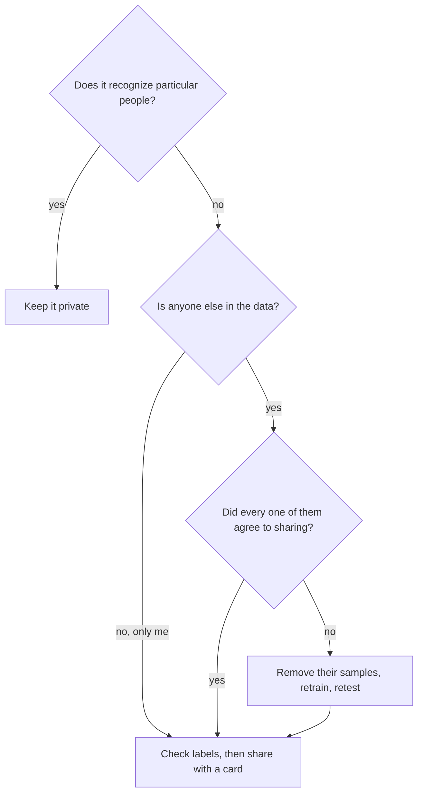

:::objectives
- Match a project to the right export tab and option.
- Find personal information in class labels and metadata, and rewrite it.
- Spot the missing sections in a weak model card, and write limits from real test results.
- Decide whether a model can be shared, based on who is in the data and what it recognizes.
:::

## Warm-up

Without looking back: which export tab would you use for a model that runs in a web page, and which for a model that runs on an Android phone?

:::solution
Web page: **Tensorflow.js** (Upload for a link, or Download to host the files yourself). Android phone: **Tensorflow Lite**, the format built for phones and small devices.
:::

### Exercise 1: Pick the export

Choose a tab and option for each project. One sentence of reasoning each.

1. A p5.js sketch your class will open in the p5.js Web Editor.
2. A museum kiosk with no internet connection, running a web page from its own hard drive.
3. A Python program on a Raspberry Pi that sorts objects with a servo.
4. A pose-controlled game on a website.

:::hint
Ask two questions each time: what runs the model (a browser, Python, or a small device), and does it have internet access to reach a hosted link?
:::

:::solution
1. **Tensorflow.js, Upload (shareable link).** The sketch can load the model straight from the link.
2. **Tensorflow.js, Download.** The kiosk can't reach a link, so the three files (`model.json`, `weights.bin`, `metadata.json`) go on its drive next to the web page.
3. **Tensorflow Lite** (Floating point is the simplest start), or **Tensorflow** (Keras) if the Pi runs full TensorFlow. Tensorflow Lite is built for small devices like the Pi.
4. **Tensorflow.js**. It's the only option for pose projects, and it's the one browsers run anyway.
:::

### Exercise 2: Audit the labels

A student is about to upload a household sound and image model with these class names. Which ones are a problem, and what would you rename them to?

```text
Background Noise | Dad snoring | Jake | Room 214 door | Thumbs up | Class 3
```

:::hint
Labels travel with the model to everyone who has the link. Look for names, places that identify where someone lives or studies, and labels that tell a stranger nothing.
:::

:::solution
- `Dad snoring`: reveals a family member and something private about him. Rename to `Snoring`, or ask whether this class should be in a shared model at all.
- `Jake`: a person's name in a model that recognizes him. Don't share a model that recognizes a particular person; keep this one private.
- `Room 214 door`: points to a real place. Rename to `Door`.
- `Class 3`: not private, just unhelpful. A stranger can't tell what it means. Rename it to what it detects, or delete it if it's a leftover.
- `Background Noise` and `Thumbs up` are fine.
:::

### Exercise 3: What does this file give away?

Someone posted a sound model link online. You fetch its `metadata.json` (audio models use `wordLabels` instead of `labels`):

```python run
import json

meta = json.loads("""
{"tfjsSpeechCommandsVersion": "0.4.0", "modelName": "TMv2",
 "timeStamp": "2026-10-02T21:43:27.414Z",
 "wordLabels": ["Background Noise", "Grandma", "Grandpa", "Dog barking"]}
""")
for key, value in meta.items():
    print(f"{key:26} {value}")
```

List what a stranger now knows, and what they could do with the model itself.

:::hint
Think about the labels, the date, and then what happens if someone plays recordings into this model.
:::

:::solution
From the file: the model recognizes two specific older people by voice and a dog, and it was made on 2 October 2026 at 21:43 UTC. From the model: anyone can play clips into it and see whether a voice scores as "Grandma" or "Grandpa", which makes it a rough tool for identifying those two people. The fix is to not share it; a voice model of particular people should stay on the computer that made it.
:::

### Exercise 4: Fix a weak model card

Here's a whole model card from a classmate. Which sections from the Module 6 table are missing?

```text
Recycling helper v1
This model sorts recycling and trash. It works really well!
Classes: Recycling, Trash
Made with Teachable Machine.
```

:::hint
Go through the table: what it does, classes, data, how it was tested, works well when, weak spots, don't use it for, version and date, contact.
:::

:::solution
It has a vague purpose, the class names, and a version number. Missing:

- **Classes** explained in camera terms (what counts as Recycling here?).
- **Data**: how many samples, what items, where and how they were recorded.
- **How it was tested**: no unseen test and no numbers. "Works really well" can't be checked.
- **Works well when** and **Known weak spots**.
- **Don't use it for** (for example: sorting for a real recycling plant without a human check).
- **Date** and **contact**.
:::

### Exercise 5: Write weak spots from real results

Your doorbell detector's unseen test sheet has these notes on its mistakes. Write the "Known weak spots" and "Don't use it for" sections.

```text
Doorbell → Background Noise   dishwasher running   (3 of 4 misses)
Doorbell → Background Noise   phone 5 m from the door
Background Noise → Doorbell   TV show with a doorbell sound effect
Background Noise → Doorbell   microwave finished beeping
Test conditions: one house, one doorbell, phone on the hall table
```

:::hint
Turn each pattern into a plain sentence a user would understand. Then think about who might rely on this app and when a miss would really matter.
:::

:::solution
```text
Known weak spots
- Misses some rings while a dishwasher is running (3 of the 4 misses).
- Misses rings when the phone is far from the door (one miss at about 5 m).
- Sometimes alerts on doorbell sounds from a TV, and on microwave beeps.
- Tested in one house with one doorbell; other doorbells are untested.

Don't use it for
- A person who can't hear the door and has no other way of knowing someone
  is there. It misses some rings, so it can only be an extra alert.
```

Every line points back to a real result, and the "untested" line is as important as the failures.
:::

### Exercise 6: Can this model be shared?

Use the flowchart to decide for each model, and say what has to happen first if the answer is "not yet".



1. A thumbs-up and thumbs-down model trained only on your own hands.
2. A sign helper trained on five club members' hands; four agreed to sharing, one hasn't answered.
3. A classroom attendance model that recognizes each student's face; every student said yes.
4. A dog-bark detector trained on your dog and a neighbor's dog, with the neighbor's permission.

:::hint
The first question in the flowchart is about what the model *does*, not about who agreed.
:::

:::solution
1. **Share**, after checking the labels and writing a card.
2. **Not yet.** Silence isn't agreement. Remove the fifth member's samples (or wait for a clear yes), retrain, retest, then share.
3. **Keep it private.** Even with everyone's agreement, a public face-recognition model can pick these students out of any photo, forever. Agreement to an attendance tool isn't agreement to that.
4. **Share**: it recognizes dogs barking, not people, and the neighbor agreed. Write in the card that it was trained on two dogs only.
:::

### Challenge: Release v3 with a changed card

You've retrained your rock, paper, scissors model as v3, adding dark-room Rock samples. The new unseen test gives Rock 10/10 and Nothing 10/10, with Paper and Scissors unchanged. Write the changes to the v2 card from Module 6 as a diff: lines starting with `-` are removed, lines with `+` are added.

:::solution
```diff
-# Model card: rock-paper-scissors v2
+# Model card: rock-paper-scissors v3
-room. 36/40 correct.
-- Rock: 9/10; mistaken for Nothing (1)
+room. 38/40 correct.
+- Rock: 10/10
 - Paper: 9/10; mistaken for Scissors (1)
 - Scissors: 9/10; mistaken for Paper (1)
-- Nothing: 9/10; mistaken for Rock (1)
+- Nothing: 10/10
-Known weak spots: very dark rooms (Rock can read as Nothing); Paper seen from
+Known weak spots: Paper seen from
-Version: v2, 2026-11-18. Link: see model-link.txt
+Version: v3, 2026-11-25. Changed: added 25 dark-room Rock samples,
+removed 25 near-duplicate Rock samples. Link: see model-link.txt
```

The version, the totals, the per-class lines, the weak spots, and the change itself all move together. Then click **Update my cloud model** so the link serves v3, and test the link in a private window again.
:::
