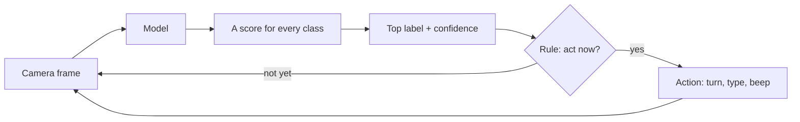

:::objectives
- Describe the loop every model-powered app runs: camera, model, label, action.
- Find the load, loop, and predict parts of Teachable Machine's exported JavaScript.
- Pick the top class from a list of scores, by name rather than by position.
- Use a confidence threshold, a hold time, and a cooldown so an app acts once per real gesture.
:::

Picture a snake game you steer by pointing your hand up, down, left, or right at the webcam. You switch from **Up** to **Left**, and in the half second it takes your hand to move, the model's top label goes Up, Left, Up, Left, Up, Left. A game that obeys every frame makes the snake zigzag five times. You only asked for one turn.

The model isn't broken. Halfway through a movement, your hand really does look a bit like both signs. The fix lives in the app, in a few lines between "the model said" and "the game does". That's what this lesson is about.

## Every app runs the same loop

A Teachable Machine model never runs once. The app grabs a camera frame, hands it to the model, gets back a score for each class, decides what to do, and starts again, many times a second.



The boxes on the left are what Teachable Machine gives you. The diamond is what you write. Most beginner apps skip the diamond and wire the label straight to the action, which is exactly how you get a zigzagging snake.

## The code Teachable Machine gives you

After you upload a model (Module 6), the export window shows code snippets. This is its **Javascript** snippet for an image model, with a few comments trimmed. In the export window, your own link appears where this shows `{{URL}}`:

```html
<div>Teachable Machine Image Model</div>
<button type="button" onclick="init()">Start</button>
<div id="webcam-container"></div>
<div id="label-container"></div>
<script src="https://cdn.jsdelivr.net/npm/@tensorflow/tfjs@latest/dist/tf.min.js"></script>
<script src="https://cdn.jsdelivr.net/npm/@teachablemachine/image@latest/dist/teachablemachine-image.min.js"></script>
<script type="text/javascript">
    // the link to your model provided by Teachable Machine export panel
    const URL = "{{URL}}";

    let model, webcam, labelContainer, maxPredictions;

    // Load the image model and setup the webcam
    async function init() {
        const modelURL = URL + "model.json";
        const metadataURL = URL + "metadata.json";

        model = await tmImage.load(modelURL, metadataURL);
        maxPredictions = model.getTotalClasses();

        const flip = true; // whether to flip the webcam
        webcam = new tmImage.Webcam(200, 200, flip); // width, height, flip
        await webcam.setup(); // request access to the webcam
        await webcam.play();
        window.requestAnimationFrame(loop);

        document.getElementById("webcam-container").appendChild(webcam.canvas);
        labelContainer = document.getElementById("label-container");
        for (let i = 0; i < maxPredictions; i++) { // and class labels
            labelContainer.appendChild(document.createElement("div"));
        }
    }

    async function loop() {
        webcam.update(); // update the webcam frame
        await predict();
        window.requestAnimationFrame(loop);
    }

    // run the webcam image through the image model
    async function predict() {
        const prediction = await model.predict(webcam.canvas);
        for (let i = 0; i < maxPredictions; i++) {
            const classPrediction =
                prediction[i].className + ": " + prediction[i].probability.toFixed(2);
            labelContainer.childNodes[i].innerHTML = classPrediction;
        }
    }
</script>
```

You don't need to understand every line. Find three parts:

- **Load.** `tmImage.load(modelURL, metadataURL)` downloads `model.json` and `metadata.json` from your link. This is why the link matters: it's the only line that ties the page to *your* model.
- **Loop.** `requestAnimationFrame(loop)` asks the browser to run `loop` again before the next screen refresh, so the page predicts as often as it can, up to about 60 times a second.
- **Predict.** `model.predict(webcam.canvas)` returns one entry per class, each with a `className` and a `probability` from 0 to 1.

This code can't run inside this lesson page, because it needs your camera and your model's link. When you run it on a real web page, you'll see a **Start** button; click it, allow the camera, and a small webcam square appears with one line per class underneath, like `Rock: 0.97`, the numbers changing as you move. The next lesson runs a version of this in the p5.js Web Editor.

## A prediction is a list of scores

Each frame, `predict()` hands back a list like the one below. Your app's first job is to pick the winner. This part *does* run here, with a pretend frame:

```javascript run
// One frame from model.predict(): one entry per class, in class order
const prediction = [
  { className: "Up",    probability: 0.08 },
  { className: "Down",  probability: 0.02 },
  { className: "Left",  probability: 0.86 },
  { className: "Right", probability: 0.04 },
];

let top = prediction[0];
for (const p of prediction) {
  if (p.probability > top.probability) top = p;
}
const total = prediction.reduce((sum, p) => sum + p.probability, 0);

console.log(`Top class: ${top.className} (${top.probability.toFixed(2)})`);
console.log(`All scores add up to ${total.toFixed(2)}`);
```

The loop keeps whichever entry has the highest probability. The scores always add up to 1, because the model must split its belief across your classes. That's also why it never says "none of these": if you show it a banana, *some* class still wins. A **Nothing** or **Background Noise** class gives it an honest place to put that belief.

Notice that the app checks `top.className`, the label's name. It never assumes "Left is entry number 2".

## Three rules that calm a jumpy model

Here's a recording of 20 frames, about two-thirds of a second, while a player switches from Up to Left. Watch what a game does if it obeys every frame, compared with one that uses two rules: act only when confidence is at least **0.85**, and only after the same label has won **4 frames in a row**.

```javascript run
const frames = [
  ["Up", 0.97], ["Up", 0.95], ["Up", 0.91], ["Left", 0.52], ["Up", 0.55],
  ["Left", 0.61], ["Up", 0.49], ["Left", 0.78], ["Left", 0.83], ["Up", 0.51],
  ["Left", 0.88], ["Left", 0.92], ["Left", 0.95], ["Left", 0.94], ["Right", 0.41],
  ["Left", 0.96], ["Left", 0.97], ["Left", 0.95], ["Left", 0.97], ["Left", 0.98],
];

// Naive: obey every frame
let direction = "Up";
let naiveTurns = 0;
frames.forEach(([label], i) => {
  if (label !== direction) { direction = label; naiveTurns++; }
});

// Steady: confident, and the same label 4 frames in a row
const THRESHOLD = 0.85, HOLD = 4;
let steadyDirection = "Up", candidate = null, streak = 0;
frames.forEach(([label, confidence], i) => {
  if (confidence < THRESHOLD) { candidate = null; streak = 0; return; }
  streak = label === candidate ? streak + 1 : 1;
  candidate = label;
  if (streak >= HOLD && label !== steadyDirection) {
    steadyDirection = label;
    console.log(`Steady app turns ${label} at frame ${i}`);
  }
});

console.log(`Naive app turned ${naiveTurns} times; steady app ended facing ${steadyDirection}`);
```

The naive app turned nine times for one real change. The steady app turned once, at frame 13. Read the frames again and you'll see why: the low-confidence frames during the switch never count, and the stray **Right** at frame 14 is far too unsure to matter.

Each rule has a job and a cost:

| Rule | What it stops | What it costs |
| --- | --- | --- |
| **Threshold** (act only above, say, 0.85) | Half-formed gestures and "not sure" frames | Misses gestures the model is only fairly sure of (more false negatives) |
| **Hold** (same label for several frames, or a few hundred milliseconds) | Single-frame flickers | A short delay before every action |
| **Cooldown or re-arm** (after acting, wait a few seconds, or wait for Nothing) | The same gesture firing again and again | You can't repeat an action quickly |

These are the false positive and false negative trade-offs from Module 5, now under your control. A higher threshold means fewer false alarms and more misses.

Try it live below. Nothing here uses a camera: the page invents model output with as much flicker as you choose. Raise the jitter and watch the naive count run away while the steady app keeps up with the real changes. Then set the hold to 0 and see how much of the work the threshold alone does.

```html preview height="330"
<div class="sim">
  <p>Pretend model output, no camera. The player switches between <b>Up</b> and <b>Left</b> every 3 seconds.</p>
  <label>Jitter <input id="jitter" type="range" min="0" max="50" value="25"> <span id="jv"></span>%</label>
  <label>Hold for <input id="hold" type="range" min="0" max="600" step="50" value="250"> <span id="hv"></span> ms</label>
  <div class="grid">
    <div><small>Player shows</small><b id="truth">Up</b></div>
    <div><small>Top label now</small><b id="raw">Up</b></div>
    <div><small>Real changes</small><b id="real">0</b></div>
    <div><small>Naive app turns</small><b id="naive">0</b></div>
    <div><small>Steady app turns</small><b id="steady">0</b></div>
  </div>
</div>
<style>
  .sim { font: 15px system-ui, sans-serif; }
  .sim label { display: block; margin: 6px 0; }
  .grid { display: grid; grid-template-columns: repeat(auto-fit, minmax(110px, 1fr)); gap: 8px; margin-top: 10px; }
  .grid div { border: 1px solid #c3c2b7; border-radius: 8px; padding: 8px; }
  .grid small { display: block; color: #5f5d66; }
  .grid b { font-size: 22px; }
</style>
<script>
  const $ = (id) => document.getElementById(id);
  const others = { Up: ["Left", "Right"], Left: ["Up", "Down"] };
  let truth = "Up", previous = "Up", frame = 0, sinceSwitch = 99;
  let naiveDir = "Up", steadyDir = "Up", candidate = null, candidateSince = 0;
  let real = 0, naive = 0, steady = 0;
  setInterval(() => {
    frame++; sinceSwitch++;
    const now = frame * 33;
    if (frame % 90 === 0) { previous = truth; truth = truth === "Up" ? "Left" : "Up"; real++; sinceSwitch = 0; }
    const jitter = $("jitter").value / 100, hold = Number($("hold").value);
    $("jv").textContent = $("jitter").value; $("hv").textContent = hold;
    let raw = truth, conf = 0.86 + Math.random() * 0.13;
    if (sinceSwitch < 8) {
      raw = Math.random() < 0.5 ? previous : truth; conf = 0.4 + Math.random() * 0.4;
    } else if (Math.random() < jitter) {
      const pool = others[truth]; raw = pool[Math.floor(Math.random() * pool.length)];
      conf = 0.35 + Math.random() * 0.4;
    }
    if (raw !== naiveDir) { naiveDir = raw; naive++; }
    if (conf >= 0.85) {
      if (raw !== candidate) { candidate = raw; candidateSince = now; }
      if (candidate !== steadyDir && now - candidateSince >= hold) { steadyDir = candidate; steady++; }
    } else { candidate = null; }
    $("truth").textContent = truth; $("raw").textContent = raw;
    $("real").textContent = real; $("naive").textContent = naive; $("steady").textContent = steady;
  }, 33);
</script>
```

## Sounds and poses use the same loop, with two twists

**Audio models** listen instead of looking. The exported code calls `recognizer.listen()` with a function that runs each time a new one-second window of sound has been scored, and an options object:

```javascript
recognizer.listen(result => {
    const scores = result.scores; // probability of prediction for each class
    // ...
}, {
    includeSpectrogram: true,
    probabilityThreshold: 0.75,
    invokeCallbackOnNoiseAndUnknown: true,
    overlapFactor: 0.50 // probably want between 0.5 and 0.75. More info in README
});
```

Two of those options are rules you already know. `probabilityThreshold` is a built-in threshold: the function only runs when the top score beats it. `overlapFactor` sets how often the model checks: at 0.5, it scores the last second of audio every half second. Class names come from `recognizer.wordLabels()`, and the first class is always **Background Noise**.

**Pose models** take two steps per frame: `model.estimatePose()` finds your body's keypoints (shoulders, elbows, wrists, and so on), then `model.predict()` classifies those points. The twist is that the pose model also cares *where* you are in the frame, so an app that works when you sit in the middle may fail when you sit to one side.

## What you could build

| Idea | Project type | The rule between label and action |
| --- | --- | --- |
| Sign-language letter helper | Image | Type a letter when it's held at 0.9 or more for one second; then wait for **Nothing** before accepting the next letter |
| Smart doorbell sound detector | Audio | Notify when **Doorbell** scores 0.9 or more; then ignore doorbells for 10 seconds |
| Posture reminder | Pose | Play a gentle sound after **Slouching** has won for 10 seconds straight; reset the timer whenever **Upright** wins |

Every row has a threshold, a hold, and a cooldown or re-arm. The numbers differ because the costs of mistakes differ.

:::warning
**Checking classes by position.** Code like `if (prediction[2].probability > 0.9)` silently breaks if you ever add, delete, or reorder a class: entry 2 is now a different class, and nothing tells you. Always find the class by its name, as in `prediction.find(p => p.className === "Left")`.
:::

:::warning
**Left and right swap.** Teachable Machine's training webcam is mirrored, like a selfie camera, which is why the snippet sets `flip = true`. If your app's camera isn't flipped the same way, a hand pointing left looks like a hand pointing right, and your snake turns the wrong way every time. Keep the flip setting the same as in training.
:::

:::video pbjR20eTLVs start=24:51
The Coding Train shows how to load your own Teachable Machine model in a p5.js sketch with ml5.js version 1. Watch how the label from the model ends up on the canvas; that's the moment where you'd add the rule from this lesson.
:::

:::quiz
Q: Your gesture app plays a sound effect about 60 times a second while you hold a thumbs-up. Which rule is missing?
- [ ] A higher threshold
  A clear thumbs-up passes any sensible threshold, so the sound would still repeat.
- [x] A cooldown or re-arm after the action
  Without one, every frame that shows a confident thumbs-up triggers the action again.
- [ ] A Nothing class
  It helps when no hand is showing, but the problem here happens while your hand is showing.

Q: You raise the threshold from 0.7 to 0.95. What happens to errors?
- [x] Fewer false positives, more false negatives
  The app ignores more uncertain frames, so it fires wrongly less often but also misses more real gestures.
- [ ] Fewer of both
  A threshold trades one error for the other; it doesn't remove both.
- [ ] More false positives, fewer false negatives
  That's what lowering the threshold does.

Q: Which line ties the exported page to your own model?
- [ ] `window.requestAnimationFrame(loop)`
  That keeps the loop running; it would run with any model.
- [x] `const URL = "..."`, which `tmImage.load` uses to fetch `model.json` and `metadata.json`
  Swap the link and the same page runs a completely different model.
- [ ] `new tmImage.Webcam(200, 200, flip)`
  That sets up the camera, not the model.

Q: Why does the model still name a class when you show it something it was never trained on?
- [ ] It's a bug in Teachable Machine
  It's how classifiers work, not a bug.
- [x] The scores always add up to 1, so one of your classes always wins
  The model splits its belief across the classes it knows. A Nothing or Background Noise class gives it somewhere sensible to put that belief.
:::

:::takeaways
- Every app runs the loop camera → model → scores → rule → action, many times a second.
- In the exported code, the link (`URL`) picks the model, `requestAnimationFrame` keeps the loop going, and `predict()` returns a `className` and `probability` for every class.
- Find classes by name, never by position, and keep the camera flip the same as in training.
- A threshold stops unsure frames, a hold stops flickers, and a cooldown or re-arm stops repeats. Each one costs a little: missed gestures, delay, or slower repeats.
:::

## Further reading

- [Teachable Machine image library](https://github.com/googlecreativelab/teachablemachine-community/tree/master/libraries/image): the official reference for `tmImage.load`, `predict`, `predictTopK`, and the webcam helper, including the note on flipping.
- [Speech commands README](https://github.com/tensorflow/tfjs-models/tree/master/speech-commands): explains every `listen()` option for audio models, including `probabilityThreshold` and `overlapFactor`.
- [ml5.js imageClassifier](https://docs.ml5js.org/#/reference/image-classifier): the friendlier library used in the next lesson, with examples for Teachable Machine models.
