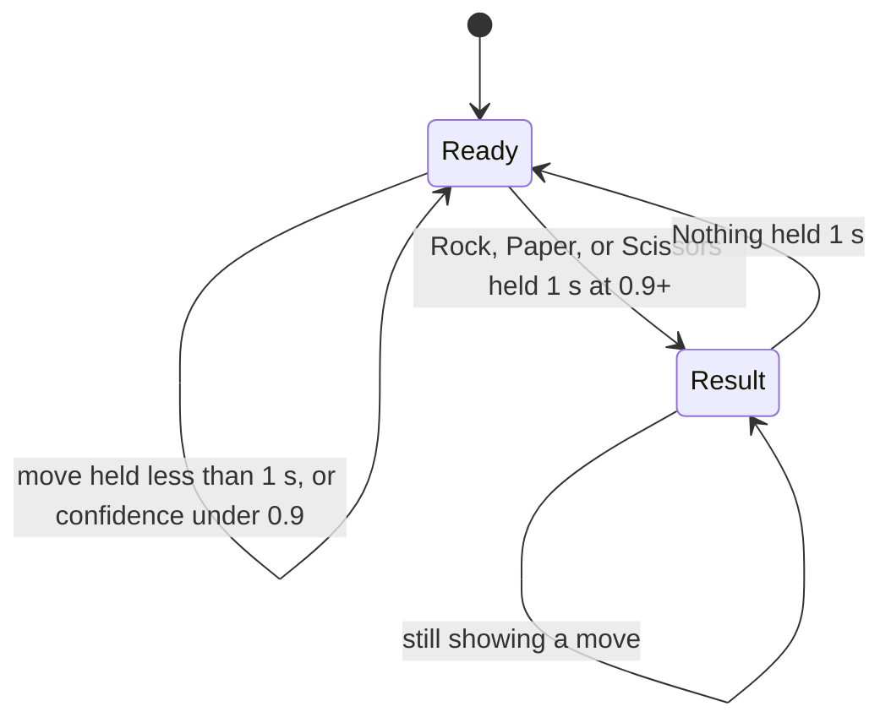

:::objectives
- Load an uploaded Teachable Machine model into the p5.js Web Editor with ml5.js.
- Show the live label and confidence on the canvas.
- Lock in a move with a threshold and a hold time, and re-arm with the **Nothing** class.
- Test the game's rules with fake data before testing with the camera, then play-test with a tally sheet.
:::

Your rock, paper, scissors model has been a project file and a link so far. In this build it becomes a game. Hold up a sign, keep it steady while a bar fills for one second, and the computer throws its own move. Lower your hand (Nothing) to start the next round. Here's how a game moves between its two states:



The second arrow out of **Result** is the re-arm from the last lesson. Without it, the hand you're still holding up would play round after round by itself.

You need your model's shareable link from Module 6 and a webcam. Everything runs in the free [p5.js Web Editor](https://editor.p5js.org/). This lesson page can't show the camera, so each step says what you should see.

## Step 1: Set up the sketch

1. Open **editor.p5js.org**. Sign in if you want to save your work (it's free).
2. A new sketch has three files: `index.html`, `sketch.js`, and `style.css`. If you don't see them, click the small arrow next to `sketch.js` to open the file list.
3. Open `index.html` and replace everything in it with this:

```html
<!DOCTYPE html>
<html lang="en">
  <head>
    <meta charset="utf-8" />
    <script src="https://cdn.jsdelivr.net/npm/p5@2.3.2/lib/p5.js"></script>
    <script src="https://unpkg.com/ml5@1/dist/ml5.min.js"></script>
    <link rel="stylesheet" type="text/css" href="style.css" />
  </head>
  <body>
    <script src="sketch.js"></script>
  </body>
</html>
```

The first script is p5.js, the drawing library. The second is ml5.js version 1, which knows how to load Teachable Machine models. These are the same two versions the ml5.js team uses in its own Teachable Machine example.

:::warning
**The p5.js snippet in Teachable Machine's export window** was written for an older ml5.js. With today's version it stops with an error like `ml5.flipImage is not a function`, because ml5.js 1.0 removed that function. Use the code in this lesson, which follows the current ml5.js examples.
:::

## Step 2: Show the camera and the model's answer

Replace everything in `sketch.js` with this, and paste your own link into `MODEL_URL`, keeping the `/` at the end:

```javascript
const MODEL_URL = "https://teachablemachine.withgoogle.com/models/YOUR_ID/";

let classifier, video;
let label = "";        // the model's latest top class
let confidence = 0;    // and how sure it is, from 0 to 1

async function setup() {
  classifier = await ml5.imageClassifier(MODEL_URL + "model.json");
  createCanvas(640, 560);
  video = createCapture(VIDEO, { flipped: true });
  video.size(640, 480);
  video.hide();
  classifier.classifyStart(video, gotResult);
}

function gotResult(results) {
  label = results[0].label;
  confidence = results[0].confidence;
}

function draw() {
  background(30);
  image(video, 0, 0);
  fill(255);
  textSize(22);
  text(`${label}  ${confidence.toFixed(2)}`, 12, 520);
}
```

Click the **Play** button (the triangle at the top). The browser asks for camera permission; allow it. After a few seconds you should see your mirrored webcam image with a line under it like `Rock 0.98`, changing as you switch signs.

What each piece does:

- `await ml5.imageClassifier(...)` loads your model from the link and waits until it's ready.
- `createCapture(VIDEO, { flipped: true })` mirrors the camera, matching how Teachable Machine recorded your samples. Without it, any sign that depends on left and right is read backward.
- `classifyStart(video, gotResult)` keeps classifying frames, and calls `gotResult` with a list of results **sorted from most to least confident**, so `results[0]` is always the top class.

If nothing appears, open the editor's **Console** at the bottom. A typo in the link usually shows up there as a failed download of `model.json`.

## Step 3: Write the "steady move" rule, and test it without a camera

The rule from the last lesson: a move counts only when the model is at least 0.9 sure **and** the same label has been on top for a full second. This function does that. It remembers which label it's watching (`candidate`) and when that label started winning (`heldSince`):

```javascript run
const THRESHOLD = 0.9;
const HOLD_MS = 1000;
let candidate = "", heldSince = 0;

function steadyMove(label, confidence, now) {
  if (confidence < THRESHOLD) { candidate = ""; return ""; }
  if (label !== candidate) { candidate = label; heldSince = now; }
  return now - heldSince >= HOLD_MS ? candidate : "";
}

// A fake stream: [time in ms, top label, confidence]
const stream = [
  [0, "Nothing", 0.97], [150, "Rock", 0.64], [300, "Rock", 0.93],
  [450, "Paper", 0.58], [600, "Rock", 0.94], [900, "Rock", 0.96],
  [1200, "Rock", 0.95], [1500, "Rock", 0.97], [1700, "Rock", 0.96],
];
for (const [time, label, confidence] of stream) {
  const move = steadyMove(label, confidence, time);
  console.log(`${String(time).padStart(4)} ms  ${label.padEnd(7)} ${confidence}  →  ${move || "(waiting)"}`);
}
```

Predict before you read the output: when does Rock first count? The unsure **Paper** frame at 450 ms resets the candidate, so the second it needs starts again at 600 ms. Rock locks in at 1700 ms, the first frame that's at least 1000 ms after 600. Testing the rule on made-up frames like this is much faster than waving your hand at a camera and wondering why nothing happened.

## Step 4: Decide who wins

The game logic is a small lookup: each move beats exactly one other. Check it against all nine combinations before trusting it:

```javascript run
function winner(player, computer) {
  if (player === computer) return "Draw";
  const beats = { Rock: "Scissors", Paper: "Rock", Scissors: "Paper" };
  return beats[player] === computer ? "You win" : "Computer wins";
}

const MOVES = ["Rock", "Paper", "Scissors"];
for (const player of MOVES) {
  for (const computer of MOVES) {
    console.log(`${player.padEnd(8)} vs ${computer.padEnd(8)} → ${winner(player, computer)}`);
  }
}
```

Three draws on the diagonal, and each move wins once and loses once. That's a complete, correct table.

## Step 5: Put it together

Now the game itself. `draw()` runs about 60 times a second; each time, it asks `steadyMove` whether a move has been held, and the `state` variable decides what that means. In **ready**, a held Rock, Paper, or Scissors plays a round. In **result**, only a held Nothing does anything: it starts the next round. The computer picks its move *after* yours locks in, from p5's `random`, so it can't cheat by watching your hand.

This is the complete `sketch.js`. Replace your file with it, paste your link again, and press **Play**:

```javascript
// Rock, paper, scissors against the computer, using a Teachable Machine model
const MODEL_URL = "https://teachablemachine.withgoogle.com/models/YOUR_ID/";
const THRESHOLD = 0.9;   // how sure the model must be
const HOLD_MS = 1000;    // how long a move must stay on top to count
const MOVES = ["Rock", "Paper", "Scissors"];

let classifier, video;
let label = "", confidence = 0;       // the latest prediction
let candidate = "", heldSince = 0;    // the label being held, and since when
let state = "ready";                  // "ready" or "result"
let playerMove = "", computerMove = "", outcome = "";
let wins = 0, losses = 0, draws = 0;

async function setup() {
  classifier = await ml5.imageClassifier(MODEL_URL + "model.json");
  createCanvas(640, 560);
  video = createCapture(VIDEO, { flipped: true });
  video.size(640, 480);
  video.hide();
  classifier.classifyStart(video, gotResult);
}

function gotResult(results) {
  label = results[0].label;
  confidence = results[0].confidence;
}

function steadyMove(label, confidence, now) {
  if (confidence < THRESHOLD) { candidate = ""; return ""; }
  if (label !== candidate) { candidate = label; heldSince = now; }
  return now - heldSince >= HOLD_MS ? candidate : "";
}

function winner(player, computer) {
  if (player === computer) return "Draw";
  const beats = { Rock: "Scissors", Paper: "Rock", Scissors: "Paper" };
  return beats[player] === computer ? "You win" : "Computer wins";
}

function draw() {
  background(30);
  image(video, 0, 0);

  const held = steadyMove(label, confidence, millis());
  if (state === "ready" && MOVES.includes(held)) {
    playerMove = held;
    computerMove = MOVES[floor(random(3))];
    outcome = winner(playerMove, computerMove);
    if (outcome === "You win") wins++;
    else if (outcome === "Computer wins") losses++;
    else draws++;
    state = "result";
  } else if (state === "result" && held === "Nothing") {
    state = "ready";
  }

  drawScreen();
}

function drawScreen() {
  noStroke();
  fill(0, 0, 0, 150);
  rect(0, 0, width, 90);
  fill(255);
  textAlign(CENTER, CENTER);
  textSize(30);
  if (state === "ready") {
    text("Hold your move steady for 1 second", width / 2, 45);
  } else {
    text(`${playerMove} vs ${computerMove}: ${outcome}`, width / 2, 32);
    textSize(18);
    text("Lower your hand (Nothing) to play again", width / 2, 70);
  }

  // How long the current move has been held
  if (state === "ready" && MOVES.includes(candidate)) {
    const progress = constrain((millis() - heldSince) / HOLD_MS, 0, 1);
    fill(255, 255, 255, 60);
    rect(380, 500, 240, 20, 4);
    fill(80, 160, 255);
    rect(380, 500, 240 * progress, 20, 4);
  }

  textAlign(LEFT, CENTER);
  textSize(18);
  fill(255);
  text(`Model sees: ${label} ${confidence.toFixed(2)}`, 12, 510);
  text(`You ${wins}   Computer ${losses}   Draws ${draws}`, 12, 540);
}
```

When it runs, the top bar reads "Hold your move steady for 1 second". Raise a fist and a blue bar under the video fills over one second, then the top bar shows something like `Rock vs Paper: Computer wins`, and the score updates. Keep your fist up and nothing else happens. Lower your hand, wait a second, and the prompt returns.

## Step 6: Play-test with a tally sheet

A game that "seems to work" hasn't been tested. Play 10 rounds with each sign, deliberately, and write down two kinds of failure, which are Module 5's two error types wearing game clothes:

```text
PLAY-TEST   model v2   THRESHOLD 0.9   HOLD_MS 1000
              rounds   locked wrong move   never locked in (5 s)
Rock            10            0                    1
Paper           10            0                    0
Scissors        10            1                    3
```

"Locked wrong move" is a false positive for the move it chose. "Never locked in" is a false negative: the model wasn't sure enough for long enough. If misses are high for one sign, try a threshold of 0.85 for that test, and see if wrong locks stay at zero. Change one setting at a time, just as you changed one thing at a time in your data.

:::video UPgxnGC8oBU start=6:07
The Coding Train steers a snake game with a Teachable Machine model. Watch how each label becomes a direction, and notice that the snake obeys every new label, with no hold time. His code uses the older ml5.js, so the function names differ slightly from this lesson's.
:::

:::quiz
Q: Why does the game need a held **Nothing** before the next round?
- [x] So a hand that stays up after a round can't play the next round by itself
  The move is still on top after the round ends. The re-arm makes the player do something new before another round can start.
- [ ] Because ml5.js can't classify the same class twice in a row
  It classifies whatever it sees, as often as it can.
- [ ] To give the model time to retrain between rounds
  The model never retrains while the game runs.

Q: You set `HOLD_MS` to 3000. What changes?
- [ ] Nothing, as long as the threshold stays at 0.9
  The hold time is a separate rule from the threshold.
- [x] Fewer accidental moves, but each round feels slow and a slightly shaky hand may never lock in
  A longer hold filters more flicker but adds delay, and any unsure frame restarts the wait.
- [ ] The computer picks its move three seconds later than yours
  The computer picks immediately after your move locks in.

Q: Why test `steadyMove` and `winner` with fake data in Steps 3 and 4?
- [ ] The camera version can't run until they've passed
  The sketch would run either way; the tests are for you.
- [x] Fake frames are repeatable, so you can check exactly when a move should lock in, without waving your hand at a camera
  When a rule misbehaves with the camera, you'd otherwise not know if the problem is the rule or the model.
:::

:::takeaways
- ml5.js loads a Teachable Machine link with `ml5.imageClassifier(link + "model.json")`; `classifyStart` keeps sending results sorted by confidence.
- Mirror the camera with `{ flipped: true }` so the app sees what the model was trained on.
- A state variable keeps the game's rules clear: in **ready** a held move plays, in **result** only a held Nothing re-arms.
- Test rules on fake data first, then play-test with a tally of wrong locks (false positives) and misses (false negatives).
:::

## Ideas to extend it

- Add a "Rock, paper, scissors, shoot!" countdown before each round and only accept a move after "shoot".
- Make the computer smarter: have it remember your last five moves and play what beats your favorite.
- Use **Update my cloud model** with your v3 model and replay your play-test. The game picks it up with no code changes, because it loads from the same link.

## Further reading

- [ml5.js imageClassifier](https://docs.ml5js.org/#/reference/image-classifier): every option for `imageClassifier` and `classifyStart`, with live examples you can open in the p5.js Web Editor.
- [p5.js createCapture](https://p5js.org/reference/p5/createCapture/): the reference for webcam video in p5.js, including the `flipped` option.
