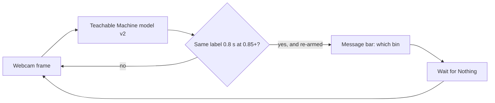

:::objectives
- Run a final round of tests: unseen items, stress conditions, an app play-test, and a stranger test.
- Turn stress-test results into model card entries or a final repair.
- Polish the screen so users can see what the model sees, when it's unsure, and what happens to the camera.
- Present the prototype in three minutes with evidence, a deliberate failure, and honest limits, and score it with the rubric.
:::

Every year someone's prototype works perfectly at home and then, in a bright classroom with twenty people moving behind them, answers **Nothing** to everything. The model didn't get worse. The conditions changed, and nobody had tested those conditions. This lesson is about finding that out on a quiet afternoon instead of in front of an audience.

## Four final tests

Each test answers a different question, so you need all four.

| Test | Question it answers | How |
| --- | --- | --- |
| **Unseen test** | How accurate is the final model on new items? | Same test set as M3, final model, confusion matrix |
| **Stress test** | Where does it break? | 10 tries in each condition you might meet at the demo |
| **App play-test** | Does the rule turn predictions into the right actions? | 10 tries per class: wrong actions, missed actions, time to act |
| **Stranger test** | Can someone use it without you? | A classmate tries it with no help while you watch silently |

The stress test is the one people skip. List the conditions your demo might bring: the room's lighting, people behind you, a different table or wall, holding items farther away, another person's hands (with their agreement), or a noisy room for audio. Then test each one, ten tries, and write down how many worked.

```python run alt="Horizontal bar chart of correct tries out of 10 for six test conditions. Home desk lamp 10, home daylight 9, classroom lights 8, people moving behind 5, far from camera 6, classmate's hands 7." caption="Stress test for the recycling helper: two conditions need attention"
import matplotlib.pyplot as plt

conditions = ["Home, desk lamp", "Home, daylight", "Classroom lights",
              "People moving behind", "Far from camera (1.5 m)", "Classmate's hands"]
correct = [10, 9, 8, 5, 6, 7]

fig, ax = plt.subplots(figsize=(7, 3.2))
colors = ["#eb6834" if c < 7 else "#2a78d6" for c in correct]
bars = ax.barh(conditions, correct, color=colors)
ax.bar_label(bars, padding=3)
ax.invert_yaxis()
ax.set_xlim(0, 11)
ax.set_xlabel("correct out of 10 (orange: below 7)")
ax.spines[["top", "right"]].set_visible(False)
```

Two conditions fall below 7 out of 10: people moving behind, and holding items far away. For each weak condition you have three honest choices:

1. **Repair it** with a targeted round, if there's time: record samples with people in the background, keeping the classes balanced.
2. **Design around it**: put a line on screen ("Hold the item close to the camera") and set up your demo so the background is a wall.
3. **Document it**: add it to the model card's "Known weak spots" either way.

What you can't do is leave it out. A weakness you found and explained earns more credit than one the audience finds for you.

## Polish what the user sees

A model that's 90% accurate can still feel broken if the screen gives no feedback. Go through this list with your app open:

- **Show progress while a label is held.** A filling bar, like the rock, paper, scissors game's, tells the user "keep going". Without it, they move their hand just before the action fires.
- **Say "not sure" out loud.** When confidence is under the threshold, show it, in words. Silence looks like a frozen app.
- **Give instructions on screen.** One line, like "Hold one item close to the camera". The stranger test will show you which line is missing.
- **Never use color alone.** "Blue bin: recycling" works for everyone; a blue rectangle doesn't work for someone who can't tell blue from green.
- **Say what happens to the camera.** With ml5.js and Teachable Machine's code, the frames are classified inside the browser and the camera image isn't sent anywhere. Tell your users: "The camera image stays in this browser and isn't recorded."
- **Add a keyboard fallback.** Some people can't make your gestures or sounds, and sometimes the demo room breaks your model. Keys that trigger the same actions fix both. Add this to the starter sketch:

```javascript
// Keys 1, 2, 3 do exactly what the model's classes do
function keyPressed() {
  const keyActions = { "1": "Recycling", "2": "Trash", "3": "Compost" };
  const name = keyActions[key];
  if (name) ACTIONS[name]();
}
```

`keyPressed` is a p5.js function that runs whenever a key goes down, and `key` holds which one. Because it calls the same `ACTIONS` table, the screen behaves identically whether the model or the keyboard triggered it.

## Present it in three minutes

Practice with a timer. Three minutes is short, so every part has a job:

| Time | Show | Say |
| --- | --- | --- |
| 0:00 | Title screen | The one-sentence plan: who it's for, what it does, why |
| 0:20 | Live demo | Two or three working examples, with the model's label visible |
| 1:00 | The deliberate failure | Show a weak condition from the stress test and explain why it fails |
| 1:30 | "How it works" diagram | Camera, model, your rule's numbers, the action |
| 1:50 | Before-and-after chart | Your biggest error, your hypothesis, the one change, the result |
| 2:30 | Model card | Who's in the data, consent, weak spots, what it shouldn't be used for |
| 2:50 | Next step | The repair you'd do next, and why |

Adapt this diagram for your "how it works" slide by putting in your own classes and numbers:



Record a short screen video of your app working the day before, and keep it open in a tab. If the room's lights or Wi-Fi break the live demo, switch to the video and the keyboard fallback, and say exactly why it failed. That's a stronger finish than a demo that only worked because you were lucky.

:::video n3HsvqBJrlY
Google's People + AI Research team introduces their guidebook for designing products that use machine learning. Watch for how they talk about setting expectations and handling errors, then compare with the polish list above.
:::

## The rubric

Score your own project before you present. Each row is worth the points shown; "full marks" describes the top level.

| Area | Points | Full marks | Common ways to lose points |
| --- | --- | --- | --- |
| Data and consent | 20 | Classes defined by what the camera or mic gets; balanced counts; varied conditions; written consent covering recording and sharing | Unbalanced classes; no Nothing class; people in the data who weren't asked |
| Testing and error analysis | 20 | Unseen test of 10+ per class in new conditions; confusion matrix read correctly; false positives and negatives named for the costly class | Testing on training items; matrix read sideways; only overall accuracy reported |
| Data improvement | 15 | Written hypothesis, one targeted change, same-test comparison, honest keep-or-roll-back decision | Several changes at once; test items moved into training; side effects ignored |
| App integration | 20 | Threshold, hold, and cooldown or re-arm, tested on fake data and play-tested; classes found by name; on-screen feedback and keyboard fallback | Acting on every frame; checking classes by position; no feedback when unsure |
| Responsible export and model card | 15 | Export choice explained; labels checked; card with real test numbers, weak spots, and "don't use it for" | Personal names in labels; a card with no limits; a people-recognizing model uploaded |
| Presentation | 10 | Under 3 minutes; live demo; one explained failure; before-and-after evidence | Over time; hiding failures; claims with no numbers behind them |

A project scoring 80 or more is complete and honest. Notice that the rubric never rewards accuracy by itself: a 75%-accurate model with a clear diagnosis, a real repair, and an honest card scores higher than a 95% model nobody tested properly.

## Reflect

Write a short paragraph in your project log answering these, before you look at anyone's feedback:

1. Which of your errors surprised you most, and what did it teach you about your data?
2. If you started again, what would you change in your data plan?
3. Who could this prototype help, and who could it fail? What would have to be true before a real person relied on it?
4. What did you decide *not* to share, and why?

## Where to go next

You've now done the whole loop that professional machine learning teams run: define the problem, collect data with consent, train, test on unseen data, diagnose errors, repair the data, document the model, and connect it to something people use. The tools get bigger from here, but the loop doesn't change.

- **ml5.js** has ready-trained models for hands, bodies, and faces (such as handPose and bodyPose) that you can combine with your own classifiers.
- **TensorFlow.js** is the library underneath everything you exported, if you want to write the model code yourself.
- **Teachable Machine's embedded image model** exports to TensorFlow Lite for Microcontrollers, so a model can run on a small board with a camera, with no laptop at all.

:::takeaways
- Test four ways before you present: unseen items, stress conditions, an app play-test, and a stranger using it alone.
- For every weak condition, repair it, design around it, or document it, and always document it.
- Polish means progress feedback, an honest "not sure", instructions, text alongside color, a camera note, and a keyboard fallback.
- A strong demo shows a failure on purpose and backs its claims with before-and-after numbers.
:::

## Further reading

- [Machine Learning Crash Course](https://developers.google.com/machine-learning/crash-course): Google's free course, the natural next step for the ideas behind confusion matrices, thresholds, and datasets.
- [ml5.js documentation](https://docs.ml5js.org/): every ready-trained model ml5.js offers, with examples you can open in the p5.js Web Editor.
- [Teachable Machine projects on Experiments with Google](https://experiments.withgoogle.com/search?q=teachable%20machine): real projects people have built with Teachable Machine, for ideas about where to take yours.
