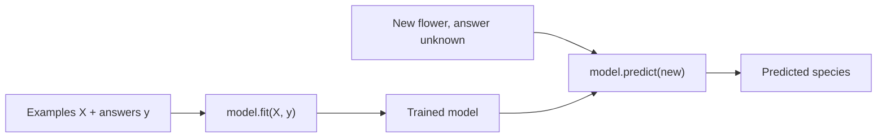

:::objectives
- Train a scikit-learn model and use it to name the species of a new flower.
- Explain what each of the five lines does, in your own words.
- Turn the model's numeric answers into species names.
- Test the model on flowers it didn't learn from and count its mistakes.
:::

In 1936 the statistician Ronald Fisher published a table of 150 iris flowers, measured by the botanist Edgar Anderson. There are three species, 50 flowers each, and four measurements per flower: the length and width of its **sepals** (the green leaf-like parts under the bloom) and of its **petals**, all in centimeters. The table is small enough to read in a few minutes, and it ships inside scikit-learn.

Here's the question you'll answer: given the four measurements of a flower nobody has labeled, which species is it? Open a new Colab notebook called `m1-first-model.ipynb` and follow along.

## Five lines, one prediction

```python run title="first_model.py"
from sklearn.datasets import load_iris
from sklearn.neighbors import KNeighborsClassifier
X, y = load_iris(return_X_y=True)
model = KNeighborsClassifier().fit(X, y)
print(model.predict([[5.0, 3.4, 1.5, 0.2]]))
```

The model looked at a flower with a 5.0 cm sepal length, 3.4 cm sepal width, 1.5 cm petal length, and 0.2 cm petal width, and answered `[0]`. Species number 0 is *setosa*, and that's right: those are textbook setosa measurements.

## What each line did

1. `load_iris` is a function that hands you the flower table. Nothing is downloaded; the data is stored inside scikit-learn.
2. `KNeighborsClassifier` is a kind of model called **k-nearest neighbors**. To classify a new flower, it finds the 5 flowers in its memory with the most similar measurements and lets them vote. You'll build one by hand in Module 4.
3. `return_X_y=True` splits the table in two. `X` holds the measurements (150 rows, 4 columns). `y` holds the answers, one species number per row.
4. `KNeighborsClassifier()` creates an empty model, and `.fit(X, y)` trains it on the examples. For this model, "training" means storing the flowers so it can search them later.
5. `.predict(...)` asks for a species. The double brackets matter: the outer list is a list of flowers, and each inner list is one flower's four numbers.

That pattern of creating a model, calling `fit` with examples and answers, then calling `predict` on new examples is the same for every model in scikit-learn. Learn it once and you can use dozens of models.



## Turn numbers into species names

A species number is hard to read. The full dataset object (load it without `return_X_y`) carries the names too:

```python run
iris = load_iris()
print(iris.feature_names)
print(iris.target_names)

new_flowers = [
    [5.0, 3.4, 1.5, 0.2],
    [6.0, 2.8, 4.5, 1.4],
    [6.5, 3.0, 5.5, 2.0],
]
predictions = model.predict(new_flowers)
print(predictions)
print(iris.target_names[predictions])
```

`iris.target_names[predictions]` uses the array of predictions as positions in the list of names, so `0` becomes `setosa`, `1` becomes `versicolor`, and `2` becomes `virginica`. One call to `predict` handled all three flowers at once.

## See why the model can tell them apart

Plot two of the four measurements, petal length against petal width, with a color for each species. The three new flowers are the black crosses.

```python run alt="Scatter plot of iris petal length against petal width. Setosa forms a separate cluster at the bottom left; versicolor and virginica form two neighboring clusters that touch. Three black crosses mark the new flowers, one inside each cluster." caption="Each species lives in its own region, so a flower's nearest neighbors usually share its species."
import matplotlib.pyplot as plt
import numpy as np

new = np.array(new_flowers)
plt.figure(figsize=(6, 4.5))
for number, name in enumerate(iris.target_names):
    rows = iris.target == number
    plt.scatter(iris.data[rows, 2], iris.data[rows, 3], label=name, s=18, alpha=0.8)
plt.scatter(new[:, 2], new[:, 3], color="black", marker="X", s=120, label="new flowers")
plt.xlabel("petal length (cm)")
plt.ylabel("petal width (cm)")
plt.title("150 iris flowers")
plt.legend()
```

Setosa sits alone at the bottom left, far from everything. Versicolor and virginica are neighbors whose edges touch. Each black cross lands inside one cluster, so its five nearest flowers agree, and the model's answers match what your eyes would say. If a flower landed on the border between versicolor and virginica, the vote could go either way. Keep that in mind for the next section.

## Peek at the table with pandas

So far `X` has been a bare grid of numbers. Ask for a pandas DataFrame and you can see it as a labeled table:

```python run
import pandas as pd
pd.set_option("display.max_columns", None)
pd.set_option("display.width", 120)

flowers = load_iris(as_frame=True).frame
print(flowers.shape)
print(flowers.head())
print(flowers["target"].value_counts())
```

(In Colab, a cell whose last line is just `flowers.head()` shows the table with neat formatting, no `print` needed. The two `set_option` lines only make plain printed tables wide enough to show every column.) The shape `(150, 5)` means 150 rows (one per flower) and 5 columns: the four measurements plus the `target` column that holds the species number. `value_counts` confirms 50 flowers of each species.

## Test it on flowers it has never seen

Asking about flowers the model memorized proves nothing; that's like grading a test after showing the student the answer key. A fairer check hides some labeled flowers during training, then asks the model about them. `train_test_split` does the hiding. Module 3 covers it properly; for now, read it as "put 30 random flowers in a drawer."

```python run
from sklearn.model_selection import train_test_split

X_train, X_test, y_train, y_test = train_test_split(X, y, test_size=30, random_state=5)
model = KNeighborsClassifier().fit(X_train, y_train)
guesses = model.predict(X_test)

print("Right:", (guesses == y_test).sum(), "out of", len(y_test))
for flower, truth, guess in zip(X_test, y_test, guesses):
    if truth != guess:
        print(flower, "is", iris.target_names[truth], "but the model said", iris.target_names[guess])
```

The model trained on 120 flowers and named 28 of the 30 hidden ones correctly. Both mistakes are versicolor flowers that it called virginica, with petal lengths near 4.9 cm. Find 4.9 on the chart's horizontal axis: that's exactly where the two clusters overlap. Wrong answers on borderline examples are normal, and seeing where they happen tells you more about a model than its score does.

:::warning
**Single brackets cause the most common first error.** `predict` expects a list of examples, even when you only have one:

```python run raises
model.predict([5.0, 3.4, 1.5, 0.2])
```

The message begins `Expected 2D array, got 1D array instead`: scikit-learn wanted a table (rows and columns) and got a flat list. Its last line suggests `reshape`, but the plainer fix is brackets. Wrap the flower in a second pair of brackets, `[[5.0, 3.4, 1.5, 0.2]]`, and it works.
:::

:::video PeMlggyqz0Y
A fast overview of what machine learning is. Watch for the two phases it describes, training on labeled examples and then predicting on new data, and match them to `fit` and `predict` in your five lines.
:::

:::quiz
Q: After `model = KNeighborsClassifier().fit(X, y)`, what does `model.predict([[6.5, 3.0, 5.5, 2.0]])` give back?
- [x] `[2]`
  `predict` returns an array of species numbers, one per flower. You get the name with `iris.target_names`.
- [ ] `virginica`
  That's what the 2 means, but `predict` returns numbers here because `y` holds numbers.
- [ ] `[5.5, 2.0]`
  `predict` returns answers, not measurements.

Q: Why does `predict` need `[[5.0, 3.4, 1.5, 0.2]]` with two pairs of brackets?
- [ ] Python needs double brackets around any list of decimals
  A plain list of decimals is fine in Python. The rule comes from scikit-learn.
- [x] It expects a table of examples, and this is a table with one row
  Every model predicts for many rows at once, so even one flower must be a row inside a list.
- [ ] The second pair tells the model to use k-nearest neighbors
  The model type was chosen when you created `KNeighborsClassifier()`.

Q: Why test on 30 hidden flowers instead of the 150 the model trained on?
- [ ] The hidden flowers are easier, so the score looks better
  They're randomly chosen, so they're neither easier nor harder on purpose.
- [ ] scikit-learn refuses to predict on training rows
  It will predict on any rows you give it, which is exactly why you have to be careful.
- [x] A model can look perfect on examples it has memorized, so only unseen examples show how it will do on new flowers
  The hidden flowers act like the new, unlabeled flowers you actually care about.
:::

:::takeaways
- `X` is the table of measurements (rows are examples, columns are features); `y` is the answer for each row.
- Every scikit-learn model follows the same steps: create it, `fit(X, y)`, then `predict(new_rows)`.
- `predict` takes a table, so one example still goes inside a second pair of brackets.
- Judge a model on examples it didn't train on, and look at which examples it gets wrong.
:::

## Further reading

- [`load_iris` reference](https://scikit-learn.org/stable/modules/generated/sklearn.datasets.load_iris.html): every option for loading the dataset, including `as_frame`.
- [Getting started with scikit-learn](https://scikit-learn.org/stable/getting_started.html): a one-page tour of fitting, predicting, and the other ideas this course builds on.
