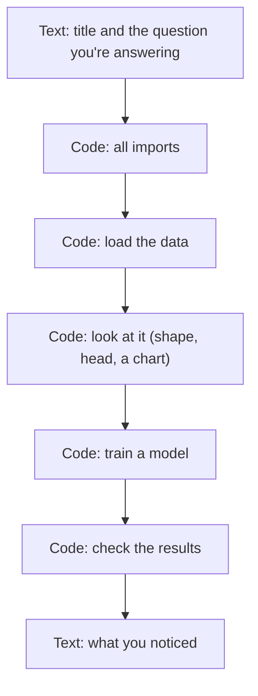

:::objectives
- Find, copy, download, and restore your notebooks from Google Drive.
- Name and lay out a notebook so it runs from top to bottom after a restart.
- Read a scikit-learn traceback from the last line up and find the line you wrote that caused it.
- Look up any scikit-learn function's settings without leaving the notebook.
:::

Yesterday your notebook printed "Right: 28 out of 30". Today you open it, click the last cell, press Shift + Enter, and get `NameError: name 'X_test' is not defined`. Nothing is broken. The notebook file kept your code, but yesterday's runtime, and every variable in it, is gone.

Almost every confusing notebook problem in this course comes from one of three things: not finding a file, cells that were run in a strange order, or an error message nobody read to the end. This lesson handles all three.

## Where your notebooks live

Every notebook you create in Colab saves itself to **My Drive → Colab Notebooks** in Google Drive. You don't have to press anything, though **Ctrl + S** (Cmd + S on a Mac) saves immediately if you're nervous.

Four menu items cover nearly everything else you'll need:

- **File → Open notebook** lists your recent notebooks and everything in your Drive.
- **File → Save a copy in Drive** makes your own editable copy. Use it whenever you open a notebook someone shared with you, so your changes go into your copy and not theirs.
- **File → Download → Download .ipynb** saves the file to your computer, which is handy for a backup or for handing in work.
- **File → Revision history** shows earlier saved versions, so you can get back code you deleted by accident.

:::tip
Make one Drive folder for this course, such as `Beginner ML`, and move your notebooks into it as you finish them. Moving a notebook in Drive doesn't break it; Colab opens it from wherever it is.
:::

## Name notebooks so you can find them in Module 7

Twenty notebooks called `Untitled3.ipynb` are useless. Start each name with the module and lesson, then a few words about it: `m1-first-model.ipynb`, `m2-pizza-predictor.ipynb`, `m3-practice-scaling.ipynb`. Sorted by name, they line up in course order.

Inside, keep the same shape every time. A reader (including you, later) should be able to run it from the top and understand each part:



Putting every import in one cell near the top means a single run of that cell fixes most `NameError`s after a reconnect.

## Cells remember the order you ran them

The numbers beside each cell, like `[4]`, record the order cells actually ran. That order can differ from the order on the page, and it can include the same cell twice. Running a cell a second time is exactly like pasting its code in again. Step through this program and watch `score`:

:::trace What running cell 2 twice does
```python
# cell 1
score = 50
# cell 2, run once
score = score + 10
# cell 2 again, run by accident
score = score + 10
print(score)
```
:::

The page shows one cell that adds 10, but `score` ends at 70. In ML notebooks the same thing happens when you rerun a cell that adds a column, drops rows, or rescales data, and the second run quietly changes the result.

The fix is a habit. Before you call a notebook finished, choose **Runtime → Restart session and run all**. That wipes the runtime and runs every cell once, top to bottom. If it reaches the end without errors and the numbers still make sense, the notebook is trustworthy. If it breaks, you've found a cell that depended on something you ran by hand and later deleted.

## Read a scikit-learn error from the bottom up

Here's a realistic mistake. The model learned from all four iris measurements, then someone asked it about a flower using only three numbers:

```python run raises
from sklearn.datasets import load_iris
from sklearn.neighbors import KNeighborsClassifier

X, y = load_iris(return_X_y=True)
model = KNeighborsClassifier().fit(X, y)
model.predict([[1.5, 0.2, 5.0]])
```

That's a lot of text, and most of it is scikit-learn's own code. Read it this way:

1. **Start at the last line.** It names the error type and, in scikit-learn, usually says exactly what's wrong: the model expects 4 features and got 3.
2. **Find your own line.** Scan upward for the code you wrote. Here it's the line marked `main.py`; in Colab, your cell's line is marked with an arrow like `---->`. Lines inside `sklearn/` are where the problem was noticed, not where it was caused.
3. **Print what you passed.** Check the shape and type of whatever went into that line.
4. **Check the docs** for the function on that line.
5. **Search the exact last line**, in quotes, or ask someone. Bring the error and the few lines of code that cause it.

Step 3 settles this one in two lines:

```python run
import numpy as np

print("trained on:", X.shape)
print("asked about:", np.array([[1.5, 0.2, 5.0]]).shape)
```

The model learned from rows of 4 numbers, and the question was a row of 3. Every row you predict on needs the same columns, in the same order, as the rows the model trained on.

:::video 3p3p6kp39to
A short guide to Python tracebacks. Watch for the order in which it reads one, last line first and then upward to your own file, which is the same routine you just used.
:::

## Look things up without leaving the notebook

Every model has settings, and you can print them. `get_params` shows the ones you didn't choose, too:

```python run
print(model.get_params())
```

`n_neighbors: 5` is the number of neighbors that vote, which you'll change in Module 4. To read the full documentation for a function, run `help(KNeighborsClassifier)` in a cell. In Colab you can also type a question mark after a name and run it, which opens the docs in a help panel:

```text
KNeighborsClassifier?
```

For longer explanations with pictures, the scikit-learn website has a page for every class, and its examples are written by the people who wrote the code.

## Ask for help well

When you're stuck after the five steps, ask a teacher, a classmate, or a forum, and include three things: what you're trying to do, the full error (copied, not retyped), and the smallest piece of code that still causes it. Shrinking the code often reveals the bug before anyone answers.

Colab also has a built-in AI assistant that can explain an error message. Use it to understand what went wrong, then write the fix yourself. If it writes your code for you, you'll get through the lesson without learning the part the lesson was for.

:::warning
Don't hit Run all again and again hoping an error goes away. If the same line fails twice, the cause is in your code or your data, and rereading the last line of the error is faster than rerunning.
:::

:::quiz
Q: A cell contains `df["price"] = df["price"] * 2`. You run it twice by accident. What happened to `price`?
- [ ] It doubled once, because Colab skips cells that already ran
  Colab runs a cell every time you ask it to, even if it ran before.
- [x] It's now four times the original
  Each run multiplies the current values by 2, so two runs multiply them by 4.
- [ ] It's back to the original, because the second run undoes the first
  Running code never undoes earlier runs. Restart and run all to get back to a clean state.

Q: A traceback is 40 lines long. Where do you look first?
- [ ] The first line
  The first line is usually just "Traceback (most recent call last)".
- [x] The last line, then upward to the first line of code you wrote
  The last line names the problem, and your own line shows where you caused it.
- [ ] The lines inside the `sklearn` folder
  Those show where scikit-learn noticed the problem. The cause is almost always in what your code passed in.

Q: When is a notebook ready to hand in or come back to later?
- [ ] When every cell shows an output
  Outputs can come from cells run in an order the page doesn't show.
- [ ] When you've saved it with Ctrl + S
  Saving keeps the file, but it says nothing about whether the code runs.
- [x] When Runtime → Restart session and run all reaches the end with no errors
  That proves the notebook works from a blank runtime, in the order written.
:::

:::takeaways
- Notebooks save to **My Drive → Colab Notebooks**; use **Save a copy in Drive** for anything shared with you.
- Name notebooks by module and lesson, and keep imports in one cell at the top.
- Run order, not page order, decides what a variable holds. **Restart session and run all** is the final test.
- Read errors from the last line up, find your own line, then print the shapes and types you passed in.
:::

## Further reading

- [Errors and exceptions](https://docs.python.org/3/tutorial/errors.html): the official Python tutorial on how tracebacks and exceptions work.
- [scikit-learn API reference](https://scikit-learn.org/stable/api/index.html): one page per class and function, with every setting and its default.
