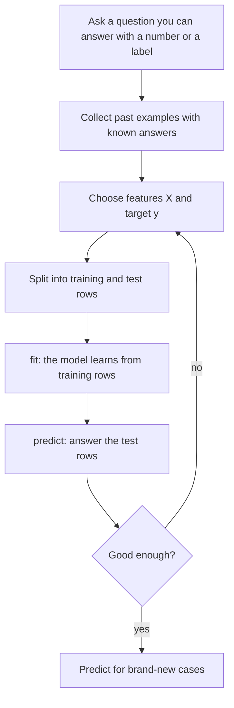

:::objectives
- Describe the steps of a machine-learning workflow, from a question to a prediction on new data.
- Split a table into a feature table `X` and a target column `y` with pandas.
- Reject columns that are identifiers or that aren't known yet when the prediction is needed.
- Tell a classification problem from a regression problem by looking at the target.
:::

A pizza shop wants its app to say "your order arrives in about 31 minutes" the moment a customer taps **Order**. The shop has a log of past orders. Here are eight of them:

```python run
import pandas as pd
pd.set_option("display.max_columns", None)
pd.set_option("display.width", 120)

orders = pd.DataFrame({
    "order_id":    [4101, 4102, 4103, 4104, 4105, 4106, 4107, 4108],
    "distance_km": [1.2, 5.5, 3.0, 8.1, 2.4, 6.7, 4.0, 7.5],
    "pizzas":      [1, 3, 2, 4, 1, 2, 5, 1],
    "raining":     [0, 0, 1, 0, 1, 0, 0, 1],
    "driver_tip":  [3, 5, 2, 8, 4, 6, 5, 7],
    "minutes":     [16, 34, 29, 45, 22, 37, 33, 44],
})
print(orders)
```

Six columns. Which ones should a model learn from? Not all of them, and picking wrong is one of the most common ways a model ends up looking great in testing and failing in real use. This lesson gives you a test for every column, and the vocabulary that every ML tutorial and library assumes you know.

## The workflow, from question to prediction

Every supervised machine-learning project, from a pizza timer to a hospital's risk score, follows the same loop. "Supervised" means you have past examples with the right answers attached, like orders whose delivery time you already know.



This module is about step C, the one that's easiest to get wrong without noticing. Module 3 handles the split, and Modules 4 to 7 are about models and how to judge them.

## Rows are examples, columns are features

In a machine-learning table, each **row** is one example: one order, one flower, one patient. Each **column** you feed the model is a **feature**, one measurable fact about the example. The column you want to predict is the **target** (some books call it the **label**).

scikit-learn uses two names for these, and you'll see them everywhere:

- `X` (capital) is the **feature table**: one row per example, one column per feature. It's two-dimensional.
- `y` (lowercase) is the **target**: one value per example. It's one-dimensional.

The capital letter is a math habit (capitals for tables, lowercase for lists), and it's worth keeping because everyone else does. Here's a real dataset from scikit-learn: 442 diabetes patients, 10 measurements each, and a target that scores how much each patient's disease progressed a year later.

```python run
from sklearn.datasets import load_diabetes

patients = load_diabetes(as_frame=True)
X_patients = patients.data
y_patients = patients.target

print("X:", X_patients.shape)
print("y:", y_patients.shape)
print(X_patients.columns.tolist())
print(y_patients.head(3).tolist())
```

`X` has shape `(442, 10)`: 442 rows, 10 columns. `y` has shape `(442,)`, a single column with one number per patient. Those two shapes must agree on the first number, because row 17 of `X` and value 17 of `y` describe the same person. (The feature values look odd, like an `age` of 0.038, because scikit-learn's copy of this dataset comes with every column already rescaled.)

To see what "a feature with signal" means, plot one useful feature next to one useless one:

```python run alt="Two scatter plots side by side. Left: body mass index against disease progression, with points trending upward. Right: row number against disease progression, with points scattered evenly and no trend." caption="BMI carries information about the target; the row number carries none."
import matplotlib.pyplot as plt

fig, (left, right) = plt.subplots(1, 2, figsize=(9, 3.6), sharey=True)
left.scatter(X_patients["bmi"], y_patients, s=10, alpha=0.6)
left.set_xlabel("bmi (rescaled)")
left.set_ylabel("disease progression")
left.set_title("A useful feature")
right.scatter(range(len(y_patients)), y_patients, s=10, alpha=0.6, color="gray")
right.set_xlabel("row number")
right.set_title("An identifier")
```

On the left, patients with a higher BMI tend to have higher scores, so knowing BMI helps you guess. On the right there's no pattern at all: knowing that a patient is row 300 tells you nothing about their health.

## The "would I know it yet?" test

Back to the pizza log. Go through it column by column and ask two questions. Does this column describe the order in a way that could plausibly affect the answer? And **will I know its value at the moment I need the prediction**, when the customer taps Order?

| Column | Role | Why |
|---|---|---|
| `order_id` | drop | An identifier. Every value is unique, so there's no pattern to learn, like the row number above. |
| `distance_km` | feature | Known from the address when the order is placed, and longer trips take longer. |
| `pizzas` | feature | Known at order time, and bigger orders take longer to make. |
| `raining` | feature | Known at order time from a weather check. |
| `driver_tip` | drop | The customer tips at the door, after delivery. The app can't know it when it has to make the prediction. |
| `minutes` | target | This is what you want to predict. |

`driver_tip` is the sneaky one. It's probably related to the delivery time (fast deliveries might get bigger tips, or longer trips might), so a model would happily use it, and it would score well on the old log. Then, in the real app, the tip column would be empty, and the model would have nothing to work with. Using information that won't exist at prediction time is called **leakage**, and it's behind a lot of models that worked in testing and failed in real use.

With the roles decided, building `X` and `y` takes two lines:

```python run
feature_columns = ["distance_km", "pizzas", "raining"]
X = orders[feature_columns]
y = orders["minutes"]

print(type(X).__name__, X.shape)
print(type(y).__name__, y.shape)
```

Selecting with a list of column names, like `orders[feature_columns]` or `orders[["pizzas"]]`, gives you a `DataFrame`, which is two-dimensional. Selecting with one name and no list, like `orders["minutes"]`, gives you a `Series`, which is one-dimensional. That's exactly the difference between `X` and `y`.

## What X and y look like without pandas

pandas hides the bookkeeping. Step through this version to watch each order become one row of `X` and one entry of `y`:

:::trace Watch each order split into a feature row and a target value
```python
orders = [
    {"id": 4101, "km": 1.2, "pizzas": 1, "minutes": 16},
    {"id": 4102, "km": 5.5, "pizzas": 3, "minutes": 34},
    {"id": 4103, "km": 3.0, "pizzas": 2, "minutes": 29},
]
X = []
y = []
for order in orders:
    X.append([order["km"], order["pizzas"]])
    y.append(order["minutes"])
print(X)
print(y)
```
:::

`X` ends as a list of lists (a table), `y` as a flat list, and both have three entries because there were three orders. The `id` never makes it into either.

## Classification or regression? Look at the target

What kind of model you need depends on what `y` holds:

- **Regression**: the target is a quantity on a scale, like delivery minutes, a price, or a temperature. Being off by 2 is better than being off by 20.
- **Classification**: the target is a category from a fixed set, like an iris species, "spam" or "not spam", or "late" or "on time".

The same log can be turned into either kind of problem. The question you ask decides it:

```python run
y_minutes = orders["minutes"]
y_late = (orders["minutes"] > 35).map({True: "late", False: "on time"})

print(y_minutes.tolist())
print(y_late.tolist())
```

Don't decide just by checking whether the column contains numbers. Zip codes, jersey numbers, and the iris species codes 0, 1, 2 are numbers that are really category names: species 2 isn't "twice" species 1.

## Every model speaks fit and predict

scikit-learn calls every model an **estimator**, and every estimator works the same way. Here are two very different regression models, a straight line and a nearest-neighbors averager, trained and used with identical code:

```python run
from sklearn.linear_model import LinearRegression
from sklearn.neighbors import KNeighborsRegressor

new_order = pd.DataFrame({"distance_km": [4.5], "pizzas": [2], "raining": [0]})

for model in [LinearRegression(), KNeighborsRegressor(n_neighbors=3)]:
    model.fit(X, y)
    guess = model.predict(new_order)[0]
    print(f"{type(model).__name__:20s} predicts {guess:.1f} minutes")
```

Same `fit(X, y)`, same `predict`, different answers, because each model learned something different from the same eight orders. Notice that `new_order` has the same three columns as `X`, with the same names. A model can only answer questions asked in the language it learned.

Eight orders is far too few to trust either number. In the next lesson you'll build the real version from 300 orders and measure how far off it is.

:::warning
**Mistake 1: a single feature in single brackets.** `orders["distance_km"]` is a one-dimensional Series, and `fit` refuses it:

```python run raises
LinearRegression().fit(orders["distance_km"], y)
```

The fix is `orders[["distance_km"]]`, a table with one column.

**Mistake 2: the target hiding in X.** If you build `X` with `orders.drop(columns=["order_id"])`, the `minutes` column is still in it. The model then predicts minutes from minutes and scores perfectly. Whenever a score looks too good, check `X.columns` for the answer.
:::

:::video Gv9_4yMHFhI
Josh Starmer's gentle introduction to machine learning. Watch for two things: how each example's measurements are kept separate from the thing being predicted, and how some data is held back only to check the predictions. Those are `X`, `y`, and the test rows of the workflow diagram.
:::

:::quiz
Q: A school wants to predict, at the start of term, whether a student will pass a course. Which column must you leave out of `X`?
- [ ] Hours of homework the student did last term
  That's known at the start of term, so it's a fair feature.
- [x] The student's final exam score in this course
  It doesn't exist yet at the start of term. Using it is leakage, and it would make the model look far better than it can be.
- [ ] The student's grade in the previous course
  That's already known when the prediction is made.

Q: `X.shape` is `(500, 8)`. What must `y.shape` be?
- [ ] `(8,)`
  `y` has one value per example (row), not per feature.
- [x] `(500,)`
  Each of the 500 rows of `X` needs exactly one target value.
- [ ] `(500, 8)`
  `y` is a single column of answers, so it's one-dimensional.

Q: You predict the number of stars (1 to 5) a customer will give a pizza. Which is true?
- [ ] It must be regression, because stars are numbers
  Numbers alone don't decide it. What matters is whether you treat the target as a scale or as categories.
- [ ] It must be classification, because there are only five values
  You could treat it that way, but you could also treat it as a scale where 4 is between 3 and 5.
- [x] Either can work, and the choice depends on whether "off by one star" should count as nearly right
  Regression rewards being close; classification counts any wrong star as simply wrong.

Q: Why does `order_id` make a bad feature?
- [x] Every value is unique and carries no information about the delivery time
  Like the row number in the diabetes chart, it has no pattern to learn from.
- [ ] scikit-learn crashes on columns that end in `_id`
  scikit-learn will happily use it. That's why you have to drop it yourself.
- [ ] It isn't known when the order is placed
  It is known, but being known isn't enough; the column also has to carry information.
:::

:::takeaways
- Rows are examples, columns are features, and the column you want to predict is the target.
- `X` is a two-dimensional table of features; `y` is a one-dimensional column with one target per row.
- Drop identifiers, and drop any column that won't be known at the moment you need the prediction.
- A target that's a quantity means regression; a target that's a category means classification.
- Every scikit-learn estimator uses `fit(X, y)` and then `predict(new_X)`, and `new_X` needs the same columns as `X`.
:::

## Further reading

- [Supervised learning](https://developers.google.com/machine-learning/intro-to-ml/supervised), from Google's Intro to Machine Learning: features, labels, and the difference between regression and classification, with clear pictures.
- [scikit-learn glossary](https://scikit-learn.org/stable/glossary.html): the official meanings of `X`, `y`, estimator, `fit`, and `predict`.
- [Selecting columns in pandas](https://pandas.pydata.org/docs/getting_started/intro_tutorials/03_subset_data.html): why one pair of brackets gives a Series and two give a DataFrame.
